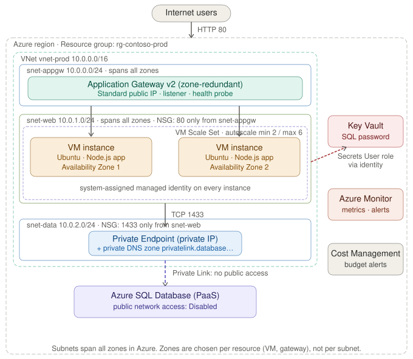

# Azure Product Map (with AWS and GCP equivalents)

Each Azure service category: what it does, key services, and the closest AWS and GCP counterpart. Equivalents are approximate. Pros and cons per service: [[concepts/azure-service-reference]]. Exam page: [[certs/az-900]]. Same idea for Google Cloud: [[concepts/gcp-product-map]].

> **Scope differences that matter:** an Azure **VNet is regional** (like an AWS VPC); a GCP VPC is **global**. In Azure a **subnet spans all availability zones** of the region, and the zone is chosen per resource (VM, gateway); in AWS a subnet lives in one AZ.

---

## Big picture: a typical production web app on Azure
Following one request from the user to the data (the AZS01 solution, see [[AZS01 - Contoso Clinic Highly Available Web App]]):

---

## Ways to manage Azure
| Tool | What it is | Use when |
|------|------------|----------|
| **Azure Portal** | Web GUI with click-through wizards | Learning, visual overview, one-off setups |
| **Cloud Shell** | Terminal built into the portal (Bash or PowerShell), nothing to install, already signed in | Quick commands without local setup |
| **CLI / PowerShell** | Commands from your own machine | Scripts and automation |
| **Bicep / ARM templates** | Infrastructure as code | Repeatable, version-controlled deployments |

AWS: Console · CloudShell · CLI · CloudFormation. GCP: Console · Cloud Shell · gcloud · Deployment Manager / Terraform.

---

## 1. Compute
Run your code or workloads. Choose by how much you want to manage.

| Azure | What it does | AWS | GCP |
|-------|--------------|-----|-----|
| **Virtual Machines** | IaaS, full OS control | EC2 | Compute Engine |
| **VM Scale Sets** | Auto-scaled identical VMs | Auto Scaling Group | Managed Instance Groups |
| **App Service** | PaaS web/API hosting | Elastic Beanstalk | App Engine / Cloud Run |
| **Functions** | Serverless, event-driven code | Lambda | Cloud Run functions |
| **Container Instances / AKS** | Containers: simple or orchestrated | ECS (Fargate) / EKS | Cloud Run / GKE |
| **Virtual Desktop** | Cloud Windows desktops | WorkSpaces | — |

## 2. Networking
Connect and protect resources, and connect Azure to the outside world.

| Azure | What it does | AWS | GCP |
|-------|--------------|-----|-----|
| **Virtual Network (VNet)** | Your private network + subnets | VPC | VPC network |
| **NSG** | Allow/deny rules per subnet or NIC | Security Groups / NACL | VPC firewall rules |
| **Load Balancer** (layer 4) | TCP/UDP distribution | Network Load Balancer | Passthrough Network LB |
| **Application Gateway** (layer 7) | HTTP load balancing, URL routing, WAF | Application Load Balancer | Application LB |
| **Front Door / CDN** | Global entry point and caching | CloudFront | Global Application LB + Cloud CDN |
| **VPN Gateway** | Encrypted tunnel to on-prem | Site-to-Site VPN | Cloud VPN / HA VPN |
| **ExpressRoute** | Private dedicated link to on-prem | Direct Connect | Cloud Interconnect |
| **Azure DNS** | Managed DNS | Route 53 | Cloud DNS |
| **Azure Firewall** | Managed network firewall | Network Firewall | Cloud NGFW |
| **Private Endpoint** | Private IP in your VNet for a PaaS service | PrivateLink / interface endpoint | Private Service Connect |

## 3. Storage
One storage account, several data services.

| Azure | What it does | AWS | GCP |
|-------|--------------|-----|-----|
| **Blob** | Objects/files at scale (Hot, Cool, Cold, Archive tiers) | S3 | Cloud Storage |
| **Azure Files** | Managed SMB/NFS file shares | EFS / FSx | Filestore |
| **Queue** | Simple messaging between components | SQS | Pub/Sub (approx) |
| **Table** | NoSQL key/attribute store | DynamoDB (approx) | Bigtable (approx) |
| **Managed Disks** | Block storage for VMs | EBS | Persistent Disk |

Redundancy options: **LRS** (one datacentre) · **ZRS** (across zones) · **GRS** (paired region) · **GZRS** (zones + paired region).

## 4. Databases
Managed data engines, so no OS or patching work for you.

| Azure | What it does | AWS | GCP |
|-------|--------------|-----|-----|
| **Azure SQL Database** | Managed SQL Server (PaaS) | RDS for SQL Server | Cloud SQL for SQL Server |
| **SQL Managed Instance** | Near-100% SQL Server compatibility | RDS for SQL Server / RDS Custom | Cloud SQL for SQL Server |
| **Cosmos DB** | Globally distributed NoSQL, multi-model | DynamoDB | Firestore / Spanner (approx) |
| **Database for MySQL / PostgreSQL** | Managed open-source engines | RDS / Aurora | Cloud SQL / AlloyDB |
| **Cache for Redis** | In-memory cache | ElastiCache | Memorystore |

## 5. Identity, access & security
Who you are, what you can do, and threat protection.

| Azure | What it does | AWS | GCP |
|-------|--------------|-----|-----|
| **Microsoft Entra ID** | Cloud identity (formerly Azure AD): SSO, MFA, Conditional Access | IAM Identity Center | Cloud Identity |
| **RBAC** | Roles assigned to identities at a scope | IAM policies / roles | IAM roles |
| **Managed Identity** | Credential-free identity for an Azure resource | IAM role for EC2 | Service account on a VM |
| **Key Vault** | Secrets, keys, certificates | Secrets Manager + KMS | Secret Manager + Cloud KMS |
| **Defender for Cloud / Sentinel** | Security posture + SIEM | Security Hub, GuardDuty | Security Command Center |

Concepts: Zero Trust, defence in depth.

## 6. Management & governance
Deploy, control, monitor, and keep costs in check.

| Azure | What it does | AWS | GCP |
|-------|--------------|-----|-----|
| **ARM templates / Bicep** | Infrastructure as code | CloudFormation | Deployment Manager / Terraform |
| **Azure Policy** | Enforce or audit rules on resources | AWS Config / SCPs | Organization Policy |
| **Resource Locks** | Block delete/edit of a resource | Termination protection (approx) | Liens (approx) |
| **Cost Management + pricing/TCO calculators** | Budgets, analysis, estimates | Cost Explorer, Budgets | Cloud Billing |
| **Azure Monitor** | Metrics, logs, alerts | CloudWatch | Cloud Monitoring |
| **Advisor / Service Health** | Recommendations, incident status | Trusted Advisor / Health Dashboard | Recommender |
| **Azure Arc** | Manage on-prem/other clouds from Azure | Systems Manager hybrid, EKS Anywhere | GKE Enterprise |

## 7. AI + machine learning
| Azure | What it does | AWS | GCP |
|-------|--------------|-----|-----|
| **Azure Machine Learning** | Build/train/deploy your own models | SageMaker | Vertex AI |
| **Azure AI services** | Prebuilt vision, speech, language APIs | Rekognition, Transcribe, Comprehend | Vision, Speech-to-Text, Natural Language APIs |
| **Azure OpenAI / AI Foundry** | Generative AI models and tooling | Bedrock | Vertex AI (Gemini) |

## 8. Analytics & big data
| Azure | What it does | AWS | GCP |
|-------|--------------|-----|-----|
| **Synapse Analytics** | Data warehouse + analytics | Redshift | BigQuery |
| **Databricks** | Spark-based analytics/ML | EMR / Databricks | Dataproc / Databricks |
| **HDInsight** | Managed Hadoop/Spark/Kafka | EMR | Dataproc |
| **Data Factory** | ETL/data pipelines | Glue | Dataflow / Data Fusion |
| **Microsoft Fabric** | Unified analytics platform | — | — |

## 9. Internet of Things
| Azure | What it does | AWS | GCP |
|-------|--------------|-----|-----|
| **IoT Hub** | Bi-directional device messaging | IoT Core | — (IoT Core retired 2023) |
| **IoT Central** | Ready-made IoT SaaS | IoT SiteWise (approx) | — |
| **Defender for IoT** | Device security | IoT Device Defender | — |

## 10. DevOps & developer tools
| Azure | What it does | AWS | GCP |
|-------|--------------|-----|-----|
| **Azure DevOps** | Boards, repos, pipelines, artifacts | CodeCommit / CodePipeline / CodeBuild | Cloud Build / Cloud Deploy |
| **GitHub / GitHub Actions** | Source + CI/CD | — (third party) | — (third party) |
| **DevTest Labs** | Cheap, disposable test environments | — | — |

## 11. Integration & serverless glue
| Azure | What it does | AWS | GCP |
|-------|--------------|-----|-----|
| **Logic Apps** | Low-code workflows | Step Functions | Workflows |
| **Event Grid** | Event routing | EventBridge | Eventarc |
| **Service Bus** | Enterprise messaging | SQS / SNS | Pub/Sub |
| **API Management** | Publish and secure APIs | API Gateway | Apigee / API Gateway |

## 12. Migration & hybrid
| Azure | What it does | AWS | GCP |
|-------|--------------|-----|-----|
| **Azure Migrate** | Assess and move servers, DBs, apps | Migration Hub / DMS | Migrate to Virtual Machines |
| **Data Box** | Ship data offline | Snowball | Transfer Appliance |
| **Azure Arc** | Extend Azure management anywhere | Systems Manager hybrid | GKE Enterprise |
| **Azure Stack** | Azure services in your datacentre | Outposts | Distributed Cloud |

---

## Where this connects
- k3s lab: **AKS** is the managed Kubernetes equivalent of what you run on k3s; **Container Instances** ≈ a single pod without the cluster.
- AWS VPC knowledge transfers directly to **VNet + NSG**; the main differences are the zone behaviour above and the resource-group requirement.
- Scenario method and decision tree: [[concepts/azure-scenario-framework]].
