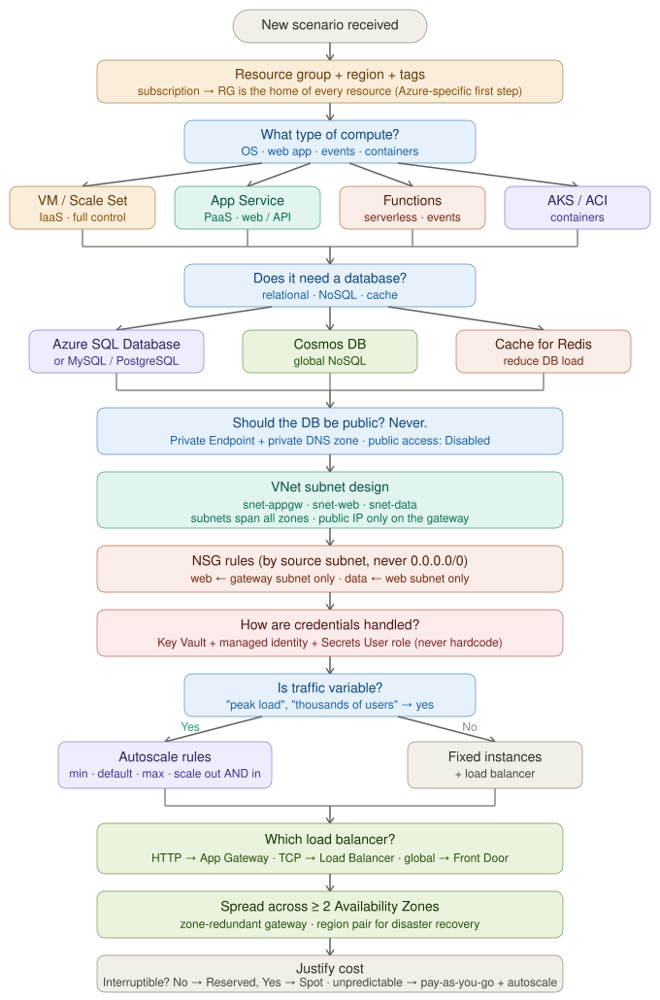

# Azure Scenario Framework

How to approach any "implement this on Azure" scenario: read it, design it, justify it. Same loop as for AWS; only the vocabulary and a few architecture rules change. Worked example: [[AZS01 - Contoso Clinic Highly Available Web App]]. Exam page: [[certs/az-900]].

---

## 1. The 9-step thinking framework (Azure version of the AWS steps)

| Step | What to do | Azure services | AWS equivalent |
|------|------------|----------------|----------------|
| **0. Read the scenario** | Workload type · hard constraints ("cannot be interrupted", "DB not public") · active pillars · assumptions (single region, HTTP only…) | — | Same as AWS |
| **1. Governance scaffold** *(Azure-specific, do this first)* | Subscription → Resource group → region → naming convention → tags. Everything you create lives in a resource group. | Subscription, Resource group, tags | No direct equivalent of the resource group |
| **2. Network** | VNet → subnets by tier (edge, web, data) → NSGs. Public IP only on the edge component. | VNet, subnets, NSG | VPC · subnets · Security Groups |
| **3. Compute + identity** | VM / VM Scale Set (IaaS), App Service (PaaS), Functions (serverless), AKS (containers). Attach a **managed identity**. | VM/VMSS, App Service, Functions, AKS, Managed Identity | EC2 / Beanstalk / Lambda / EKS · IAM Role |
| **4. Data layer** | Azure SQL Database, Cosmos DB, Storage. Reach it through a **Private Endpoint**, with public access disabled. | Azure SQL, Cosmos DB, Private Endpoint | RDS / DynamoDB · private subnet |
| **5. Security** | NSG rules by source, Key Vault for secrets, RBAC least privilege, Defender for Cloud, no hardcoded credentials. | NSG, Key Vault, RBAC, Defender | SG/NACL · Secrets Manager · IAM |
| **6. Availability** | Spread across **Availability Zones**; Application Gateway / Load Balancer with health probes; zone-redundant services; region pair for disaster recovery. | Availability Zones, App Gateway, Load Balancer | multi-AZ · ALB · health checks |
| **7. Scalability** | Autoscale rules on the VM Scale Set or App Service plan: min / default / max + scale-out and scale-in rules. | VMSS autoscale, App Service autoscale | Auto Scaling Group policies |
| **8. Operate and justify cost** | Azure Monitor + alerts, Cost Management budgets, Advisor, Reservations (predictable load) vs Spot (interruptible), Hybrid Benefit. | Monitor, Cost Management, Advisor | CloudWatch · Cost Explorer · Reserved/Spot |

---

## 2. The Azure design decision tree

Follow it from the top whenever a new scenario arrives. Each question tells you which service to add next.

---

## 3. Decision rules: how to pick the service

### Which compute?
| If the scenario says… | Pick |
|-----------------------|------|
| Need OS control, custom software, lift-and-shift | **VM / Scale Set** |
| Just a web app or API, minimal management | **App Service** |
| Short event-triggered code, pay per execution | **Functions** |
| Containerised microservices at scale | **AKS** |
| Run a container quickly, no orchestration | **Container Instances** |

### Which load balancer?
| If the scenario says… | Pick |
|-----------------------|------|
| HTTP/HTTPS, URL routing, WAF, inside one region | **Application Gateway** |
| Any TCP/UDP traffic, high throughput, layer 4 | **Load Balancer** |
| Global entry point, multi-region, CDN, WAF | **Front Door** |
| DNS-based routing across regions | **Traffic Manager** |

### Which database?
| If the scenario says… | Pick |
|-----------------------|------|
| Relational, SQL Server compatible, managed | **Azure SQL Database** |
| Relational, need near-full SQL Server features | **SQL Managed Instance** |
| Globally distributed NoSQL, low latency | **Cosmos DB** |
| MySQL or PostgreSQL application | **Azure Database for MySQL / PostgreSQL** |
| Cache to take read load off the DB | **Cache for Redis** |

**Tie the choice back to a sentence in the scenario.** VM Scale Set mirrors EC2 + Auto Scaling and fits "Ubuntu machines running the provided app". If the scenario said "minimise management effort", **App Service** would be the better answer (no OS patching, autoscale built in).

---

## 4. Azure-specific points to focus on

| Topic | What is different from AWS | Why it matters |
|-------|----------------------------|----------------|
| **Subnets and zones** | An Azure subnet spans **all** zones in the region. You pick the zone per resource (VM, gateway). In AWS a subnet lives in one AZ. | Draw one `snet-web` with VMs in Zone 1 and Zone 2. Don't create "subnet A / subnet B per zone". |
| **Resource group** | Mandatory container for every resource, and the unit for access control, tags, lifecycle and cost. | Delete the group and everything inside it goes. Group by lifecycle. |
| **Security rules** | NSGs attach to a **subnet or a NIC**. Stateful, allow/deny with priorities (lower number wins). | No separate "NACL" layer. Use service tags (`AzureLoadBalancer`) and subnet CIDRs as sources. |
| **Workload identity** | **Managed identity** (system- or user-assigned) plus **RBAC** role assignments. | Equivalent of an IAM Role, but you must still grant it a role, e.g. *Key Vault Secrets User*. |
| **PaaS network access** | Azure SQL, Storage and Key Vault have public endpoints by default. Lock them with a **Private Endpoint**. | "Database not reachable from the internet" = Private Endpoint + public access disabled. |
| **Disaster recovery** | Regions come in **pairs**. Zones protect against datacentre failure; region pairs protect against a whole region failing. | For a single-region assumption, zones are enough. Mention the region pair as an improvement. |
| **Well-Architected pillars** | Azure's framework has 5: Reliability, Security, Cost Optimization, Operational Excellence, Performance Efficiency. | Use these words when justifying choices. |

## 5. Best practices to state in an answer
Put each tier in its own subnet · give a public IP only to the edge component · least-privilege RBAC · secrets in Key Vault · tag everything (`env`, `owner`, `costcenter`) · zones for anything that must survive a datacentre failure · budgets and alerts from day one.

## 6. Common mistakes to avoid
- Leaving the database's public network access on "Enabled".
- Creating the Private Endpoint but not the **private DNS zone**, so the app still resolves the public address and fails.
- Allowing `0.0.0.0/0` on the web NSG instead of only the gateway subnet.
- Forgetting a **scale-in** rule, so the scale set grows and never shrinks (cost leak).
- Putting the Application Gateway in the same subnet as the VMs. It needs its own dedicated subnet.
- Granting the managed identity *Owner* or *Contributor* on Key Vault when *Secrets User* is enough.
- Hardcoding the SQL password in the app or in the startup script.

## 7. How to answer on an exam
State the answer in the shape **constraints → service per requirement → why → trade-off**. Example: "The database uses a Private Endpoint with public access disabled, because the scenario requires it not to be reachable from public networks. The trade-off is extra DNS configuration and a small hourly cost for the endpoint."

AZ-900 itself tests recognising services and concepts rather than building them. The build in AZS01 is what a lab or design question (or the real job) expects.

## Related
[[concepts/azure-product-map]] · [[concepts/azure-service-reference]] · [[concepts/azure-cloud-concepts]] · [[concepts/vpc-and-subnets]] · [[concepts/cloud-fundamentals]]
