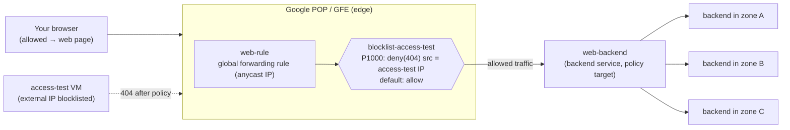

# GCP28 — Lab: Configuring Traffic Blocklisting with Google Cloud Armor

## Lab Goal
"Cloud Armor in action." This is the hands-on lab for [[GCP26 - Google Cloud DDoS Mitigations]].
- Verify a **pre-provisioned global Application Load Balancer** with backends in several zones.
- Create an **`access-test` VM** as a client.
- **Blocklist** that VM's external IP with a Cloud Armor policy.
- Confirm the block and read the **Cloud Armor logs**.

**Why it matters:** Application LB runs at Google's **points of presence (POPs)**. User traffic enters the POP **closest to the user** and is load-balanced over Google's network to the closest backend with capacity. Cloud Armor allow/deny lists enforce **at that edge**, "as close as possible to the user and to malicious traffic", so blocked traffic **never consumes backend resources or enters your VPC**.

> Qwiklabs temporary credentials from the lab page are intentionally **not** stored here.

> 🎛️ **Interactive visualization:** [Cloud Armor at the Edge](https://claude.ai/artifact/HUYW5ZyNyEmr5ZnnWx1Wvj). Step through the lab tasks: POP routing, stress-test overflow, blocklist propagation, policy logs. Source: `wiki/visualizations/gcp/GCP28 - Cloud Armor at the Edge.html`

---

## Topology


| Resource | Created by | Notes |
|----------|-----------|-------|
| `web-backend` | Lab startup | Global backend service, **3 instances** in different zones |
| `web-rule` | Lab startup | Global forwarding rule holding the LB's IP |
| `access-test` | You | VM with default settings and an external IP. Used as the "malicious" client |
| `blocklist-access-test` | You | Cloud Armor policy: default **Allow**, rule 1000 **Deny (404)** |

---

## Task 1 — Verify the load balancer
```bash
# Wait until all three backends report HEALTHY
gcloud compute backend-services get-health web-backend --global

# Get the LB's anycast IP (IPAddress field)
gcloud compute forwarding-rules describe web-rule --global
gcloud compute forwarding-rules describe web-rule --global --format="value(IPAddress)"   # just the IP
```
- Browse to `http://<IP>`. The page reads *"Web server … the server is in zone X"*. **404/502 for a couple of minutes is normal** while the new LB propagates to the GFEs.
- In Cloud Shell, `while true; do curl -m1 <IP>; done` shows responses from backends in **different zones**, which proves the global LB is spreading load. `-m1` = 1-second timeout per request. Stop with Ctrl+C.

**Why `get-health` first:** if the backends aren't HEALTHY, the LB returns 502 and you'd wrongly blame Cloud Armor later. Always confirm the baseline before adding security controls.

## Task 2 — Create the access-test VM
Compute Engine → VM instances → **Create instance**: name `access-test`, the lab's region/zone, defaults otherwise. SSH in and run `curl -m1 <IP>`:
```html
<h1>Web server</h1><h2>This server is in zone: projects/<num>/zones/<ZONE></h2>
```
The client works, so the baseline is established.

## Task 3 — Create the Cloud Armor policy
Network Security → **Cloud Armor policies → Create policy**:

| Setting | Value | Why |
|---------|-------|-----|
| Name | `blocklist-access-test` | — |
| **Default rule action** | **Allow** | Allow-by-default + specific denies = a **blocklist** |
| Rule mode | **Basic mode** (IP addresses/ranges only) | Advanced mode = CEL expressions (geo, headers, WAF rules) |
| Match | `access-test` **external** IP | The LB sees the client's public IP, never its internal IP |
| Action | **Deny** | — |
| Response code | **404 (Not Found)** | The lab deliberately uses 404, not 403 (see below) |
| Priority | **1000** | Lower number = evaluated first. The default rule is `2147483647` |
| Target | Type **Backend service (external application load balancer)** → `web-backend` | Policies attach to **backend services** |

gcloud equivalent:
```bash
VM_IP=$(gcloud compute instances describe access-test --zone=<ZONE> \
        --format="value(networkInterfaces[0].accessConfigs[0].natIP)")
gcloud compute security-policies create blocklist-access-test
gcloud compute security-policies rules create 1000 \
    --security-policy=blocklist-access-test \
    --src-ip-ranges="${VM_IP}/32" --action=deny-404
gcloud compute backend-services update web-backend \
    --security-policy=blocklist-access-test --global
```

**Verify** (allow a couple of minutes to propagate):
- From `access-test`: `curl -m1 <IP>` returns `<title>404</title>404 Not Found`.
- From your browser: still the web page. **Only one IP is blocked.**

**Why 404 instead of 403?** A 403 tells the attacker "you were detected and blocked". A 404 makes the resource look like it **doesn't exist**, which reveals less. Cloud Armor deny actions support `deny-403`, `deny-404` and `deny-502`.

**Alternative (lab note):** default rule **Deny** + allow rules for known IPs = an **allowlist**, good for admin panels or partner-only APIs.

## Task 4 — View Cloud Armor logs
Cloud Armor policies → `blocklist-access-test` → **Logs → View policy logs**. Find an entry with **404** and expand `httpRequest`: `remoteIp` = the access-test VM.

Equivalent Logs Explorer query:
```
resource.type="http_load_balancer"
jsonPayload.enforcedSecurityPolicy.name="blocklist-access-test"
jsonPayload.enforcedSecurityPolicy.outcome="DENY"
```
Useful fields: `enforcedSecurityPolicy.{name, priority, outcome, configuredAction}`, `statusDetails` (`denied_by_security_policy`), `httpRequest.{remoteIp, status, requestUrl, userAgent}`.

---

## Concepts Demonstrated
| Concept | What the lab showed |
|---------|-------------------|
| Edge enforcement | Denied requests stop at the POP. Backends never see them |
| Policy → backend service | One policy targets `web-backend`; all its instances in all zones are protected at once |
| Priority + first match | Rule 1000 matches the VM IP first. Everything else falls to the default allow |
| Blocklist vs allowlist | Set by the default rule's action |
| Propagation delay | Both the LB and policy changes take minutes to reach every GFE |
| Logging | Each decision is logged with the rule that matched |

### Fact-check: "identify attackers with VPC Flow Logs in BigQuery"
The lab suggests VPC Flow Logs to find a high-volume client IP. For a **proxy-based external Application LB** that's only partly useful. The GFE **terminates** the client connection and opens a new one to the backend, so backend VM flow logs show **GFE source IPs** (`35.191.0.0/16`, `130.211.0.0/22`), **not the client**. The client IP is in the **LB request logs** (`httpRequest.remoteIp`) and in the `X-Forwarded-For` header at the backend. For finding abusive clients behind an Application LB, **query LB logs** (export them to BigQuery for volume analysis):
```sql
SELECT httpRequest.remoteIp, COUNT(*) AS reqs
FROM `<project>.<dataset>.requests_*`
GROUP BY 1 ORDER BY reqs DESC LIMIT 20
```

---

## Troubleshooting
| Symptom | Likely cause | Fix |
|---------|-------------|-----|
| 502 from the LB | Backends not HEALTHY yet, or health-check firewall rule missing | `get-health web-backend --global`. Allow `130.211.0.0/22` + `35.191.0.0/16` |
| 404 **before** creating the policy | LB still propagating (not Cloud Armor) | Wait. Check that a response is the backend's page vs the GFE's 404 |
| access-test still gets the page | Policy still propagating; internal IP used in the rule; wrong target | Wait about 2 minutes. Use the **external** IP. `backend-services describe web-backend --global --format="value(securityPolicy)"` |
| Browser also blocked | Range too broad (e.g., /0) or default rule = deny | `gcloud compute security-policies rules list blocklist-access-test` |
| How do I tell a Cloud Armor 404 from a "real" 404? | Both are 404 | Logs: `enforcedSecurityPolicy.outcome="DENY"` / `statusDetails="denied_by_security_policy"` |

---

## Real-World Connections
- **Incident response:** an IP blocklist is the quick first move. Botnets rotate IPs ([[GCP25 - How DDoS Attacks Work]]), so follow up with **rate-based rules**, **Adaptive Protection** and WAF rules ([[GCP26 - Google Cloud DDoS Mitigations]]). Use **preview mode** before enforcing new rules in production.
- **Network+:** an ACL at L7, enforced at the edge ([[L20 - Network Defense Techniques]]).
- **Wireshark / k3s:** behind any L7 proxy (GFE, ingress-nginx), packet captures on the backend show the **proxy's IP**. Look in `X-Forwarded-For` for the real client. Kubeshark shows the header, not the source IP. On k3s, ingress-nginx `denylist-source-range` gives the same result, but traffic still reaches your node.
- **AWS:** WAF web ACL with an **IP set** rule on ALB/CloudFront. Block response codes are configurable too.

---

## Quiz
1. Where does Cloud Armor enforce the blocklist?
   - A) On each backend VM  B) At Google's edge (POP/GFE), before traffic enters the VPC  C) In the subnet firewall  D) At Cloud NAT
2. What response code did the lab configure for the deny rule?
   - A) 403  B) 502  C) 404  D) 429
3. Why might you prefer 404 over 403 for blocked clients?
   - A) 404 is faster  B) It hides that a block exists, revealing less to the attacker  C) 403 isn't supported  D) 404 bypasses logs
4. What makes this policy a *blocklist*?
   - A) Default rule Allow + a specific deny rule  B) Default rule Deny  C) Priority 1000  D) Basic mode
5. Which command confirms the three backends are HEALTHY?
   - A) `gcloud compute forwarding-rules describe web-rule --global`  B) `gcloud compute instances list`  C) `gcloud compute backend-services get-health web-backend --global`  D) `gcloud compute health-checks list`
6. With an external Application LB, why don't backend VPC Flow Logs show the attacker's IP?
   - A) Flow logs are disabled for LBs  B) The GFE proxies the connection, so backends see GFE source IPs. The client IP is in LB logs / X-Forwarded-For  C) Clients use IPv6  D) Cloud Armor removes it
7. What should the rule match on for the access-test VM?
   - A) Its internal IP  B) Its external IP  C) Its hostname  D) Its service account

**Answers:** 1-B, 2-C, 3-B, 4-A, 5-C, 6-B, 7-B

---

## Weak Areas to Revisit
*(none flagged yet)*

## Linked Pages
- [[GCP26 - Google Cloud DDoS Mitigations]] · [[GCP27 - Types of Complementary Partner Products]] · [[GCP24 - Module Introduction - DDoS Protection]]
- [[GCP12 - Lab - Implement Private Google Access and Cloud NAT]] · [[GCP19 - Lab - Implement a Hub-and-Spoke Network Using Network Connectivity Center]]
- [[L20 - Network Defense Techniques]] · [[gcp-product-map]] · [[certs/gcp-networking]]
