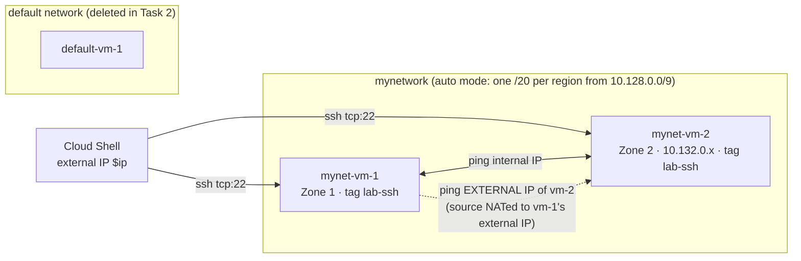

# GCP32 — Lab: Configuring VPC Firewalls

> 🎛️ **Interactive visualization:** [VPC Firewall Lab](../visualizations/gcp/GCP32%20-%20VPC%20Firewall%20Lab.html): replay each task, run the lab's SSH and ping tests against the live rule set, and see which egress and ingress rule decides each one. Opens in your browser.

## Lab Goal
The hands-on lab for [[GCP31 - Firewall Rules]]:
1. Create an **auto-mode** VPC (`mynetwork`) and test VMs.
2. Compare the **default** network (permissive pre-populated rules) with a **user-created** network (implied rules only: nothing gets in).
3. Delete the default network.
4. Build ingress rules with **target tags** and **source ranges**.
5. Use **priority** to make a deny win, then lose.
6. Show that **egress** rules are checked separately from ingress.

> Qwiklabs temporary credentials from the lab page are intentionally **not** stored here. `Zone 1` / `Zone 2` are the lab's placeholders for its two zones.

---

## Topology


| Resource | Notes |
|----------|-------|
| `mynetwork` | `--subnet-mode=auto`: one subnet per region, all inside `10.128.0.0/9` |
| `default-vm-1` | In the default network. Only used to show the default rules, then deleted |
| `mynet-vm-1`, `mynet-vm-2` | `e2-micro`, in two zones/regions of `mynetwork`, both with external IPs |

---

## Tasks, with the why

### Task 1: Create the network and VMs
```bash
gcloud compute networks create mynetwork --subnet-mode=auto
gcloud compute instances create default-vm-1 --machine-type e2-micro --zone=ZONE_1 --network=default
gcloud compute instances create mynet-vm-1   --machine-type e2-micro --zone=ZONE_1 --network=mynetwork
gcloud compute instances create mynet-vm-2   --machine-type e2-micro --zone=ZONE_2 --network=mynetwork
```
**Why auto mode here:** it's quick for a lab. In production, use **custom mode**: auto-mode ranges can overlap with on-prem `10.x` space, and you can't choose them.

### Task 2: Investigate the default network, then delete it
- **VPC network → Firewall** shows the four default rules: `default-allow-internal`, `default-allow-ssh`, `default-allow-rdp`, `default-allow-icmp` (priority 65534).
- SSH to `default-vm-1` from the console **works**, because of `default-allow-ssh` (`0.0.0.0/0`). `ping www.google.com` works too (implied egress allow + external IP).
- Delete `default-vm-1`, then the **default network**. You can't delete a network while VMs are still attached to it.

> **Lab-text error:** the lab says every network has "default deny all ingress and default **deny** all egress" implied rules. Wrong: the implied rules are **deny ingress** and **allow egress** (both priority 65535). Task 2's own `ping www.google.com` working proves egress is allowed.

### Task 3: User-created network blocks all ingress
- Console SSH and `gcloud compute ssh qwiklabs@mynet-vm-2` both **fail** (`exited with return code [255]`).
- **Why:** `mynetwork` has no rules except the implied ones, so implied **deny ingress** drops tcp:22. Unlike the default network, user-created networks get **no** pre-populated rules.

### Task 4: Custom ingress rules
```bash
ip=$(curl -s https://api.ipify.org)          # Cloud Shell's public IP
gcloud compute firewall-rules create mynetwork-ingress-allow-ssh-from-cs \
    --network mynetwork --action ALLOW --direction INGRESS \
    --rules tcp:22 --source-ranges $ip --target-tags=lab-ssh
gcloud compute instances add-tags mynet-vm-2 --zone ZONE_2 --tags lab-ssh
gcloud compute instances add-tags mynet-vm-1 --zone ZONE_1 --tags lab-ssh
gcloud compute ssh qwiklabs@mynet-vm-2 --zone ZONE_2     # ✔ works now
```
| Step | Why |
|------|-----|
| `--source-ranges $ip` | Only Cloud Shell's IP. A bare IP is treated as `/32` |
| `--target-tags=lab-ssh` | The rule applies to **no VMs** until a VM carries the tag |
| `add-tags` | Takes effect immediately, with no restart. (Changing a VM's **service account** needs stop/start.) |
| Console SSH still fails | Browser SSH connects from Google-owned addresses that change per session. Allowing them means `0.0.0.0/0` or Google's ranges. The modern fix is **IAP** with `35.235.240.0/20` ([[GCP12 - Lab - Implement Private Google Access and Cloud NAT]]) |

**Stateful:** SSH replies flow back with no egress rule. Return traffic of a tracked connection is allowed automatically.

```bash
# from mynet-vm-1:
ping mynet-vm-2.ZONE_2                           # ✘ no ingress rule allows ICMP
gcloud compute firewall-rules create mynetwork-ingress-allow-icmp-internal \
    --network mynetwork --action ALLOW --direction INGRESS --rules icmp \
    --source-ranges 10.128.0.0/9                 # no target → ALL instances
ping mynet-vm-2.ZONE_2                           # ✔ resolves to 10.132.0.x (internal DNS)
ping <EXTERNAL_IP_OF_mynet-vm-2>                 # ✘ fails
```
**Why the external-IP ping fails:** traffic to an external IP leaves through the internet gateway. Google translates the source to **mynet-vm-1's external IP**, which isn't in `10.128.0.0/9`, so no allow rule matches and implied deny ingress drops it. (Internal DNS: `VM.ZONE.c.PROJECT.internal`. The short form `mynet-vm-2.ZONE` resolves through the search domain.)

### Task 5: Priority
```bash
gcloud compute firewall-rules create mynetwork-ingress-deny-icmp-all \
    --network mynetwork --action DENY --direction INGRESS --rules icmp --priority 500
# ping ✘: deny 500 is evaluated before allow 1000
gcloud compute firewall-rules update mynetwork-ingress-deny-icmp-all --priority 2000
# ping ✔: allow 1000 matches first, so the deny at 2000 is never reached
```
**Rule:** **lower number = higher priority**. First match wins. With no `--source-ranges`, an ingress rule defaults to `0.0.0.0/0`.

### Task 6: Egress is a separate check
```bash
gcloud compute firewall-rules create mynetwork-egress-deny-icmp-all \
    --network mynetwork --action DENY --direction EGRESS --rules icmp --priority 10000
gcloud compute firewall-rules list --filter="network:mynetwork"
# ping ✘ again
```
**Why it blocks despite "priority 10000":**
1. Priority only orders rules **within the same direction**. Ingress and egress are separate lists.
2. Egress list for mynet-vm-1 → `egress-deny-icmp-all` (10000) is the **first and only matching egress rule** above the implied allow (65535), so ICMP is dropped **leaving vm-1**, before it ever reaches vm-2's ingress rules.
3. A new connection needs **egress allowed at the source and ingress allowed at the destination**.

> **Lab-text wording errors:** (a) "the rule that denies ICMP has a **higher** priority than the allow ICMP rule". After Task 5 the deny is at **2000**, a *lower* priority than the allow at 1000, which is why ping works. (b) "egress rule has a much **higher** priority of 10,000". 10000 is a *lower* priority (larger number). It still wins because it's the only matching rule in the **egress** list. (c) The closing summary mentions creating a "custom-mode network". The lab only creates an **auto-mode** network.

---

## Final rule set (mynetwork)
| Name | Dir | Pri | Action | Source/Dest | Target | Proto |
|------|-----|-----|--------|-------------|--------|-------|
| mynetwork-ingress-deny-icmp-all | IN | 2000 | deny | 0.0.0.0/0 | all | icmp |
| mynetwork-ingress-allow-ssh-from-cs | IN | 1000 | allow | $ip/32 | tag lab-ssh | tcp:22 |
| mynetwork-ingress-allow-icmp-internal | IN | 1000 | allow | 10.128.0.0/9 | all | icmp |
| mynetwork-egress-deny-icmp-all | OUT | 10000 | deny | 0.0.0.0/0 | all | icmp |
| *(implied)* allow egress | OUT | 65535 | allow | 0.0.0.0/0 | all | all |
| *(implied)* deny ingress | IN | 65535 | deny | 0.0.0.0/0 | all | all |

## Test results matrix
| Test | After T3 | After T4 | After T5 (500) | After T5 (2000) | After T6 |
|------|----------|----------|----------------|-----------------|----------|
| Cloud Shell → vm-2 SSH | ✘ | ✔ | ✔ | ✔ | ✔ |
| vm-1 → vm-2 ping (internal) | ✘ | ✔ (after ICMP rule) | ✘ | ✔ | ✘ |
| vm-1 → vm-2 ping (external IP) | ✘ | ✘ | ✘ | ✘ | ✘ |
| Console browser SSH | ✘ | ✘ | ✘ | ✘ | ✘ |

---

## Concepts Demonstrated
| Concept | Where |
|---------|-------|
| Default vs user-created network rules | T2 vs T3 |
| Implied deny ingress | T3 SSH fails |
| Target tags | T4: the rule does nothing until `add-tags` |
| Source ranges + NAT | T4: the external-IP ping fails |
| Stateful | T4: SSH replies flow without an egress rule |
| Priority ordering | T5: 500 vs 2000 |
| Separate egress evaluation | T6 |

## Troubleshooting
| Symptom | Cause | Fix |
|---------|-------|-----|
| `gcloud compute ssh` returns code 255 | No ingress tcp:22 from your IP, or the VM lacks the target tag | Check `firewall-rules list`, `instances describe --format="value(tags.items)"` |
| SSH breaks after reopening Cloud Shell | Cloud Shell's public IP changed | Re-run `ip=$(curl -s https://api.ipify.org)` and `firewall-rules update ... --source-ranges $ip` |
| Ping by name fails, by internal IP works | DNS: wrong zone suffix | Use `VM.ZONE.c.PROJECT.internal` |
| Can't delete the default network | VMs or other resources still attached | Delete them first |
| Deny "doesn't work" | A matching allow has a lower priority number | Give the deny a number below the allow (e.g. 500 < 1000) |

## Real-World Connections
- **k3s:** with a default-deny NetworkPolicy, pods can't ping each other until you add an allow, just like Task 3/4. Labels play the role of the target tags.
- **AWS:** security groups have no deny and no priority (allow-only). Task 5's "deny overrides allow" behavior needs **NACLs** in AWS, which are stateless and ordered by rule number.
- **Production:** never leave an SSH allow keyed to a changing client IP. Use **IAP** (`35.235.240.0/20`) + OS Login, and **service-account targets** instead of tags.

## Quiz
1. Why does SSH to `mynet-vm-2` fail in Task 3?
   - A) User-created networks have only the implied rules, and implied deny ingress blocks tcp:22  B) No external IP  C) Wrong zone  D) OS Login disabled
2. After creating `...allow-ssh-from-cs` with `--target-tags=lab-ssh`, SSH still fails until you:
   - A) Restart the VM  B) Wait 10 minutes  C) Change the service account  D) Add the `lab-ssh` tag to the VM
3. Ping to mynet-vm-2's **external** IP fails while the internal ping works because:
   - A) ICMP isn't allowed to external IPs  B) External IPs block ping  C) The source becomes vm-1's external IP, which isn't in 10.128.0.0/9  D) DNS
4. Deny ICMP at 500 + allow ICMP at 1000 means:
   - A) Ping fails: 500 is evaluated first  B) Ping works  C) Random  D) Allow always wins
5. Deny ICMP at 2000 + allow ICMP at 1000 means:
   - A) Ping fails  B) Ping works: allow 1000 matches first  C) Deny wins ties  D) Both apply
6. An egress deny ICMP at 10000 blocks ping even though the ingress allow is 1000, because:
   - A) 10000 is a higher priority  B) Egress always beats ingress  C) It's a bug  D) Egress and ingress are separate lists; egress must also be allowed at the source
7. The implied rules in every VPC are:
   - A) Deny ingress, deny egress  B) Allow both  C) Deny ingress, allow egress  D) Allow ingress, deny egress

**Answers:** 1-A, 2-D, 3-C, 4-A, 5-B, 6-D, 7-C

---

## Weak Areas to Revisit
*(none flagged yet)*

## Linked Pages
- [[GCP31 - Firewall Rules]] · [[GCP30 - IAM Roles]] · [[GCP29 - Module Introduction - Controlling Access to VPC Networks]]
- [[GCP28 - Lab - Configuring Traffic Blocklisting with Google Cloud Armor]] · [[GCP12 - Lab - Implement Private Google Access and Cloud NAT]]
- [[gcp-command-anatomy]] · [[certs/gcp-networking]]
