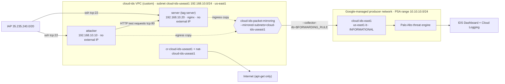

# GCP34 — Lab: Getting Started with Cloud IDS

> 🎛️ **Interactive visualization:** [Cloud IDS Lab](../visualizations/gcp/GCP34%20-%20Cloud%20IDS%20Lab.html): replay all 10 tasks, build the footprint, send each severity's test request, see why every threat shows up twice, then block the attacker and watch the retry die. Opens in your browser.

## Lab Goal
The hands-on lab for [[GCP33 - Cloud IDS]]. **Scenario:** Alice, Lead Security Engineer at **Cymbal Bank**, hardens internal web servers against "Bash Remote Code Execution" and other exploit attempts. You:
1. Build the footprint: custom VPC, subnet, **private services access**, Cloud Router + **Cloud NAT**.
2. Create a **Cloud IDS endpoint** (severity `INFORMATIONAL`).
3. Mirror the subnet to it with **Packet Mirroring**.
4. Send **low → critical** test requests from an `attacker` VM to a `server` VM.
5. Read the threats in the **IDS dashboard** and **Cloud Logging**.
6. Respond by hand: a **priority-1 DENY** firewall rule for the attacker's IP, then **verify** the retry is dropped.

> Qwiklabs temporary credentials aren't stored. The lab's attack requests are **lab-provided test signatures against a lab-owned server**. They're summarized by category below, not reproduced.

---

## Topology


---

## Tasks, with the why

### Task 1: Enable APIs
```bash
export PROJECT_ID=$(gcloud config get-value project | sed '2d')
gcloud services enable servicenetworking.googleapis.com --project=$PROJECT_ID
gcloud services enable ids.googleapis.com --project=$PROJECT_ID
gcloud services enable logging.googleapis.com --project=$PROJECT_ID
```
`sed '2d'` deletes the second line of output (a status/notice line) so that only the project ID is captured.

### Task 2: Network footprint + private services access
```bash
gcloud compute networks create cloud-ids --subnet-mode=custom
gcloud compute networks subnets create cloud-ids-useast1 --range=192.168.10.0/24 \
    --network=cloud-ids --region=us-east1
gcloud compute addresses create cloud-ids-ips --global --purpose=VPC_PEERING \
    --addresses=10.10.10.0 --prefix-length=24 --description="Cloud IDS Range" --network=cloud-ids
gcloud services vpc-peerings connect --service=servicenetworking.googleapis.com \
    --ranges=cloud-ids-ips --network=cloud-ids --project=$PROJECT_ID
```
**Why PSA:** the IDS endpoint and its inspection VMs live in a **Google-owned producer network**. PSA peers it with your VPC so mirrored packets travel on internal IPs only. `10.10.10.0/24` is carved out for Google, so it must not overlap your subnets ([[GCP10 - Private Services Access]]).

### Task 3: IDS endpoint (~20 min)
```bash
gcloud ids endpoints create cloud-ids-east1 --network=cloud-ids --zone=us-east1-b \
    --severity=INFORMATIONAL --async
gcloud ids endpoints list --project=$PROJECT_ID          # STATE: CREATING → READY
```
- `--async` returns at once, so you build the rest while it provisions.
- `INFORMATIONAL` = the lowest threshold, so every severity is reported (useful in a lab, noisy in production).
- Zonal (`us-east1-b`), but it inspects mirrored traffic from **any zone in us-east1**.

### Task 4: Firewall rules + Cloud NAT
```bash
gcloud compute firewall-rules create allow-http-icmp --direction=INGRESS --priority=1000 \
    --network=cloud-ids --action=ALLOW --rules=tcp:80,icmp --source-ranges=0.0.0.0/0 --target-tags=server
gcloud compute firewall-rules create allow-iap-proxy --direction=INGRESS --priority=1000 \
    --network=cloud-ids --action=ALLOW --rules=tcp:22 --source-ranges=35.235.240.0/20
gcloud compute routers create cr-cloud-ids-useast1 --region=us-east1 --network=cloud-ids
gcloud compute routers nats create nat-cloud-ids-useast1 --router=cr-cloud-ids-useast1 \
    --router-region=us-east1 --auto-allocate-nat-external-ips --nat-all-subnet-ip-ranges
```
| Rule | Why |
|------|-----|
| `allow-http-icmp` → tag `server` | The attacker must reach nginx on tcp:80. `0.0.0.0/0` is fine here: the server has **no external IP**, so only VPC sources can actually connect |
| `allow-iap-proxy` (no target = all VMs) | SSH via IAP to both VMs, with no public IPs ([[GCP12 - Lab - Implement Private Google Access and Cloud NAT]]) |
| Cloud Router + NAT (same region) | VMs without external IPs still need outbound internet for `apt-get install nginx` ([[GCP11 - Cloud NAT]]) |

### Task 5: Two VMs + prepare the server
```bash
gcloud compute instances create server --zone=us-east1-b --machine-type=e2-medium \
    --subnet=cloud-ids-useast1 --no-address --private-network-ip=192.168.10.20 \
    --metadata=startup-script='#! /bin/bash
sudo apt-get update
sudo apt-get -qq -y install nginx' \
    --tags=server --image-family=DEBIAN_FAMILY --image-project=debian-cloud --boot-disk-size=10GB
gcloud compute instances create attacker --zone=us-east1-b --machine-type=e2-medium \
    --subnet=cloud-ids-useast1 --no-address --private-network-ip=192.168.10.10 \
    --image-family=DEBIAN_FAMILY --image-project=debian-cloud --boot-disk-size=10GB
gcloud compute ssh server --zone=us-east1-b --tunnel-through-iap
sudo systemctl status nginx              # active (running)
cd /var/www/html/ && sudo touch eicar.file   # then write the standard EICAR test string into it
exit
```
- `--no-address` + `--private-network-ip`: fixed internal IPs and no internet exposure.
- The **EICAR test file** is the industry-standard *harmless* antivirus test string. Every AV/IDS engine flags it, so it proves the malware signatures work without real malware.
- (The lab shows `$'\n'`-escaped startup-script syntax. The multi-line quote above is equivalent.)

### Task 6: Packet Mirroring → endpoint
```bash
gcloud ids endpoints list --project=$PROJECT_ID | grep STATE      # wait for READY
export FORWARDING_RULE=$(gcloud ids endpoints describe cloud-ids-east1 --zone=us-east1-b \
    --format="value(endpointForwardingRule)")
gcloud compute packet-mirrorings create cloud-ids-packet-mirroring --region=us-east1 \
    --collector-ilb=$FORWARDING_RULE --network=cloud-ids --mirrored-subnets=cloud-ids-useast1
gcloud compute packet-mirrorings list                               # ENABLE: TRUE
```
**Why wait for READY:** the forwarding rule (the internal LB inside Google's network) only exists once the endpoint is up. The mirroring policy needs it as `--collector-ilb`.

### Task 7: Simulate attacks (attacker → server, tcp:80)
```bash
gcloud compute ssh attacker --zone=us-east1-b --tunnel-through-iap
# run the lab's curl test requests against http://192.168.10.20/ ...
exit
```
| Severity | Lab test request (category) | What the signature recognizes |
|----------|----------------------------|------------------------------|
| **Low** | Shell metacharacters in a CGI login parameter | Command-injection attempt |
| **Medium** | `../` path traversal toward a Windows system file; **GET of `eicar.file`** | Directory traversal; EICAR antivirus test file (virus signature) |
| **High** | CGI path traversal reading `/etc/passwd` | Sensitive file disclosure |
| **Critical** | Shellshock-style function definition in the `User-Agent` header | **Bash Remote Code Execution (Shellshock, CVE-2014-6271)** |

### Task 8: Review threats
**Network Security → IDS Dashboard → Top threats → View top threats** → *Bash Remote Code Execution Vulnerability* → **View threat details** / **View threat logs**.

**Why each threat appears twice (different session IDs):** both VMs are in the **mirrored subnet**. The request is copied once as it **leaves the attacker** (egress) and again as it **arrives at the server** (ingress). Two copies, two detections. In production you'd mirror only the protected tier, or filter by direction, to avoid double-counting.

Threat logs can be exported to **Cloud Storage, Google Security Operations (Chronicle), or any SIEM/SOAR**. Automated response: a log sink → Pub/Sub → Cloud Run function that **creates or updates a firewall rule** or a **Cloud Armor** policy.

### Task 9: Manual incident response
```bash
gcloud compute firewall-rules create cymbal-emergency-block --direction=INGRESS --priority=1 \
    --network=cloud-ids --action=DENY --rules=all --source-ranges=192.168.10.10/32 --enable-logging
gcloud compute firewall-rules list
```
| Choice | Why |
|--------|-----|
| `--priority=1` | Evaluated before `allow-http-icmp` (1000), so it **wins** ([[GCP31 - Firewall Rules]]) |
| `--rules=all` | Every protocol from that source, not just tcp:80 |
| No target | Applies to all VMs: the attacker can't pivot to other hosts either |
| `--enable-logging` | Proves the block in Logging (`disposition: DENIED`) |
| Source `/32` = the IP from the IDS threat | The IDS gave you the indicator. The firewall acts on it, because **IDS itself never blocks** |

### Task 10: Verify the defense
```bash
gcloud compute ssh attacker --zone=us-east1-b --tunnel-through-iap   # still works: IAP source isn't blocked
# re-run the critical test request → hangs / times out
```
Logs Explorer: `jsonPayload.disposition="DENIED"` (filter on `jsonPayload.rule_details.reference` containing `cymbal-emergency-block`).

**Why a timeout, not "connection refused":** GCP firewall drops are **silent** (no RST, no ICMP). curl's SYN never gets a SYN-ACK. And because the TCP handshake never completes, **no HTTP payload is ever sent**, so Cloud IDS has nothing to match and no new alert appears. The attacker's SSH still works because its source is the IAP range, not `192.168.10.10`.

---

## Lab-text notes
| Lab says | Reality |
|----------|---------|
| "simulate multiple attacks from an **external** client" | `attacker` is an **internal VM in the same subnet**: this is **east-west** traffic, which IDS sees and edge tools like Cloud Armor don't |
| "block threats at the **perimeter**" | The deny rule is enforced at the **server's NIC** (distributed VPC firewall), not at an edge perimeter |
| "Chronicle" | Now **Google Security Operations** |
| `--image-family=debian_image_id_short` | A lab placeholder. Use a real family such as `debian-12` from `debian-cloud` |

## Concepts Demonstrated
| Concept | Task |
|---------|------|
| PSA as an IDS prerequisite | 2 |
| Zonal endpoint, regional coverage, async creation | 3 |
| Private VMs: IAP for SSH, NAT for egress | 4–5 |
| Mirroring → `--collector-ilb` forwarding rule | 6 |
| Signature severities; EICAR as a safe test | 5, 7 |
| Duplicate detections from mirroring both endpoints | 8 |
| Detect (IDS) → respond (firewall) | 9 |
| Silent drop, no payload → no new alert | 10 |

## Troubleshooting
| Symptom | Cause | Fix |
|---------|-------|-----|
| `packet-mirrorings create` fails / FORWARDING_RULE empty | Endpoint still `CREATING` | Wait for `READY`, then re-export |
| `vpc-peerings connect` error | Service Networking API not enabled, or the range overlaps | Enable the API; choose an unused `/24` |
| `apt-get` hangs on the server | No Cloud NAT, or NAT in the wrong region | NAT in us-east1 with `--nat-all-subnet-ip-ranges` |
| IAP SSH fails | `allow-iap-proxy` missing | Allow tcp:22 from `35.235.240.0/20` |
| No threats on the dashboard | Mirroring not attached, wrong subnet, or a severity filter on the dashboard | `packet-mirrorings list`; Refresh; widen the time range |
| Attack still works after the block | Wrong source IP (used the NAT IP?) or priority above 1000 | Use the attacker's **internal** IP `192.168.10.10/32`, priority 1 |

## Real-World Connections
- **SOC workflow:** detect (IDS) → triage (threat details, session, source) → contain (firewall `/32`) → verify (firewall logs) → automate (log sink + function). The same loop as Cloud Armor in [[GCP28 - Lab - Configuring Traffic Blocklisting with Google Cloud Armor]], but for **internal** traffic.
- **Wireshark:** run `sudo tcpdump -ni ens4 port 80` on the server during Task 10. You see SYNs never arriving, not RSTs ([[WS03 - Where to Capture on the Network]]).
- **k3s:** the same pattern as Falco/Kubeshark alert → apply a deny NetworkPolicy for the offending pod's IP.
- **AWS:** GuardDuty finding → EventBridge → Lambda → security group / NACL update.

## Quiz
1. Why is private services access required in this lab?
   - A) Cloud IDS runs in a Google-managed producer network peered with your VPC  B) For Cloud NAT  C) For IAP  D) For DNS
2. Each threat appears twice with different session IDs because:
   - A) A bug  B) Both VMs are in the mirrored subnet, so the attacker's egress and the server's ingress are both mirrored  C) Two endpoints  D) Retransmissions
3. What does `--async` do on `ids endpoints create`?
   - A) Creates two endpoints  B) Disables alerts  C) Mirrors asynchronously  D) Returns immediately while the ~20-minute creation continues
4. Which firewall rule property makes the emergency block win over `allow-http-icmp`?
   - A) `--rules=all`  B) `--enable-logging`  C) `--priority=1` (evaluated before 1000)  D) INGRESS direction
5. After the block, the retried critical request:
   - A) Returns 403  B) Gets "connection refused"  C) Times out: silent drop, and IDS raises no new alert because no payload is sent  D) Still succeeds
6. What is the EICAR file?
   - A) A harmless standard test string that AV/IDS engines detect as a virus  B) Real ransomware  C) An nginx config  D) A TLS key
7. Why could you still SSH to the attacker VM after the block?
   - A) SSH isn't covered by `--rules=all`  B) Egress rules  C) The rule has no target  D) IAP connections come from 35.235.240.0/20, not the blocked 192.168.10.10

**Answers:** 1-A, 2-B, 3-D, 4-C, 5-C, 6-A, 7-D

---

## Weak Areas to Revisit
*(none flagged yet)*

## Linked Pages
- [[GCP33 - Cloud IDS]] · [[GCP31 - Firewall Rules]] · [[GCP32 - Lab - Configuring VPC Firewalls]]
- [[GCP10 - Private Services Access]] · [[GCP11 - Cloud NAT]] · [[GCP12 - Lab - Implement Private Google Access and Cloud NAT]] · [[GCP28 - Lab - Configuring Traffic Blocklisting with Google Cloud Armor]]
- [[gcp-command-anatomy]] · [[certs/gcp-networking]]
