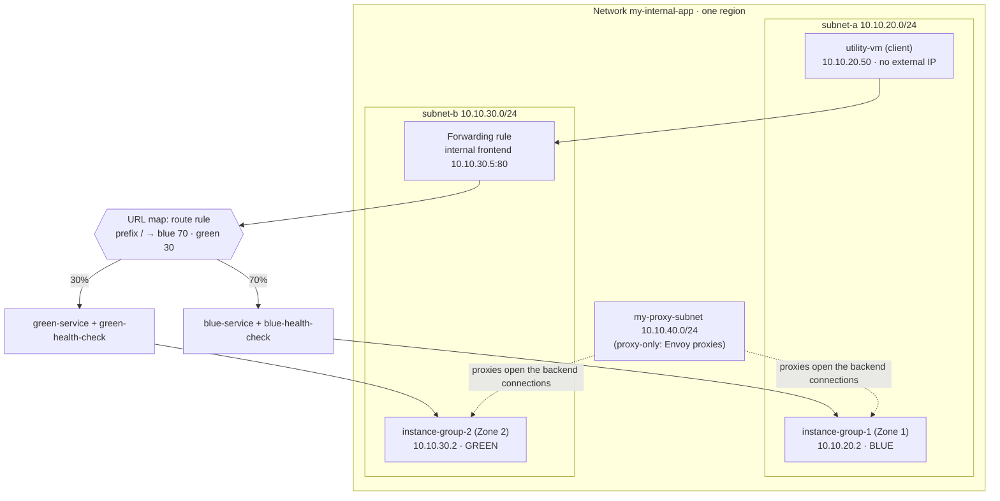

# GCP43 — Lab: Configuring Traffic Management with a Load Balancer

> 🎛️ **Interactive visualization:** [URL Map and Traffic Split](../visualizations/gcp/GCP42-43%20-%20URL%20Map%20and%20Traffic%20Split.html), "Blue-green lab" tab: run the lab's curl loop against the 70/30 split and move the weights. Opens in your browser.

## Lab Goal
The hands-on lab for [[GCP42 - Traffic Management]]. Build a **regional internal Application Load Balancer** with two backend services and route **70% to blue** (current version, `instance-group-1`) and **30% to green** (new version, `instance-group-2`), which is a **blue-green deployment**. Test it from a client VM.

> Qwiklabs temporary credentials aren't stored. `Region`, `Zone 1` and `Zone 2` are the lab's placeholders.

---

## Topology (course diagram)

> **Diagram note:** the course figure labels the network `my-internet-app` and shows two instances per group (10.10.20.2/.3, 10.10.30.2/.3). The lab's network is **`my-internal-app`**, and each group starts with one VM at 10.10.20.2 and 10.10.30.2.

### Pre-created firewall rules
| Rule | Purpose |
|------|---------|
| `app-allow-icmp` | ICMP |
| `app-allow-ssh-rdp` | tcp:22, 3389 |
| `fw-allow-health-checks` | Health checks on tcp:80 |
| `fw-allow-lb-access` | Traffic from `10.10.0.0/16`, which **includes the proxy-only subnet 10.10.40.0/24**. That's how proxied requests reach the backends |

---

## Tasks, with the why

### Task 1: Explore and create a test client
- `my-internal-app` has `subnet-a` and `subnet-b` in one region, each with a managed instance group.
- Create **`utility-vm`**: e2-medium, Debian, `subnet-a`, custom ephemeral IP **10.10.20.50**, **no external IP**.
- From utility-vm, `curl 10.10.20.2` and `curl 10.10.30.2` return each backend's page directly. **Server Location** (the zone) is the field that tells backends apart (the lab's inline question).

### Task 2: Build the load balancer (console)
| Step | Value | Why |
|------|-------|-----|
| Type | Application LB → **Internal** → **Best for regional workloads** | Regional internal ALB: backends must be in one region |
| Name / region / network | `my-ilb` / Region / `my-internal-app` | — |
| **Proxy-only subnet** | `my-proxy-subnet` `10.10.40.0/24` | Envoy-based LBs run managed proxies that need their own addresses ([[GCP41 - Hybrid Load Balancing]]) |
| Backend `blue-service` | `instance-group-1`, port 80, `blue-health-check` (TCP 80, 10 s interval, 5 s timeout, healthy 2, unhealthy 3) | Healthy after 2 passes (~20 s); removed after 3 failures (~30 s) |
| Backend `green-service` | `instance-group-2`, same health-check settings (`green-health-check`) | — |
| **Routing** | **Advanced host and path rule**, host `*`, path matcher YAML below | Weighted splits need advanced mode |
| Default route | Unmatched hosts → `blue-service` | Required even though the rule matches everything |
| Frontend | `subnet-b`, custom ephemeral **10.10.30.5**, port 80 | Clients in any subnet of the VPC can reach it |

```yaml
defaultService: regions/REGION/backendServices/blue-service
name: matcher1
routeRules:
- matchRules:
  - prefixMatch: /
  priority: 0
  routeAction:
    weightedBackendServices:
    - backendService: regions/REGION/backendServices/blue-service
      weight: 70
    - backendService: regions/REGION/backendServices/green-service
      weight: 30
```

**gcloud equivalent** (what the console builds):
```bash
gcloud compute networks subnets create my-proxy-subnet --purpose=REGIONAL_MANAGED_PROXY --role=ACTIVE \
    --region=REGION --network=my-internal-app --range=10.10.40.0/24
gcloud compute health-checks create tcp blue-health-check --region=REGION --port=80 \
    --check-interval=10s --timeout=5s --healthy-threshold=2 --unhealthy-threshold=3
gcloud compute backend-services create blue-service --region=REGION --load-balancing-scheme=INTERNAL_MANAGED \
    --protocol=HTTP --health-checks=blue-health-check --health-checks-region=REGION
gcloud compute backend-services add-backend blue-service --region=REGION \
    --instance-group=instance-group-1 --instance-group-zone=ZONE_1
#   ...same for green-service / instance-group-2 / ZONE_2...
gcloud compute url-maps import my-ilb --region=REGION --source=bluegreen.yaml
gcloud compute target-http-proxies create my-ilb-proxy --region=REGION --url-map=my-ilb --url-map-region=REGION
gcloud compute forwarding-rules create my-ilb-fr --region=REGION --load-balancing-scheme=INTERNAL_MANAGED \
    --network=my-internal-app --subnet=subnet-b --address=10.10.30.5 --ports=80 \
    --target-http-proxy=my-ilb-proxy --target-http-proxy-region=REGION
```

### Task 3: Test
```bash
for i in $(seq 1 20); do curl -s 10.10.30.5 | grep -o 'instance-group-[12]'; done | sort | uniq -c
#   ~14 instance-group-1   ~6 instance-group-2
```
A small sample won't show exactly 70/30. Each request is an independent weighted pick, so 10 curls can easily come out 6/4 or 9/1. Run more (`seq 1 100`) to see the ratio settle.

---

## Blue-green rollout plan (beyond the lab)
| Phase | blue / green weight | Gate to move on |
|-------|---------------------|-----------------|
| Canary | 95 / 5 | Green error rate and latency match blue |
| Ramp (the lab's state) | 70 / 30 | Still healthy under real load |
| Cutover | 0 / 100 | — |
| Rollback | 100 / 0 | **One YAML edit**, no DNS change, no client change |

Edit the weights with `gcloud compute url-maps import my-ilb --region=REGION --source=new.yaml`. Changes propagate within about a minute.

---

## Lab-text notes
| Lab says | Reality |
|----------|---------|
| Health check: Protocol **TCP**, then "This **HTTP** health check polls…" | It's a **TCP** health check (connection-level). An HTTP check would also verify the page returns 200 |
| The Task 3 sample output shows `instance-group-2-1zn8` | Hostname suffixes are random. Read the zone or the group number |
| "Your IP address : 10.10.20.50" in the LB response | The backend's TCP peer is a **proxy in 10.10.40.0/24**. The page shows the client IP only if it reads `X-Forwarded-For`; otherwise expect a 10.10.40.x address |
| Mode: "Advanded host and path rule" | Typo for *Advanced host and path rule* |

## Concepts Demonstrated
| Concept | Where |
|---------|-------|
| Proxy-only subnet for Envoy-based LBs | Task 2 |
| Backend service = group + health check | blue/green services |
| Advanced routing + weighted split | Route rule YAML |
| Two default services (host-level and matcher-level) | URL map default + `defaultService` in the matcher |
| Internal frontend in a different subnet from the client | 10.10.30.5 reached from subnet-a |

## Troubleshooting
| Symptom | Cause | Fix |
|---------|-------|-----|
| `curl 10.10.30.5` hangs | LB still provisioning, or no proxy-only subnet | Wait; confirm `my-proxy-subnet` exists with purpose `REGIONAL_MANAGED_PROXY` |
| 503 no healthy upstream | Health check failing | `fw-allow-health-checks` present, nginx/apache on port 80 |
| Proxied requests blocked, direct curls work | Firewall doesn't allow the **proxy-only subnet** | Allow `10.10.40.0/24` → tcp:80 (here covered by `10.10.0.0/16`) |
| Always blue | Route rule not saved, or simple mode used | Check `url-maps describe my-ilb --region=REGION` for `weightedBackendServices` |

## Real-World Connections
- **k3s:** the same rollout with Gateway API `HTTPRoute` `backendRefs` weights, or Argo Rollouts / Flagger driving the weights automatically from metrics.
- **AWS:** ALB weighted target groups. CodeDeploy blue/green flips them.

## Quiz
1. Why does the regional internal ALB need `my-proxy-subnet`?
   - A) Its Envoy proxies take addresses from it  B) For Cloud NAT  C) For the client VM  D) For health checks only
2. Which routing mode enables the 70/30 split?
   - A) Session affinity  B) Balancing mode  C) Advanced host and path rule  D) Simple host and path rule
3. With 10 curls, you get 6 blue and 4 green. Is the LB broken?
   - A) Green is overloaded  B) Health checks failed  C) Yes  D) No: each request is an independent weighted pick, so small samples vary
4. Rolling back green means:
   - A) Recreate the forwarding rule  B) Delete instance-group-2  C) Change DNS  D) Set weights to 100/0 in the URL map
5. Which firewall rule lets proxied requests reach the backends?
   - A) app-allow-ssh-rdp  B) fw-allow-lb-access (10.10.0.0/16, includes the proxy-only subnet)  C) None needed  D) app-allow-icmp

**Answers:** 1-A, 2-C, 3-D, 4-D, 5-B

---

## Weak Areas to Revisit
*(none flagged yet)*

## Linked Pages
- [[GCP42 - Traffic Management]] · [[GCP41 - Hybrid Load Balancing]] · [[GCP40 - Module Introduction - Hybrid Load Balancing and Traffic Management]]
- [[GCP28 - Lab - Configuring Traffic Blocklisting with Google Cloud Armor]] · [[gcp-command-anatomy]] · [[certs/gcp-networking]]
