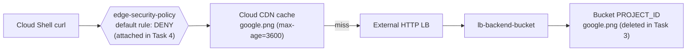

# GCP47 — Lab: Cloud Armor Edge Security Policies for Cloud CDN (GSP878)

> 🎛️ **Interactive visualization:** [Edge Cache and Armor](../visualizations/gcp/GCP45-48%20-%20Edge%20Cache%20and%20Armor.html), "Lab replay" tab: populate the cache, delete the origin, attach the deny-all edge policy, then remove it. Opens in your browser.

## Lab Goal
The hands-on lab for [[GCP46 - Google Cloud Armor with Cloud CDN]]. **Edge security policies** are enforced at the outermost perimeter of Google's network, **upstream of the Cloud CDN cache**. Use cases: keep users in restricted geographies away from bucket objects, or enforce media **licensing territories**.

Pre-provisioned by Terraform:
- a Cloud Storage bucket (named after the project ID) holding `google.png`
- an external HTTP LB with backend bucket **`lb-backend-bucket`** and **Cloud CDN enabled**

> Qwiklabs credentials aren't stored.

## Topology


## Tasks, with the why
| Task | Action | What you see | Why it matters |
|------|--------|-------------|----------------|
| Setup | `export PROJECT_ID=$(gcloud config get-value project)` | — | — |
| 1 | Verify the bucket + `google.png` | Object present | Origin content |
| 2 | Verify `lb-backend-bucket` has CDN on; note `LOAD_BALANCER_IP`; `curl -svo /dev/null http://LB_IP/google.png`, then a 50-request loop | `200 OK`, `Cache-Control: public, max-age=3600`; Cloud CDN page shows **~100% hit ratio** | `public, max-age=3600` makes it cacheable for 1 h; the loop fills the cache |
| 3 | **Delete `google.png` from the bucket** | — | Proves later 200s come from the **cache**, not the origin |
| 4 | Create **`edge-security-policy`**: type **Edge security policy**, default rule **Deny**, target **Backend bucket → lb-backend-bucket** | `curl` returns **403 Forbidden** (repeat: it stays 403) | The edge policy runs **before** the cache, so even cached objects are blocked |
| 4b | Logs Explorer: `resource.type:(http_load_balancer) AND jsonPayload.@type="type.googleapis.com/google.cloud.loadbalancing.type.LoadBalancerLogEntry" AND severity>=WARNING` | 403 entries with `enforcedEdgeSecurityPolicy` | Audit trail of edge denials |
| 5 | **Remove the target** from the policy, wait, `curl` again | **`200 OK` with `Age: 1621`** | Origin object is gone, yet the request succeeds: **served from edge cache**. `Age` = seconds in cache |

## gcloud equivalent
```bash
gcloud compute security-policies create edge-security-policy --type=CLOUD_ARMOR_EDGE
gcloud compute security-policies rules update 2147483647 --security-policy=edge-security-policy --action=deny-403
gcloud compute backend-buckets update lb-backend-bucket --edge-security-policy=edge-security-policy
gcloud compute backend-buckets update lb-backend-bucket --no-edge-security-policy     # remove target (Task 5)
curl -svo /dev/null http://LOAD_BALANCER_IP/google.png 2>&1 | grep -E '^< (HTTP|Age|Cache-Control)'
```

## Lab-text notes
| Lab says | Meaning |
|----------|---------|
| "Try it a couple of times and see if you get a 200 OK" (after creating the deny policy) | Repeat to confirm the 403 is **consistent**, not cache noise. You shouldn't get 200 |
| "reinfore" | *reinforce* |
| The 403 sample shows `X-GUploader-UploadID` and `Server: UploadServer` headers | Illustrative output copied from a storage response. An edge denial is generated by Google's front end |
| Cloud Armor "policies are substantiated outside of the HTTP Load Balancer" | *instantiated*: policies are separate resources attached to targets |

## Concepts Demonstrated
- Edge policy ordering: **policy → cache → origin**
- Cache survives origin deletion until TTL or invalidation
- Default-deny edge policy as a kill switch for a bucket
- `Age` header as proof of a cache hit

## Real-World Connections
- **Incident response for leaked or illegal content:** attach a deny edge policy instantly, then `invalidate-cdn-cache` and delete the object. Deleting the origin alone **doesn't** remove cached copies.
- Contrast with [[GCP28 - Lab - Configuring Traffic Blocklisting with Google Cloud Armor]], a **backend** policy on a backend service.

## Quiz
1. Why delete the object before testing the policy?
   - A) To save storage  B) To reset the TTL  C) To prove that responses come from the edge cache, so the policy is applied at the edge, not the backend  D) Required by Cloud Armor
2. After removing the policy target, the deleted object returns 200 with `Age: 1621` because:
   - A) It's still in the Cloud CDN cache (max-age 3600)  B) The bucket restored it  C) Cloud Armor cached it  D) Versioning
3. Which target type did the lab attach the policy to?
   - A) URL map  B) Backend service  C) Backend bucket  D) Forwarding rule

**Answers:** 1-C, 2-A, 3-C

## Weak Areas to Revisit
*(none flagged yet)*

## Linked Pages
- [[GCP46 - Google Cloud Armor with Cloud CDN]] · [[GCP45 - Cloud CDN]] · [[GCP28 - Lab - Configuring Traffic Blocklisting with Google Cloud Armor]] · [[certs/gcp-networking]]
