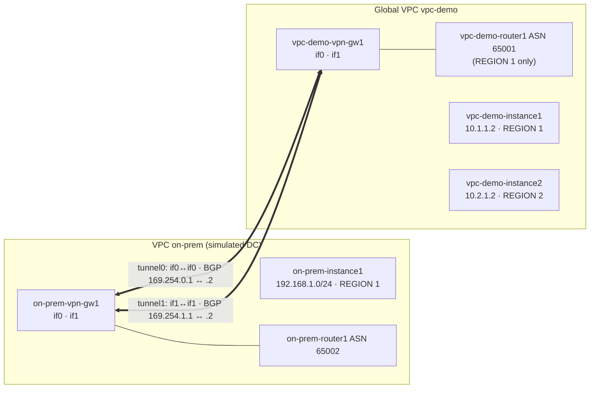

# GCP58 — Lab: Configuring Google Cloud HA VPN

> 🎛️ **Interactive visualization:** [HA VPN and BGP Paths](../visualizations/gcp/GCP55-60%20-%20HA%20VPN%20and%20BGP%20Paths.html), "Lab replay" tab: build the gateways, tunnels and BGP sessions, ping across regions before and after global routing, then delete a tunnel. Opens in your browser.

## Lab Goal
Build **HA VPN between two VPCs**: `vpc-demo` (the "cloud") and `on-prem` (a simulated data center), with **two tunnels and BGP**. Then prove:
1. Private connectivity works.
2. **Global dynamic routing** is needed to reach a second region.
3. Losing a tunnel doesn't break traffic, which is the **99.99% SLA** design.

> Qwiklabs credentials aren't stored. `[SHARED_SECRET]` stays a placeholder: use your own random secret, never a real one in notes.

## Topology (course diagram)

> **Diagram vs output:** the course figure shows us-central1 + us-east1. The lab's sample output shows `vpc-demo-subnet2` in **us-west1**. Your regions vary per lab run.

## Tasks, with the why

### Tasks 1–2: Two VPCs and test VMs
```bash
gcloud compute networks create vpc-demo --subnet-mode custom            # BGP_ROUTING_MODE: REGIONAL (default)
gcloud compute networks subnets create vpc-demo-subnet1 --network vpc-demo --range 10.1.1.0/24 --region REGION1
gcloud compute networks subnets create vpc-demo-subnet2 --network vpc-demo --range 10.2.1.0/24 --region REGION2
gcloud compute firewall-rules create vpc-demo-allow-custom --network vpc-demo \
    --allow tcp:0-65535,udp:0-65535,icmp --source-ranges 10.0.0.0/8
gcloud compute firewall-rules create vpc-demo-allow-ssh-icmp --network vpc-demo --allow tcp:22,icmp   # source 0.0.0.0/0
gcloud compute instances create vpc-demo-instance1 --machine-type=e2-medium --zone ZONE1 --subnet vpc-demo-subnet1
gcloud compute instances create vpc-demo-instance2 --machine-type=e2-medium --zone ZONE2 --subnet vpc-demo-subnet2
gcloud compute networks create on-prem --subnet-mode custom
gcloud compute networks subnets create on-prem-subnet1 --network on-prem --range 192.168.1.0/24 --region REGION1
gcloud compute firewall-rules create on-prem-allow-custom --network on-prem \
    --allow tcp:0-65535,udp:0-65535,icmp --source-ranges 192.168.0.0/16
gcloud compute firewall-rules create on-prem-allow-ssh-icmp --network on-prem --allow tcp:22,icmp
gcloud compute instances create on-prem-instance1 --machine-type=e2-medium --zone OTHER_ZONE_IN_REGION1 --subnet on-prem-subnet1
```
The ranges don't overlap (10.1/10.2 vs 192.168.1). Overlapping ranges can't be routed over VPN.

### Task 3: HA VPN gateways + Cloud Routers
```bash
gcloud compute vpn-gateways create vpc-demo-vpn-gw1 --network vpc-demo --region REGION1   # INTERFACE0 / INTERFACE1 public IPs
gcloud compute vpn-gateways create on-prem-vpn-gw1 --network on-prem --region REGION1
gcloud compute routers create vpc-demo-router1 --region REGION1 --network vpc-demo --asn 65001
gcloud compute routers create on-prem-router1 --region REGION1 --network on-prem --asn 65002
```
Each gateway gets **two public IPs from different pools**. The two sides need **different private ASNs** (65001 / 65002), which makes this eBGP.

### Task 4: Four tunnels (two per side, interface-matched)
```bash
gcloud compute vpn-tunnels create vpc-demo-tunnel0 --peer-gcp-gateway on-prem-vpn-gw1 --region REGION1 \
    --ike-version 2 --shared-secret [SHARED_SECRET] --router vpc-demo-router1 --vpn-gateway vpc-demo-vpn-gw1 --interface 0
#   ...vpc-demo-tunnel1 --interface 1; on-prem-tunnel0 / on-prem-tunnel1 mirrored with --peer-gcp-gateway vpc-demo-vpn-gw1
```
- Between two Google gateways: **if0 ↔ if0 and if1 ↔ if1**.
- With a real on-prem peer: two devices, one device with two interfaces, or one device with one interface (both tunnels to the same IP) ([[GCP57 - HA VPN Topologies]]).

### Task 5: BGP per tunnel
| Router | Interface | Local IP | Peer IP | Peer ASN |
|--------|-----------|----------|---------|---------|
| vpc-demo-router1 | if-tunnel0-to-on-prem | 169.254.0.1/30 | 169.254.0.2 | 65002 |
| vpc-demo-router1 | if-tunnel1-to-on-prem | 169.254.1.1/30 | 169.254.1.2 | 65002 |
| on-prem-router1 | if-tunnel0-to-vpc-demo | 169.254.0.2/30 | 169.254.0.1 | 65001 |
| on-prem-router1 | if-tunnel1-to-vpc-demo | 169.254.1.2/30 | 169.254.1.1 | 65001 |
```bash
gcloud compute routers add-interface vpc-demo-router1 --interface-name if-tunnel0-to-on-prem \
    --ip-address 169.254.0.1 --mask-length 30 --vpn-tunnel vpc-demo-tunnel0 --region REGION1
gcloud compute routers add-bgp-peer vpc-demo-router1 --peer-name bgp-on-prem-tunnel0 \
    --interface if-tunnel0-to-on-prem --peer-ip-address 169.254.0.2 --peer-asn 65002 --region REGION1
```
- **Link-local `169.254.0.0/16` /30s**: each BGP session needs its own point-to-point pair, and one side's local IP is the other's peer IP.
- **HA VPN requires dynamic routing** for the 99.99% SLA.

### Task 6: Verify
```bash
gcloud compute routers describe vpc-demo-router1 --region REGION1      # bgpPeers, interfaces, keepalive 20, BFD defaults
gcloud compute firewall-rules create vpc-demo-allow-subnets-from-on-prem --network vpc-demo \
    --allow tcp,udp,icmp --source-ranges 192.168.1.0/24
gcloud compute firewall-rules create on-prem-allow-subnets-from-vpc-demo --network on-prem \
    --allow tcp,udp,icmp --source-ranges 10.1.1.0/24,10.2.1.0/24
gcloud compute vpn-tunnels list                                          # 4 tunnels
gcloud compute vpn-tunnels describe vpc-demo-tunnel0 --region REGION1    # status ESTABLISHED, "Tunnel is up and running"
gcloud compute ssh on-prem-instance1 --zone ZONE && ping -c 4 10.1.1.2    # works (TTL 62: two router hops)
ping -c 2 10.2.1.2                                                       # fails while vpc-demo is REGIONAL
gcloud compute networks update vpc-demo --bgp-routing-mode GLOBAL
ping -c 2 10.2.1.2                                                       # works (~33 ms: cross-region)
```
**Why the region 2 ping needs GLOBAL:**
- In **regional** mode, `vpc-demo-router1` (REGION 1) **advertises only REGION 1 subnets**, so on-prem never learns `10.2.1.0/24`.
- Routes it **learns** are only programmed for REGION 1, so instance2's replies have no path back.
- **Global** mode advertises all regions' subnets and applies learned routes VPC-wide.

`on-prem` stays regional because it has only one region.

### Task 7: Failover test
```bash
gcloud compute vpn-tunnels delete vpc-demo-tunnel0 --region REGION1
gcloud compute vpn-tunnels describe on-prem-tunnel0 --region REGION1   # FIRST_HANDSHAKE, "Handshake with peer broken"
ping -c 3 10.1.1.2                                                      # still works via tunnel1
```
The BGP session on tunnel0 drops, its routes are withdrawn, and traffic shifts to the tunnel1 routes. That's **automatic failover**.

### Task 8: Clean up, in dependency order
Tunnels → BGP peers → routers → VPN gateways → instances → firewall rules → subnets → VPCs. Each layer blocks deleting the one below it.

## Lab-text notes
| Lab says | Reality |
|----------|---------|
| "allow SSH, **RDP, HTTP**, and ICMP" | The rule allows only `tcp:22,icmp` |
| "two VM instances running in each zone" (Task 1) | One VM per region (two total) |
| "Handshake_with_peer_broken" | The actual `detailedStatus` text is "Handshake with peer broken for unknown reason. Trying again soon." with `status: FIRST_HANDSHAKE` |
| Command placeholders `"REGION"`, `REGION 2`, `zone_name` | Lab placeholders. `--region REGION 2` with a space would break the command |

## Concepts Demonstrated
| Concept | Task |
|---------|------|
| HA VPN gateway = 2 interfaces / 2 IPs | 3 |
| Interface-matched tunnels for HA-to-HA | 4 |
| eBGP over link-local /30 per tunnel | 5 |
| Firewall still applies to VPN traffic | 6 |
| Regional vs **global** dynamic routing | 6 |
| BGP-driven failover (99.99% design) | 7 |

## Troubleshooting
| Symptom | Cause | Fix |
|---------|-------|-----|
| Tunnel `NO_INCOMING_PACKETS` / `AUTHORIZATION_ERROR` | Shared secret or IKE version mismatch | Same secret and IKEv2 on both sides |
| Tunnel ESTABLISHED, no learned routes | BGP peer IP or ASN wrong, or interface not linked to the tunnel | `routers get-status ROUTER --region R` → `bgpPeerStatus` |
| Ping region 1 OK, region 2 fails | Regional dynamic routing | `networks update --bgp-routing-mode GLOBAL` |
| Ping fails both ways, BGP up | Firewall: no rule for the remote ranges | Add the `allow-subnets-from-*` rules |

## Real-World Connections
- **Home k3s over HA VPN:** replace `on-prem` with VyOS/strongSwan + FRR at home, using the same ASNs, link-local /30s and two tunnels, with `TWO_IPS_REDUNDANCY` if you have two WAN IPs.
- **Wireshark:** on the internet path you'd see only ESP (IP protocol 50) and IKE (UDP 500/4500). The inner ICMP is encrypted.

## Quiz
1. Why does on-prem need different ASN than vpc-demo here?
   - A) It doesn't  B) For NAT  C) eBGP between two routers needs distinct ASNs  D) Required for IPsec
2. Ping to 10.2.1.2 (REGION 2) fails until you:
   - A) Add a third tunnel  B) Set vpc-demo to global dynamic routing  C) Add a static route  D) Restart BGP
3. Between two Google HA VPN gateways, interface 0 must connect to:
   - A) The router  B) Either  C) Interface 0 on the peer  D) Interface 1 on the peer
4. After deleting vpc-demo-tunnel0, ping still works because:
   - A) The tunnel auto-recreates  B) Cloud NAT  C) BGP withdraws tunnel0 routes and traffic uses tunnel1  D) Peering takes over
5. BGP session addresses on each tunnel come from:
   - A) 10.0.0.0/8  B) The subnet range  C) Public IPs  D) Link-local 169.254.0.0/16 (/30 per session)

**Answers:** 1-C, 2-B, 3-C, 4-C, 5-D

## Weak Areas to Revisit
*(none flagged yet)*

## Linked Pages
- [[GCP57 - HA VPN Topologies]] · [[GCP56 - Cloud VPN Overview]] · [[GCP59 - Influence Best Path Selection]] · [[GCP41 - Hybrid Load Balancing]] (global routing)
- [[GCP19 - Lab - Implement a Hub-and-Spoke Network Using Network Connectivity Center]] · [[gcp-command-anatomy]] · [[certs/gcp-networking]]
