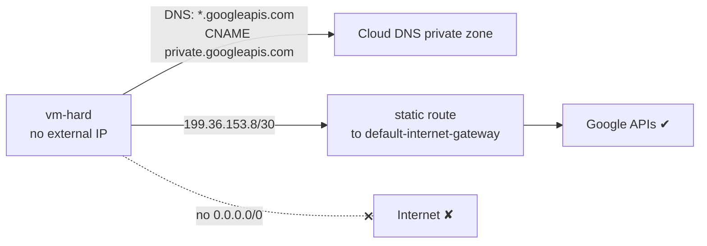
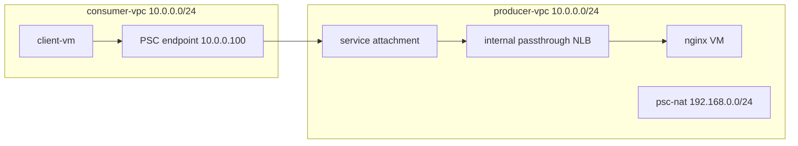
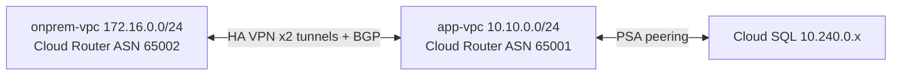
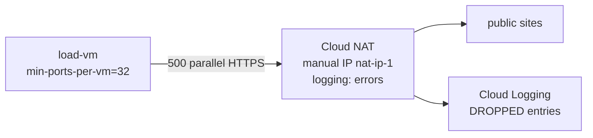
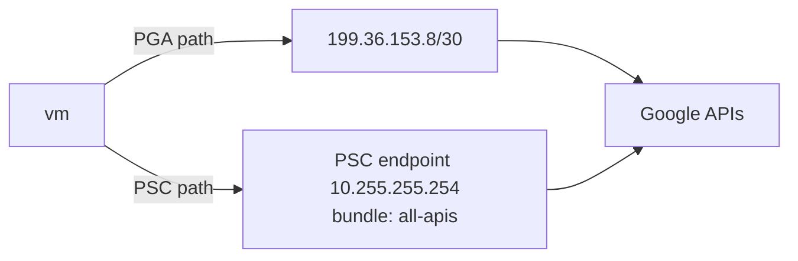

# GPL01 — Private Connectivity Practice Labs

New labs that go **beyond** the course labs. Each has: **Goal → Architecture → Tasks → Hints → Verify → Cleanup → Solution** (hidden; try first). They run in a personal test project; delete everything afterwards (NAT, VPN, LB and Cloud SQL bill hourly).
Walkthrough theory: [[GS01 - Private Connectivity Scenarios]].

```bash
export PROJECT=$(gcloud config get-value project) REGION=us-central1 ZONE=us-central1-a
```

---

## Lab P1 — Hardened VPC: no default route, Google APIs still work
**Goal:** remove the internet default route entirely, then restore **only** Google API access via `private.googleapis.com`.


**Tasks**
1. Create VPC `hard-vpc` + subnet (PGA on) + VM with `--no-address` + IAP SSH firewall.
2. **Delete** the `0.0.0.0/0` default route. Confirm `gcloud storage ls` now fails.
3. Add a route for `199.36.153.8/30` → `default-internet-gateway`.
4. Create a Cloud DNS private zone `googleapis.com.`: `*.googleapis.com` CNAME `private.googleapis.com.` and A records `199.36.153.8–11`.
5. Confirm storage works and `curl example.com` fails.

**Hints:** `gcloud compute routes list --filter="network:hard-vpc"` shows the default route's name. Without step 4, DNS still returns public Google IPs, which have no route.

**Verify:** `dig +short storage.googleapis.com` → `199.36.153.x`; `gcloud storage ls` ✔; `curl -m5 example.com` ✘.

<details><summary>Solution</summary>

```bash
gcloud compute networks create hard-vpc --subnet-mode=custom
gcloud compute networks subnets create hard-sn --network=hard-vpc --region=$REGION \
  --range=10.50.0.0/24 --enable-private-ip-google-access
gcloud compute firewall-rules create hard-iap --network=hard-vpc --allow=tcp:22 --source-ranges=35.235.240.0/20
gcloud compute instances create vm-hard --zone=$ZONE --subnet=hard-sn --no-address
DEF=$(gcloud compute routes list --filter="network:hard-vpc AND destRange=0.0.0.0/0" --format="value(name)")
gcloud compute routes delete $DEF --quiet
gcloud compute routes create google-private --network=hard-vpc \
  --destination-range=199.36.153.8/30 --next-hop-gateway=default-internet-gateway
gcloud dns managed-zones create googleapis --dns-name=googleapis.com. \
  --visibility=private --networks=hard-vpc --description="PGA private VIP"
gcloud dns record-sets create private.googleapis.com. --zone=googleapis --type=A --ttl=300 \
  --rrdatas=199.36.153.8,199.36.153.9,199.36.153.10,199.36.153.11
gcloud dns record-sets create "*.googleapis.com." --zone=googleapis --type=CNAME --ttl=300 \
  --rrdatas=private.googleapis.com.
```
**Why:** PGA needs *a* route to the API IPs. Without the default route, give it a specific route plus DNS that points at those IPs.
</details>

**Cleanup:** delete VM, zone records + zone, routes, firewall, subnet, VPC.

---

## Lab P2 — Publish a service with PSC to an overlapping consumer
**Goal:** a producer VPC and a consumer VPC **both use `10.0.0.0/24`**. Expose an nginx service through PSC anyway.


**Tasks**
1. Producer: VPC, subnet `10.0.0.0/24`, nginx VM, unmanaged instance group, internal passthrough NLB (`nginx-fr`), PSC NAT subnet, service attachment (`ACCEPT_AUTOMATIC`), firewall allowing tcp:80 from the NAT range **and** health-check ranges.
2. Consumer: VPC with the **same** `10.0.0.0/24`, client VM, reserved internal IP, forwarding rule targeting the attachment.
3. `curl http://10.0.0.100` from the client.

**Hints:** the NAT subnet needs `--purpose=PRIVATE_SERVICE_CONNECT`. Health-check ranges are `35.191.0.0/16`, `130.211.0.0/22`.

**Verify:** `curl` returns the nginx page. `gcloud compute service-attachments describe … --format="value(connectedEndpoints)"` lists the consumer.

<details><summary>Solution (key commands)</summary>

```bash
# producer
gcloud compute networks subnets create psc-nat --network=producer-vpc --region=$REGION \
  --range=192.168.0.0/24 --purpose=PRIVATE_SERVICE_CONNECT
gcloud compute service-attachments create nginx-sa --region=$REGION \
  --producer-forwarding-rule=nginx-fr --connection-preference=ACCEPT_AUTOMATIC --nat-subnets=psc-nat
gcloud compute firewall-rules create p-allow --network=producer-vpc --allow=tcp:80 \
  --source-ranges=192.168.0.0/24,35.191.0.0/16,130.211.0.0/22
# consumer
gcloud compute addresses create ep-ip --region=$REGION --subnet=consumer-sn --addresses=10.0.0.100
gcloud compute forwarding-rules create nginx-ep --region=$REGION --network=consumer-vpc \
  --address=ep-ip --target-service-attachment=projects/$PROJECT/regions/$REGION/serviceAttachments/nginx-sa
```
**Why:** no routes are exchanged, so overlap doesn't matter. The producer sees the traffic coming from `192.168.0.x` (the NAT subnet).
</details>

---

## Lab P3 — Cloud SQL private IP from a "simulated on-prem" VPC
**Goal:** simulate on-prem with a second VPC connected by **HA VPN**, then reach a **PSA** Cloud SQL instance from it.


**Tasks**
1. Two VPCs, an HA VPN gateway + Cloud Router in each, 2 tunnels, BGP sessions.
2. PSA on `app-vpc` (allocated `10.240.0.0/16`), Cloud SQL Postgres with **private IP only**.
3. Try `psql` from the onprem VM (fails).
4. Fix the **forward** path (custom advertisement) and the **return** path (export custom routes).

**Hints:** this is Scenario 6 in [[GS01 - Private Connectivity Scenarios]]. Use `gcloud compute routers get-status` to see learned routes.

<details><summary>Solution (fix commands)</summary>

```bash
gcloud compute routers update app-router --region=$REGION --advertisement-mode=CUSTOM \
  --set-advertisement-groups=ALL_SUBNETS --set-advertisement-ranges=10.240.0.0/16
gcloud compute networks peerings update servicenetworking-googleapis-com \
  --network=app-vpc --export-custom-routes
gcloud compute routers get-status onprem-router --region=$REGION \
  --format="table(result.bestRoutes[].destRange)"   # should include 10.240.0.0/16
```
</details>

**Cleanup:** Cloud SQL first (billing), then VPN tunnels/gateways/routers, PSA connection, VPCs.

---

## Lab P4 — Cloud NAT under load: ports, manual IPs, logging
**Goal:** reproduce NAT **port exhaustion**, then fix it.


**Tasks**
1. Reserve a static IP; create NAT with **manual** IP, `--min-ports-per-vm=32`, `--enable-logging --log-filter=ERRORS_ONLY`.
2. From the VM: `seq 500 | xargs -P 500 -I{} curl -s -o /dev/null -m 10 https://www.google.com`.
3. Find DROPPED logs. Enable dynamic port allocation and repeat the test.
4. `curl ifconfig.me` should show your **manual NAT IP**.

<details><summary>Solution (key commands)</summary>

```bash
gcloud compute addresses create nat-ip-1 --region=$REGION
gcloud compute routers nats create load-nat --router=nat-router --region=$REGION \
  --nat-external-ip-pool=nat-ip-1 --nat-all-subnet-ip-ranges \
  --min-ports-per-vm=32 --enable-logging --log-filter=ERRORS_ONLY
gcloud logging read 'resource.type="nat_gateway" AND jsonPayload.allocation_status="DROPPED"' --limit=5
gcloud compute routers nats update load-nat --router=nat-router --region=$REGION \
  --enable-dynamic-port-allocation --min-ports-per-vm=32 --max-ports-per-vm=4096
```
</details>

---

## Lab P5 — PGA vs PSC endpoint for Google APIs
**Goal:** compare reaching Cloud Storage via **PGA** (shared VIPs) with a **PSC endpoint for Google APIs** (your own internal IP).


**Tasks**
1. Reserve a **global** internal address with `--purpose=PRIVATE_SERVICE_CONNECT`.
2. Create a global forwarding rule `--target-google-apis-bundle=all-apis`.
3. Make Cloud DNS resolve `storage.googleapis.com` to the endpoint (Service Directory DNS integration, or a manual private zone).
4. Compare the paths with `dig` and `curl -v`. Explain when you'd prefer PSC (custom IP, on-prem reachability through your routing, per-VPC control).

<details><summary>Solution (key commands)</summary>

```bash
gcloud compute addresses create psc-apis-ip --global --purpose=PRIVATE_SERVICE_CONNECT \
  --addresses=10.255.255.254 --network=lab-vpc
gcloud compute forwarding-rules create pscapis --global --network=lab-vpc \
  --address=psc-apis-ip --target-google-apis-bundle=all-apis
```
</details>

---

## Self-Check Questions
1. In P1, why does PGA fail after deleting the default route even though PGA is still "on"?
2. In P2, which IP does the producer's nginx log as the client, and why?
3. In P3, which fix repairs the forward path and which repairs the return path?
4. In P4, what's the trade-off of very high `max-ports-per-vm`?
5. In P5, name two reasons to choose a PSC endpoint over PGA.

<details><summary>Answers</summary>

1. PGA still needs a route to the Google API IPs. The default route provided it; now nothing does.
2. An address from the PSC NAT subnet (`192.168.0.x`), because PSC SNATs consumer traffic.
3. Forward: Cloud Router custom advertisement of `10.240.0.0/16`. Return: export custom routes on the PSA peering.
4. Fewer VMs fit per NAT IP (ports are finite: ~64k per IP), so you may need more IPs.
5. Your own internal IP (no special VIP ranges), on-prem reachability through your routing, and per-endpoint control and logging.
</details>

## Linked Pages
[[GS01 - Private Connectivity Scenarios]] · [[GCP12 - Lab - Implement Private Google Access and Cloud NAT]] · [[gcp-private-access]]
