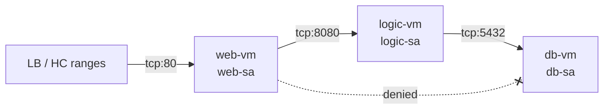
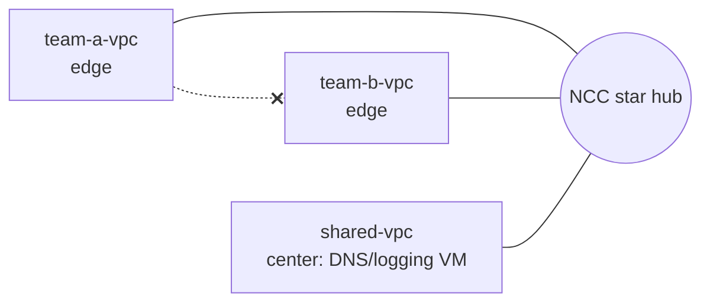
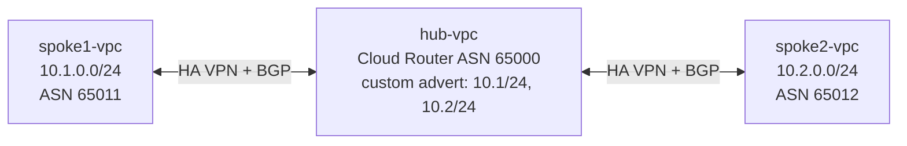
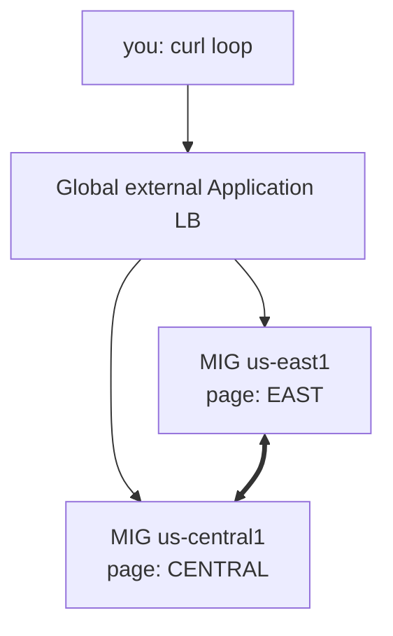
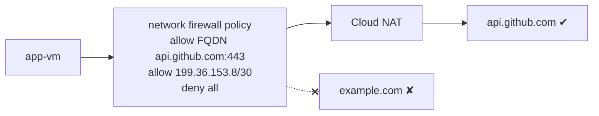
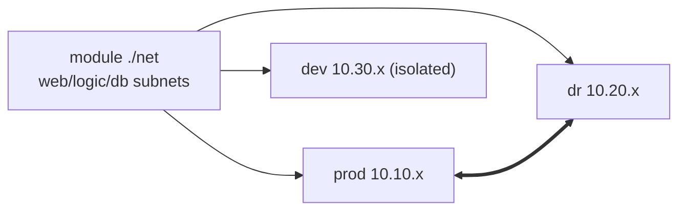

# GPL02 — Architecture & Topology Practice Labs

Theory: [[GS02 - Network Topologies Explained]] · Scenarios: [[GS03 - Architecture and Topology Scenarios]]. Run them in a personal test project and **clean up** after each lab.

```bash
export PROJECT=$(gcloud config get-value project) REGION=us-central1 ZONE=us-central1-a
```

---

## Lab T1 — Three-tier with identity-based firewall + Connectivity Tests
**Goal:** build web → logic → db in one region with a **service-account** firewall matrix, then *prove* the policy.


**Tasks:** 3 subnets, 3 SAs, 3 VMs (each with its SA), 3 allow rules (as in GS03 Scenario 1), IAP SSH rule. Then run **4 Connectivity Tests**: web→logic:8080 ✔, logic→db:5432 ✔, web→db:5432 ✘, internet→db ✘.

<details><summary>Solution hints</summary>

```bash
gcloud compute instances create db-vm --zone=$ZONE --subnet=db-sn --no-address \
  --service-account=db-sa@$PROJECT.iam.gserviceaccount.com --scopes=cloud-platform
gcloud network-management connectivity-tests create web-db --source-instance=projects/$PROJECT/zones/$ZONE/instances/web-vm \
  --destination-instance=projects/$PROJECT/zones/$ZONE/instances/db-vm --protocol=TCP --destination-port=5432
gcloud network-management connectivity-tests describe web-db --format="value(reachabilityDetails.result)"
```
Expected result for web-db: `UNREACHABLE`, with the trace pointing to the implied deny ingress rule.
</details>

---

## Lab T2 — NCC Star: shared services reachable, teams isolated
**Goal:** `shared-vpc` (center) reachable by `team-a-vpc` and `team-b-vpc` (edges), but **team-a ↛ team-b**.


**Tasks:** hub with `--preset-topology=star`; add the shared VPC to group `center`, the team VPCs to group `edge`; VMs in each; ping tests.

<details><summary>Solution hints</summary>

```bash
gcloud network-connectivity hubs create star-hub --preset-topology=star
gcloud network-connectivity spokes linked-vpc-network create shared-spoke --hub=star-hub \
  --vpc-network=projects/$PROJECT/global/networks/shared-vpc --global --group=center
gcloud network-connectivity spokes linked-vpc-network create team-a-spoke --hub=star-hub \
  --vpc-network=projects/$PROJECT/global/networks/team-a-vpc --global --group=edge
```
Expected: edge ↔ center ✔, edge ↔ edge ✘. Check `gcloud compute routes list` per VPC: team-a has a route to shared-vpc only.
</details>

---

## Lab T3 — Transitive hub with HA VPN + BGP (no NCC)
**Goal:** see **why** VPN hubs are transitive and peering hubs aren't.


**Tasks**
1. Peer spoke1 and spoke2 to hub with **VPC peering** first. Ping spoke1 → spoke2 ✘.
2. Replace with HA VPN (two gateways per link, BGP). With the default advertisement, ping ✘.
3. Set the hub router to **custom advertisement**: ALL_SUBNETS + `10.1.0.0/24`, `10.2.0.0/24`. Ping ✔.

<details><summary>Why it works</summary>

The hub Cloud Router learns each spoke's range over BGP, and with custom advertisement **re-advertises** them to the other spoke. BGP routing is transitive. Peering never re-exports peer-learned subnet routes.
</details>

---

## Lab T4 — Partial mesh failover across regions
**Goal:** two regions behind one **global external Application LB**. Kill one region and watch traffic fail over.


**Tasks**
1. Instance template with a startup script printing its region; one MIG per region.
2. Health check, global backend service with both MIGs, URL map, HTTP proxy, global forwarding rule.
3. `while true; do curl -s http://LB_IP; sleep 1; done`, then `gcloud compute instance-groups managed resize mig-east --size=0 --region=us-east1` and watch only CENTRAL answer.

<details><summary>Solution hints</summary>

```bash
gcloud compute url-maps create web-map --default-service=app-bes
gcloud compute target-http-proxies create web-proxy --url-map=web-map
gcloud compute forwarding-rules create web-fr --global --target-http-proxy=web-proxy --ports=80
```
Failover happens because health checks mark the empty region unhealthy and the LB sends all traffic to the healthy backend.
</details>

---

## Lab T5 — Gated egress: workloads may reach only one external API
**Goal:** VMs reach **only** `api.github.com` (and Google APIs). Everything else is denied.


**Tasks:** Cloud NAT; network firewall policy with an **FQDN** allow rule, a Google API VIP allow rule, and deny-all egress; associate it with the VPC; test with `curl`.

<details><summary>Solution hints</summary>

```bash
gcloud compute network-firewall-policies create gate --global
gcloud compute network-firewall-policies rules create 100 --firewall-policy=gate --global-firewall-policy \
  --direction=EGRESS --action=allow --dest-fqdns=api.github.com --layer4-configs=tcp:443
gcloud compute network-firewall-policies rules create 200 --firewall-policy=gate --global-firewall-policy \
  --direction=EGRESS --action=allow --dest-ip-ranges=199.36.153.8/30 --layer4-configs=tcp:443
gcloud compute network-firewall-policies rules create 65000 --firewall-policy=gate --global-firewall-policy \
  --direction=EGRESS --action=deny --dest-ip-ranges=0.0.0.0/0 --layer4-configs=all
gcloud compute network-firewall-policies associations create --firewall-policy=gate \
  --network=app-vpc --global-firewall-policy
```
Note: FQDN rules resolve via Cloud DNS. Also allow DNS to the metadata server if your policy blocks it.
</details>

---

## Lab T6 — Mirrored environments with Terraform (layout, not addresses)
**Goal:** one Terraform module, three environments (prod, DR, dev) with **identical layout** and **different CIDR bases**. Connect only prod ↔ DR.


**Tasks:** write `modules/net` (VPC + 3 subnets from `var.cidr_base`), instantiate it 3×, add an NCC hub with prod + DR spokes only, `terraform apply`, verify, `terraform destroy`.

<details><summary>Module skeleton</summary>

```hcl
variable "name"      {}
variable "region"    {}
variable "cidr_base" {}   # e.g. "10.10"
resource "google_compute_network" "vpc" { name = var.name  auto_create_subnetworks = false }
resource "google_compute_subnetwork" "tier" {
  for_each      = { web = 1, logic = 2, db = 3 }
  name          = "${var.name}-${each.key}"
  region        = var.region
  network       = google_compute_network.vpc.id
  ip_cidr_range = "${var.cidr_base}.${each.value}.0/24"
}
```
</details>

---

## Design Challenge (no commands): Cymbal Retail
> 18 VPCs across 6 teams, one on-prem DC (Interconnect), 4 branches (SD-WAN), a PCI-scoped payments VPC, and DR in a second region.

Produce: **HLD diagram**, topology choice per area, IP plan, firewall/egress strategy, BoM outline.

<details><summary>Reference answer</summary>

- **NCC hub** (Star): center = shared-services + security; edges = team VPCs. Payments VPC as its own edge with **gated ingress** (PSC/ILB) only.
- **Hybrid spokes:** Interconnect VLAN attachments (DC) and router appliances (SD-WAN branches).
- **Mirrored DR** per critical workload, unique CIDR base, connected as spokes. Failover via global LB / DNS.
- **Gated egress:** central Cloud NAT + firewall policy FQDN allow-lists; PGA via `private.googleapis.com`; PCI VPC with no internet egress.
- **IPAM:** /16 per environment per region from one RFC 1918 plan; nothing overlapping on-prem.
</details>

## Linked Pages
[[GS02 - Network Topologies Explained]] · [[GS03 - Architecture and Topology Scenarios]] · [[GCP19 - Lab - Implement a Hub-and-Spoke Network Using Network Connectivity Center]] · [[gcp-network-architecture]]
