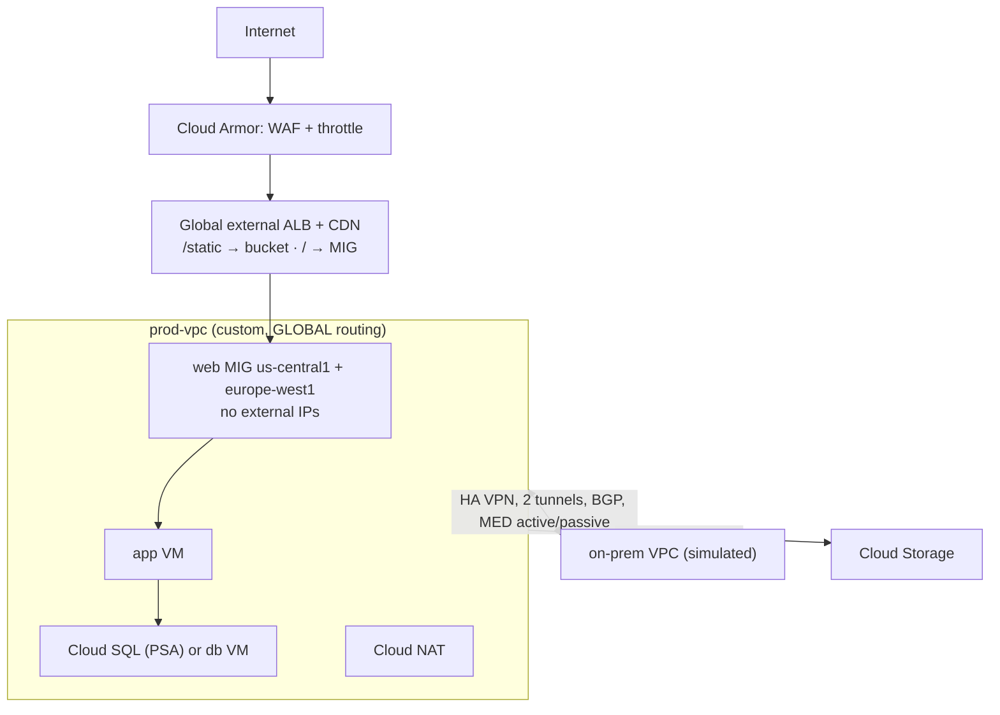

# GPL06 — Capstone Practice Lab: Mini Landing Zone

The buildable version of [[GS07 - Capstone - Cymbal Global Landing Zone]], cut down to what fits in a personal project and a weekend. **Build it in Terraform**, so you can destroy and rebuild it, and so the design review happens in code.

## Target


## Milestones (each one verifiable)
| # | Build | Verify with |
|---|-------|-------------|
| 1 | Custom VPC, 4 subnets (web/app × 2 regions) from a written **IP plan**, flow logs on | `subnets list`; no overlap with the on-prem range |
| 2 | Firewall: **network firewall policy** with secure tags (web ← LB + health-check ranges, app ← web, db ← app), IAP SSH only | **Connectivity Tests** for each allowed and denied pair |
| 3 | No external IPs; Cloud NAT; PGA + private zone for `private.googleapis.com` | `curl ifconfig.me` = NAT IP; `gcloud storage ls` works from a private VM |
| 4 | Global external ALB → web MIGs in 2 regions; `/static/*` → backend bucket with CDN | Responses from both regions; `Age` header on static content |
| 5 | Cloud Armor policy: preconfigured SQLi/XSS rules + `/login` throttle (preview, then enforce) | Benign test request with `' OR 1=1` returns 403; the throttle returns 429 |
| 6 | Canary: v2 web backend at 10% via a route rule | 200 requests come out about 180/20 |
| 7 | Simulated on-prem VPC + HA VPN (GCP58 pattern) with MED active/passive | `routers get-status` best routes; tunnel-delete failover |
| 8 | Private services access + Cloud SQL private IP (or skip for cost) | App VM connects on 5432; no public IP on SQL |
| 9 | IAM: network team group = Network Admin, security group = Security Admin; firewall edits denied for everyone else | `troubleshoot-policy iam` results |
| 10 | Teardown and rebuild from `terraform apply` with zero manual console steps | A clean plan on the second apply |

## Terraform starter layout
```
landing-zone/
├── main.tf            # provider, project, APIs
├── network.tf         # VPC, subnets, routing mode, NAT, PGA DNS
├── firewall.tf        # network firewall policy + secure tags
├── lb.tf              # MIGs, health checks, backend services/bucket, URL map, ALB
├── armor.tf           # security policy + rules
├── vpn.tf             # on-prem VPC, HA VPN gateways, tunnels, routers, BGP peers
├── iam.tf             # group bindings, deny policy (if org available)
└── tests/             # gcloud network-management connectivity-tests as a CI step
```
Useful resources: `google_compute_network`, `google_compute_subnetwork`, `google_compute_router_nat`, `google_compute_network_firewall_policy` (+ `_rule`, `_association`), `google_tags_tag_key`/`_value`/`_binding`, `google_compute_url_map`, `google_compute_security_policy`, `google_compute_ha_vpn_gateway`, `google_compute_vpn_tunnel`, `google_compute_router_peer`.

## Cost and safety notes
- The expensive parts are Cloud SQL, VPN tunnels (hourly) and LB forwarding rules. Destroy after each session.
- Store the VPN pre-shared key in Secret Manager or a TF variable, **never** in git.
- Only load-test or attack-test **your own** endpoints, with low volumes.

## Linked Pages
- [[GS07 - Capstone - Cymbal Global Landing Zone]] · [[GPL01 - Private Connectivity Practice Labs]] · [[GPL02 - Architecture and Topology Practice Labs]] · [[GPL03 - Network Security Practice Labs]] · [[GPL04 - Load Balancing Practice Labs]] · [[GPL05 - Hybrid and Multicloud Practice Labs]] · [[certs/gcp-networking]]
