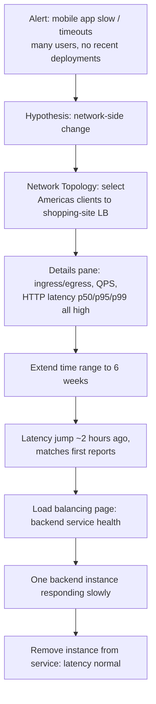

# GCP21 — Getting Topology Data (Network Topology)

## Summary
**Network Topology** (part of **Network Intelligence Center**) **visualizes** your network as a **graph**: **nodes = entities** (VMs, instance groups, load balancers, GKE workloads, NAT gateways, VPN/Interconnect) and **lines = traffic between them**. It combines **configuration data** with **real-time telemetry** (throughput, packet loss, latency), keeps **six weeks of history** in **hourly snapshots**, and **aggregates** resources into expandable hierarchies so large networks stay readable. In the case study, Charlie uses it to trace a mobile-app latency spike to **one slow backend instance behind a load balancer**.

---

## Core Concepts

### What it shows
| View | Shows |
|------|-------|
| **Infrastructure view** | VPC networks, hybrid connectivity (VPN, Interconnect, router appliances), connections to Google-managed services, internet traffic, plus metrics |
| **GKE Enterprise view** (GKE Enterprise projects only) | Clusters, namespaces, workloads, pods, and their metrics |

**Data sources:** configuration details + **metrics** + **logs** from Google's infrastructure, used to **infer relationships** within one project or **across projects** (via a Cloud Monitoring **metrics scope**).

### History: six weeks, hourly snapshots
- **6 weeks** of history.
- **Hourly snapshots** starting at the top of each hour. Each captures the entities and their communication in that hour.
- Resources **created and deleted within the hour** still appear in that hour's snapshot.
- Use the **timeline slider** to move between hours (the GCP19 lab step "slide the timeline to the current time").

### Entities and hierarchies
- **Base entity**: the lowest level, a resource that communicates directly (VM instance, GKE pod).
- **Hierarchical entity**: aggregates base entities. Expand or collapse it. The initial graph shows everything at the **top** level.
- **Each resource type has its own hierarchy** (load balancers ≠ VMs). All are drawn as **circular nodes**.

**Hierarchies (verified against the docs):**
| Base entity | Aggregation hierarchy (top → bottom) |
|-------------|--------------------------------------|
| VM instance | region > network > subnet > zone > instance group > instance |
| External load balancer (Classic ALB, external passthrough/proxy NLB) | external load balancing > load balancer |
| Internal load balancer | internal load balancing > load balancer |
| Cloud NAT gateway | region > network > NATs > NAT gateway |
| VPC Network Peering endpoint | shown when you **lack permission** to view the peer network |
| GKE pod (GKE Enterprise view) | cluster > namespace > workload > pod |

> **Lecture vs docs:** the lecture says VMs aggregate "into instance groups, then into zones". The docs' full chain is **region > network > subnet > zone > instance group > instance**. A level may be **skipped** in the UI if it contains only one entity.

### Connections (lines)
- Drawn between entities **if at least one side is sending traffic**, at any hierarchy level where the underlying base entities communicate. Example: two regions are connected if at least one VM in each region talks to the other.
- **Protocols:** TCP, UDP, ICMP, ICMPv6, ESP, GRE (for certain paths).
- **Paths visualized:**
  - within a VPC (VM ↔ VM, VM ↔ internal LB)
  - across **peered** VPCs
  - Google Cloud ↔ **internet** (clients ↔ VMs or external LBs with external IPs)
  - to/from **Cloud VPN gateways, Interconnect connections, router appliances**
  - GKE view: pod ↔ pod on different nodes; **same-node pods only if intranode visibility is enabled**; cluster ↔ external IPs

### Metrics (per selected hour)
| Metric | Availability |
|--------|-------------|
| **Average hourly throughput** | Most entities |
| **Average hourly packet loss** | Traffic within Google Cloud (and some other paths) |
| **Hourly median latency (RTT)** | Many entity types |
| **QPS, HTTP request latency (p50/p95/p99)** | Load balancer connections (from the Charlie case) |
| **Insights** | High-egress instances / instance groups / GKE workloads |

### Limitations (from the docs, beyond the lecture)
- **Only `nic0`** of a VM is visualized ([[GCP01 - Routes and Route Preferences]]: multi-NIC VMs).
- VMs talking over **external IPs** appear as two connections to **countries**, not a direct VM↔VM line.
- Google-managed services: supported via a **default route to `default-internet-gateway` or Private Google Access**. **Not** shown: PGA from on-prem hosts, direct internet traffic to managed services, and services such as **Cloud SQL, Memorystore, Filestore**, App Engine Memcache, and marketplace solutions.
- No metrics for traffic **between GKE nodes** within a cluster.

---

## Case Study: Charlie's latency incident (workflow)

| Methodology step ([[L21 - Network Troubleshooting Methodology]]) | Charlie |
|-----------------------------------------|---------|
| Identify the problem | Users + alert; **what changed?** No deployments |
| Establish a theory | Network-side change near the LB |
| Test | Topology metrics (p50/p95/p99 up); history pinpoints the time |
| Plan / implement | Drain/remove the slow backend |
| Verify | Latency back to baseline |
| Preventive *(beyond the lecture)* | Health check tuned to fail slow instances (or outlier detection on Envoy-based LBs); latency alerting in Cloud Monitoring |

**Why it worked:** all percentiles rising together pointed to **every request being affected**, i.e. something in the shared path (the LB backend pool). The 6-week view separated a **sudden step change** (an incident) from a gradual trend (capacity).

---

## Key Terms
| Term | Definition |
|------|-----------|
| Network Intelligence Center | GCP's network observability suite (Network Topology, Connectivity Tests, Performance Dashboard, Firewall Insights, Network Analyzer, Flow Analyzer) |
| Network Topology | Graph visualization of entities, connections, and metrics |
| Base entity | Lowest-level communicating resource (VM, pod) |
| Hierarchical entity | Aggregation of base entities (zone, region, cluster…) |
| Snapshot | Hourly record of entities and communication |
| Metrics scope | Cloud Monitoring setting that lets Network Topology show multiple projects |
| Intranode visibility | GKE setting exposing same-node pod-to-pod traffic |
| p50 / p95 / p99 | Median / 95th / 99th percentile latency |

---

## Real-World Connections
- **Network+:** a live **network diagram + baseline** ([[L13 - Organizational Processes and Procedures]], [[L14 - Network Monitoring]]): throughput, loss and latency are the metrics from [[L24 - Troubleshooting Network Performance Issues]].
- **Wireshark course:** Topology = Statistics → **Conversations/Endpoints** at cloud scale ([[WS10 - The Statistics View]]). Hourly aggregates show *where*; a packet capture ([[WS03 - Where to Capture on the Network]]) shows *why*.
- **k3s:** **Kubeshark**'s service map is the cluster equivalent (pods as nodes, request latency per edge). Hubble (Cilium) is another option.
- **AWS:** VPC Reachability Analyzer + Network Manager topology + CloudWatch/ALB metrics, split across tools; Network Topology combines them.

---

## Troubleshooting Scenario
**Scenario:** After adding a second NIC to NVA VMs for an inspection hub, Network Topology shows **no traffic** through the inspection path, yet the firewall logs show packets flowing.
**Analysis:** Network Topology **only visualizes `nic0`**. The inspection traffic uses `nic1`, so the graph isn't wrong about connectivity; it just can't see that interface.
**Fix:** verify that path with **Connectivity Tests** and **VPC Flow Logs** on the nic1 subnet, or design so that the monitored path is on nic0.

---

## Hands-On Ideas
1. In any project with traffic: **Network Intelligence → Network Topology**, move the timeline, expand region → network → subnet → zone, and click a connection to read throughput and RTT.
2. Generate traffic between the GCP19 lab spokes (`ping -i 0.2` for 10 min). In the next hourly snapshot, find the spoke1 ↔ spoke2 connection.
3. Set up a **metrics scope** across two projects and confirm cross-project connections appear.
4. Compare with Kubeshark in your k3s cluster: same idea (entities + edges + latency) at pod level.

---

## Quiz
1. What is Network Topology?
   - A) A DNS service  B) A firewall  C) A visualization of network entities, connections and metrics  D) A routing protocol
2. How much history does Network Topology keep?
   - A) 24 hours  B) 7 days  C) Six weeks  D) One year
3. How is history organized?
   - A) Per minute  B) Hourly snapshots  C) Daily reports  D) Per deployment
4. A VM created and deleted within the same hour. Does it appear?
   - A) No  B) Yes, in that hour's snapshot  C) Only if it had an external IP  D) Only in GKE view
5. What is a base entity?
   - A) The lowest-level resource that communicates directly, e.g. a VM or pod  B) A region  C) A project  D) A firewall rule
6. GKE pods aggregate into what?
   - A) Zones then regions  B) Workloads, then namespaces, then clusters  C) Instance groups  D) Subnets
7. When is a line drawn between two regions?
   - A) Always  B) If at least one VM in each region communicates  C) Only with VPN  D) Only with peering
8. Which interface does Network Topology visualize for VMs?
   - A) All NICs  B) Only the last NIC  C) None  D) Only nic0
9. In the Charlie case, what was the root cause?
   - A) DNS  B) One slow backend instance in the load balancer's backend service  C) Cloud NAT exhaustion  D) An app deployment

**Answers:** 1-C, 2-C, 3-B, 4-B, 5-A, 6-B, 7-B, 8-D, 9-B

---

## Weak Areas to Revisit
*(none flagged yet)*

---

## Linked Pages
- [[GCP19 - Lab - Implement a Hub-and-Spoke Network Using Network Connectivity Center]] — Task 6 uses Network Topology
- [[GCP20 - Other Topologies - Mesh, Mirrored, Gated]] · [[GCP18 - Hub-and-Spoke Topology]]
- [[gcp-network-architecture]]
- [[L14 - Network Monitoring]] · [[L21 - Network Troubleshooting Methodology]] · [[WS10 - The Statistics View]]
- [[certs/gcp-networking]]
