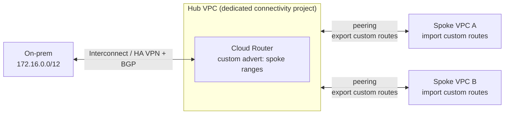
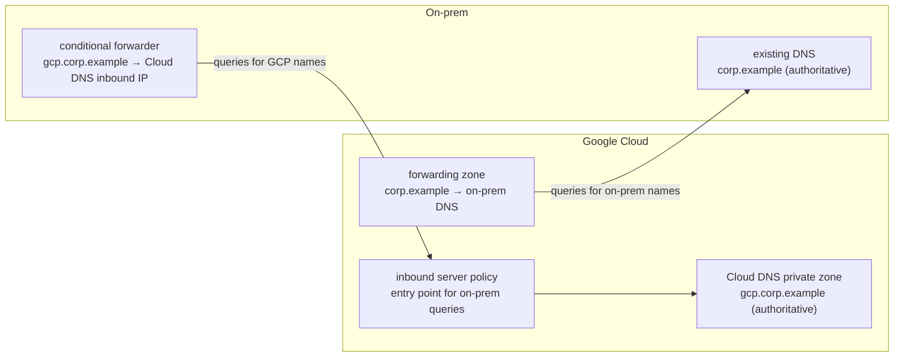

# GCP22 — Best Practices: Choosing Connectivity and Topologies

## Summary
This lesson closes Module 2 with **practical rules** for hybrid and multicloud connectivity:
1. Choose connectivity that meets the **SLAs** for **performance and uptime**.
2. To extend hub-and-spoke across many VPCs, **centralize hybrid connectivity in a dedicated VPC** and **peer** the other projects with **custom route import/export + custom advertisement**, so static and dynamic routes are shared.
3. **Expose applications through APIs** via an **API gateway or load balancer**. **Apigee** adds security, rate limiting, quotas and analytics.
4. Use Cloud Load Balancing's **application capacity optimization** features for global apps.
5. In hybrid DNS, run **two authoritative DNS systems**: **Cloud DNS** for the private GCP environment, **existing on-prem DNS** for on-prem resources.

Google's Architecture Center lists more best practices in the same guide, added below *(verified against docs.cloud.google.com, 2026-10-15)*.

---

## Core Concepts

### 1. Meet SLAs (performance and uptime)
The connectivity choice must match the requirements: **SLA, performance, security, cost, reliability, bandwidth** (the doc's full list).
| Need | Option | SLA notes |
|------|--------|----------|
| Quick, encrypted, moderate bandwidth | **HA VPN** | **99.99%** with two tunnels from an HA VPN gateway to two peer interfaces and correct BGP; each tunnel is limited (~250,000 packets/s, roughly 1–3 Gbps depending on packet size); add capacity with **active/active** tunnels |
| High bandwidth, low latency, predictable | **Dedicated / Partner Interconnect** | 99.9% or **99.99%** depending on redundant topology (attachments in 2 metros / edge availability domains) |
| Another cloud | **Cross-Cloud Interconnect** | Dedicated physical links to AWS/Azure/OCI/Alibaba |

### 2. Centralized hybrid connectivity: hub VPC + peering with custom routes

**How it works:**
- On-prem routes are **dynamic** routes in the hub VPC (learned via Cloud Router BGP).
- The hub peering **exports custom routes** (static + dynamic). Each spoke peering **imports custom routes**, so the spokes learn the on-prem prefixes.
- The hub Cloud Router **custom-advertises** the spoke subnet ranges to on-prem, so on-prem can return traffic.

**Result:** **every spoke ↔ on-prem** through **one** set of VPNs/Interconnects: centralized config, fewer circuits, easier scale.

> **Important nuance (beyond the lecture):** this design gives **spoke ↔ on-prem** connectivity, but **spoke ↔ spoke still doesn't work** through the hub, because peering is non-transitive for **subnet** routes ([[GCP18 - Hub-and-Spoke Topology]]). If spokes must talk to each other, add **NCC** (VPC spokes + hybrid spokes give any-to-any), an NVA hub, or direct peerings. **Shared VPC** is often simpler still (next point).

```bash
gcloud compute networks peerings create hub-to-a --network=hub-vpc --peer-network=spoke-a \
  --export-custom-routes
gcloud compute networks peerings create a-to-hub --network=spoke-a --peer-network=hub-vpc \
  --import-custom-routes
gcloud compute routers update hub-router --region=<r> --advertisement-mode=CUSTOM \
  --set-advertisement-groups=ALL_SUBNETS --set-advertisement-ranges=10.20.0.0/16,10.30.0.0/16
```

### 3. Expose applications through APIs
**API gateway or load balancer as the facade**, never raw network reachability. That's the **gated** principle ([[GCP20 - Other Topologies - Mesh, Mirrored, Gated]]).
| Capability | Apigee (API platform) | Cloud Load Balancing |
|-----------|----------------------|---------------------|
| Security (auth, OAuth, API keys) | ✔ | Cloud Armor WAF/DDoS |
| Rate limiting, quotas | ✔ | Basic (Cloud Armor rate-based rules) |
| Analytics / monetization | ✔ | Logs and metrics |
| Global distribution, CDN | via LB + Cloud CDN | ✔ |

**Per the docs, they're not mutually exclusive:** an **Application Load Balancer in front of Apigee** gives global hosting, **Cloud CDN** caching (lower latency, handles peak seasons), **Cloud Armor** protection, and **multi-region failover across gateways** (also with PSC).

### 4. Application capacity optimization (Cloud Load Balancing)
For globally distributed apps, use the LB's capacity features: **balancing modes** (UTILIZATION / RATE / CONNECTION) with **max targets**, **capacity scaler**, autoscaling MIGs, and **traffic spill-over** to the next-closest region when a backend is full. That avoids hot-spotting one region. See also Charlie's slow backend in [[GCP21 - Getting Topology Data]].

### 5. Hybrid DNS: two authoritative systems

- **Cloud DNS is authoritative for GCP names**, and **on-prem DNS stays authoritative for on-prem names**. Each side **forwards** to the other: an outbound **forwarding zone** in GCP, an **inbound server policy** that gives on-prem an entry IP.
- Use separate subdomains (e.g., `gcp.corp.example`) to avoid split-brain zones.
- Server and forwarding policies are covered in [[GCP04 - Cloud DNS]].

### Additional best practices from the docs
| Area | Practice |
|------|----------|
| **VPC design** | Use **Shared VPC** instead of multiple VPCs when it fits your resource hierarchy |
| **Identity** | Establish a **common identity** across environments for secure cross-boundary auth |
| **IPv6** | Consider IPv6 **early**, and check service support |
| **Firewall** | Prefer **service-account** filtering over network tags for strict control; group rules in **firewall policies** (can be hierarchical); **geo-location objects**; **Threat Intelligence** rules |
| **Multilayer security** | **Cloud Armor**, **Cloud IDS**, **Cloud NGFW IPS**, Threat Intelligence |
| **Encryption** | VPN encrypts; **Interconnect doesn't**, so use **MACsec** or **HA VPN over Interconnect** (or TLS at the service layer) |
| **VPN throughput** | Need more than one tunnel's capacity? Use **active/active HA VPN** |
| **High egress volume** | Long-term, high outbound volume: **Cloud Interconnect / Cross-Cloud Interconnect** (better performance, possibly lower egress pricing) |
| **Interconnect vs peering** | Prefer **Cloud Interconnect** over Direct/Carrier Peering unless you need Google Workspace apps |

### Gemini prompt ideas (from the lecture)
- "Describe a scenario where *[topology name]* would be the best choice."
- "What are the advantages and disadvantages of a mesh topology?"

---

## Key Terms
| Term | Definition |
|------|-----------|
| SLA | Service-level agreement for availability/performance |
| Centralized hybrid connectivity | Hybrid links terminate in one dedicated VPC; other VPCs reach on-prem through it |
| Custom route import/export | Peering options that share static and dynamic routes |
| Custom route advertisement | Cloud Router advertising specific ranges (e.g., spoke subnets) to on-prem |
| API gateway / Apigee | Facade for backend APIs: security, rate limiting, quotas, analytics |
| Application capacity optimization | LB features that balance by capacity/utilization and spill over across regions |
| Authoritative DNS | The DNS system that holds the definitive records for a zone |
| Forwarding zone / inbound server policy | Cloud DNS outbound forwarding to on-prem / inbound entry point for on-prem queries |
| MACsec | Layer 2 encryption on Interconnect links |
| Active/active HA VPN | Multiple tunnels carrying traffic simultaneously for more throughput |

---

## Real-World Connections
- **Network+:** SLA/uptime and redundancy ([[L15 - Disaster Recovery]], [[L13 - Organizational Processes and Procedures]]); DNS forwarding and authoritative vs recursive ([[L16 - IP Services]]); VPN and IPsec ([[L17 - Network Access and Management]]); API gateway + WAF as screened-subnet thinking ([[L20 - Network Defense Techniques]]).
- **AWS:** centralized hybrid VPC ≈ a **Transit Gateway** + Direct Connect gateway in a network account; Apigee ≈ **API Gateway**; hybrid DNS ≈ **Route 53 Resolver inbound/outbound endpoints** with forwarding rules.
- **k3s:** your cluster already has "two authoritative DNS systems": **CoreDNS** for `cluster.local`, forwarding everything else to the node's resolver. An **Ingress + API gateway** (e.g., Kong/Envoy Gateway) in front of services is the API-facade practice.

---

## Troubleshooting Scenario
**Scenario:** A company centralizes Interconnect in `hub-vpc` and peers `spoke-a` and `spoke-b` to it with custom route export/import. On-prem ↔ spoke-a works. **Spoke-a ↔ spoke-b doesn't**, and **on-prem → spoke-b fails** while spoke-b → on-prem SYNs are sent.
**Analysis:**
1. Spoke-a ↔ spoke-b is the **non-transitive peering** limitation (subnet routes aren't re-exported). That's expected with this design.
2. On-prem → spoke-b fails: the hub Cloud Router's custom advertisement lists only `spoke-a`'s range, so on-prem has **no route back** to spoke-b.
**Fix:** add spoke-b's range to the custom advertisement (`--set-advertisement-ranges=…spoke-a…,…spoke-b…`). For spoke ↔ spoke, move to **NCC** (VPC spokes + Interconnect hybrid spoke for any-to-any) or **Shared VPC**.

---

## Hands-On Ideas
1. Build the hub-VPC + peering design with a simulated on-prem VPC over HA VPN (reuse [[GPL01 - Private Connectivity Practice Labs]] Lab P3). Show spoke ↔ "on-prem" works and spoke ↔ spoke doesn't.
2. Set up **hybrid DNS**: a Cloud DNS private zone `gcp.lab.internal`, a forwarding zone `onprem.lab.internal` → a dnsmasq VM in the "on-prem" VPC, and an inbound server policy. Test both directions with `dig`.
3. Put an Application LB in front of two regional backends and set **balancing mode RATE** with `max-rate-per-instance`. Load test and watch spill-over.
4. Write down which of the "additional best practices" your own k3s-to-cloud plan would follow (Shared VPC? SA firewall rules? MACsec?).

---

## Quiz
1. What must a hybrid connectivity solution meet first, according to the lesson?
   - A) The required SLAs for performance and uptime  B) The cheapest price  C) IPv6-only  D) A single region
2. How does the lesson suggest extending hub-and-spoke across many VPCs with hybrid connectivity?
   - A) A VPN from every VPC  B) Centralize hybrid connectivity in a dedicated VPC and peer other VPCs with custom routes  C) Public IPs everywhere  D) Disable BGP
3. In that design, can spoke VPCs reach each other through the hub?
   - A) Yes, always  B) No, peering is non-transitive for subnet routes; use NCC/NVA/Shared VPC for spoke↔spoke  C) Only with IPv6  D) Only with Cloud NAT
4. What does Apigee provide on top of exposing APIs?
   - A) BGP routing  B) IP allocation  C) Security, rate limiting, quotas, and analytics  D) DNS hosting
5. What DNS approach is recommended for hybrid?
   - A) One DNS server on-prem for everything  B) Two authoritative systems: Cloud DNS for GCP, existing DNS for on-prem, forwarding between them  C) Public DNS only  D) /etc/hosts files
6. Which statement about Cloud Interconnect encryption is correct?
   - A) It's always encrypted  B) Encryption isn't possible  C) Only Partner Interconnect encrypts  D) Use MACsec or HA VPN over Interconnect (or TLS) to encrypt
7. When should you prefer Shared VPC over many separate VPCs?
   - A) Never  B) When it fits your resource hierarchy design: central networking, simpler connectivity  C) Only for IPv6  D) Only for Cloud SQL

**Answers:** 1-A, 2-B, 3-B, 4-C, 5-B, 6-D, 7-B

---

## Weak Areas to Revisit
*(none flagged yet)*

---

## Linked Pages
- [[GCP21 - Getting Topology Data]] · [[GCP20 - Other Topologies - Mesh, Mirrored, Gated]] · [[GCP18 - Hub-and-Spoke Topology]]
- [[GCP04 - Cloud DNS]] — DNS server/forwarding policies
- [[gcp-network-architecture]] · [[GS02 - Network Topologies Explained]]
- [[certs/gcp-networking]]
