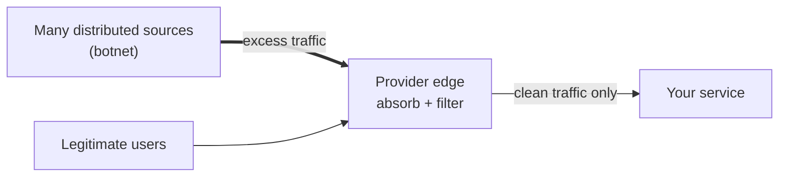

# GCP25 — How DDoS Attacks Work

## Summary
A **DDoS attack** tries to make an online service **unavailable** by overwhelming the target, or the infrastructure around it, with traffic from **many sources**. Attackers can be individuals, cybercriminal groups, or **state-sponsored** actors, and usually use **botnets**: large numbers of compromised machines controlled remotely without their owners' knowledge. Google's defensive advantage is **scale**: one Google data center's **bisection bandwidth (~1,300 Tbps)** far exceeds the **whole internet's (~200 Tbps)** and any attack seen, so there's time to **isolate and address** attacks. Attacks keep growing: Cloud Armor absorbed a **46 million requests/s** L7 attack (2022) and then **398 million rps** (August 2023).

---

## Core Concepts

### Concept view (defender's perspective)

The goal of defense is to **absorb volume at a large edge** and **filter** so only legitimate traffic reaches the application.

### Attack categories (standard taxonomy, beyond the lecture)
| Category | Layer | Resource exhausted | Measured in | Typical defense |
|----------|-------|--------------------|-------------|-----------------|
| **Volumetric** | L3/L4 | Network bandwidth | bits/s (Tbps) | Absorb at a large anycast edge; upstream filtering |
| **Protocol / state exhaustion** | L3/L4 | Connection-state tables (servers, firewalls, LBs) | packets/s | Proxy-based load balancers that terminate connections at the edge; SYN cookies |
| **Application (L7)** | L7 | Server CPU, app/DB resources | requests/s | WAF, rate limiting, adaptive detection (**Cloud Armor**) |

### Why Google's scale matters (lecture numbers)
| Reference | Bandwidth |
|-----------|-----------|
| Large DDoS attack, 2017 (lecture) | ~4 Tbps |
| Whole internet (bisection bandwidth) | ~200 Tbps |
| **One Google data center** (bisection bandwidth) | **~1,300 Tbps** |

**Bisection bandwidth** = capacity across a network's midpoint: how much traffic can cross it at once. With capacity far above any anticipated load, attack traffic can be absorbed at the edge while it's isolated and filtered.

> **Fact-check note:** Google's public reporting of its largest 2017 volumetric attack is **~2.5 Tbps** (disclosed in 2020). The lecture's "around four terabits per second" may be rounded or a different figure. Either way, attacks reach **Tbps**, and Google's capacity is far above that.

### Record L7 attacks blocked by Cloud Armor
| When | Peak | Notes |
|------|------|-------|
| 2022 (reported by Google in August 2022) | **46 million rps** (HTTPS) | At least **76% larger** than the previous L7 record |
| **August 2023** | **398 million rps** (7.5× larger) | Associated with the HTTP/2 "Rapid Reset" vulnerability (CVE-2023-44487), since patched by vendors |

**Why rps matters:** L7 attacks don't need huge bandwidth. Each request makes the server do work (TLS, application logic, database queries), so defenses must **inspect and rate-limit at L7 at the edge**. That's Cloud Armor's role (next lessons).

---

## Key Terms
| Term | Definition |
|------|-----------|
| DDoS | Coordinated traffic from many sources making a service unavailable |
| Botnet | Network of compromised machines controlled remotely |
| Volumetric attack | Saturates bandwidth |
| Protocol / state-exhaustion attack | Exhausts connection tables |
| Application-layer (L7) attack | Exhausts application resources via requests |
| Bisection bandwidth | Total capacity across a network's midpoint cut |
| rps | Requests per second (L7 attack size) |
| Anycast edge | One IP announced from many locations, spreading load geographically |

---

## Real-World Connections
- **Network+:** DoS vs DDoS, botnets, amplification ([[L19 - Network Attacks]]); availability in the CIA triad ([[L18 - Basic Network Security]]).
- **Wireshark (detection):** in a capture of an affected server, signs include very many connection attempts with few completed handshakes, or a huge number of short conversations from many sources. Use your **TCP SYN coloring rule** ([[WS07 - Coloring Traffic]]) and **Statistics → Conversations / Endpoints** ([[WS10 - The Statistics View]]) to spot them.
- **k3s:** a single ingress node is a small edge, and CPU would saturate first under L7 load. Real protection means fronting it with a provider edge (Cloud Armor, Cloudflare).
- **AWS / Azure:** AWS Shield Standard/Advanced + WAF; Azure DDoS Protection + WAF.

---

## Troubleshooting Scenario
**Scenario:** An API behind a global external Application Load Balancer slows down. Bandwidth graphs look normal, but backend CPU is pegged and the LB shows **requests/s ×40** from thousands of IPs, mostly to one expensive endpoint with random query strings.
**Analysis:** not volumetric. It's an **L7 flood**, and random query strings bypass caching, so every request reaches the back end.
**Response (preview of the next lessons):** a Cloud Armor **rate-based rule** for that path, **Adaptive Protection** to detect the anomaly and suggest a rule, and bot management if needed. Confirm the effect in LB request logs (`enforcedSecurityPolicy`).

---

## Hands-On Ideas (defensive)
1. In a test project with an external Application LB, enable **request logging** on the backend service and explore the fields in Logs Explorer (`resource.type="http_load_balancer"`).
2. Create a basic **Cloud Armor security policy** with a deny rule for a test IP and attach it to the backend service. Confirm with your own request that it returns 403, and check the logs.
3. Review an existing PCAP (e.g., `raw/assets/wireshark-101/`) with Statistics → Conversations to practice reading connection patterns.

---

## Quiz
1. What is a DDoS attack?
   - A) A single user sending one large file  B) An attempt to make a service unavailable by overwhelming it with traffic from multiple sources  C) A DNS misconfiguration  D) A routing loop
2. What is a botnet?
   - A) A Google service  B) A firewall  C) A network of compromised machines controlled remotely  D) A CDN
3. Why does Google's bisection bandwidth matter for DDoS defense?
   - A) It encrypts traffic  B) Capacity far exceeds attack sizes, allowing absorption and isolation  C) It blocks all IPv6  D) It replaces firewalls
4. Which attack type is measured in requests per second?
   - A) Volumetric  B) Application layer (L7)  C) ARP spoofing  D) Physical
5. How large was the August 2023 L7 attack Cloud Armor blocked?
   - A) 398 million rps  B) 46 million rps  C) 4 Tbps  D) 200 Tbps

**Answers:** 1-B, 2-C, 3-B, 4-B, 5-A

---

## Weak Areas to Revisit
*(none flagged yet)*

## Linked Pages
- [[GCP24 - Module Introduction - DDoS Protection]] · [[GCP23 - Network Security - Course Introduction]]
- [[L19 - Network Attacks]] · [[L18 - Basic Network Security]]
- [[certs/gcp-networking]]
