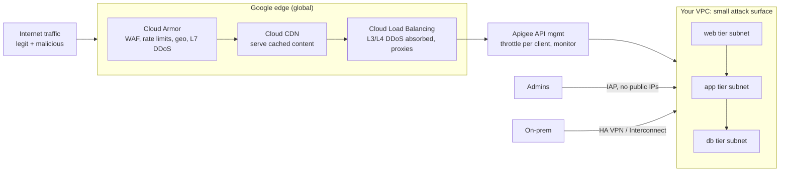

# GCP26 — Google Cloud DDoS Mitigations

## Summary
Kai (Cymbal) needs to replace an outdated, resource-heavy DDoS solution with something **scalable, cloud-based and cost-effective**, with **no long-term contracts**, that doesn't hurt performance. Google Cloud's answer is **defense in depth** with six strategies:
1. **Cloud Load Balancing**: built-in L3/L4 DDoS defense, no configuration.
2. **Reduce the attack surface**: VPC/subnet design, firewall rules, no unnecessary public IPs, IAP/bastion.
3. **Isolate internal traffic**: VPN/Interconnect for on-prem.
4. **Cloud CDN**: absorbs requests at the edge.
5. **API management (Apigee)**: throttling, central access control, monitoring.
6. **Google Cloud Armor**: L3/L4 + **L7** DDoS defense and **WAF** at Google's edge.

*(Cloud Armor details verified against docs.cloud.google.com, 2026-10-15.)*

---

## Core Concepts

### Layers of defense


### 1. Cloud Load Balancing: built-in infrastructure DDoS defense
- **No extra configuration**: placing an LB in front of services **filters known-bad traffic** before it reaches your resources.
- **L4 LBs** (TCP/UDP) automatically protect against **UDP floods** and **TCP SYN floods**.
- **L7 LBs** (HTTP/HTTPS) add protection against **connection-based attacks such as Slowloris**, because the proxy terminates connections and only well-formed requests are forwarded.
- They use Google's **global DoS mitigation service**: when an attack is detected, LBs are **automatically configured to drop or throttle** the traffic.

### 2. Reduce the network attack surface
**Attack surface** = every point where an unauthorized user can try to enter or extract data. Keep it small:
| Practice | Detail |
|----------|--------|
| VPC grouping | Resources that communicate → **same VPC**; unrelated resources → **separate VPCs** |
| **Subnet per tier** | Web / services / DB in separate subnets, a convenient way to enforce inter-tier firewall restrictions ([[GCP15 - Cloud Network Architecture Overview]]) |
| **Firewall rules** | Control ingress **and** egress. Block **unused ports** *and* **unwanted sources**. Target with **network tags or service accounts** |
| **No unnecessary public IPs** | Even when internet access to a VM is needed, use **IAP** or a **bastion host** ([[GCP12 - Lab - Implement Private Google Access and Cloud NAT]], [[L17 - Network Access and Management]]) |

### 3. Isolate internal traffic
Connect on-prem over **IPsec VPN tunnels** or **Dedicated Interconnect** instead of exposing internal services publicly.

### 4. Cloud CDN
- Caches web content at Google **edge locations / PoPs** worldwide (the lecture cites "over 90").
- Gives protection similar to the load balancers. Requests hit Google's **PoPs**, not your resources, so the edge **absorbs the brunt** of an attack and the origin load drops even in normal times.

### 5. API management (Apigee)
An API gateway in front of back-end services helps prevent DoS by:
- **throttling** requests per client
- **centralizing access control** to APIs
- **monitoring and tracking** all API usage

### 6. Google Cloud Armor
**DDoS and application defense at Google's edge**, blocking attacks **close to their source**.
| Capability | Detail |
|-----------|--------|
| **L3/L4 DDoS** | **Always-on** protection from volumetric and protocol attacks for apps behind LBs, with automated inline mitigation, no latency impact |
| **L7 DDoS** (HTTP floods) | Through **user-configured security policies** (proactive rules, rate limiting, Adaptive Protection) |
| **Preconfigured WAF rules** | OWASP Top 10: **SQLi, XSS**, insecure deserialization, LFI/RFI, RCE… Tunable by sensitivity and by excluding noisy signatures |
| **Geo-based rules** | Block or allow by country/region (attack sources, regulatory compliance) |
| **Rate limiting** | **Rate-based rules** throttle or ban clients sending too many requests |
| **Adaptive Protection** | **ML detection** of L7 DDoS (HTTP floods, high-frequency L7 abuse), suggesting rules. ⚠️ **Requires Cloud Armor Enterprise** per the docs |
| **Bot management** | **reCAPTCHA Enterprise** integration to assess and act on automated clients |
| **Custom rules language** | Prioritized rules with flexible match conditions (CEL-based expressions on headers, paths, IPs, geo…) |
| **Logging** | Detailed request logs for analysis and tuning |

**Security policy = ordered rules.** Each rule has a **condition** (match), an **action** (allow, deny-403/404/502, throttle, rate-based-ban, redirect…), and a **priority**. The policy is attached to a **target** (backend service or backend bucket). The highest-priority matching rule wins, which is the same first-match logic as ACLs ([[L20 - Network Defense Techniques]]).

**Supported load balancers (lecture list):** global external ALB, regional external ALB, classic ALB, external proxy NLB, external passthrough NLB. The docs' Standard tier also lists **Cloud CDN and Media CDN**. Security policies can also protect **VMs with external IPs** (network edge policies), and backend policies can apply to the regional internal ALB.

### Cloud Armor Standard vs Enterprise (from the docs)
| | **Standard** | **Enterprise** (Paygo or Annual) |
|-|-------------|-------------------------|
| Pricing | Pay-as-you-go | Paygo or **Annual** (12-month commitment) |
| L3/L4 always-on DDoS protection | ✔ | ✔ |
| Security policies on LBs/CDN | ✔ | ✔ |
| Preconfigured WAF (OWASP Top 10) | ✔ (usage billed) | ✔ **WAF usage bundled** (rules, policies, requests) |
| Third-party **named IP lists** | — | ✔ |
| **Google Threat Intelligence** | — | ✔ |
| **Adaptive Protection** (L7, ML) | — | ✔ |
| **Advanced network DDoS protection** for passthrough endpoints (passthrough NLB, protocol forwarding, VM public IPs) | — | ✔ |
| DDoS attack visibility, hierarchical security policies | — | ✔ |
| **DDoS bill protection + DDoS response team** | — | **Annual only** |

Projects with an external ALB or external proxy NLB are **automatically enrolled in Standard**. Enterprise is subscribed at the **billing account** level, with projects enrolled individually.

### Example: build a defensive policy
```bash
# 1. Create the policy
gcloud compute security-policies create web-shield --description="edge protection for web-bes"
# 2. Preconfigured WAF rules (OWASP): SQLi and XSS
gcloud compute security-policies rules create 1000 --security-policy=web-shield \
  --expression="evaluatePreconfiguredWaf('sqli-v33-stable')" --action=deny-403
gcloud compute security-policies rules create 1010 --security-policy=web-shield \
  --expression="evaluatePreconfiguredWaf('xss-v33-stable')" --action=deny-403
# 3. Rate-based ban per client IP (e.g., >100 req/min → banned 5 min)
gcloud compute security-policies rules create 2000 --security-policy=web-shield \
  --src-ip-ranges="*" --action=rate-based-ban \
  --rate-limit-threshold-count=100 --rate-limit-threshold-interval-sec=60 \
  --ban-duration-sec=300 --conform-action=allow --exceed-action=deny-429 --enforce-on-key=IP
# 4. Attach to the load balancer's backend service
gcloud compute backend-services update web-bes --security-policy=web-shield --global
# 5. (Enterprise) Adaptive Protection
gcloud compute security-policies update web-shield --enable-layer7-ddos-defense
```
Start new WAF rules in **preview mode** (`--preview`) and watch the logs for false positives before enforcing.

---

## Key Terms
| Term | Definition |
|------|-----------|
| Attack surface | All points where unauthorized users can enter or extract data |
| Slowloris | Attack holding many connections open with slow, partial requests |
| PoP | Point of presence: Google edge location |
| Apigee | Google's API management platform (throttling, access control, analytics) |
| Cloud Armor | Edge DDoS + WAF service attached to load balancers/CDN |
| Security policy | Ordered set of Cloud Armor rules attached to a backend |
| Preconfigured WAF rules | Signature sets for OWASP Top 10 (SQLi, XSS…) |
| Rate-based rule | Throttles or bans clients over a request-rate threshold |
| Adaptive Protection | ML-based L7 DDoS detection and rule suggestions (Enterprise) |
| reCAPTCHA Enterprise | Bot assessment integrated with Cloud Armor |
| Cloud Armor Enterprise | Paid tier: bundled WAF, threat intel, Adaptive Protection, advanced network DDoS, bill protection (Annual) |
| Preview mode | Rule logs matches without enforcing them |

---

## Real-World Connections
- **Network+:** defense in depth, hardening, attack-surface reduction ([[L20 - Network Defense Techniques]]); DoS/DDoS ([[L19 - Network Attacks]]); first-match ACL logic ([[L20 - Network Defense Techniques]]).
- **Course ties:** gated ingress via LB/Apigee ([[GCP20 - Other Topologies - Mesh, Mirrored, Gated]]); best practice "expose APIs via API gateway/LB; multilayer security" ([[GCP22 - Best Practices for Connectivity and Topologies]]).
- **AWS / Azure (AZ-500):** Cloud Armor ≈ **AWS WAF + Shield**; Cloud Armor Enterprise Annual ≈ **Shield Advanced** (cost protection + response team); Azure ≈ **DDoS Protection + Front Door/App Gateway WAF**.
- **k3s:** Traefik middlewares (rate limit, IP allow-list) are a mini Cloud Armor. ModSecurity/Coraza with the OWASP CRS is the open-source equivalent of preconfigured WAF rules.

---

## Troubleshooting Scenario
**Scenario:** After attaching a new Cloud Armor policy with SQLi/XSS rules, some legitimate users get **HTTP 403** on a search form that accepts free text.
**Analysis:** a **WAF false positive**: certain search strings match SQLi signatures.
**Fix:**
1. Check LB logs for `enforcedSecurityPolicy.outcome="DENY"` and the matched `preconfiguredExprIds`.
2. **Tune** the rule: lower its sensitivity, or exclude the specific signature or the field (`evaluatePreconfiguredWaf('sqli-v33-stable', {'sensitivity': 1, 'opt_out_rule_ids': [...]})`).
3. In future, roll out new rules with `--preview` first.

---

## Hands-On Ideas (defensive)
1. In a test project with an external Application LB: create the `web-shield` policy above **in preview mode**, attach it, browse the site, and review the logs.
2. Add a **geo rule** (`origin.region_code == 'XX'`) as preview and see which requests would match.
3. Configure a **rate-based rule** with a low threshold and test it with your own few requests from one browser (well below any real load) to see the 429 response.
4. Compare the costs of Standard vs Enterprise in the pricing calculator for your expected request volume.

---

## Quiz
1. Which mitigation gives built-in infrastructure DDoS defense with no additional configuration?
   - A) Cloud Load Balancing  B) Cloud NAT  C) Cloud DNS  D) VPC Flow Logs
2. Which load balancer type adds protection against connection-based attacks like Slowloris?
   - A) L4 passthrough  B) L7 (HTTP/HTTPS) proxy  C) Internal TCP  D) None
3. What best reduces the network attack surface for VMs that admins must reach?
   - A) Give every VM a public IP  B) Disable firewalls  C) No public IPs; use IAP or bastion hosts and tight firewall rules  D) Open all ports for monitoring
4. How does Cloud CDN help against DDoS?
   - A) It encrypts the database  B) Requests hit Google PoPs, so the edge absorbs attacks and origin load drops  C) It blocks all countries  D) It replaces IAM
5. What three things does API management (Apigee) add?
   - A) Per-client throttling, centralized access control, usage monitoring  B) BGP, OSPF, RIP  C) NAT, DNS, DHCP  D) Disk encryption
6. Which Cloud Armor feature protects against OWASP Top 10 threats like SQLi and XSS?
   - A) Adaptive Protection  B) Preconfigured WAF rules  C) Named IP lists  D) Bill protection
7. According to the docs, which feature requires Cloud Armor Enterprise?
   - A) Preconfigured WAF rules  B) Adaptive Protection  C) Security policies on a global ALB  D) Always-on L3/L4 protection
8. Which benefit is available only with Cloud Armor Enterprise **Annual**?
   - A) Rate limiting  B) Geo rules  C) Logging  D) DDoS bill protection and DDoS response team
9. What three parts does a Cloud Armor rule have?
   - A) Source, destination, port  B) Condition (match), action, priority, inside a policy attached to a target  C) Region, zone, subnet  D) User, role, permission

**Answers:** 1-A, 2-B, 3-C, 4-B, 5-A, 6-B, 7-B, 8-D, 9-B

---

## Weak Areas to Revisit
*(none flagged yet)*

## Linked Pages
- [[GCP25 - How DDoS Attacks Work]] · [[GCP24 - Module Introduction - DDoS Protection]]
- [[GCP15 - Cloud Network Architecture Overview]] · [[GCP20 - Other Topologies - Mesh, Mirrored, Gated]] · [[GCP22 - Best Practices for Connectivity and Topologies]]
- [[L19 - Network Attacks]] · [[L20 - Network Defense Techniques]]
- [[certs/gcp-networking]]
