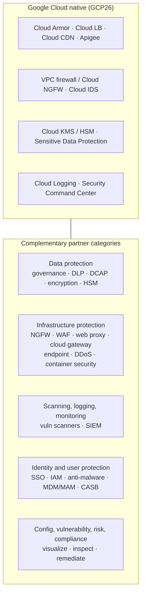
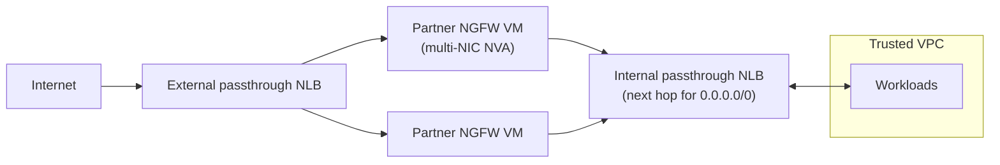

# GCP27 — Types of Complementary Partner Products

## Summary
Google's native platform security (GCP26) is extended by a **partner ecosystem** of security-focused firms. The lecture groups it into **five categories**:

1. **Data protection**: governance, DLP, data-centric audit and protection (DCAP), encryption, HSMs
2. **Infrastructure protection**: DDoS protection, network and application firewalls, IDS/IPS, container security
3. **Scanning, logging, and monitoring**: vulnerability scanners, SIEM
4. **Identity and user protection**: SSO, IAM, anti-malware, MDM/MAM, CASB
5. **Configuration, vulnerability, risk, and compliance**: posture across all areas of the infrastructure

Partners are consumed **from Google Cloud**, usually through **Google Cloud Marketplace** as VM images (NVAs), SaaS, or Kubernetes apps.

---

## Core Concepts

### Ecosystem map

### Category detail (lecture + what each does)
| Category | Lecture scope | What it delivers | Native Google counterpart (for comparison) |
|----------|--------------|------------------|-------------------------------------------|
| **Infrastructure protection** | NGFW, WAF, web proxies, cloud gateways, server endpoint protection, DDoS, container security | Protects infrastructure and apps from cyber attacks | Cloud NGFW, Cloud Armor, Secure Web Proxy, GKE security posture |
| **Data protection** | Encryption, key management, policy-driven DLP | Protects data from unauthorized access and internal/external threats | Cloud KMS, Cloud HSM, Cloud EKM, Sensitive Data Protection |
| **Logging and monitoring** | Vulnerability scanners, SIEM | **Visibility and auditability** of user and system activity, plus policy-driven alerting and reporting | Cloud Logging/Monitoring, Google Security Operations (SIEM) |
| **Identity and user protection** | SSO, IAM, anti-malware, MDM/MAM, CASB | Controls who gets in and protects user devices | Cloud Identity, IAM, BeyondCorp/Chrome Enterprise Premium |
| **Config, vulnerability, risk, compliance** | Across all infrastructure | **Visualize and inspect** network and app deployments for vulnerability, security, and compliance risks, and **assist with remediation** | Security Command Center |

> **Beyond the lecture:** the counterpart column and the vendor examples below are my additions, for context. The course names categories only, not vendors.

### Why use a partner when native exists?
| Reason | Example |
|--------|---------|
| **Consistent policy across hybrid/multicloud** | Same NGFW vendor on-prem, in AWS and in GCP, so one rule set and one console |
| **Existing licenses and team skills** | SOC already runs a given SIEM; bring-your-own-license (BYOL) on Marketplace |
| **Feature gaps or certifications** | Specific DLP classifiers, FIPS-validated HSM, industry compliance reporting |
| **Edge before Google** | Third-party CDN/DDoS scrubbing in front of multiple clouds |

### How a partner NVA fits the network (connects to GCP20 gated topology)

- Each NIC sits in a **different VPC** (untrusted / trusted / mgmt). Multi-NIC is how one VM bridges VPCs.
- **HA:** two or more NVAs behind an **internal passthrough NLB used as a next hop** for a custom route. Health checks remove a failed appliance.
- Same pattern as **gated egress/ingress** in [[GCP20 - Other Topologies - Mesh, Mirrored, Gated]].

### Vendor examples (illustrative, not exhaustive)
| Category | Typical vendors |
|----------|----------------|
| NGFW / NVA | Palo Alto Networks VM-Series, Fortinet FortiGate, Check Point CloudGuard, Cisco |
| WAF / DDoS / edge | Cloudflare, Akamai, Imperva, F5 |
| SIEM / logging | Splunk, Elastic, Datadog |
| Identity / CASB | Okta, Ping Identity, Netskope, Zscaler |
| Data / HSM | Thales, Fortanix |
| Container security | Aqua, Sysdig, Prisma Cloud |

Note: **Cloud IDS** is built on **Palo Alto Networks** threat detection, and **Cloud NGFW Enterprise** IPS also uses Palo Alto technology. The line between "native" and "partner" is blurry.

---

## Key Terms
| Term | Definition |
|------|-----------|
| DLP | Data loss prevention: detects and blocks sensitive data leaving its allowed scope |
| DCAP | Data-centric audit and protection: monitors and protects data where it lives |
| HSM | Hardware security module: tamper-resistant key storage and crypto operations |
| NGFW | Next-generation firewall: L7 app awareness, IPS, URL filtering, TLS inspection |
| SIEM | Security information and event management: central log correlation and alerting |
| CASB | Cloud access security broker: policy enforcement between users and SaaS |
| MDM / MAM | Mobile device / application management |
| NVA | Network virtual appliance: a vendor firewall or router running as a VM |
| CSPM | Cloud security posture management: the "configuration and compliance" category |
| Marketplace | Google Cloud Marketplace: deploy and bill partner solutions in GCP |

---

## Real-World Connections
- **Your k3s lab:** **Elasticsearch + Kibana** is the "logging and monitoring" category (SIEM-like). **Kubeshark** gives network visibility. Falco or Trivy would cover **container security** and **vulnerability scanning**.
- **Network+:** NGFW, IDS/IPS, proxies ([[L20 - Network Defense Techniques]]); SIEM and logging ([[L18 - Basic Network Security]]).
- **AWS:** AWS Marketplace + **Gateway Load Balancer** (GENEVE) for inline NVAs; Network Firewall is the native option.
- **Azure (AZ-500):** Azure Firewall (native) vs NVAs from Marketplace; Sentinel = SIEM; Defender for Cloud = CSPM.

---

## Troubleshooting Scenario
**Scenario:** After inserting a partner NGFW pair (behind an internal passthrough NLB as next hop for `0.0.0.0/0`), egress from the trusted VPC fails intermittently. Roughly half the flows break.
**Analysis:**
1. Check **health checks**. If the firewall-rule allowance for health-check ranges `35.191.0.0/16` and `130.211.0.0/22` is missing, the NLB marks backends unhealthy (or fails open across all of them).
2. Check **symmetric routing**. Return traffic must hit the **same** NVA that holds the session state. Enable **session affinity** on the internal NLB, or SNAT on the NVA.
3. Make sure **IP forwarding** (`--can-ip-forward`) is enabled on the NVA VMs. Without it, GCP drops packets not addressed to the VM.
4. Inspect the NVA's own logs, plus VPC Flow Logs on both NICs.

---

## Hands-On Ideas
1. Browse **Google Cloud Marketplace → Security** and sort listings into the five lecture categories.
2. Inventory your k3s stack by category: logging/monitoring (ES/Kibana), visibility (Kubeshark). Note which categories are empty (vulnerability scanning, container runtime security).
3. In a test project, create a VM with `--can-ip-forward` and two NICs in different VPCs. Confirm the routes each NIC learns (`ip route` in the VM, and the VPC route tables).

---

## Quiz
1. Which category includes DLP, encryption and HSMs?
   - A) Identity and user protection  B) Data protection  C) Infrastructure protection  D) Logging and monitoring
2. NGFW, WAF, web proxies and container security belong to which category?
   - A) Infrastructure protection  B) Data protection  C) Compliance  D) Identity
3. What do logging and monitoring partners mainly provide?
   - A) Key management  B) SSO  C) Visibility and auditability with policy-driven alerting and reporting  D) Container builds
4. A CASB falls under which category?
   - A) Data protection  B) Scanning  C) Infrastructure protection  D) Identity and user protection
5. What do configuration, vulnerability, risk and compliance partners do?
   - A) Visualize and inspect deployments for risks and assist with remediation  B) Encrypt disks  C) Terminate TLS  D) Provide SSO
6. Why might an organization choose a partner NGFW over the native firewall?
   - A) Native firewalls cannot filter by port  B) Partner products are always cheaper  C) Consistent policy and tooling across hybrid/multicloud and existing skills/licenses  D) Google requires it
7. What VM setting must be enabled for an NVA to forward traffic not addressed to itself?
   - A) Shielded VM  B) `--can-ip-forward`  C) OS Login  D) Preemptible

**Answers:** 1-B, 2-A, 3-C, 4-D, 5-A, 6-C, 7-B

---

## Weak Areas to Revisit
*(none flagged yet)*

## Linked Pages
- [[GCP26 - Google Cloud DDoS Mitigations]] · [[GCP25 - How DDoS Attacks Work]] · [[GCP24 - Module Introduction - DDoS Protection]]
- [[GCP20 - Other Topologies - Mesh, Mirrored, Gated]] · [[GCP22 - Best Practices for Connectivity and Topologies]]
- [[L18 - Basic Network Security]] · [[L20 - Network Defense Techniques]]
- [[certs/gcp-networking]]
