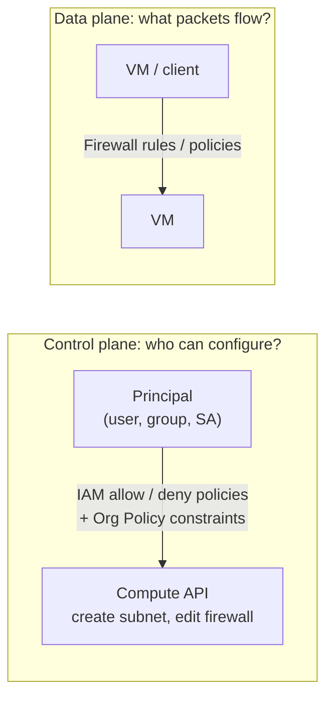

# GCP29 — Module Introduction: Controlling Access to VPC Networks

> 🎛️ **Interactive visualization:** [IAM Access Explorer](../../visualizations/gcp/GCP29-30%20-%20IAM%20Access%20Explorer.html) (opens in your browser).

## Summary
Module 2 of *Network Security* is about **restricting access to VPC networks**. The two layers of control:
1. **Who can change the network:** **IAM**, the **resource hierarchy** and **policy constraints** (Organization Policy).
2. **What traffic can flow:** **firewall rules**.

Then the **Controlling Access to VPC Networks** lab and a quiz.

---

## Core Concepts

### Two different "access" questions

| Layer | Question | Tool | Example |
|-------|----------|------|---------|
| Control plane | Who may create, modify or delete network resources? | **IAM** roles, **deny policies**, **Org Policy** | Only the security team can edit firewall rules |
| Data plane | Which packets may reach which VMs? | **Firewall rules / firewall policies** | Only the web tier accepts tcp:443 from the internet |

The two are independent. A Network Admin with no firewall-edit permission still can't open port 22. A perfect firewall doesn't help if anyone can edit it.

### Module map
| Step | Lesson |
|------|--------|
| 1 | IAM roles: [[GCP30 - IAM Roles]] |
| 2 | Resource hierarchy and policy constraints *(upcoming)* |
| 3 | Firewall rules: [[GCP31 - Firewall Rules]] |
| 4 | Lab: Controlling Access to VPC Networks *(upcoming)* |
| 5 | Quiz *(upcoming)* |

---

## Key Terms
| Term | Definition |
|------|-----------|
| IAM | Identity and Access Management: who (principal) can do what (role/permissions) on which resource |
| Resource hierarchy | Organization → folders → projects → resources. Policies inherit downward |
| Policy constraint | Organization Policy rule restricting *how* resources can be configured (e.g., no external IPs) |
| Firewall rule | Allow or deny traffic to/from VMs by direction, protocol/port, source/destination, target |

---

## Real-World Connections
- **k3s:** Kubernetes RBAC (who can `kubectl apply` a NetworkPolicy) is the control plane. **NetworkPolicy** (which pods talk) is the data plane. Same split.
- **AWS:** IAM policies + SCPs (control plane) vs security groups / NACLs (data plane).
- **Network+:** least privilege and AAA ([[L18 - Basic Network Security]]); ACLs ([[L20 - Network Defense Techniques]]).

---

## Troubleshooting Scenario
**Scenario:** A developer opened `0.0.0.0/0` on tcp:22 in production "to debug".
**Two fixes, one per layer:** (1) **control plane**: take away firewall-edit permission (no Security Admin for developers; consider a deny policy on `compute.firewalls.create/update`). (2) **data plane**: replace it with an IAP-only rule (`35.235.240.0/20`).

---

## Hands-On Ideas
1. `gcloud projects get-iam-policy PROJECT --format=json | jq '.bindings[] | {role, members}'`: who has what in your test project.
2. List firewall rules allowing `0.0.0.0/0` ingress, then check who could have created them (Cloud Audit Logs, `compute.firewalls.insert`).

---

## Quiz
1. Which two areas does this module use to control access to VPC networks?
   - A) Cloud NAT and Cloud DNS  B) IAM (with hierarchy and policy constraints) and firewall rules  C) VPN and Interconnect  D) Cloud CDN and Armor
2. Firewall rules mainly control:
   - A) Who can edit subnets  B) Which network traffic reaches VMs  C) Billing  D) API quotas

**Answers:** 1-B, 2-B

---

## Weak Areas to Revisit
*(none flagged yet)*

## Linked Pages
- [[GCP30 - IAM Roles]] · [[GCP28 - Lab - Configuring Traffic Blocklisting with Google Cloud Armor]] · [[GCP23 - Network Security - Course Introduction]]
- [[gcp-command-anatomy]] · [[certs/gcp-networking]]
