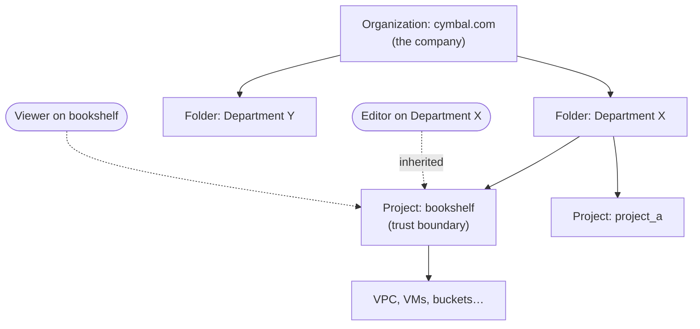
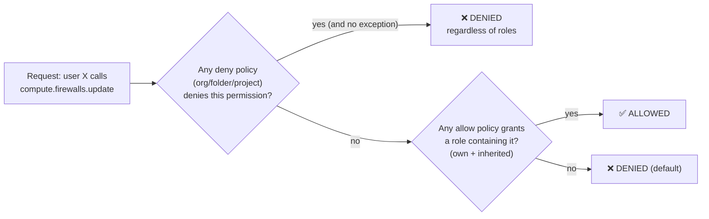

# GCP30 — IAM Roles

> 🎛️ **Interactive visualization:** [IAM Access Explorer](../../visualizations/gcp/GCP29-30%20-%20IAM%20Access%20Explorer.html): hierarchy inheritance, deny vs allow evaluation, role contents, custom-role builder, the Karen scenario. Opens in your browser.

## Summary
**Scenario:** Karen, a cloud network administrator at Cymbal, must grant **least-privilege** access:
- **Sarah** needs to view VPC firewall rules.
- **Jamal** tracks user access to networking resources.
- **Kalani** needs to view VPC network configurations.

**IAM** answers this. Policies are set at any level of the **resource hierarchy** (organization → folders → projects → resources) and **inherited downward**. A child **can't take away** what a parent grants, so grant at the **smallest scope**. **Deny policies** override allow policies. **Predefined roles** bundle permissions for a job function. If none fits, build a **custom role**.

The three networking roles to know:
- **Network Viewer:** read-only access to all networking resources.
- **Network Admin:** manage networking resources, *except* firewall rules and SSL certificates (read-only for those).
- **Security Admin:** manage firewall rules and SSL certificates.

---

## Core Concepts

### Resource hierarchy and inheritance

- **Each resource has exactly one parent.** The IAM policy hierarchy **follows the resource hierarchy**. Move a project to another folder/org and its inherited policy changes with it.
- **Effective access = union** of the resource's own policy plus everything inherited. In the lecture example, **Editor** at Department X + **Viewer** at bookshelf gives **Editor** on bookshelf. The lower-level Viewer grant doesn't restrict it.
- **Projects are trust boundaries.** Services in the same project have a default level of trust.

### Policy evaluation: deny first

- **Deny policies take precedence.** IAM checks deny policies **before** allow policies. A denied principal can't use the permission no matter which roles they hold.
- Deny policies attach to **organization, folder or project**, with optional **exception principals** and **denial conditions** (resource tags only).
- This is the **only** way to "take away" an inherited grant.

> **Fact-check (docs vs lecture):** the lecture says each project, folder or org can have **up to 5** deny policies. Current Google Cloud docs and quota pages say **up to 500 deny policies per resource, with 500 deny rules total** across them. The limit was raised. Expect the **docs value** on newer exams.

### Permissions → roles → bindings
```
compute . networks . list
└──┬──┘   └──┬───┘   └┬─┘
 service  resource   verb
```
| Concept | What it is | Example |
|---------|-----------|---------|
| **Permission** | One API action: `service.resource.verb` | `compute.networks.list`, `compute.firewalls.update` |
| **Role** | A named collection of permissions | `roles/compute.networkViewer` |
| **Binding** | role + principals (+ optional condition) in a policy on a resource | group `net-eng@` → Network Viewer on project_a |
| **Policy** | All of a resource's bindings | `gcloud projects get-iam-policy project_a` |

You grant **roles, never single permissions**. Meaningful work almost always needs several permissions.

### Three kinds of roles
| Kind | Examples | Use? |
|------|----------|------|
| **Basic** | Owner, Editor, Viewer | Avoid in production: far too broad (Editor can change almost everything) |
| **Predefined** | `roles/compute.networkAdmin`, `roles/compute.securityAdmin`, `roles/compute.networkViewer` | **Default choice**. Google maintains them as APIs evolve |
| **Custom** | `roles/customNetAdmin` = firewall CRUD + read-only SSL certs | When no predefined role is a tight fit. *You* maintain it (new permissions aren't added automatically) |

### The networking roles
| Role | ID | Can do | Can't do |
|------|----|--------|----------|
| **Network Viewer** | `roles/compute.networkViewer` | **Read-only on all networking resources** (VPCs, subnets, routes, firewall rules, LBs…) | Change anything |
| **Network Admin** | `roles/compute.networkAdmin` | Create/modify/delete networking resources | **Firewall rules and SSL certs: read-only**. Also view instances and ephemeral IPs, but not manage instances |
| **Security Admin** | `roles/compute.securityAdmin` | Create/modify/delete **firewall rules and SSL certificates** | Other networking resources |
| Shared VPC roles | `roles/compute.xpnAdmin`, `roles/compute.networkUser` | Shared VPC admin / use host subnets | (Later module) |

**Separation of duties:** Network Admin + Security Admin are split on purpose, so the team that builds the network isn't automatically the team that opens it. A networking team that needs both gets **both roles** granted to its Google group (per docs).

### Custom role example (from the lecture)
Need: **create/modify/delete firewall rules** + **read-only SSL certificates**. Security Admin is too much (SSL cert write); Network Admin is too little (no firewall write).
```bash
gcloud iam roles create customNetFirewall --project=PROJECT \
    --title="Firewall Editor + SSL Viewer" \
    --permissions=compute.firewalls.create,compute.firewalls.delete,compute.firewalls.get,compute.firewalls.list,compute.firewalls.update,compute.networks.get,compute.networks.list,compute.networks.updatePolicy,compute.sslCertificates.get,compute.sslCertificates.list \
    --stage=GA
```
(`compute.networks.updatePolicy` is needed to attach a firewall rule to a network.)

### Solving Karen's scenario
| Person | Need | Least-privilege grant | Scope |
|--------|------|----------------------|-------|
| **Sarah** | View firewall rules | **Network Viewer** (read-only includes firewall rules). Or a custom role with only `compute.firewalls.get/list` for strict least privilege | The project(s) she reviews |
| **Kalani** | View VPC network configurations | **Network Viewer** | Project, or a folder if many |
| **Jamal** | Track user access to networking resources | **Who has access:** `roles/iam.securityReviewer` (view IAM policies). **What they did:** Cloud Audit Logs via `roles/logging.viewer` (Admin Activity), plus `roles/logging.privateLogViewer` for Data Access logs | Org/folder for wide visibility |

> The lecture describes the method (predefined role if one fits, otherwise custom) without naming a role per person. The table above is my mapping, based on the docs' role descriptions.

### Commands
```bash
gcloud iam roles describe roles/compute.networkViewer               # list a role's permissions
gcloud projects add-iam-policy-binding PROJECT \
    --member="user:kalani@cymbal.com" --role="roles/compute.networkViewer"
gcloud resource-manager folders add-iam-policy-binding FOLDER_ID \
    --member="group:net-eng@cymbal.com" --role="roles/compute.networkAdmin"
gcloud projects get-iam-policy PROJECT --flatten="bindings[].members" \
    --format="table(bindings.role,bindings.members)"
gcloud iam policies create deny-fw-edits --kind=denypolicies \
    --attachment-point="cloudresourcemanager.googleapis.com/projects/PROJECT" \
    --policy-file=deny.json        # deny compute.firewalls.* except security team
```
Full anatomy: [[gcp-command-anatomy]] §12.

---

## Key Terms
| Term | Definition |
|------|-----------|
| Principal | Identity that gets access: Google account, group, service account, domain, workforce/workload identity |
| Permission | `service.resource.verb`, one API method |
| Role | Collection of permissions (basic / predefined / custom) |
| Allow policy | Bindings of roles to principals on a resource. Inherited downward |
| Deny policy | Rules denying permissions to principals. Checked **first**, overrides allow |
| Least privilege | Smallest set of permissions at the smallest scope needed |
| Network Viewer / Admin / Security Admin | Read-all / manage network (no firewall-cert write) / manage firewall + certs |

---

## Real-World Connections
- **k3s:** `Role`/`ClusterRole` + `RoleBinding` ≈ role + binding. Namespace ≈ project scope, cluster ≈ org. Kubernetes RBAC has **no deny** (allow-only), unlike GCP IAM.
- **AWS:** IAM policies use explicit deny > allow inside one policy language. SCPs ≈ org-level guardrails. GCP separates allow policies, deny policies and Org Policy.
- **Production pattern:** grant roles to **groups**, not individual users. Network team group → Network Admin. Security group → Security Admin. Auditors → Network Viewer + Security Reviewer.

---

## Troubleshooting Scenario
**Scenario:** Kalani was granted Viewer on the `bookshelf` project, but she can still delete subnets.
**Cause:** an **inherited Editor** grant (or Network Admin) at the Department X folder. Child policies can't restrict parent grants.
**Fix:** remove the broad parent grant and regrant at the right scope. If the org needs a hard guardrail, add a **deny policy** on `compute.subnetworks.delete` for that group. Use **Policy Analyzer** / **Policy Troubleshooter** to see *why* a principal has a permission.
```bash
gcloud policy-intelligence troubleshoot-policy iam \
    //compute.googleapis.com/projects/bookshelf/regions/us-central1/subnetworks/web \
    --principal-email=kalani@cymbal.com --permission=compute.subnetworks.delete
```

---

## Hands-On Ideas
1. `gcloud iam roles describe roles/compute.networkAdmin | grep firewalls`: confirm firewall permissions are only `get/list`.
2. Compare Network Admin vs Security Admin permission counts: `gcloud iam roles describe ROLE --format="value(includedPermissions)" | tr ';' '\n' | wc -l`.
3. Create the custom firewall role above in a test project, grant it to a second account, and confirm it can create a firewall rule but not an SSL cert.
4. Map to your k3s cluster: write a `Role` that can only `get/list` NetworkPolicies (the Network Viewer equivalent).

---

## Quiz
1. Engineer has **Editor** on folder Department X and **Viewer** on project bookshelf (inside it). Effective access on bookshelf?
   - A) Viewer  B) Editor  C) None  D) Owner
2. Which role can create firewall rules?
   - A) Network Admin  B) Network Viewer  C) Security Admin  D) Network User
3. What's the correct permission format?
   - A) `verb.resource.service`  B) `service.resource.verb`  C) `resource.service.verb`  D) `roles/service.verb`
4. A user has Owner on a project, but a deny policy on the org denies `compute.firewalls.delete` for them. Can they delete firewall rules?
   - A) Yes, Owner wins  B) Yes, project overrides org  C) No, deny policies are checked first and take precedence  D) Only via gcloud
5. Network Admin has what access to SSL certificates?
   - A) Full  B) Read-only  C) None  D) Create only
6. No predefined role fits. You need firewall write + SSL cert read. What's the best option?
   - A) Grant Owner  B) Grant Security Admin  C) Create a custom role with exactly those permissions  D) Grant Editor
7. Software that only *inspects* network configuration should run as a service account with:
   - A) Network Admin  B) Network Viewer  C) Security Admin  D) Editor
8. You move a project from folder A to folder B. Its inherited IAM policy:
   - A) Stays from folder A  B) Now inherits from folder B  C) Is deleted  D) Merges A and B

**Answers:** 1-B, 2-C, 3-B, 4-C, 5-B, 6-C, 7-B, 8-B

---

## Weak Areas to Revisit
*(none flagged yet)*

## Linked Pages
- [[GCP29 - Module Introduction - Controlling Access to VPC Networks]] · [[GCP23 - Network Security - Course Introduction]]
- [[GCP15 - Cloud Network Architecture Overview]] (service-account firewall targets)
- [[L18 - Basic Network Security]] · [[gcp-command-anatomy]] · [[gcp-product-map]] · [[certs/gcp-networking]]
