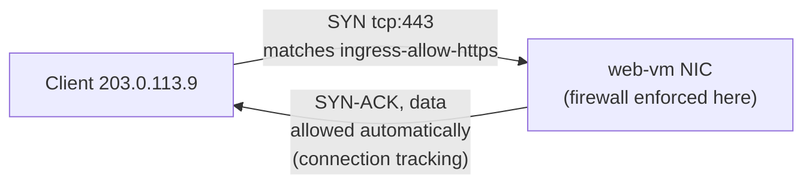
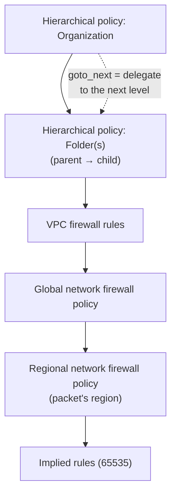

# GCP31 — Firewall Rules

> 🎛️ **Interactive visualization:** [Firewall Rule Evaluator](../../visualizations/gcp/GCP31%20-%20Firewall%20Rule%20Evaluator.html): send packets through a VPC's rules, see which rule matches and why, watch stateful return traffic, and step through the policy hierarchy. Opens in your browser.

## Summary
VPC firewall rules are **stateful**, **distributed** (enforced at every VM's NIC, not at a choke point), and built from five parameters: **direction**, **source/destination**, **protocol/port**, **action** and **priority**. They're evaluated from lowest number to highest, and the **first match wins**. At equal priority, **deny beats allow**. Every VPC has **implied rules** (allow all egress, deny all ingress, priority 65535) that you can't delete. The **default** VPC adds four permissive rules at 65534 that you should tighten. Some traffic is **always allowed** (metadata server, a VM talking to its own IPs) or **always blocked** (DHCP offers not from the metadata server, unusual protocols to external IPs).

Beyond per-VPC rules, **Cloud NGFW** groups rules into **firewall policies**:
- **Hierarchical** policies: organization or folder level.
- **Global or regional network** policies: attachable to many VPCs.

Policies support IAM-governed **secure tags**, L7/FQDN/geo filtering and IPS. **Firewall Insights** shows how rules are used and which ones to tighten.

**Cymbal scenario:** Kwan needs firewalling that applies at multiple levels of Cymbal's hierarchy → **Cloud NGFW firewall policies** (hierarchical at org/folder, plus network policies).

---

## Core Concepts

### Distributed and stateful

- **Stateful:** once a connection is allowed in one direction, **return traffic is allowed automatically**, whatever other rules say. The return packets must match the reversed 5-tuple.
- A tracked connection stays active if **at least one packet every 10 minutes** passes. After that, return traffic needs its own rule, which is a common cause of long-idle TCP sessions dropping.
- **Distributed:** rules are programmed on every host. There's no firewall appliance to scale or fail.

### The five parameters
| Parameter | Values | Notes |
|-----------|--------|-------|
| **Direction** | `INGRESS` or `EGRESS` | One rule = one direction |
| **Source / destination** | IP ranges, source tags, source service accounts | **Source** applies only to ingress. **Destination** applies only to egress |
| **Target** | All instances · target tags · target service accounts (optionally narrowed by IP) | *Which VMs the rule protects* |
| **Protocol / port** | `tcp`, `udp`, `icmp`, `tcp:22`, `tcp:80,443`, `tcp:8000-8100` | Nothing set = **all protocols** |
| **Action** | `allow` / `deny` | |
| **Priority** | 0–65535, default **1000** | Lower number = evaluated first. First match wins. **Same priority: deny beats allow** |

### How the target is selected
| Target | Applies to | Watch out |
|--------|-----------|-----------|
| All instances | Every VM in the VPC | Broad. Fine for org-wide denies |
| **Target tags** | VMs with that network tag | **Anyone with Instance Admin can add a tag** to a VM and grant themselves access |
| **Target service accounts** | VMs running as that SA, new or existing | Changing a VM's SA needs **stop → start**. Using an SA requires explicit IAM (`iam.serviceAccountUser`), so it's **more secure than tags** |

### Implied rules (every VPC, can't be deleted)
| Rule | Direction | Range | Action | Priority |
|------|-----------|-------|--------|----------|
| Implied IPv4 allow egress | EGRESS | `0.0.0.0/0` | allow | 65535 |
| Implied IPv4 deny ingress | INGRESS | `0.0.0.0/0` | deny | 65535 |
| Implied IPv6 allow egress *(IPv6 enabled)* | EGRESS | `::/0` | allow | 65535 |
| Implied IPv6 deny ingress *(IPv6 enabled)* | INGRESS | `::/0` | deny | 65535 |

Out of the box, VMs can **reach out** but **nothing can reach in**. Internet egress also needs an external IP or Cloud NAT. A firewall allow alone doesn't route anything.

### Default VPC pre-populated rules (priority 65534, deletable)
| Rule | Allows | Source | Risk |
|------|--------|--------|------|
| `default-allow-internal` | All protocols/ports between VMs in the VPC | `10.128.0.0/9` | No east-west segmentation |
| `default-allow-ssh` | tcp:22 | **0.0.0.0/0** | Internet SSH brute force |
| `default-allow-rdp` | tcp:3389 | **0.0.0.0/0** | Internet RDP: a top ransomware entry point |
| `default-allow-icmp` | ICMP | **0.0.0.0/0** | Recon |

**Production:** don't use the default VPC. Create custom-mode VPCs with explicit rules. Replace SSH/RDP from anywhere with **IAP** (`35.235.240.0/20`).

### Always allowed / always blocked
| Always **allowed** (no firewall rule applies) | Always **blocked** |
|----------------------------------------------|-------------------|
| Traffic to/from the **metadata server** (`169.254.169.254`) | Incoming **DHCP offers/ACKs** from anywhere except the metadata server |
| Packets to a VM's **own** IPs that stay inside the VM: primary internal IPv4, alias IPs, its IPv6, LB forwarding-rule IPs when it's a backend, loopback, overlay IPs | To external IPv4/IPv6: anything except **TCP, UDP, ICMP, ICMPv6, IPIP, AH, ESP, SCTP, GRE** |

### Best practices (lecture)
1. **Least privilege:** allow only what apps need. Avoid allow rules with `0.0.0.0/0`.
2. **Lowest-priority egress deny-all:** create `egress-deny-all` at 65534 (above the implied 65535 allow), then open specific egress at higher priority.
3. **Naming convention:** `direction-action-service-from/to-description`, e.g. `ingress-allow-ssh-from-onprem`, `egress-allow-all-to-gcevms`.
4. **Service-account targets over tags** (IAM-controlled).
5. Turn on **Firewall Rules Logging** for rules you need to audit.

### Cloud NGFW and firewall policies

| Construct | Attached to | Key properties |
|-----------|-------------|---------------|
| **Hierarchical firewall policy** | Organization or folder | Consistent org-wide rules. Actions `allow`, `deny`, **`goto_next`** (delegate to the next level down) |
| **Global network firewall policy** | One or more VPCs (**one per VPC**) | Applies in all regions. Batch updates. Supports **secure tags**, FQDN, geo, address groups, threat intel |
| **Regional network firewall policy** | One or more VPCs (**one per region per VPC**) | Applies only in its target region. Config isn't propagated elsewhere |
| VPC firewall rules (classic) | One VPC | The original model. New features ship only on policies |

**Default evaluation order:** hierarchical (org → folders) → VPC firewall rules → global network policy → regional network policy → implied rules. The first terminal match (`allow`/`deny`) ends evaluation. `goto_next` passes evaluation down. A network can be switched to evaluate network policies **before** classic VPC rules (`--network-firewall-policy-enforcement-order=BEFORE_CLASSIC_FIREWALL`).

> **Beyond the lecture / verify:** this order comes from the Cloud NGFW docs as I know them. The live docs page (rule evaluation order) couldn't be fetched this session (it renders client-side). Re-check it before relying on it in an exam question.

### Secure tags vs network tags
| | Network tags | **Secure tags** (Resource Manager tags) |
|--|-------------|----------------------------------------|
| Defined | Free-text string on a VM | Key-value pair defined at **org/project** level |
| Who can attach | Anyone who can edit the VM | Needs IAM `tagUser` on that tag |
| Used by | VPC firewall rules | **Network firewall policies** (and hierarchical policies) |
| Security | Weak (self-service) | Strong (IAM-governed) |

### Cloud NGFW tiers
| Tier | Adds |
|------|------|
| Essentials | Policies, secure tags, address groups, IPv4/IPv6 rules |
| Standard | FQDN objects, geolocation objects, **Google Threat Intelligence** lists |
| Enterprise | **IPS** (Palo Alto-based threat signatures), **TLS inspection**, L7 app filtering |

### Firewall Insights (Network Intelligence Center)
Built on **Cloud Monitoring metrics** + **Recommender insights**:
- **Shadowed rules:** rules that never match because a higher-priority rule covers them.
- **Overly permissive rules:** allow rules with no hits, or unused IP/port ranges. Candidates to tighten.
- **Deny-rule hits:** traffic being blocked, useful for spotting misconfigurations or attacks.

Needs **Firewall Rules Logging** enabled for hit-count data.

---

## Key Terms
| Term | Definition |
|------|-----------|
| Stateful | Return traffic of an allowed connection is allowed automatically (connection tracking) |
| Implied rules | Allow-egress / deny-ingress at 65535, in every VPC, not deletable |
| Target | Which VMs a rule applies to (all, tags, service accounts) |
| Hierarchical firewall policy | Org/folder-level rule container. Supports `goto_next` |
| Network firewall policy | Global or regional rule container attached to VPCs |
| Secure tag | IAM-governed key:value tag usable in firewall policies |
| Cloud NGFW | Google's firewall service: policies, L7, FQDN/geo, IPS |
| Firewall Insights | Usage metrics + recommendations for firewall rules |

---

## Real-World Connections
- **k3s:** a Kubernetes NetworkPolicy is also stateful and target-selected by **labels** (≈ secure tags). A default-deny NetworkPolicy ≈ an egress/ingress deny-all at the lowest priority. On k3s, Flannel doesn't enforce NetworkPolicy by itself; k3s ships an embedded network policy controller for that.
- **AWS:** **security groups** (stateful, allow-only, per ENI) ≈ VPC firewall rules with SA/tag targets. **NACLs** (stateless, per subnet, ordered) have no GCP equivalent. **AWS Firewall Manager** ≈ hierarchical policies.
- **Network+:** stateful vs stateless firewalls, ACL ordering, implicit deny ([[L20 - Network Defense Techniques]]).
- **Wireshark:** if a capture shows SYNs with no SYN-ACK, the ingress rule (or the implied deny) dropped them. GCP firewall drops are silent: no RST, no ICMP unreachable.

---

## Troubleshooting Scenario
**Scenario:** A new `api-vm` (tag `api`, SA `api-sa@`) in a custom VPC can't be reached on tcp:8443 from `web-vm`, though you created `ingress-allow-8443-from-web` (priority 1000, target tag `api`, source tag `web`).
**Check in order:**
1. **Connectivity Test** web-vm → api-vm tcp:8443. It names the blocking rule.
2. Is there a **deny at the same priority 1000**? Deny wins ties.
3. Does `web-vm` actually carry the **`web` tag**? Source tags match the VM's **primary internal IP** only, not external IPs.
4. A **hierarchical policy** deny at the org/folder level that's evaluated before VPC rules?
5. The app listening on `0.0.0.0:8443` (`ss -tlnp`)? A firewall allow doesn't help if nothing listens.
```bash
gcloud network-management connectivity-tests create web-api \
  --source-instance=projects/P/zones/Z/instances/web-vm \
  --destination-instance=projects/P/zones/Z/instances/api-vm --protocol=TCP --destination-port=8443
gcloud compute firewall-rules list --filter="network:app-vpc" --sort-by=priority \
  --format="table(name,direction,priority,sourceTags.list(),targetTags.list(),allowed[].map().firewall_rule().list(),denied[].map().firewall_rule().list())"
```

---

## Hands-On Ideas
1. In a custom VPC, create `egress-deny-all` (priority 65534) and confirm `curl example.com` fails. Then add `egress-allow-https-to-any` (1000, tcp:443) and confirm HTTPS works but `curl http://` doesn't.
2. Create two rules for tcp:22 at priority 1000, one allow and one deny, and confirm the deny wins.
3. Prove statefulness: allow only ingress tcp:80 to a web VM and confirm responses flow back with no egress rule (the implied egress allow would hide this, so repeat with `egress-deny-all` in place).
4. Replace a tag-based rule with a service-account-target rule. Then try adding the tag to another VM as a non-admin user and see the difference.
5. Enable logging on a rule and look at **Firewall Insights** after some traffic.

---

## Quiz
1. Two ingress rules at priority 1000 match the same packet: one allows, one denies. Result?
   - A) Allowed  B) Denied  C) Rule created first wins  D) Random
2. What is the default priority if none is specified?
   - A) 0  B) 100  C) 1000  D) 65535
3. The implied rules are:
   - A) Allow ingress, deny egress  B) Allow egress and deny ingress at 65535, not deletable  C) Deny both, deletable  D) Only present in the default VPC
4. Why prefer service-account targets over network tags?
   - A) Faster  B) Using a service account requires explicit IAM, while any Instance Admin can add a tag  C) Tags don't work on egress  D) SAs are free
5. A VM allowed inbound tcp:443 sends responses with no matching egress rule. Responses:
   - A) Are blocked  B) Are allowed: firewalls are stateful  C) Need Cloud NAT  D) Only work for UDP
6. Which default-VPC rule allows all traffic between VMs in the network?
   - A) default-allow-ssh  B) default-allow-internal  C) default-allow-icmp  D) implied allow egress
7. Kwan needs firewall rules enforced across the organization and folders, as well as per VPC. What should Kwan use?
   - A) VPC firewall rules only  B) Cloud Armor  C) Cloud NGFW firewall policies (hierarchical + network)  D) Cloud NAT
8. How many global network firewall policies can be associated with one VPC?
   - A) Unlimited  B) One  C) One per region  D) Five
9. Which traffic is always allowed regardless of firewall rules?
   - A) SSH from on-prem  B) Traffic to the metadata server  C) DHCP offers from any source  D) HTTP from the internet
10. Firewall Insights is built on:
    - A) Cloud Armor logs  B) Cloud Monitoring metrics and Recommender insights  C) VPC Flow Logs only  D) BigQuery

**Answers:** 1-B, 2-C, 3-B, 4-B, 5-B, 6-B, 7-C, 8-B, 9-B, 10-B

---

## Weak Areas to Revisit
*(none flagged yet)*

## Linked Pages
- [[GCP30 - IAM Roles]] · [[GCP29 - Module Introduction - Controlling Access to VPC Networks]]
- [[GCP20 - Other Topologies - Mesh, Mirrored, Gated]] (Cloud NGFW Enterprise IPS) · [[GCP12 - Lab - Implement Private Google Access and Cloud NAT]] (IAP rule)
- [[GCP21 - Getting Topology Data]] (Network Intelligence Center) · [[L20 - Network Defense Techniques]]
- [[gcp-command-anatomy]] · [[certs/gcp-networking]]
