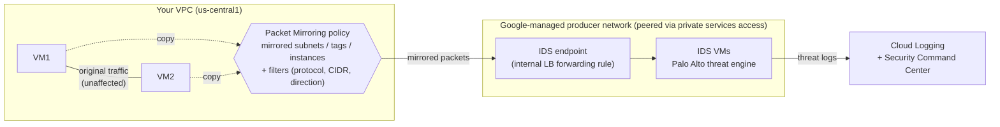

# GCP33 — Cloud IDS

> 🎛️ **Interactive visualization:** [Cloud IDS Explorer](../../visualizations/gcp/GCP33%20-%20Cloud%20IDS%20Explorer.html): choose what gets mirrored, set the severity threshold, send simulated traffic and read the threat log; size endpoints by throughput. Opens in your browser.

## Summary
**Scenario:** Quinn, a network engineer at Cymbal, faces rising attacks on customer and financial data: unauthorized access attempts, malware delivery and execution, covert spyware, and **command-and-control (C2)** channels from compromised hosts to external servers. Cymbal adopts **Cloud IDS**.

**Cloud IDS** is a **fully managed intrusion *detection*** service. Real-time detection of **intrusions, malware, spyware and C2** in both **north-south** (in/out of the VPC) and **east-west** (VM-to-VM, i.e. **lateral movement**) traffic. How it works:
- You create an **IDS endpoint**: a zonal resource that inspects traffic from **any zone in its region**.
- **Packet Mirroring** policies copy traffic to it.
- Google runs the inspection VMs in a **Google-managed peered network**, using **Palo Alto Networks** threat technology.
- **Signatures update automatically.**
- It helps with **compliance** (PCI DSS 11.4, HIPAA per docs).

---

## Core Concepts

### Architecture

| Component | What it is | Notes |
|-----------|-----------|-------|
| **IDS endpoint** | Zonal resource; inspects mirrored traffic from **any zone in its region** | Needs one per region you monitor. Exposes a forwarding rule that the mirroring policy targets |
| **Packet Mirroring policy** | Copies VM traffic (subnets, tags or instances) | Attach **one or more** policies to an endpoint. Each policy sends to **one** endpoint |
| **Google-managed IDS VMs** | Run the Palo Alto engine in a peered producer network | All mirrored traffic from a given VM always goes to the **same** IDS VM (flow-consistent inspection) |
| **Private services access** | Peering between your VPC and Google's IDS producer network | **Prerequisite**. Needs its own unique allocated range (separate from other PSA uses) ([[GCP10 - Private Services Access]]) |
| **Service profile / severity** | Minimum alert severity: INFORMATIONAL · LOW · MEDIUM · HIGH · CRITICAL | Lower threshold = more alerts (noise). `--threat-exceptions` mutes up to **99** threat IDs per endpoint |

### Detection, not prevention
| | **Cloud IDS** | **Cloud NGFW Enterprise (IPS)** | **Cloud Armor** |
|--|---------------|------------------------------|-----------------|
| Mode | **Detect + alert** (out-of-band copy) | Detect **and block** (inline) | Block at the edge (L7) |
| Traffic | Mirrored copy, so no latency on production traffic | Inline, through firewall endpoints | Requests to external LBs |
| Scope | North-south + **east-west** | North-south + east-west | Internet → LB only |
| Engine | Palo Alto threat signatures | Palo Alto threat signatures | Google WAF/ML |

> **Docs:** "Cloud IDS detects and alerts on threats, but it does **not** take action to prevent attacks or repair damage." Respond with Cloud NGFW (firewall rules or Enterprise IPS), isolate the VM, and so on.

### What the signatures catch
| Signature type | Detects | Cymbal example |
|----------------|---------|----------------|
| **Vulnerability** | Exploit attempts against system flaws, unauthorized access | Known web/app exploit patterns hitting the API; brute-force access attempts |
| **Anti-spyware** | Infected hosts phoning home: **C2 beacons**, spyware traffic leaving the network | A compromised VM contacting an external C2 server |
| **Antivirus / malware** | Malicious files crossing the network | Malware download into a VM |

### Capacity and sizing (docs)
- Each IDS endpoint inspects up to **5 Gbps** (it absorbs spikes to ~17 Gbps).
- Plan **one endpoint per 5 Gbps** of mirrored throughput in a region.

### Packet Mirroring refresher
Mirroring sends a **copy** of each packet. The source VM's traffic isn't delayed or changed. Filters cut cost and noise: mirror only certain **CIDRs**, **protocols** or **directions**. Mirrored bandwidth adds to the VM's egress, so mirroring busy VMs has a cost.

### Setup sequence
```bash
# 1. IAM: roles/ids.admin (create endpoints), roles/ids.viewer (read)
# 2. Private services access (unique range for IDS)
gcloud services enable servicenetworking.googleapis.com ids.googleapis.com
gcloud compute addresses create ids-psa-range --global --purpose=VPC_PEERING \
    --prefix-length=24 --network=cymbal-vpc
gcloud services vpc-peerings connect --service=servicenetworking.googleapis.com \
    --ranges=ids-psa-range --network=cymbal-vpc
# 3. IDS endpoint (takes ~20 min)
gcloud ids endpoints create ids-usc1 --network=cymbal-vpc --zone=us-central1-a \
    --severity=INFORMATIONAL [--threat-exceptions=THREAT_ID,...] --no-async
gcloud ids endpoints describe ids-usc1 --zone=us-central1-a --format="value(endpointForwardingRule)"
# 4. Packet Mirroring policy → endpoint's forwarding rule
gcloud compute packet-mirrorings create ids-mirror --region=us-central1 --network=cymbal-vpc \
    --collector-ilb=ENDPOINT_FORWARDING_RULE --mirrored-subnets=web-subnet,db-subnet \
    [--filter-cidr-ranges=0.0.0.0/0 --filter-protocols=tcp,udp,icmp --filter-direction=both]
# 5. Read threats
gcloud logging read 'resource.type="ids.googleapis.com/Endpoint" AND logName:"ids.googleapis.com%2Fthreat"' --limit=10
```
Full flag breakdown: [[gcp-command-anatomy]] §13.

---

## Key Terms
| Term | Definition |
|------|-----------|
| IDS vs IPS | Detection (alerts, out-of-band) vs prevention (blocks, inline) |
| IDS endpoint | Zonal Cloud IDS resource; inspects mirrored traffic from any zone in its region |
| Packet Mirroring | Clones VM traffic to a collector (internal LB / IDS endpoint) |
| North-south / east-west | In/out of the network / between workloads inside it |
| Lateral movement | An attacker pivoting from one compromised host to others (east-west) |
| C2 (command and control) | A channel between malware on a victim host and the attacker's server |
| Threat exception | A muted threat ID (≤ 99 per endpoint) to reduce noise |

---

## Real-World Connections
- **Wireshark course:** Cloud IDS is the managed version of "capture at the right point and look for bad patterns". Packet Mirroring = a SPAN/TAP ([[WS03 - Where to Capture on the Network]]). You could point a mirroring policy at your own collector (internal LB → VMs running Zeek/Suricata/tshark) instead of Cloud IDS.
- **k3s lab:** Kubeshark is east-west visibility for pods (similar to Cloud IDS's VM-to-VM view, but for observability, not signature detection). Falco covers runtime threats on the node.
- **AWS:** VPC Traffic Mirroring + **GuardDuty** (managed detection from flow/DNS logs) or a partner IDS. Network Firewall with Suricata rules covers IPS.
- **Network+:** IDS vs IPS, signature vs anomaly detection, SPAN/TAP ([[L20 - Network Defense Techniques]]).
- **Partner ecosystem:** Cloud IDS *is* a Palo Alto engine delivered natively, which shows how blurry the native-vs-partner line is ([[GCP27 - Types of Complementary Partner Products]]).

---

## Troubleshooting Scenario
**Scenario:** Quinn created an IDS endpoint and a mirroring policy, but the threat log is empty for days, even after a scheduled vulnerability scan of `web-subnet`.
**Check:**
1. **Endpoint state** `READY`? (`gcloud ids endpoints describe`). Creation takes ~20 minutes.
2. Mirroring policy **collector** = the endpoint's **forwarding rule**, in the **same region** as the mirrored VMs?
3. Policy **mirrored sources** actually include the scanned VMs (subnet, tag or instance)? Filters too narrow (wrong CIDR, direction `INGRESS` only)?
4. **Severity** too high (e.g. `CRITICAL` hides MEDIUM scanner detections)? Any **threat exceptions** muting them?
5. **PSA** peering active, with no overlapping ranges?

---

## Hands-On Ideas (defensive)
1. In a test project, set up PSA + an endpoint at `INFORMATIONAL` + a mirroring policy on one subnet. Generate **benign** traffic (curl to a test web server) and browse the endpoint's dashboards and logs.
2. Compare mirroring filters: all traffic vs `--filter-direction=ingress` vs one CIDR. Note the mirrored-byte differences in Monitoring.
3. Build a Logging **alert policy** on IDS threat logs with severity ≥ HIGH that notifies a channel. Route threat logs to BigQuery to track trends.
4. Do the Wireshark version: mirror to your own internal-LB collector VM and capture with `tcpdump` to see exactly what Cloud IDS receives.

---

## Quiz
1. Cloud IDS mainly:
   - A) Blocks attacks inline  B) Detects and alerts on intrusions, malware, spyware and C2  C) Load-balances traffic  D) Encrypts traffic
2. How does traffic reach Cloud IDS?
   - A) DNS redirection  B) Packet Mirroring copies traffic to an IDS endpoint  C) VPN tunnel  D) Cloud NAT
3. An IDS endpoint is:
   - A) Global  B) Regional only  C) Zonal, but inspects traffic from any zone in its region  D) Per VM
4. Which traffic does Cloud IDS see?
   - A) Only internet ingress  B) Only egress  C) North-south and east-west, including VM-to-VM lateral movement  D) Only load balancer traffic
5. Whose threat technology inspects traffic in Cloud IDS?
   - A) Cisco  B) Fortinet  C) Check Point  D) Palo Alto Networks
6. Which networking prerequisite does Cloud IDS need?
   - A) Cloud NAT  B) Private services access to the Google-managed network  C) HA VPN  D) Shared VPC
7. Cloud IDS finds a C2 beacon. What actually stops the traffic?
   - A) Cloud IDS itself  B) A response such as a Cloud NGFW firewall rule or Enterprise IPS, or isolating the VM  C) Packet Mirroring  D) Cloud Logging
8. How should you size endpoints for 12 Gbps of mirrored traffic in one region?
   - A) 1  B) 2  C) 3 (one per ~5 Gbps)  D) 12

**Answers:** 1-B, 2-B, 3-C, 4-C, 5-D, 6-B, 7-B, 8-C

---

## Weak Areas to Revisit
*(none flagged yet)*

## Linked Pages
- [[GCP31 - Firewall Rules]] (Cloud NGFW Enterprise IPS) · [[GCP32 - Lab - Configuring VPC Firewalls]] · [[GCP23 - Network Security - Course Introduction]]
- [[GCP10 - Private Services Access]] · [[GCP27 - Types of Complementary Partner Products]] · [[GCP20 - Other Topologies - Mesh, Mirrored, Gated]]
- [[WS03 - Where to Capture on the Network]] · [[L20 - Network Defense Techniques]]
- [[gcp-command-anatomy]] · [[certs/gcp-networking]]
