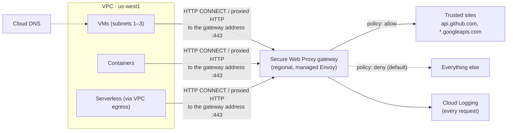
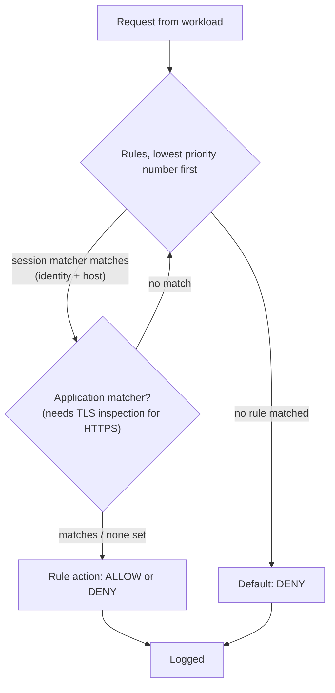

# GCP35 — Secure Web Proxy

> 🎛️ **Interactive visualization:** [Secure Web Proxy Policy](../../visualizations/gcp/GCP35%20-%20Secure%20Web%20Proxy%20Policy.html): build rules, send requests from different workloads and see which rule decides, with and without TLS inspection. Opens in your browser.

## Summary
**Secure Web Proxy (SWP)** is a managed **forward proxy for outbound web traffic** (HTTP/HTTPS). It sits between your workloads and the internet and decides each request by policy: *who* is asking (service account, secure tag, client certificate) and *where* they're going (host, URL list, path). Sources can be VMs, containers, serverless apps, and workloads outside Google Cloud that route through it.

The lecture gives three benefits:
- **Streamlined cloud migration:** keep your existing egress web policies, with no third-party proxy to run.
- **Controlled access to external services:** identity- and URL-based rules.
- **Monitored access to untrusted sites:** everything that deviates from policy is logged.

**Cymbal scenario:** Kwan (the transcript says "Quan"; the slide says Kwan) needs one automated way to control web egress across on-prem and cloud. SWP lets Cymbal **programmatically restrict cloud workloads to an allowlist of trusted external web services**.

Docs add: SWP is **deny-all by default**. Nothing leaves until a rule allows it.

---

## Core Concepts

### Where SWP sits


### Building blocks
| Object | What it is | Example |
|--------|-----------|---------|
| **Gateway** (`network-services gateways`, type `SECURE_WEB_GATEWAY`) | The regional proxy instance: an internal IP and port in your VPC | `10.0.9.10:443` in `us-west1` |
| **Gateway security policy** | Container of rules, attached to the gateway | `egress-policy` |
| **Rules** | Priority + **session matcher** (+ optional **application matcher**) + allow/deny | Priority 100: SA `ci-runner@` → host `api.github.com` → ALLOW |
| **URL list** | Reusable list of hosts/URLs, wildcards allowed | `*.github.com`, `pypi.org`, `files.pythonhosted.org` |
| **TLS inspection policy** | Lets SWP decrypt HTTPS (with your CA via Certificate Authority Service) so it can match full URL paths | Required to match `/repos/cymbal/*` rather than just the host |

### Two matchers, one important limit
| Matcher | Sees | Can match on |
|---------|------|--------------|
| **Session matcher** | The connection (CONNECT host, SNI, source) | `host()`, source IP, `source.matchServiceAccount()`, `source.matchTag()`, URL list membership |
| **Application matcher** | The HTTP request *inside* the tunnel | Full URL path, method, headers. **Only works with TLS inspection** for HTTPS |

Without TLS inspection, HTTPS is a tunnel: SWP knows the **destination host** but not the path. Allowing `github.com` then allows all of GitHub. That's a common exam and design trap.

### How a request is decided


### Why identity beats IP for egress
- **Firewall egress rules** ([[GCP31 - Firewall Rules]]) match IPs and ports (plus FQDN objects in Cloud NGFW Standard). They can't tell `ci-runner` from `web-frontend` if both share a subnet unless you use SA targets, and they never see URLs.
- **SWP** matches **service account / secure tag / mTLS identity** together with **host and URL**. For example, "only the finance service account may reach the bank's API". The docs' own example: *"Only members of the Finance team can access this banking website."*

### SWP vs related controls
| Control | Direction | Layer | Decides on |
|---------|-----------|-------|-----------|
| **Secure Web Proxy** | **Egress** web | L7 (HTTP/S) | Identity + host/URL; logs every request |
| Cloud NGFW egress rules / FQDN objects | Egress, any protocol | L3–L4 (+FQDN) | IP, port, FQDN, geo, tags |
| Cloud NAT | Egress | L3–L4 | No policy: just address translation ([[GCP11 - Cloud NAT]]) |
| Cloud Armor | **Ingress** to external LBs | L7 | Client IP, headers, WAF signatures ([[GCP26 - Google Cloud DDoS Mitigations]]) |
| Gated egress topology | Design pattern | — | SWP or an NVA is how you *implement* it ([[GCP20 - Other Topologies - Mesh, Mirrored, Gated]]) |

### Deployment modes (docs)
| Mode | How clients reach SWP |
|------|----------------------|
| **Explicit proxy** (default) | Clients set `HTTPS_PROXY=http://10.0.9.10:443` (or a PAC file) |
| **Next hop** | A route sends web traffic to SWP. No client configuration |
| **PSC service** | Publish SWP to other VPCs/projects as a Private Service Connect service ([[GCP09 - Private Service Connect]]) |

Egress from the proxy to the internet uses **Cloud NAT** (or static IPs you assign), so partners can allowlist a fixed set of addresses.

### Setup sketch
```bash
gcloud network-security url-lists import trusted-dev --location=us-west1 --source=urls.yaml
#   urls.yaml: name: ..., values: ["*.github.com", "pypi.org", "files.pythonhosted.org"]
gcloud network-security gateway-security-policies import egress-policy --location=us-west1 --source=policy.yaml
gcloud network-security gateway-security-policies rules import allow-ci --location=us-west1 \
    --gateway-security-policy=egress-policy --source=rule.yaml
#   rule.yaml: priority: 100, basicProfile: ALLOW, enabled: true,
#     sessionMatcher: "source.matchServiceAccount('ci-runner@PROJECT.iam.gserviceaccount.com') &&
#                      inUrlList(host(), 'projects/PROJECT/locations/us-west1/urlLists/trusted-dev')"
gcloud network-services gateways import swp-usw1 --location=us-west1 --source=gateway.yaml
#   gateway.yaml: type: SECURE_WEB_GATEWAY, addresses: [10.0.9.10], ports: [443],
#     gatewaySecurityPolicy: .../egress-policy, network: ..., subnetwork: ...
# client VM:
export HTTPS_PROXY=http://10.0.9.10:443; curl -I https://api.github.com   # allowed
curl -I https://example.com                                                # 403 from proxy (default deny)
```
Field-by-field breakdown: [[gcp-command-anatomy]] §14. A regional **proxy-only subnet** is also required, because SWP runs on Google-managed Envoy proxies.

---

## Key Terms
| Term | Definition |
|------|-----------|
| Forward proxy | A proxy for **outbound** client requests (vs a reverse proxy in front of servers, like a load balancer) |
| Gateway security policy | The rule set SWP enforces |
| Session matcher | CEL expression on connection-level facts: source identity, destination host |
| Application matcher | CEL expression on HTTP request details. Needs TLS inspection for HTTPS |
| URL list | Named, reusable host/URL allowlist |
| TLS inspection | Decrypt, inspect, re-encrypt HTTPS using your own CA |
| Egress control | Restricting which external destinations workloads may reach |

---

## Real-World Connections
- **Supply-chain defense:** build runners should reach only package registries and source hosts. SWP + a URL list blocks malware callbacks and data exfiltration to random hosts, and the logs show attempted destinations. This is the egress half of what Cloud IDS detects ([[GCP33 - Cloud IDS]]).
- **k3s lab:** the same idea as a Squid proxy or an Istio **egress gateway** with ServiceEntries. A Kubernetes NetworkPolicy alone can't filter by hostname.
- **AWS:** AWS Network Firewall domain lists (SNI-based) or a self-managed Squid fleet. There's no direct managed identity-aware forward proxy equivalent.
- **Azure (AZ-500):** Azure Firewall application rules with FQDN tags and TLS inspection (Premium).
- **Network+:** forward vs reverse proxy, content filtering, explicit vs transparent proxy ([[L20 - Network Defense Techniques]]).

---

## Troubleshooting Scenario
**Scenario:** After SWP rollout, `pip install` on the CI VMs fails with HTTP 403, though `pypi.org` is in the allowed URL list.
**Analysis:** pip downloads packages from **`files.pythonhosted.org`**, not `pypi.org`. Default deny blocks it. The SWP logs show the denied host.
**Fix:** add `files.pythonhosted.org` to the URL list. Also check:
- clients actually have `HTTPS_PROXY` set (explicit mode)
- the rule's service account matches the VM's SA
- the priority order isn't letting a broader deny match first
- path-based rules aren't silently failing because TLS inspection is off

---

## Hands-On Ideas
1. Build the setup sketch in a test project with one VM. Prove that the default deny returns 403, then allow exactly one host.
2. Add a second VM with a different service account. Show the same URL allowed for one SA and denied for the other.
3. Try a path rule (`/repos/cymbal/*`) without TLS inspection and observe that it can't match. Then explain why.
4. Query logs: `resource.type="networkservices.googleapis.com/Gateway"` and filter denied requests.

---

## Quiz
1. Secure Web Proxy controls which traffic?
   - A) Inbound internet traffic to load balancers  B) VM-to-VM east-west traffic  C) DNS queries only  D) Outbound HTTP/HTTPS from workloads
2. With no rules defined, SWP:
   - A) Denies everything (default deny)  B) Allows everything  C) Allows only Google APIs  D) Logs but forwards
3. Which identities can SWP rules match on?
   - A) Only source IP  B) Only usernames  C) Service accounts, secure tags, and mTLS client identities  D) MAC addresses
4. You allow `github.com` but want only `/repos/cymbal/*`. What's required?
   - A) A bigger URL list  B) TLS inspection, so the application matcher can see the path  C) Cloud Armor  D) Cloud NAT logging
5. Which statement best describes Kwan's goal?
   - A) An allowlist of trusted external web services for cloud workloads  B) Load-balance inbound traffic  C) Detect intrusions  D) Encrypt disks
6. Which tool would you use to stop VMs reaching arbitrary websites while still allowing specific API hosts by workload identity?
   - A) Cloud Armor  B) Cloud IDS  C) Secure Web Proxy  D) Packet Mirroring

**Answers:** 1-D, 2-A, 3-C, 4-B, 5-A, 6-C

---

## Weak Areas to Revisit
*(none flagged yet)*

## Linked Pages
- [[GCP29 - Module Introduction - Controlling Access to VPC Networks]] · [[GCP31 - Firewall Rules]] · [[GCP33 - Cloud IDS]]
- [[GCP20 - Other Topologies - Mesh, Mirrored, Gated]] · [[GCP11 - Cloud NAT]] · [[GCP09 - Private Service Connect]]
- [[gcp-command-anatomy]] · [[certs/gcp-networking]]
