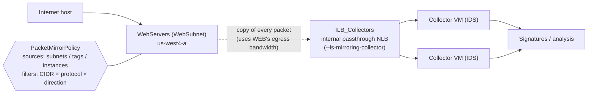

# GCP37 — Packet Mirroring for Network Traffic Inspection

> 🎛️ **Interactive visualization:** [Packet Mirroring Planner](../../visualizations/gcp/GCP36-38%20-%20Packet%20Mirroring%20Planner.html): pick sources, add filters (and watch the ranges × protocols count against the 30 limit), see the egress bandwidth cost, and check collector placement rules. Opens in your browser.

## Summary
**Scenario:** Izumi, a network engineer at Cymbal, must watch traffic from **selected VMs** for malicious activity. Some attacks span **multiple packets**: sampled logs and per-packet firewall checks miss them.

**Packet Mirroring** clones **all ingress and egress traffic** of chosen instances (**headers and payloads**) and sends the copy to a **collector**, usually an instance group behind an **internal passthrough Network Load Balancer**, running IDS, network monitoring or forensics tools.
- Mirroring happens **on the VM host**, not in the network fabric. It **consumes the mirrored VM's egress bandwidth**.
- **Filters** (IP ranges, protocols, direction) cut that cost. Max **30 filters**.
- Use cases:
  - threat detection
  - application performance troubleshooting
  - **network forensics for PCI DSS** and other regulations

---

## Core Concepts

### Architecture (deck 10, slide 4)

- **Policies are tied to workloads, not the VPC** (slide 4). You select instances by subnet, network tag or name. The policy follows them.
- The collector ILB spreads mirrored flows across analyzer VMs. **Each flow consistently lands on the same collector**, so a tool sees whole conversations.

### Flow Logs vs Packet Mirroring
| | VPC Flow Logs | Packet Mirroring |
|--|--------------|-----------------|
| Content | Flow **metadata** (5-tuple, bytes, packets, RTT) | **Full packets**: headers + payloads |
| Coverage | **Sampled** | **All** traffic matching the policy ("not only between sampling periods") |
| Cost driver | Log volume | **Egress bandwidth** on mirrored VMs + collector capacity |
| Good for | Capacity, top talkers, forensics on *who talked to whom* | DPI, IDS, multi-packet attack detection, protocol debugging |

### Rules and limits (docs)
| Rule | Value |
|------|-------|
| Mirrored sources per policy | **5 subnets**, **5 tags**, **50 instances** |
| Filters | Max **30**, counted as **(IP ranges) × (protocols)**. 30 ranges × 1 protocol = 30 ✔; 30 × 2 = 60 ✘ |
| Default capture | All **IPv4** traffic (filters can add IPv6 or narrow it) |
| Region | All sources + the collector in the **same region**, **same project and VPC** for sources |
| Collector location | Same VPC, or a VPC **peered** with the sources' VPC |
| Collector per policy | **One** collector destination per policy. One collector can serve many policies |
| Loop guard | You **can't mirror and collect on the same NIC** |
| Protocols | All layer 4 protocols |
| GKE same-node pod traffic | Needs **intranode visibility** |

### Bandwidth: the main limitation (slide 5)
Mirrored copies count against the **VM's egress bandwidth**. A web VM doing 4 Gbps of ingress+egress with full mirroring sends ~4 Gbps *more* egress. Fixes:
- **Filter by CIDR** (only internet-facing traffic, skip backup traffic to `10.0.50.0/24`)
- **Filter by protocol** (`tcp` only)
- **Filter by direction** (`INGRESS` only for an inbound-attack IDS)
- Mirror a **subset of instances** (one per MIG) instead of the whole subnet

### Use cases
| Use case | Collector runs | Notes |
|----------|---------------|-------|
| Threat detection (IDS) | Suricata/Zeek, partner IDS, or **Cloud IDS** endpoint | Cloud IDS manages the collector for you ([[GCP33 - Cloud IDS]]) |
| App performance troubleshooting | tshark, NPM tools | Retransmissions, TLS handshake failures, slow responses |
| **Forensics / compliance** | Full packet capture to storage | **PCI DSS**: keep evidence of what crossed the cardholder-data environment |

### Commands
```bash
# collector: MIG behind an internal passthrough NLB flagged as a mirroring collector
gcloud compute forwarding-rules create collector-fr --region=us-west4 --load-balancing-scheme=INTERNAL \
    --backend-service=collector-bes --ip-protocol=TCP --ports=all --is-mirroring-collector \
    --network=prod-vpc --subnet=collector-subnet
gcloud compute packet-mirrorings create web-mirror --region=us-west4 --network=prod-vpc \
    --collector-ilb=collector-fr --mirrored-subnets=web-subnet \
    --filter-cidr-ranges=0.0.0.0/0 --filter-protocols=tcp --filter-direction=ingress
gcloud compute packet-mirrorings update web-mirror --region=us-west4 --no-enable   # pause
gcloud compute packet-mirrorings describe web-mirror --region=us-west4
```
Full anatomy: [[gcp-command-anatomy]] §13.

---

## Key Terms
| Term | Definition |
|------|-----------|
| Mirrored source | VM(s) whose traffic is copied (selected by subnet, tag or instance) |
| Collector destination | Internal passthrough NLB (`--is-mirroring-collector`) in front of analyzers |
| Mirroring filter | CIDR × protocol × direction selection of what gets copied |
| Intranode visibility | GKE setting that routes same-node pod traffic through the VPC so it can be mirrored or logged |
| SPAN / TAP | On-prem equivalents: switch port mirroring / passive network tap |

---

## Real-World Connections
- **Wireshark course:** this is the cloud version of choosing a **capture point**. Mirroring the VM is like a SPAN on its switch port. The collector is your capture box ([[WS03 - Where to Capture on the Network]]). Open its pcaps with the coloring rules and Statistics views you built ([[WS10 - The Statistics View]]).
- **k3s lab:** Kubeshark captures pod traffic per node with eBPF/AF_PACKET. That's the same "copy, don't touch" idea, and also the same cost: CPU and bandwidth on the node.
- **AWS:** **VPC Traffic Mirroring** (ENI source → NLB or ENI target, filters, VXLAN-encapsulated). Very close to GCP's model.
- **Network+:** port mirroring, TAPs, IDS placement ([[L20 - Network Defense Techniques]]).

---

## Troubleshooting Scenario
**Scenario:** After enabling mirroring on `web-subnet`, users report slower downloads at peak, and the collector shows only some web VMs.
**Analysis:**
1. **Slower downloads:** mirroring doubles egress on busy web VMs, which hit their egress cap. Add `--filter-direction=ingress` (inbound attacks only) and a CIDR filter excluding internal backup flows.
2. **Missing VMs:** some web VMs are in a **different region**. Sources and collector must share a region, so add a policy plus collector in that region.
3. Also check that a collector VM isn't itself in `web-subnet`. You can't mirror and collect on the same NIC.

---

## Hands-On Ideas
1. Build a 2-VM collector MIG behind an internal NLB with `--is-mirroring-collector`. Mirror one web VM and capture on the collector: `sudo tcpdump -ni ens4 -w mirror.pcap`. Open the file in Wireshark.
2. Compare captured bytes with and without `--filter-direction=ingress` while running `curl` loops.
3. Work out the filter count for 12 CIDRs × 3 protocols (36, over the limit) and redesign it to fit.

---

## Quiz
1. Packet Mirroring copies:
   - A) Full packets (headers and payloads), ingress and egress  B) Only headers  C) Only sampled flows  D) Only DNS
2. Where does mirroring happen, and what does it cost?
   - A) In the network fabric, at no cost to VMs  B) On the VM host, consuming the mirrored VM's egress bandwidth  C) At the load balancer  D) At Cloud NAT
3. The collector destination is typically:
   - A) A Cloud Storage bucket  B) Cloud Armor  C) A VPN tunnel  D) An instance group behind an internal passthrough load balancer
4. 10 CIDR ranges and 3 protocols equals how many filters?
   - A) 13  B) 3  C) 30 (exactly at the limit)  D) 10
5. Which is NOT a valid rule?
   - A) Collector in the same region as the sources  B) Collector in a peered VPC  C) Mirror and collect on the same NIC  D) One collector shared by several policies
6. Best way to cut mirroring bandwidth for an inbound-attack IDS?
   - A) `--filter-direction=ingress` plus CIDR/protocol filters  B) Mirror every subnet  C) Increase the VM size only  D) Disable flow logs

**Answers:** 1-A, 2-B, 3-D, 4-C, 5-C, 6-A

---

## Weak Areas to Revisit
*(none flagged yet)*

## Linked Pages
- [[GCP36 - Module Introduction - Advanced Security Monitoring and Analysis]] · [[GCP38 - Network Security Best Practices]] · [[GCP33 - Cloud IDS]] · [[GCP34 - Lab - Getting Started with Cloud IDS]]
- [[GCP20 - Other Topologies - Mesh, Mirrored, Gated]] · [[WS03 - Where to Capture on the Network]] · [[gcp-command-anatomy]] · [[certs/gcp-networking]]
