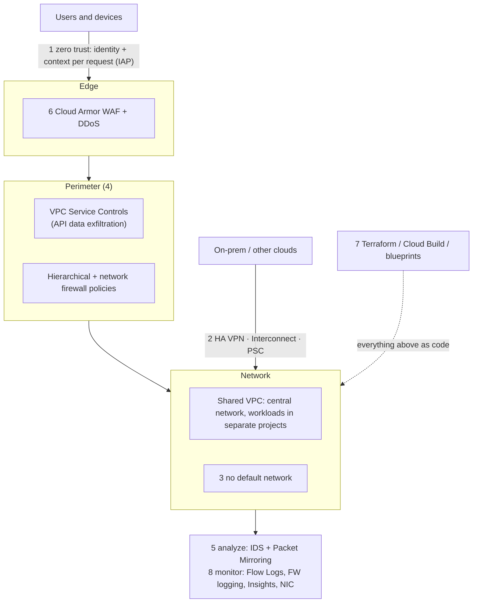

# GCP38 — Network Security Best Practices

> 🎛️ **Interactive visualization:** [Packet Mirroring Planner](../../visualizations/gcp/GCP36-38%20-%20Packet%20Mirroring%20Planner.html), "Best practices" tab: score an environment against the eight practices. Opens in your browser.

## Summary
The lecture's checklist (it "varies case by case"). Each one maps to a lesson already in this wiki, so this page is the Course 4 capstone:

| # | Practice | Google Cloud tools | Lesson |
|---|----------|-------------------|--------|
| 1 | **Adopt zero trust** | IAP, IAM, context-aware access, BeyondCorp / Chrome Enterprise Premium | [[GCP12 - Lab - Implement Private Google Access and Cloud NAT]] (IAP) |
| 2 | **Secure on-prem ↔ cloud links** | HA VPN (IPsec), Dedicated/Partner/Cross-Cloud Interconnect, PSC for APIs and services | [[GCP09 - Private Service Connect]] · Course 6 |
| 3 | **Disable default networks** | Org policy `compute.skipDefaultNetworkCreation`; plan IPs; ~1 VPC per project | [[GCP32 - Lab - Configuring VPC Firewalls]] |
| 4 | **Secure the cloud perimeter** | Firewall policies (org/folder/VPC), **VPC Service Controls**, **Shared VPC** | [[GCP31 - Firewall Rules]] · [[GCP08 - Private Google Access]] |
| 5 | **Analyze your network** | **Cloud IDS**, **Packet Mirroring** | [[GCP33 - Cloud IDS]] · [[GCP37 - Packet Mirroring for Network Traffic Inspection]] |
| 6 | **Use a WAF** | **Cloud Armor** (WAF + DDoS) | [[GCP26 - Google Cloud DDoS Mitigations]] |
| 7 | **Automate provisioning** | Terraform, Jenkins, Cloud Build, **security blueprints** (immutable environments) | — |
| 8 | **Monitor your network** | VPC Flow Logs, Firewall Rules Logging, Cloud Logging/Monitoring, Firewall Insights, Network Intelligence Center | [[GCP21 - Getting Topology Data]] · [[GCP31 - Firewall Rules]] |

> **Naming update:** the deck says "Cloud Armor **Managed Protection Plus**". That tier was renamed **Cloud Armor Enterprise** (Annual / Paygo). Same thing, new name ([[GCP26 - Google Cloud DDoS Mitigations]]).

---

## Core Concepts

### Defense in depth: the practices as layers


### Why each practice matters
| Practice | The failure it prevents |
|----------|------------------------|
| Zero trust | "Inside the VPN = trusted": one phished laptop reaches everything. IAP checks identity and device on **every request** instead of trusting network location |
| Secure hybrid links | Plain internet paths or unencrypted links. Note: **HA VPN is IPsec-encrypted; Cloud Interconnect is NOT encrypted by default** (add MACsec or HA VPN over Interconnect) |
| Disable default networks | Auto-mode `10.128.0.0/9` overlapping on-prem; `default-allow-ssh/rdp` from `0.0.0.0/0` |
| One VPC per project | Clear IAM boundaries. Network admins vs app teams via Shared VPC host/service projects |
| VPC Service Controls | A stolen key copying a bucket to an outside project. VPC-SC stops API calls that cross the perimeter |
| Firewall policies at many levels | One project opening RDP to the internet. An org-level deny can't be overridden |
| IDS + mirroring | Lateral movement and C2 inside the VPC that edge tools never see |
| WAF | SQLi/XSS and L7 floods reaching the app |
| IaC + immutable environments | Console drift, undocumented "temporary" rules. Code review catches `0.0.0.0/0` before it ships |
| Monitoring | No evidence after an incident, and no signal during one |

### Quick hardening checklist (gcloud)
```bash
# 3. no default network for new projects (org policy)
gcloud resource-manager org-policies enable-enforce compute.skipDefaultNetworkCreation --organization=ORG_ID
# 1. block external IPs on VMs (pair with IAP + Cloud NAT)
gcloud resource-manager org-policies set-policy vmExternalIp.yaml --organization=ORG_ID   # constraints/compute.vmExternalIpAccess deny all
# 4. VPC Service Controls perimeter around storage and BigQuery
gcloud access-context-manager perimeters create data_perim --policy=POLICY_ID \
    --title="data" --resources=projects/PROJECT_NUMBER --restricted-services=storage.googleapis.com,bigquery.googleapis.com
# 8. turn on visibility
gcloud compute networks subnets update app-subnet --region=us-central1 --enable-flow-logs
gcloud compute firewall-rules update ingress-allow-https-from-any --enable-logging
```

---

## Key Terms
| Term | Definition |
|------|-----------|
| Zero trust | Never trust by network location; verify identity and context on every request |
| VPC Service Controls | Service perimeter limiting which projects and networks can call Google APIs on protected data |
| Shared VPC | Host project owns the network; service projects run workloads in its subnets |
| Security blueprint | Google's reference IaC (e.g. enterprise foundations blueprint) with security defaults |
| Immutable infrastructure | Replace, don't patch in place; every change goes through code |

---

## Real-World Connections
- **Your k3s lab, scored against this list:** zero trust (k8s RBAC + no open NodePorts), disable defaults (delete the `default` namespace's permissive access, add a default-deny NetworkPolicy), analyze (Kubeshark), monitor (Elasticsearch + Kibana), IaC (Helm/Kustomize in git). The gaps are usually WAF and egress control.
- **AWS mapping:** IAM Identity Center + Verified Access (zero trust), Site-to-Site VPN / Direct Connect + MACsec, delete default VPCs, SCPs + VPC endpoint policies (≈ VPC-SC), GuardDuty + Traffic Mirroring, AWS WAF + Shield, CloudFormation/Terraform, VPC Flow Logs + CloudTrail.
- **AZ-500:** almost one-to-one with Azure's network security domain (NSGs, Azure Firewall, DDoS Protection, Private Link, Defender for Cloud).
- **Interviews:** "How would you secure a new GCP landing zone?" Walk this list in order.

---

## Troubleshooting Scenario
**Scenario:** An audit finds a developer project with the default network, `default-allow-rdp` from anywhere, no flow logs, and a public bucket copied to a personal project.
**Remediation, mapped to the practices:**
1. Practice 3: delete the default network and enforce `skipDefaultNetworkCreation`.
2. Practice 4: an org firewall policy denying tcp:3389/22 from `0.0.0.0/0`, plus a VPC-SC perimeter around storage.
3. Practice 1: SSH/RDP through IAP only.
4. Practice 8: flow logs and firewall logging.
5. Practice 7: rebuild the project from Terraform so the fix doesn't drift.

---

## Hands-On Ideas
1. Run the hardening checklist in a sandbox org (or the project-level equivalents).
2. Write a one-page "landing zone security baseline" for your Next.js + PostgreSQL project using the eight practices as headings.
3. Build a Terraform module: custom VPC, no external IPs, IAP SSH rule, Cloud NAT, flow logs on. Then destroy and recreate it to prove it's immutable.

---

## Quiz
1. Which practice shifts security controls from the network perimeter to individual users and devices?
   - A) Disable default networks  B) Adopt a zero-trust model  C) Use a WAF  D) Monitor your network
2. Which hybrid link is IPsec-encrypted by default?
   - A) Dedicated Interconnect  B) Partner Interconnect  C) HA VPN  D) Direct Peering
3. Why disable default networks?
   - A) They cost more  B) Avoid IP conflicts and the permissive default firewall rules  C) They don't support IPv4  D) They can't use Cloud NAT
4. Which two tools does the lecture name under "analyze your network"?
   - A) Cloud CDN and Cloud DNS  B) Cloud IDS and Packet Mirroring  C) Cloud NAT and Cloud Router  D) Apigee and Cloud Armor
5. Which practice centralizes network management while isolating workloads into separate projects?
   - A) Shared VPC  B) VPC peering only  C) Default network  D) Cloud CDN
6. "Managed Protection Plus" is now called:
   - A) Cloud Armor Standard  B) Cloud Armor Enterprise  C) Cloud NGFW Enterprise  D) Security Command Center Premium

**Answers:** 1-B, 2-C, 3-B, 4-B, 5-A, 6-B

---

## Weak Areas to Revisit
*(none flagged yet)*

## Linked Pages
- [[GCP36 - Module Introduction - Advanced Security Monitoring and Analysis]] · [[GCP37 - Packet Mirroring for Network Traffic Inspection]] · [[GQ06_Advanced_Security_Monitoring]]
- [[GCP22 - Best Practices for Connectivity and Topologies]] · [[GCP31 - Firewall Rules]] · [[GCP33 - Cloud IDS]] · [[GCP35 - Secure Web Proxy]] · [[GCP26 - Google Cloud DDoS Mitigations]]
- [[certs/gcp-networking]]
