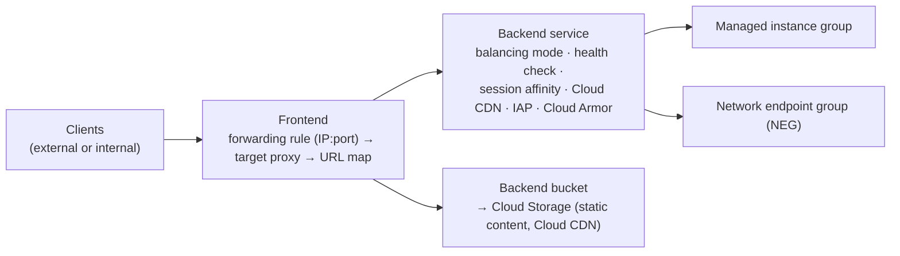

# GCP40 — Module Introduction: Hybrid Load Balancing and Traffic Management

> 🎛️ **Interactive visualization:** [Hybrid Load Balancer Builder](../../visualizations/gcp/GCP39-41%20-%20Hybrid%20Load%20Balancer%20Builder.html): "Pick a load balancer" and "NEG types" tabs. Opens in your browser.

## Summary
Module 1 of Course 5:
1. A **Cloud Load Balancing review**
2. **Hybrid load balancing**
3. **Traffic management**
4. A traffic-management **lab**

The review covers:
- the **backend service vs backend bucket** split
- the three LB families: **Application** (L7 proxy), **proxy Network**, **passthrough Network**
- the **five NEG types**. The module focuses on **hybrid connectivity NEGs**.

---

## Core Concepts

### What a backend configuration decides

| | **Backend service** | **Backend bucket** |
|--|--------------------|-------------------|
| Points to | MIGs or NEGs | A **Cloud Storage** bucket |
| Defines | Distribution, **health check**, **session affinity**, add-ons (**Cloud CDN, IAP**, Cloud Armor) | Static content serving (+ Cloud CDN) |
| Typical | Dynamic app tiers | Images, JS/CSS, downloads |

### The three load balancer families
| Family | Layer | Connection | Source IP at backend | Typical use |
|--------|-------|-----------|----------------------|-------------|
| **Application LB** | L7 HTTP/HTTPS | **Reverse proxy**: terminates and re-originates | Proxy IP (client IP in `X-Forwarded-For`) | Web apps/APIs, content-based routing, TLS termination |
| **Proxy Network LB** | L4 TCP (SSL offload optional) | Reverse proxy | Proxy IP (PROXY protocol optional) | Non-HTTP TCP, global TCP, **hybrid/multicloud backends** |
| **Passthrough Network LB** | L4 TCP/UDP/ESP/GRE/ICMP… | **No proxy**: packets forwarded as-is | **Original client IP preserved** | Direct server return, any IP protocol, UDP, next-hop ILB |

Each family comes in **external** (internet-facing) and **internal** flavors, and in global, regional or cross-region scopes. Picker: the visualization's first tab.

### The five NEG types
| NEG type | Endpoints | Specified by | Example |
|----------|----------|--------------|---------|
| **Zonal** | VMs or services on VMs (incl. **GKE pods** via container-native LB) | IP or IP:port | `GCE_VM_IP_PORT`: pod IPs from GKE |
| **Internet** | **One** endpoint outside Google Cloud | FQDN:port or IP:port | `INTERNET_FQDN_PORT` → `api.partner.com:443` (public) |
| **Serverless** | Cloud Run, App Engine, Cloud Run functions, API Gateway, **same region** | Service name | Regional serverless backend for a global LB |
| **Private Service Connect** | **One** endpoint: a Google regional API or a PSC-published service | Target service | Consume a producer service through the LB ([[GCP09 - Private Service Connect]]) |
| **Hybrid connectivity** | Endpoints **on-prem or in other clouds**, reached **privately** | IP:port, type `NON_GCP_PRIVATE_IP_PORT` | On-prem web farm over Interconnect/VPN ([[GCP41 - Hybrid Load Balancing]]) |

**Internet NEG vs hybrid NEG**, a classic confusion:
- **Internet NEG** reaches a *public* address over the internet.
- **Hybrid NEG** reaches a *private* IP over **Cloud VPN / Interconnect**.

> **Terminology update:** the lecture says NEGs work "with Traffic Director" and that hybrid NEGs point to "Traffic Director services". Traffic Director is now **Cloud Service Mesh**. Hybrid NEGs are used mainly as **load balancer backends**, as the next lesson shows.

---

## Key Terms
| Term | Definition |
|------|-----------|
| Backend service | LB config object: backends + health check + balancing + affinity + add-ons |
| Backend bucket | LB backend that serves a Cloud Storage bucket |
| Reverse proxy | Terminates the client connection and opens a new one to the backend |
| Passthrough | Forwards packets unchanged, preserving the client IP |
| NEG | Network endpoint group: a list of IP:port (or service) endpoints |
| Container-native load balancing | LB sends straight to pod IPs through zonal NEGs (no node hop) |

---

## Real-World Connections
- **k3s:** `kube-proxy` / ServiceLB ≈ passthrough. Traefik Ingress ≈ Application LB (reverse proxy, client IP in `X-Forwarded-For`). Container-native NEGs avoid the extra node hop that NodePort adds.
- **AWS:** ALB target types `instance` / `ip` / `lambda` ≈ MIG / zonal-or-hybrid NEG (`ip` targets can be on-prem over DX/VPN) / serverless NEG. NLB preserves the client IP like a passthrough NLB.
- **Wireshark:** behind a proxy LB, backend captures show **GFE/proxy-only-subnet IPs**. Behind a passthrough LB you see the real clients ([[GCP28 - Lab - Configuring Traffic Blocklisting with Google Cloud Armor]]).

---

## Troubleshooting Scenario
**Scenario:** An app behind a load balancer logs every request as coming from `35.191.x.x`, and the security team can't tell clients apart.
**Cause:** a **proxy-based** LB (Application or proxy Network) re-originates connections.
**Fix:**
- Read `X-Forwarded-For` (Application LB), or enable the **PROXY protocol** (proxy Network LB).
- Or, if you need raw client IPs at L4, use a **passthrough** NLB.

---

## Hands-On Ideas
1. `gcloud compute network-endpoint-groups list --format="table(name,zone,region,networkEndpointType,size)"`. Identify each NEG type in a project.
2. Create a backend bucket for a static-site bucket and attach it under `/static/*` in an existing URL map.

---

## Quiz
1. Which LB type preserves the client source IP at the backend?
   - A) Application LB  B) Proxy Network LB  C) Passthrough Network LB  D) All of them
2. A backend bucket serves content from:
   - A) Managed instance groups  B) Cloud Storage  C) Cloud Run  D) Filestore
3. Which NEG points to a single FQDN:port endpoint on the public internet?
   - A) Zonal  B) Serverless  C) Internet  D) Hybrid connectivity
4. Which NEG reaches private IP:port endpoints on-prem over VPN/Interconnect?
   - A) Internet  B) Hybrid connectivity  C) PSC  D) Serverless
5. Where are session affinity and the health check defined?
   - A) Forwarding rule  B) URL map  C) Backend service  D) Target proxy
6. A serverless NEG must be in the same ___ as the Cloud Run service.
   - A) Zone  B) Region  C) Project only  D) Organization

**Answers:** 1-C, 2-B, 3-C, 4-B, 5-C, 6-B

---

## Weak Areas to Revisit
*(none flagged yet)*

## Linked Pages
- [[GCP39 - Load Balancing - Course Introduction]] · [[GCP41 - Hybrid Load Balancing]]
- [[GCP09 - Private Service Connect]] · [[GCP28 - Lab - Configuring Traffic Blocklisting with Google Cloud Armor]] · [[gcp-command-anatomy]] · [[certs/gcp-networking]]
