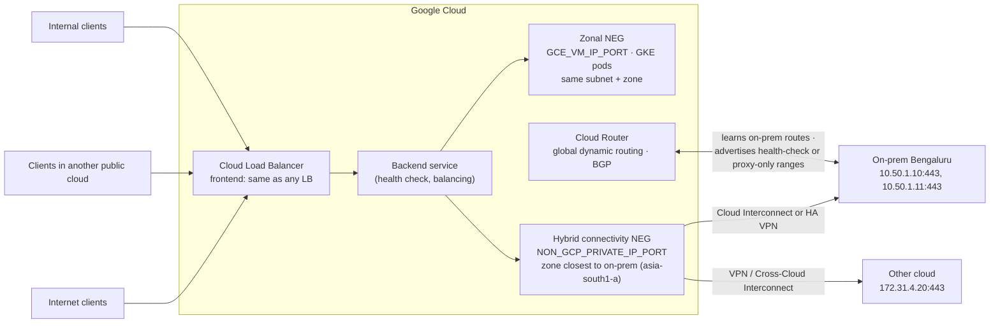

# GCP41 — Hybrid Load Balancing

> 🎛️ **Interactive visualization:** [Hybrid Load Balancer Builder](../../visualizations/gcp/GCP39-41%20-%20Hybrid%20Load%20Balancer%20Builder.html), "Hybrid NEG checker" tab: configure a hybrid deployment and see which requirement breaks it. Opens in your browser.

## Summary
**Hybrid load balancing** extends Cloud Load Balancing to workloads **outside Google Cloud** (on-prem and other clouds). It's useful both as a **migration bridge** and as a **permanent hybrid architecture**.

**Cymbal scenario:** Jia (later called Azumi in the transcript) has apps both on-prem and in **GKE**:
- sale-day spikes overwhelm the on-prem servers
- idle spare capacity is expensive
- running two separate load-balancing stacks is painful

**Solution:** one Google load balancer whose backend service holds a **zonal NEG** (GKE/VM endpoints) **and a hybrid connectivity NEG** (on-prem/other-cloud endpoints). Only the **backend** needs special configuration. The frontend is the same as for any LB.

**Requirements and caveats:**
- **Endpoints:** hybrid NEG endpoints are `NON_GCP_PRIVATE_IP_PORT`, must be reachable over **Cloud VPN / Interconnect**, and must live **outside** Google Cloud.
- **Placement:** put the NEG in the **zone closest** to the environment (Bengaluru → `asia-south1-a`).
- **Routing:** the Cloud Router needs **global dynamic routing**. Regional dynamic routing and static routes aren't supported.
- **Region:** an internal Application LB must be in the **same region** as the hybrid connectivity.
- **Tooling:** mixed zonal + hybrid NEGs in one backend service need the **gcloud CLI or REST API** (not the console).
- **Encryption:** **HA VPN is IPsec-encrypted; Interconnect isn't encrypted by default.**

---

## Core Concepts

### Architecture


### Setup steps
| # | Step | Why |
|---|------|-----|
| 1 | Hybrid connectivity up (HA VPN or Interconnect) + **Cloud Router with global dynamic routing** | The LB reaches on-prem IPs only through routes Cloud Router learns by BGP. Static routes aren't supported |
| 2 | Create the hybrid NEG: `--network-endpoint-type=NON_GCP_PRIVATE_IP_PORT` in the **closest zone** | Zone choice drives latency and health-check paths |
| 3 | Add endpoints (IP:port), **only non-Google** ones | Endpoints inside a VPC may have their **traffic dropped** |
| 4 | Health check, then a backend service with the NEG (+ a zonal NEG for cloud capacity) | Unhealthy endpoints get no traffic |
| 5 | Advertise Google's probe/proxy ranges **to on-prem**; allow them in the on-prem firewall | Otherwise health checks fail → "all backends unhealthy" |
| 6 | Frontend: URL map / proxy / forwarding rule as usual | Nothing hybrid-specific |

```bash
gcloud compute network-endpoint-groups create onprem-neg --zone=asia-south1-a \
    --network=hybrid-vpc --network-endpoint-type=NON_GCP_PRIVATE_IP_PORT --default-port=443
gcloud compute network-endpoint-groups update onprem-neg --zone=asia-south1-a \
    --add-endpoint="ip=10.50.1.10,port=443" --add-endpoint="ip=10.50.1.11,port=443"
gcloud compute health-checks create https onprem-hc --port=443 --request-path=/healthz
gcloud compute backend-services create web-bes --global --protocol=HTTPS \
    --health-checks=onprem-hc --load-balancing-scheme=EXTERNAL_MANAGED
gcloud compute backend-services add-backend web-bes --global --network-endpoint-group=onprem-neg \
    --network-endpoint-group-zone=asia-south1-a --balancing-mode=RATE --max-rate-per-endpoint=100
gcloud compute backend-services add-backend web-bes --global --network-endpoint-group=gke-neg \
    --network-endpoint-group-zone=asia-south1-a --balancing-mode=RATE --max-rate-per-endpoint=100
gcloud compute routers update hybrid-cr --region=asia-south1 --advertisement-mode=custom \
    --set-advertisement-groups=all_subnets --set-advertisement-ranges=35.191.0.0/16,130.211.0.0/22
gcloud compute networks update hybrid-vpc --bgp-routing-mode=global
```
Anatomy: [[gcp-command-anatomy]] §15.

### Which ranges must on-prem learn and allow? (docs)
| Load balancer type | Health checks come from | Advertise to on-prem |
|-------------------|------------------------|---------------------|
| Global external Application LB, classic Application LB, global external proxy NLB, classic proxy NLB | **Centralized** Google health checkers | **`35.191.0.0/16`, `130.211.0.0/22`** |
| **Envoy-based**: regional external/internal Application LB, cross-region internal Application LB, regional/cross-region internal proxy NLB, regional external proxy NLB | **Distributed Envoy** health checks from the proxies | The region's **proxy-only subnet** |

### Supported load balancers (lecture)
- Global external Application LB · classic Application LB · regional external Application LB
- Cross-region internal Application LB · regional internal Application LB
- External proxy NLB (global and regional) · regional internal proxy NLB · cross-region internal proxy NLB

**Not on the list:** **passthrough** NLBs. Hybrid NEGs need a **proxy** in front, because the proxy opens the connection to the on-prem IP.

### Gotchas (lecture + docs)
| Gotcha | Symptom | Fix |
|--------|---------|-----|
| Cloud Router in **regional** dynamic routing mode, or static routes | NEG unreachable or unhealthy | `--bgp-routing-mode=global` on the VPC; use BGP-learned routes |
| Internal Application LB in a **different region** from the hybrid connectivity | Backends show **healthy**, but requests are **never forwarded** | Put the LB in the same region as the VPN/Interconnect |
| Hybrid NEG holding **VPC** IPs | Traffic dropped | Hybrid NEGs = non-GCP only. Use a zonal NEG for VPC endpoints |
| Mixed zonal + hybrid NEGs built in the **console** | Not supported | gcloud or REST API |
| Probe/proxy ranges not advertised or allowed on-prem | All on-prem backends unhealthy | Custom advertisement + on-prem firewall allow |
| Interconnect assumed encrypted | Plaintext over the link | **MACsec** for Interconnect, HA VPN over Interconnect, or TLS end to end |

### Cloud bursting pattern (Jia's spike problem)
- Put both NEGs in one backend service with **RATE** balancing.
- On-prem endpoints get a capacity cap (`--max-rate-per-endpoint`). Once on-prem is full, the LB spills extra requests to the GKE zonal NEG, which autoscales.
- Result: on-prem keeps serving steady load, and the cloud absorbs sale-day bursts without idle spare capacity.

---

## Key Terms
| Term | Definition |
|------|-----------|
| Hybrid connectivity NEG | NEG of `NON_GCP_PRIVATE_IP_PORT` endpoints outside Google Cloud |
| Global dynamic routing | VPC BGP mode where Cloud Router-learned routes apply in all regions |
| Proxy-only subnet | Regional subnet holding Envoy proxies for Envoy-based LBs |
| Centralized vs distributed health checks | Google probers (35.191/16, 130.211/22) vs Envoy proxies in the proxy-only subnet |
| Cloud bursting | Overflow from on-prem to cloud capacity under load |

---

## Real-World Connections
- **Migration playbook:** start 100% on-prem behind the hybrid NEG, add the GKE zonal NEG, shift weight with traffic management (next lessons), then remove the hybrid NEG. That's a strangler-fig migration with no DNS change.
- **k3s lab:** your k3s cluster is "on-prem". With HA VPN + BGP, a Google LB could front a k3s NodePort or MetalLB IP as a hybrid NEG endpoint.
- **AWS:** ALB **IP targets** outside the VPC (on-prem over Direct Connect/VPN). The same idea, same caveats (routing, health checks, security groups).
- **Network+ / BGP:** why static routes don't work here. The LB's data plane programs only **dynamic** routes learned by Cloud Router ([[GCP01 - Routes and Route Preferences]]).

---

## Troubleshooting Scenario
**Scenario:** A regional internal Application LB in `us-central1` fronts a hybrid NEG for on-prem servers reached over Interconnect in `us-east4`. The console shows all endpoints **healthy**, but clients time out.
**Analysis:** the internal ALB and the hybrid connectivity are in **different regions**. The lecture warns about exactly this: health can look fine while requests aren't forwarded.
**Fix:** deploy the internal ALB (and its proxy-only subnet) in `us-east4`, or add a VLAN attachment in `us-central1`. Then check that global dynamic routing is on and the proxy-only subnet is advertised to on-prem.

---

## Hands-On Ideas
1. Lab-at-home: HA VPN between a GCP VPC and a second VPC acting as "on-prem" (BGP on both sides). Put an nginx VM in the "on-prem" VPC and register its IP in a **hybrid NEG** in the first VPC. Google's own codelabs simulate on-prem this way. It's fine for learning, but production hybrid NEGs should hold only truly external endpoints.
2. Break it on purpose: switch the VPC to regional routing mode and watch health checks fail.
3. Write the custom route advertisement for both LB families from the table above.

---

## Quiz
1. What endpoint type does a hybrid connectivity NEG use?
   - A) `GCE_VM_IP_PORT`  B) `NON_GCP_PRIVATE_IP_PORT`  C) `INTERNET_FQDN_PORT`  D) `SERVERLESS`
2. Where should you create a hybrid NEG for an on-prem site in Bengaluru?
   - A) The zone closest to Bengaluru, e.g. asia-south1-a  B) us-central1-a  C) Any zone  D) A global location
3. Which Cloud Router setting is required?
   - A) Regional dynamic routing  B) Static routes  C) Global dynamic routing  D) No router
4. An internal Application LB and the hybrid connectivity are in different regions. What happens?
   - A) Works fine  B) The LB can't be created  C) Traffic is encrypted  D) Backends can look healthy but requests aren't forwarded
5. Which hybrid link is encrypted by default?
   - A) Dedicated Interconnect  B) Partner Interconnect  C) HA VPN (IPsec)  D) None
6. To mix zonal and hybrid NEGs in one backend service, you must use:
   - A) gcloud CLI or REST API  B) The console only  C) Terraform only  D) It's impossible
7. Which load balancer type can't use hybrid NEGs?
   - A) Global external Application LB  B) Regional internal proxy NLB  C) Passthrough Network LB  D) Cross-region internal Application LB
8. For a global external Application LB, which ranges must on-prem learn and allow for health checks?
   - A) 35.235.240.0/20  B) 35.191.0.0/16 and 130.211.0.0/22  C) The proxy-only subnet  D) 199.36.153.8/30

**Answers:** 1-B, 2-A, 3-C, 4-D, 5-C, 6-A, 7-C, 8-B

---

## Weak Areas to Revisit
*(none flagged yet)*

## Linked Pages
- [[GCP40 - Module Introduction - Hybrid Load Balancing and Traffic Management]] · [[GCP39 - Load Balancing - Course Introduction]]
- [[GCP01 - Routes and Route Preferences]] · [[GCP18 - Hub-and-Spoke Topology]] · [[GCP22 - Best Practices for Connectivity and Topologies]] (MACsec)
- [[gcp-command-anatomy]] · [[certs/gcp-networking]]
