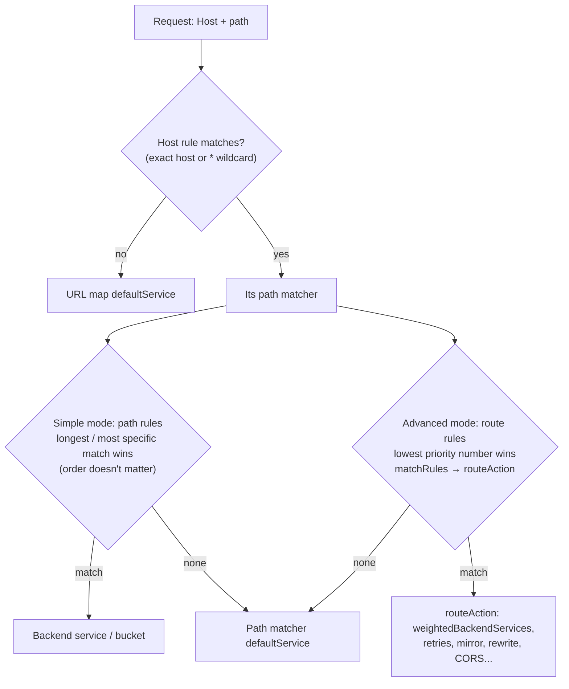

# GCP42 — Traffic Management

> 🎛️ **Interactive visualization:** [URL Map and Traffic Split](../../visualizations/gcp/GCP42-43%20-%20URL%20Map%20and%20Traffic%20Split.html): test URLs against simple and advanced URL maps, watch longest-match and wildcard rules decide, and run a weighted split. Opens in your browser.

## Summary
**Scenario:** Bola runs Cymbal's video streaming site behind Cloud Load Balancing, and wants requests for **4K** and **HD** video to go to different backends to optimize performance and cost.

**Traffic management** is a set of URL map features that route load balancer traffic on criteria you choose:
- **Traffic steering** by host, path, headers and other request parameters
- **Request and response actions**: redirects, URL rewrites, header transformations
- **Traffic policies**: retries, **request mirroring**, CORS, timeouts, fault injection, and **weighted splits**

It's configured in the **URL map**. That's the answer to GQ07 Q2.

Only the **Application Load Balancers** support it:
- global external ALB
- classic ALB (a smaller feature set)
- regional external ALB
- internal ALBs

The other load balancers only get backend-service features: balancing mode, session affinity, capacity scaling and health checks.

---

## Core Concepts

### How a URL map decides

| Mode | Rules | Evaluation | Use for |
|------|-------|-----------|---------|
| **Simple host and path rule** | `pathRules` (list of paths → service) | **Longest match** wins, in any order | Path-based routing (Bola's HD/4K split) |
| **Advanced host, path, and route rule** | `routeRules` (matchRules + routeAction) | **Priority** order, first match wins | Weighted splits, header matching, retries, mirroring, rewrites |

**One URL map uses one mode or the other, never both.**

### Bola's simple URL map
```yaml
defaultService: projects/P/global/backendServices/video-site      # host didn't match
hostRules:
- hosts: ['cymbal.com']                                           # lecture; the YAML slide uses '*'
  pathMatcher: pathmap
pathMatchers:
- name: pathmap
  defaultService: projects/P/global/backendServices/video-site    # host matched, no path matched
  pathRules:
  - paths: ['/video-hd']
    service: projects/P/global/backendServices/video-hd
  - paths: ['/video-4k']
    service: projects/P/global/backendServices/video-4k
```
| Request | Goes to | Why |
|---------|---------|-----|
| `cymbal.org/video-hd` | video-site | Host doesn't match `cymbal.com` → URL map default |
| `cymbal.com/video-hd` | **video-hd** | Exact path rule |
| `cymbal.com/video-4k` | **video-4k** | Exact path rule |
| `cymbal.com/home` | video-site | Host matched, no path → path matcher default |
| `cymbal.com/video-hd/clip1` | video-site | `/video-hd` is an **exact** path; it doesn't cover sub-paths. Use `/video-hd/*` for that |

### Advanced mode: a 95/5 canary
```yaml
defaultService: projects/P/global/backendServices/service-a       # no host rule matched
hostRules:
- hosts: ['*']
  pathMatcher: matcher1
pathMatchers:
- name: matcher1
  defaultService: projects/P/global/backendServices/service-a     # no route rule matched
  routeRules:
  - priority: 1
    matchRules:
    - prefixMatch: ''              # empty prefix = every path
    routeAction:
      weightedBackendServices:
      - backendService: projects/P/global/backendServices/service-a
        weight: 95
      - backendService: projects/P/global/backendServices/service-b
        weight: 5
      retryPolicy: {retryConditions: ['5xx'], numRetries: 2}     # optional traffic policy
```
The **two `defaultService`** values are the classic confusion:
- the top one applies when **no host rule** matches
- the one in the path matcher applies when **no route rule** matches

### Path matching rules (lecture + docs)
| Pattern | Matches | Doesn't match |
|---------|---------|---------------|
| `/video/*` | `/video/hd-pdq`, `/video/test1` | **`/video`** itself (add it as a separate path) |
| `/video*` | Invalid: a wildcard is only allowed right after `/` | — |
| `/videos/hd*` | Invalid for the same reason (it doesn't match `/videos/hd-pdq`) | — |
| `/video/hd/movie1` + `/video/hd/*` | The exact rule wins for `/video/hd/movie1`; the wildcard catches the rest | — |

There's **no regex and no substring matching** in simple path rules. Advanced route rules add `fullPathMatch`, `prefixMatch`, `pathTemplateMatch`, plus header and query-parameter matches.

### Traffic management feature menu
| Category | Examples | Typical use |
|----------|----------|------------|
| Steering | Host/path/header/query matches | Mobile vs desktop backends, API versions (`/v2/*`), tenant routing |
| Weighted split | `weightedBackendServices` | **Canary** (95/5) and **blue-green** (70/30 → 0/100) ([[GCP43 - Lab - Configuring Traffic Management with a Load Balancer]]) |
| Actions | `urlRedirect`, `urlRewrite`, `headerAction` | HTTP→HTTPS redirect, strip `/api` prefix, add `X-Client-Region` |
| Policies | `retryPolicy`, `timeout`, `requestMirrorPolicy`, `corsPolicy`, `faultInjectionPolicy` | Resilience, shadow testing (mirror to v2 without affecting users), chaos testing |

### Gemini tip from the lecture
Give the model a **role** ("You are a Google Cloud technical support engineer…"). A persona sets the expertise level and communication style of the answer.

---

## Key Terms
| Term | Definition |
|------|-----------|
| URL map | LB config resource that maps host + path (+ headers) to backend services or buckets |
| Host rule | Hostnames (or `*`) → one path matcher |
| Path matcher | Named set of path rules (simple) or route rules (advanced) + its own default service |
| Route rule | Priority + matchRules + routeAction (advanced mode) |
| Weighted backend services | Percentage split across backend services |
| Request mirroring | Copy live requests to a shadow backend; its responses are discarded |

---

## Real-World Connections
- **k3s / Kubernetes:** Gateway API `HTTPRoute` is almost the same model: `hostnames` ≈ host rules, `matches` (path/header) ≈ matchRules, `backendRefs` with `weight` ≈ weightedBackendServices, filters ≈ header/URL rewrites. GKE's Gateway controller compiles HTTPRoutes **into URL maps**.
- **Next.js project:** route `/api/*` to a Cloud Run backend and `/_next/static/*` to a backend bucket with Cloud CDN, all on one IP.
- **AWS:** ALB listener rules (priority, host/path/header conditions) + **weighted target groups**. AWS has no path matcher layer and evaluates rules by priority only.

---

## Troubleshooting Scenario
**Scenario:** After adding the path rule `/video-hd`, requests to `cymbal.com/video-hd/episode-12` still go to video-site.
**Cause:** simple path rules match the exact path unless the rule ends in `/*`.
**Fix:** add `/video-hd/*` (keep `/video-hd` too, since `/*` doesn't match the bare path). Check with:
```bash
gcloud compute url-maps validate --source=urlmap.yaml --global   # dry-run test of the config
gcloud compute url-maps describe web-map --global --format=yaml
```

---

## Hands-On Ideas
1. Rebuild Bola's map with `gcloud compute url-maps import web-map --source=bola.yaml --global` and add `tests:` entries (`host`, `path`, `service`). `validate` checks each test.
2. Convert it to advanced mode and add a header rule: `X-Quality: 4k` → video-4k.
3. Shadow-test: `requestMirrorPolicy` to a v2 backend, then compare its logs with v1.

---

## Quiz
1. Where is traffic management configured?
   - A) URL map  B) Health check  C) Forwarding rule  D) Backend service
2. In simple mode, how are path rules evaluated?
   - A) Longest, most specific match first  B) Randomly  C) In the order listed  D) By priority number
3. Does `/video/*` match `/video`?
   - A) Only with HTTPS  B) No: add `/video` as its own path  C) Yes  D) Only in advanced mode
4. Which feature sends 95% to service-a and 5% to service-b?
   - A) Session affinity  B) Cloud CDN  C) Balancing mode RATE  D) `weightedBackendServices` in a route rule
5. Can one URL map mix simple path rules and advanced route rules?
   - A) Yes  B) Only with backend buckets  C) No, it's one mode or the other  D) Only for internal LBs
6. Which load balancer supports URL-map traffic management?
   - A) Regional internal Application LB  B) External passthrough NLB  C) Internal passthrough NLB  D) External proxy NLB

**Answers:** 1-A, 2-A, 3-B, 4-D, 5-C, 6-A

---

## Weak Areas to Revisit
*(none flagged yet)*

## Linked Pages
- [[GCP43 - Lab - Configuring Traffic Management with a Load Balancer]] · [[GCP41 - Hybrid Load Balancing]] · [[GCP40 - Module Introduction - Hybrid Load Balancing and Traffic Management]]
- [[GQ07_Hybrid_Load_Balancing_and_Traffic_Management]] · [[gcp-command-anatomy]] · [[certs/gcp-networking]]
