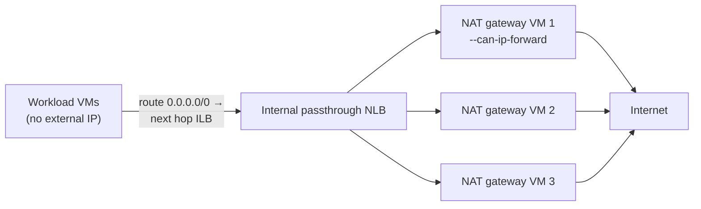
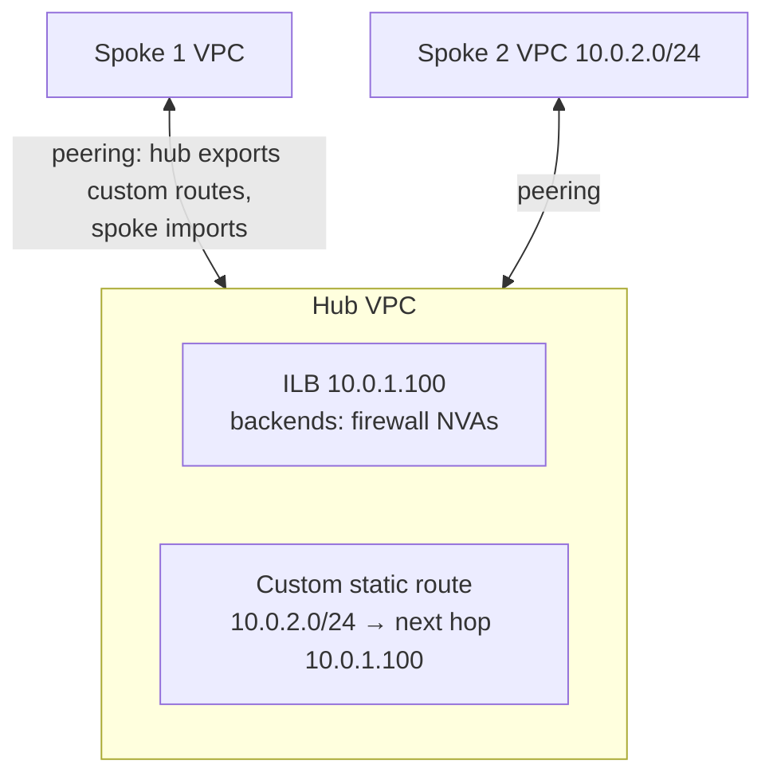

# GCP44 — Internal Network Load Balancers as Next Hops

> 🎛️ **Interactive visualization:** [ILB Next Hop Router](../../visualizations/gcp/GCP44%20-%20ILB%20Next%20Hop%20Router.html): send packets from spokes and regions through a next-hop ILB, toggle global access, health and peering export, and see where each packet goes. Opens in your browser.

## Summary
**Module 2 of Course 5** (*Caching and Optimizing Load Balancing*) covers:
- internal network load balancers as next hops
- Cloud CDN, and Cloud Armor with Cloud CDN, plus a lab
- content caching and LB optimization strategies, plus a quiz

An **internal passthrough Network Load Balancer** can be the **next hop of a custom static route**. Why it works well:
- **It's fast:** minimal processing, with no proxy and no single device in the path.
- **Direct server return:** responses go straight from the backend to the client, not back through the LB.
- **No client changes:** clients just follow VPC routing ("bump in the wire").
- **Health checks and autoscaling** come for free, as with any ILB.

**Use cases:**
- load-balance a set of **gateway, router or NAT VMs**
- make **firewall appliances** the next hop for `0.0.0.0/0`
- use **multi-NIC appliances** in several VPCs, with one ILB per NIC

---

## Core Concepts

### How you name the next hop
| Method | Where the ILB can be | Notes |
|--------|---------------------|-------|
| Forwarding rule **name + region** | **Same VPC** as the route | Most common |
| Forwarding rule **internal IP address** | **Same VPC or a peered VPC** | The GQ07 Q1 / GQ08 Q3 answer. Not limited to a subnet; not "Shared VPC" as such |
| Forwarding rule **resource link (URL)** | The rule's network must match the route's VPC | The rule can live in a standalone project, a Shared VPC host or a service project |

```bash
gcloud compute routes create default-via-fw --network=hub-vpc --destination-range=0.0.0.0/0 \
    --priority=900 --next-hop-ilb=fw-ilb-fr --next-hop-ilb-region=us-central1       # by name
gcloud compute routes create to-spoke2 --network=hub-vpc --destination-range=10.0.2.0/24 \
    --next-hop-ilb=10.0.1.100                                                     # by IP
```

### Pattern 1: load-balanced NAT / egress gateways

The gateways can apply **custom logic** (filtering, logging) that Cloud NAT doesn't offer. Backends need **`--can-ip-forward`** because they forward packets not addressed to themselves ([[GCP27 - Types of Complementary Partner Products]]).

### Pattern 2: hub-and-spoke through firewall appliances

1. Hub: ILB with firewall appliances as backends.
2. Hub: static route `10.0.2.0/24` → next hop ILB `10.0.1.100`. (The transcript says "10.0.2.2.0/24", a typo.)
3. Peer the hub with each spoke. **Hub exports custom routes, spokes import them.**
4. Spokes now learn the ILB-next-hop route, subject to the routing order.

**Peering export rules:**
- custom static routes with next hop **default internet gateway are never exported**
- routes with **next-hop ILBs are exported**

That's why this pattern works over peering ([[GCP18 - Hub-and-Spoke Topology]]).

### Pattern 3: multi-NIC appliances in two directions
- ILB 1 distributes to the backends' **nic0** (VPC A).
- ILB 2 distributes to their **nic1** (VPC B).
- A static route in each VPC points at its own ILB.

An ILB only operates within **one VPC** and reaches backend NICs in that VPC. For **stateful** appliances, both ILBs must pick the **same backend** for both directions of a flow, so they need the same symmetric session affinity. Per docs, that shared setting **can't be `CLIENT_IP_NO_DESTINATION`**.

### Rules and caveats
| Rule | Detail |
|------|--------|
| **Global access** | A setting on the **ILB forwarding rule**. Off: the next hop works only for sources **in the ILB's region**, and packets from other regions are **dropped**. On: usable from all regions. The lecture says to enable it "on the VPC network"; the docs put it on the load balancer |
| Health checks all fail | The route **stays in effect**; packets still go to some backend. Configure a **failover policy** (primary/backup backends) if needed |
| Unique IP | The next-hop ILB must use an IP that belongs to **one** forwarding rule, so it references exactly one backend service |
| No ECMP across ILBs | Two routes, same destination, different ILBs: **never ECMP**. Different priorities: the best one wins. Equal priorities: Google picks **one** (with no guarantee it's consistent), so avoid this |
| Same source to same backend | Session affinity `CLIENT_IP_NO_DESTINATION` (one-direction appliances) |
| Network tags | With tags, you can create multiple routes with the same destination, priority and ILB next hop. Without tags, you can't (docs) |

---

## Key Terms
| Term | Definition |
|------|-----------|
| Next-hop ILB | A custom static route whose next hop is an internal passthrough NLB forwarding rule |
| Direct server return | Backend replies go straight to the client, bypassing the LB |
| Bump in the wire | Traffic transparently passes through an appliance by routing; clients aren't configured |
| Global access | ILB forwarding-rule option allowing clients and routes from any region |
| Failover policy | ILB primary/backup backend groups for when primaries are unhealthy |

---

## Real-World Connections
- **This completes the gated-topology story:** a next-hop ILB in front of partner NGFWs is how gated egress/ingress is built ([[GCP20 - Other Topologies - Mesh, Mirrored, Gated]], [[GCP27 - Types of Complementary Partner Products]]).
- **Routing order:** a next-hop ILB route is a static route in the **third preference category** (below instance/VPN next hops and dynamic routes), and it's never ECMP'd with other ILBs ([[GCP01 - Routes and Route Preferences]]).
- **AWS:** **Gateway Load Balancer** (GENEVE) + GWLB endpoints as route targets is the equivalent, and it handles flow symmetry for you.
- **k3s:** like pointing a node's default route at a MetalLB-advertised VIP fronting a pair of egress gateways.

---

## Troubleshooting Scenario
**Scenario:** A hub's next-hop ILB (us-central1) inspects traffic for spokes. Spoke VMs in us-central1 work; spoke VMs in europe-west1 lose egress.
**Cause:** **global access is off** on the ILB forwarding rule, so packets from other regions are dropped.
**Fix:** `gcloud compute forwarding-rules update fw-ilb-fr --region=us-central1 --allow-global-access`. Also confirm the hub **exports** and spokes **import** custom routes.

---

## Hands-On Ideas
1. Build two NAT VMs (`--can-ip-forward`, iptables MASQUERADE) behind an ILB, add `0.0.0.0/0` → next hop ILB at priority 900, and remove external IPs from a test VM. `curl ifconfig.me` should show a gateway's IP.
2. Stop one gateway and watch the health check move flows. Stop both and see the route still in effect, with traffic black-holed. Then add a failover policy.
3. Peer a spoke, toggle `--import-custom-routes`, and compare `gcloud compute routes list` in the spoke.

---

## Quiz
1. When the next hop is given as the forwarding rule's **internal IP**, the ILB can be in:
   - A) The same VPC or a peered VPC  B) A Shared VPC only  C) The same subnet only  D) Any VPC in the organization
2. Why are internal passthrough NLBs fast as next hops?
   - A) Minimal processing, no proxy, direct server return  B) They cache content  C) They terminate TLS  D) They use Cloud CDN
3. Global access is off. A VM in another region sends traffic to the next-hop route. Result?
   - A) Routed normally  B) Dropped  C) Sent to the internet gateway  D) ECMP to another ILB
4. Which static routes are exported over VPC peering?
   - A) Next hop default internet gateway  B) Next hop internal NLB  C) Only subnet routes  D) None
5. Two routes, same destination, same priority, different next-hop ILBs:
   - A) Lowest IP wins  B) Google picks one: no ECMP across ILBs  C) Both are dropped  D) ECMP across both
6. All backend health checks fail. The next-hop route:
   - A) Is withdrawn  B) Becomes ECMP  C) Falls back to the internet gateway  D) Stays in effect; packets still go to a backend unless you configure failover

**Answers:** 1-A, 2-A, 3-B, 4-B, 5-B, 6-D

---

## Weak Areas to Revisit
- **Next-hop ILB by IP = same VPC or peered VPC.** Answered correctly in GQ07 Q1, but missed in GQ08 Q3 (a "same subnet" option was chosen). Key idea: routes are VPC-wide, not subnet-scoped, and specifying by IP is what allows a peered VPC.

## Linked Pages
- [[GCP45 - Cloud CDN]] · [[GCP42 - Traffic Management]] · [[GCP20 - Other Topologies - Mesh, Mirrored, Gated]] · [[GCP27 - Types of Complementary Partner Products]]
- [[GCP01 - Routes and Route Preferences]] · [[GCP18 - Hub-and-Spoke Topology]] · [[GQ08_Caching_and_Optimizing_Load_Balancing]] · [[certs/gcp-networking]]
