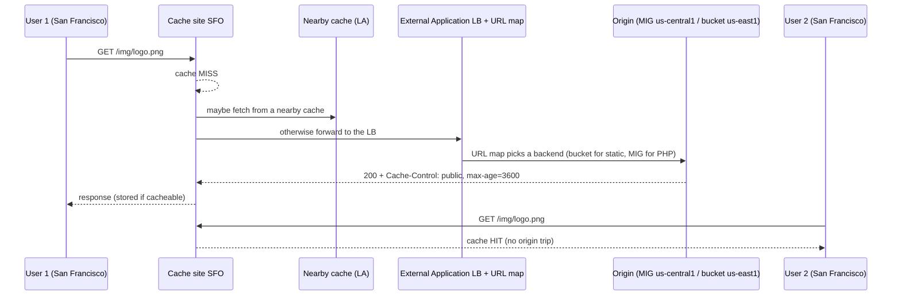

# GCP45 — Cloud CDN

> 🎛️ **Interactive visualization:** [Edge Cache and Armor](../../visualizations/gcp/GCP45-48%20-%20Edge%20Cache%20and%20Armor.html): request flow with hit/miss per city, cache modes against real response headers, Cloud Armor edge vs backend policies, the edge-policy lab replay, and cost levers. Opens in your browser.

## Summary
**Cloud CDN** caches content at Google's edge: per the lecture, **90+ cache sites** across Asia Pacific, the Americas and EMEA (check the docs for the current list). That means faster delivery and lower origin load and egress cost. You **enable it with a checkbox on an external Application LB backend** (a backend service or backend bucket).

**Three cache modes** decide what gets cached:
| Mode | Behavior | Watch out |
|------|----------|-----------|
| `USE_ORIGIN_HEADERS` | Caches only responses with valid cache directives and headers (`Cache-Control: public, max-age=…`) | Origin must set headers correctly; otherwise nothing is cached |
| `CACHE_ALL_STATIC` | Caches static content (images, CSS, JS, video…) unless it's marked `no-store`, `private` or `no-cache`; also honors valid directives | **Default** for CDN-enabled backends created with gcloud/REST (docs) |
| `FORCE_CACHE_ALL` | Caches **every** successful response, ignoring origin directives | Never on backends serving **private, per-user** content (dynamic HTML, API responses) |

Every request is **logged** with its cache status (hit or miss).

**CDN Interconnect:** **select third-party CDN providers** peer directly with Google's edge, so egress from Google Cloud to that provider is **cheaper and faster**. It needs no configuration, and Google bills it as "Compute Engine network egress via carrier peering network".

---

## Core Concepts

### Request flow: miss, then hit

A hit shortens the round trip **and** spares the origin. The lab later proves the cache can keep serving **after the origin object is deleted** ([[GCP47 - Lab - Cloud Armor Edge Security Policies for Cloud CDN]]).

### What makes a response cacheable
- A successful status (e.g. 200, 203, 206, 300, 301, 308, 404, 410…). Mode-dependent.
- No `Cache-Control: private` / `no-store` (and no `Set-Cookie` unless allowed).
- A freshness lifetime: `max-age`/`s-maxage`/`Expires`, or the mode's default TTL.
- The **cache key** is by default protocol + host + path + query string. You can drop the query string or host to raise the hit ratio.

### CDN Interconnect
| Point | Detail |
|-------|--------|
| What | Direct links between Google's edge and **approved third-party CDN providers** (GQ08 Q1) |
| Benefit | Lower **egress pricing** to that CDN, lower latency for cache fill, good for **frequent content updates** and **large files** |
| Setup | **None** on your side: if the provider is in the program, supported locations get it automatically. It isn't integrated with Cloud Load Balancing |
| Pricing | Ingress free. Egress discounted **IPv4 only** (not IPv6). Intra-region pricing applies at specific locations |
| Not to confuse with | Dedicated/Partner Interconnect (your on-prem ↔ Google) ([[GCP52 - Dedicated Interconnect]], [[GCP53 - Partner Interconnect]]) |

> **Transcript garble:** "intra-region egress routes, which costs less than intra-region egress traffic" means intra-region routes cost less than **inter-region** egress.

### Enable and inspect
```bash
gcloud compute backend-buckets create static-bb --gcs-bucket-name=cymbal-static --enable-cdn \
    --cache-mode=CACHE_ALL_STATIC --default-ttl=3600
gcloud compute backend-services update web-bes --global --enable-cdn --cache-mode=USE_ORIGIN_HEADERS
gcloud compute url-maps invalidate-cdn-cache web-map --path="/img/*"     # purge
curl -sI http://LB_IP/img/logo.png | grep -i -E 'age|cache-control'       # Age > 0 = served from cache
```
Logs: `resource.type="http_load_balancer"`, with `jsonPayload.cacheHit`, `cacheLookup` and `cacheFillBytes`.

---

## Key Terms
| Term | Definition |
|------|-----------|
| Cache hit / miss | Served from edge cache / fetched from origin |
| Cache mode | Policy for which responses Cloud CDN stores |
| TTL | How long a cached object stays fresh |
| Cache key | The request attributes that identify a cached object |
| Invalidation | Purging cached objects by path before TTL expiry |
| `Age` header | Seconds since the object was cached: proof of a cache hit |
| CDN Interconnect | Discounted direct peering from Google Cloud to approved third-party CDNs |

---

## Real-World Connections
- **Next.js project:** `/_next/static/*` is immutable and hashed, so it's a perfect `CACHE_ALL_STATIC` fit with long TTLs. Keep `/api/*` and server-rendered pages on a backend without `FORCE_CACHE_ALL`, or cache them only with explicit `s-maxage`.
- **Wireshark / curl:** the `Age` and `Cache-Control` headers prove where a response came from. That's the same evidence you'd read in a capture.
- **AWS:** CloudFront (cache behaviors per path ≈ URL map + backend CDN settings; cache policies ≈ cache modes + key).
- **DDoS link:** a cache absorbs L7 floods for cacheable URLs ([[GCP26 - Google Cloud DDoS Mitigations]]).

---

## Troubleshooting Scenario
**Scenario:** CDN is enabled, but the hit ratio is ~0% for product images.
**Causes to check:**
1. The origin sends `Cache-Control: private` or `no-store`, or sets a cookie on images.
2. The mode is `USE_ORIGIN_HEADERS` and the origin sends **no** cache headers.
3. A cache-busting **query string** (`?v=random`) is in the cache key.

**Fix:** set `public, max-age=86400` on images (or switch to `CACHE_ALL_STATIC`) and exclude the query string from the cache key. Then check logs for `cacheHit: true` and `Age` headers.

---

## Hands-On Ideas
1. Bucket + backend bucket with CDN. `curl -sI` twice and compare `Age`.
2. Upload an object with `Cache-Control: private`. Confirm it's never a hit in `CACHE_ALL_STATIC`, and confirm it is in `FORCE_CACHE_ALL` (and why that's dangerous).
3. Run `invalidate-cdn-cache` and watch the next request miss.

---

## Quiz
1. Which mode caches every successful response, ignoring origin directives?
   - A) FORCE_CACHE_ALL  B) CACHE_ALL_STATIC  C) BYPASS  D) USE_ORIGIN_HEADERS
2. Which mode is the default for CDN backends created with gcloud/REST?
   - A) CACHE_ALL_STATIC  B) None  C) FORCE_CACHE_ALL  D) USE_ORIGIN_HEADERS
3. CDN Interconnect is:
   - A) A VPN to your origin  B) Direct peering between approved third-party CDNs and Google's edge  C) A Cloud CDN cache mode  D) Partner Interconnect for on-prem
4. Configuration needed for CDN Interconnect if your provider is in the program:
   - A) VLAN attachments  B) A new load balancer  C) None  D) BGP sessions
5. A response has `Cache-Control: private`. In CACHE_ALL_STATIC mode it is:
   - A) Cached for 1 hour  B) Not cached  C) Cached  D) Cached only for HTTPS
6. Which header proves a response came from cache?
   - A) `Age`  B) `Server`  C) `ETag`  D) `Content-Type`

**Answers:** 1-A, 2-A, 3-B, 4-C, 5-B, 6-A

---

## Weak Areas to Revisit
*(none flagged yet)*

## Linked Pages
- [[GCP44 - Internal Network Load Balancers as Next Hops]] · [[GCP46 - Google Cloud Armor with Cloud CDN]] · [[GCP47 - Lab - Cloud Armor Edge Security Policies for Cloud CDN]] · [[GCP48 - Load Balancer Optimization Strategies]]
- [[GCP26 - Google Cloud DDoS Mitigations]] · [[GQ08_Caching_and_Optimizing_Load_Balancing]] · [[gcp-command-anatomy]] · [[certs/gcp-networking]]
