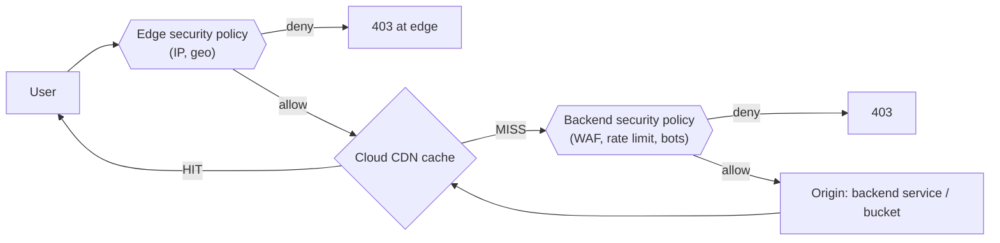

# GCP46 — Google Cloud Armor with Cloud CDN

> 🎛️ **Interactive visualization:** [Edge Cache and Armor](../../visualizations/gcp/GCP45-48%20-%20Edge%20Cache%20and%20Armor.html), "Edge vs backend policy" tab. Opens in your browser.

## Summary
**Cloud Armor and Cloud CDN work in tandem:**
- **Armor is the security guard.** It filters DDoS and web exploits, mitigates the **OWASP Top 10**, and enforces **L7 filtering**.
- **CDN is the fast courier.** It serves copies from the nearest edge and offloads the origin.

**Two policy types matter with CDN:**
| Policy | Where it acts | Protects | Supports |
|--------|--------------|----------|----------|
| **Edge security policy** | **Before the cache**, at the outermost edge | **Cached content** (CDN-enabled backend services, **backend buckets**, Cloud Storage) | A **subset** of matching: IP/CIDR, geography (region code) and similar basic attributes. Docs: "filtering based on a subset of parameters compared to backend" policies |
| **Backend security policy** | After the cache, on requests that **go to the origin** (cache misses, uncacheable) | The **backend service** | Full feature set: preconfigured **WAF** (OWASP), rate limiting, bot management, Adaptive Protection |

**Key consequence:** a backend policy **doesn't see cache hits**. If you must block a country from *cached* media (licensing), you need an **edge** policy.

---

## Core Concepts

### Where each policy sits


### Choosing
| Requirement | Policy |
|-------------|--------|
| Geo-licensing for cached video/images ("only distribute where licensed") | **Edge** |
| Block a country or IP range from a **backend bucket** | **Edge** (backend buckets take edge policies) |
| SQLi/XSS on the dynamic app | **Backend** (preconfigured WAF) |
| Rate limiting `/login` | **Backend** |
| Both cached and dynamic paths | Both: edge for access control, backend for deep inspection |

```bash
gcloud compute security-policies create edge-geo --type=CLOUD_ARMOR_EDGE
gcloud compute security-policies rules create 1000 --security-policy=edge-geo \
    --expression="origin.region_code == 'XX'" --action=deny-403
gcloud compute backend-buckets update lb-backend-bucket --edge-security-policy=edge-geo
gcloud compute backend-services update web-bes --global --edge-security-policy=edge-geo   # + --security-policy for backend
```

---

## Key Terms
| Term | Definition |
|------|-----------|
| Edge security policy | Cloud Armor policy (type `CLOUD_ARMOR_EDGE`) evaluated before Cloud CDN cache lookup |
| Backend security policy | Cloud Armor policy (type `CLOUD_ARMOR`) evaluated for requests sent to the backend |
| OWASP Top 10 | Industry list of top web-app risks (injection, broken access control…) |

## Real-World Connections
- **Media/streaming:** territory-licensed content is the textbook edge-policy case. It's the same as CloudFront geo-restriction in AWS.
- Builds directly on [[GCP26 - Google Cloud DDoS Mitigations]] and [[GCP28 - Lab - Configuring Traffic Blocklisting with Google Cloud Armor]] (which used a backend policy).

## Troubleshooting Scenario
**Scenario:** A backend policy denies a country, but users there still download cached images.
**Cause:** cache hits never reach the backend policy.
**Fix:** attach an **edge** security policy to the CDN-enabled backend or bucket. Then purge the cache if needed.

## Hands-On Ideas
1. Do the GCP47 lab, then add a geo rule instead of deny-all and test it via a VPN exit node in an allowed vs a blocked country.

## Quiz
1. Which policy filters requests before content is served from cache?
   - A) VPC Service Controls  B) Firewall policy  C) Backend security policy  D) Edge security policy
2. A backend security policy sees:
   - A) Only requests forwarded to the backend (misses and uncacheable)  B) Only health checks  C) Every request  D) Only cache hits
3. Preconfigured OWASP WAF rules belong in:
   - A) URL maps  B) Edge policies  C) Backend policies  D) Cache modes

**Answers:** 1-D, 2-A, 3-C

## Weak Areas to Revisit
*(none flagged yet)*

## Linked Pages
- [[GCP45 - Cloud CDN]] · [[GCP47 - Lab - Cloud Armor Edge Security Policies for Cloud CDN]] · [[GCP26 - Google Cloud DDoS Mitigations]] · [[certs/gcp-networking]]
