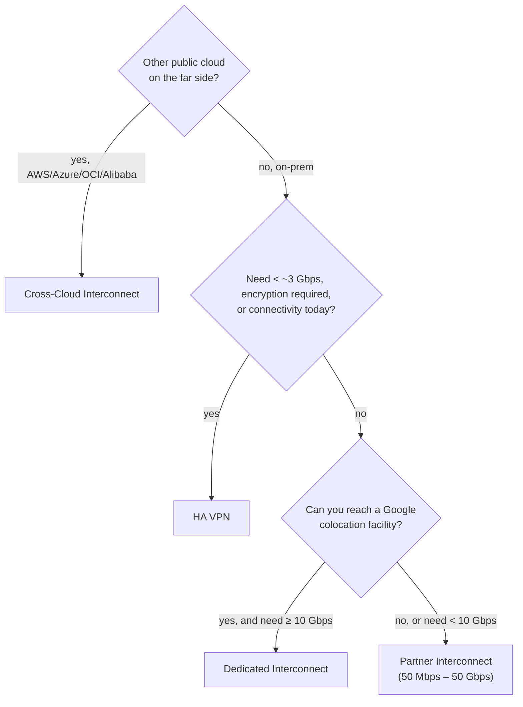

# GCP51 — Connectivity Options

> 🎛️ **Interactive visualization:** [Interconnect Chooser](../../visualizations/gcp/GCP49-54%20-%20Interconnect%20Chooser.html), "Choose an option" tab. Opens in your browser.

## Summary
All four options give **internal-IP access** between on-prem (or another cloud) and your VPC. They differ in **capacity**, **where you connect** and **encryption**.

| Choose | When |
|--------|------|
| **Dedicated Interconnect** | You can physically reach Google at a **colocation facility** |
| **Partner Interconnect** | You can't reach a Google colocation facility, but **can reach a supported service provider** |
| **Cross-Cloud Interconnect** | You need a **direct link to another cloud** (AWS, Azure, OCI, Alibaba) |
| **Cloud VPN** | **Lower bandwidth**, or you **must encrypt in transit**, or you need it fast and cheap |

---

## Core Concepts

### Comparison
| | Cloud VPN (HA VPN) | Dedicated Interconnect | Partner Interconnect | Cross-Cloud Interconnect |
|--|--------------------|------------------------|----------------------|--------------------------|
| Path | IPsec over the **internet** | Your router ↔ Google at a **colocation facility** | Through a **service provider** network | Google ↔ another cloud's network, provisioned by Google |
| Capacity | **1.5 Gbps per tunnel** over the internet, **3 Gbps** over a direct-peering link; scale with more tunnels | **10, 100 or 400 Gbps** circuits, up to 8 per connection (docs) | **50 Mbps – 50 Gbps** per VLAN attachment | **10, 100 or 400 Gbps** (docs) |
| Encrypted by default | **Yes** (IPsec) | **No** (add MACsec, HA VPN over Interconnect, or TLS) | **No** | **No** (MACsec available) |
| Your equipment | VPN gateway/router | **Your own router** in the colo | Provider handles the physical link | None: Google and the other cloud provision ports |
| Lead time | Minutes | Weeks (LOA-CFA, cross-connect) | Days (circuit already exists at the provider) | Weeks |
| SLA | 99.99% (HA VPN, 2 tunnels) | 99.9% / 99.99% by topology | 99.9% / 99.99% by topology | 99.9% / 99.99% by topology |

> **Lecture vs current docs:**
> - The lecture says Dedicated Interconnect allows "up to two links to achieve multiples of 200 Gbps". That's wrong in two ways: **100 Gbps** circuits give multiples of 100, and the docs now allow **up to 8 × 100 Gbps (800 Gbps)** and also **400 Gbps circuits (up to 8 × 400 = 3.2 Tbps)**.
> - The older 8 × 10 / 2 × 100 limits are what this course teaches. Expect the docs' numbers on newer exams.

### Decision flow

### Encryption in transit
- Interconnect circuits are private but **not encrypted**. Options:
  - **MACsec** (L2, hop by hop at the edge)
  - **HA VPN over Cloud Interconnect** (IPsec over the private link)
  - **TLS** at the application layer
- Cloud VPN is encrypted by design (IPsec).

---

## Key Terms
| Term | Definition |
|------|-----------|
| Colocation facility | Where your router meets Google's edge (Dedicated) |
| Service provider | Carrier that already connects to Google (Partner) |
| VLAN attachment | Logical connection from an Interconnect to a region's Cloud Router; 802.1Q tagged |
| HA VPN | Regional VPN gateway with 2 interfaces; 99.99% SLA with 2 tunnels |
| Direct Peering | Peering with Google's edge for Google services. Cloud VPN gets 3 Gbps per tunnel over such links |

## Real-World Connections
- **AWS mapping:** Site-to-Site VPN (1.25 Gbps per tunnel) ≈ HA VPN; Direct Connect dedicated ≈ Dedicated Interconnect; Direct Connect hosted ≈ Partner Interconnect; there's no AWS equivalent of Cross-Cloud Interconnect (Google provisions *into* AWS).
- **k3s at home:** HA VPN from a GCP VPC to a home router (strongSwan/VyOS with BGP via FRR) is a realistic lab. Interconnect isn't.

## Troubleshooting Scenario
**Scenario:** A 2 Gbps backup replication over a single Cloud VPN tunnel caps at ~1.5 Gbps.
**Cause:** the per-tunnel limit.
**Fix:** add tunnels (ECMP across BGP sessions on HA VPN), or move to Partner Interconnect with a 5–10 Gbps VLAN attachment, plus HA VPN over Interconnect if encryption is required.

## Hands-On Ideas
1. Price out 1 Gbps steady traffic over HA VPN vs a 1 Gbps Partner attachment vs a 10G Dedicated port in the pricing calculator.

## Quiz
1. Which option is encrypted in transit by default?
   - A) Dedicated Interconnect  B) Cross-Cloud Interconnect  C) Partner Interconnect  D) Cloud VPN
2. Per-tunnel Cloud VPN capacity over the public internet is about:
   - A) 50 Mbps  B) 10 Gbps  C) 1.5 Gbps  D) 100 Gbps
3. Your data center can't reach a Google colocation facility, and you need 5 Gbps of private connectivity:
   - A) Partner Interconnect  B) Carrier Peering  C) Dedicated Interconnect  D) Cross-Cloud Interconnect
4. Partner Interconnect capacity per attachment ranges from:
   - A) 50 Mbps–50 Gbps  B) 1–10 Gbps  C) 100 Mbps–1 Gbps  D) 10–100 Gbps

**Answers:** 1-D, 2-C, 3-A, 4-A

## Weak Areas to Revisit
*(none flagged yet)*

## Linked Pages
- [[GCP52 - Dedicated Interconnect]] · [[GCP53 - Partner Interconnect]] · [[GCP54 - Cross-Cloud Interconnect]] · [[GQ09_Connectivity_Options]] · [[certs/gcp-networking]]
