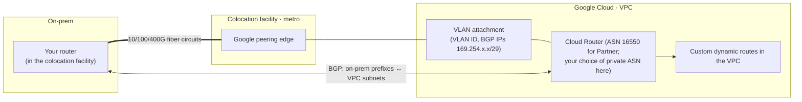
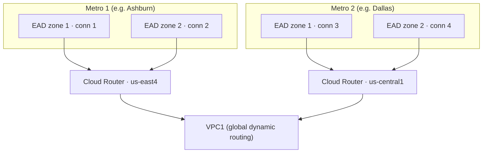

# GCP52 — Dedicated Interconnect

> 🎛️ **Interactive visualization:** [Interconnect Chooser](../../visualizations/gcp/GCP49-54%20-%20Interconnect%20Chooser.html), "SLA builder" and "Setup steps" tabs. Opens in your browser.

## Summary
**Scenario:** Sam, at Cymbal, is migrating **part** of a mission-critical workload. It needs minimal latency and jitter, dedicated bandwidth, isolation from the internet, and optional encryption. Internet VPN overhead and variability rule out VPN.

**Dedicated Interconnect** is a **direct physical fiber connection** between your network and Google's at a **colocation facility**:
- **You provide your own routing equipment** there, and run **BGP** with a Cloud Router over VLAN attachments. That's the GQ09 Q2 answer.
- At high volume, it can be **cheaper than buying extra internet bandwidth**, and data transfer pricing is discounted.

---

## Core Concepts

### Routing model

- Cloud Router **learns on-prem routes** → installs them as **custom dynamic routes**.
- Cloud Router **advertises VPC subnets** (or custom ranges) to on-prem. That's a two-way exchange.
- Each **VLAN attachment** connects to **one region's** Cloud Router. Use **global dynamic routing** so all regions use the routes.

### Capacity
| Circuit type | Per connection | Max |
|--------------|---------------|-----|
| 10 Gbps | 1–8 circuits | **80 Gbps** |
| 100 Gbps | 1–8 circuits (lecture: 2) | **800 Gbps** (lecture: 200) |
| 400 Gbps (docs, newer) | 1–8 circuits | **3.2 Tbps** |

You can't mix circuit types in one connection, and you can't change the link type later. 10 Gbps is the minimum. (The transcript's "810" and "2100" mean "8 × 10" and "2 × 100".)

### Redundancy and SLA
| Topology | Layout | SLA |
|----------|--------|-----|
| Single connection | 1 connection | No SLA |
| **99.9%** | **2 connections**, same metro, **different edge availability domains** | 99.9% |
| **99.99%** | **4 connections**: 2 metros × 2 edge availability domains, **2 Cloud Routers in 2 regions**, global dynamic routing | 99.99% |


- **Edge availability domains** in a metro are never under maintenance at the same time, so each Cloud Router keeps a working connection.
- **Two Cloud Routers in two regions**, even if all VMs are in one region: if a region is disrupted, traffic flows through the other.
- The docs also call an edge availability domain's location an **"interconnect location name"**.

### Ordering and setup
| # | Step | Who |
|---|------|-----|
| 1 | **Order** the connection in Google Cloud (location, circuits, capacity) | You |
| 2 | Google emails the **LOA-CFA** (Letter of Authorization and Connecting Facility Assignment) identifying the assigned ports | Google |
| 3 | Send the LOA-CFA to the **colocation facility** so they run the **cross-connect** | Colo vendor |
| 4 | **Test**: first light levels on each circuit, then IP connectivity (Google sends test configurations) | You + Google |
| 5 | Create **VLAN attachments** + **BGP sessions** on Cloud Router | You |
| 6 | Configure the **on-prem router** with the VLAN ID, interface IP and peer IP from the attachment | You |

```bash
gcloud compute interconnects create sam-ic-1 --customer-name="Cymbal" --interconnect-type=DEDICATED \
    --link-type=LINK_TYPE_ETHERNET_10G_LR --requested-link-count=2 --location=iad-zone1-1 --admin-enabled
gcloud compute interconnects get-diagnostics sam-ic-1      # light levels, LACP, circuit state
gcloud compute routers create cr-use4 --network=vpc1 --region=us-east4 --asn=65010
gcloud compute interconnects attachments dedicated create att-1 --region=us-east4 --router=cr-use4 \
    --interconnect=sam-ic-1 --vlan=100 --bandwidth=BPS_10G
gcloud compute routers add-interface cr-use4 --region=us-east4 --interface-name=if-att-1 --interconnect-attachment=att-1
gcloud compute routers add-bgp-peer cr-use4 --region=us-east4 --interface=if-att-1 \
    --peer-name=onprem-1 --peer-asn=65001 --peer-ip-address=169.254.10.2
```

---

## Key Terms
| Term | Definition |
|------|-----------|
| LOA-CFA | Authorization identifying Google's assigned ports for the colo cross-connect |
| Cross-connect | Physical fiber patch in the colo between your cage and Google's |
| Edge availability domain | Maintenance-isolated part of a metro's Google edge |
| VLAN attachment | 802.1Q logical link from an Interconnect to a regional Cloud Router |
| Custom dynamic route | VPC route learned by Cloud Router through BGP |

---

## Real-World Connections
- **Telecom/V2X background:** this is PE-CE BGP peering over a leased fiber at a carrier hotel. LOA-CFA is the standard carrier-hotel workflow.
- **AWS:** Direct Connect dedicated connections (1/10/100/400G), LOA-CFA, Direct Connect gateway. The SLA model is similar: two locations for 99.99%.
- **k3s/home lab:** you can't build this at home, but you can practice the **BGP half** with FRR + HA VPN, which uses the same Cloud Router commands.

---

## Troubleshooting Scenario
**Scenario:** Circuits show up, but no routes appear in the VPC.
**Check, in order:**
1. **Light levels and LACP:** `interconnects get-diagnostics`.
2. **Attachment state:** `ACTIVE`, with the right VLAN ID on the on-prem subinterface.
3. **BGP:** `routers get-status cr-use4`. Is the session `Established`? Check the ASN and peer IP (`169.254.x.x/29`), and MD5 if used.
4. **Route policy:** is on-prem actually advertising prefixes, or filtering them?
5. **Dynamic routing mode:** VMs in other regions won't see routes with **regional** mode.

---

## Hands-On Ideas
1. Draw your own 99.99% topology with real Google metros near you (from the colocation list).
2. Practice the BGP configuration on HA VPN (same `add-bgp-peer` flow) with FRR on a VM acting as "on-prem".

---

## Quiz
1. Which option requires your own routing equipment and a BGP session with Google's edge at a colocation facility?
   - A) Partner Interconnect  B) Cross-Cloud Interconnect  C) Network Connectivity Center  D) Dedicated Interconnect
2. What does the LOA-CFA do?
   - A) Encrypts the link  B) Configures BGP  C) Creates a VLAN attachment  D) Identifies Google's assigned ports and authorizes the colo cross-connect
3. For 99.99% availability you need:
   - A) 2 connections in one metro  B) 1 connection  C) 2 VPN tunnels  D) 4 connections across 2 metros, 2 edge availability domains each, Cloud Routers in 2 regions
4. Why use two edge availability domains in a metro?
   - A) More bandwidth  B) Encryption  C) They're never under maintenance at the same time  D) Lower price
5. Maximum capacity with 10 Gbps circuits?
   - A) 200 Gbps  B) 10 Gbps  C) 80 Gbps  D) 40 Gbps
6. How do on-prem routes reach the VPC?
   - A) Peering  B) Static routes  C) Cloud Router learns them via BGP and installs custom dynamic routes  D) DNS

**Answers:** 1-D, 2-D, 3-D, 4-C, 5-C, 6-C

---

## Weak Areas to Revisit
- **"Requires customer's own routing equipment + BGP session with Google's edge" = Dedicated Interconnect.** Missed in GQ09 Q2 (Partner was chosen). Remember:
  - **Dedicated:** you're physically in Google's colo, with your router.
  - **Partner:** the provider supplies the physical link. With an L3 partner, you don't even run BGP to Google yourself.
  - **Cross-Cloud:** Google provisions it into the other cloud, so no hardware of your own.

## Linked Pages
- [[GCP51 - Connectivity Options]] · [[GCP53 - Partner Interconnect]] · [[GCP54 - Cross-Cloud Interconnect]] · [[GQ09_Connectivity_Options]]
- [[GCP41 - Hybrid Load Balancing]] (global dynamic routing) · [[gcp-command-anatomy]] · [[certs/gcp-networking]]
