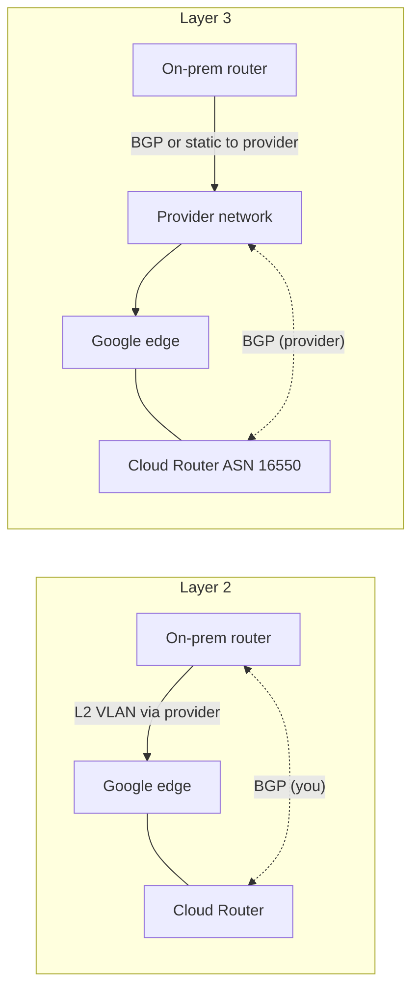

# GCP53 — Partner Interconnect

> 🎛️ **Interactive visualization:** [Interconnect Chooser](../../visualizations/gcp/GCP49-54%20-%20Interconnect%20Chooser.html), "Setup steps" tab: compare the Layer 2 and Layer 3 BGP responsibilities. Opens in your browser.

## Summary
**Scenario:** Ken's remote data center **can't reach a Dedicated Interconnect colocation facility**, but still needs high-bandwidth, low-latency private connectivity using a **partner's existing infrastructure**. That's the GQ09 Q1 answer: **Partner Interconnect**.

- **Technical feature parity** with Dedicated. The difference is that the physical connection goes through a **supported service provider**.
- **Faster to procure:** the provider's physical connection to Google already exists.
- **Capacity:** **50 Mbps to 50 Gbps** per VLAN attachment, so you can scale by number and size of attachments. Under 50 Mbps → use **Cloud VPN**.
- **Redundancy:** place attachments in **multiple edge availability domains**.

---

## Core Concepts

### Setup flow (pairing key)
| # | Step | Who |
|---|------|-----|
| 1 | **Order connectivity** from a supported service provider (between your site and the provider) | You + provider |
| 2 | **Create a VLAN attachment** (type `PARTNER`) on a Cloud Router in the region you want. You get a **pairing key** | You |
| 3 | **Request the connection** from the provider: give them the **pairing key**, capacity and location | You |
| 4 | Provider **configures** the attachment and confirms capacity; you get an email | Provider |
| 5 | **Activate** the attachment (pre-activation can be set) | You |
| 6 | **BGP:** Layer 2 = you configure it; Layer 3 = provider does it | Depends |

```bash
gcloud compute interconnects attachments partner create ken-att-1 --region=us-west2 \
    --router=cr-usw2 --edge-availability-domain=availability-domain-1
gcloud compute interconnects attachments describe ken-att-1 --region=us-west2 --format="value(pairingKey)"
#   → give the pairing key to the provider; after they provision:
gcloud compute interconnects attachments partner update ken-att-1 --region=us-west2 --admin-enabled
```
The **pairing key** uniquely identifies your attachment and Cloud Router so the provider can attach its side.

### Layer 2 vs Layer 3 providers
| | **Layer 2 connection** | **Layer 3 connection** |
|--|------------------------|------------------------|
| What the provider does | Extends an L2 VLAN from your router to Google's edge | Routes your traffic through **its own** network |
| BGP to Cloud Router | **You** establish BGP between **your on-prem router** and Cloud Router, using the VLAN ID, interface IP and peering IP from the attachment | **Provider** establishes BGP with Cloud Router for each attachment. You don't configure BGP toward Google |
| Your side to provider | Plain L2 handoff | Whatever the provider requires: BGP with them, or a static default route to them |
| Cloud Router ASN | Any private ASN | **16550** (required for Partner L3) |



### Dedicated vs Partner: deciding factors
| Factor | Dedicated | Partner |
|--------|-----------|---------|
| Where you connect | **Google colocation facility** | **Partner facility / provider network** |
| Your router in the colo | Required | Not required |
| Capacity | 10 Gbps+ per circuit | 50 Mbps – 50 Gbps per attachment |
| Lead time | Longer (cross-connect) | Short (the circuit already exists) |
| SLA model | Same topology rules (2 EADs → 99.9%; 2 metros → 99.99%) | Same |

---

## Key Terms
| Term | Definition |
|------|-----------|
| Pairing key | One-time key from the attachment that the provider uses to connect your Cloud Router |
| Service provider | Google-approved carrier already connected to Google's edge |
| Layer 2 / Layer 3 partner | VLAN extension (you run BGP) / routed service (provider runs BGP) |
| Pre-activation | Option to auto-activate the attachment when the provider finishes |

## Real-World Connections
- **Telecom view:** an L2 partner is like an Ethernet private line (EPL/EVPL). An L3 partner is like an MPLS L3VPN where the carrier runs eBGP with Google.
- **AWS:** Direct Connect **hosted connections** via partners, with similar capacity tiers starting at 50 Mbps.
- **When a VPN is better:** < 50 Mbps, or you need a link today, or encryption is mandatory and you can't add IPsec over the attachment.

## Troubleshooting Scenario
**Scenario:** The provider says the circuit is up, but the attachment shows `PENDING_CUSTOMER` and no traffic flows.
**Cause:** the attachment isn't **activated**.
**Fix:** `attachments partner update … --admin-enabled` (or use pre-activation next time). With an L2 provider, also check that **your** BGP session to Cloud Router is up (`routers get-status`).

## Hands-On Ideas
1. Create a partner attachment in a sandbox (it stays pending, but shows the pairing key and states), then delete it.
2. Write the BGP config for an L2 partner on a Cisco/FRR router using made-up attachment values.

## Quiz
1. Your city has no Dedicated Interconnect location, and you need a private connection to your VPC:
   - A) Dedicated Interconnect  B) Partner Interconnect  C) Network Connectivity Center  D) Carrier Peering
2. What does the provider use to connect to your VLAN attachment?
   - A) The VPC name  B) The pairing key  C) The ASN  D) The LOA-CFA
3. With a Layer 3 partner, who establishes BGP with your Cloud Router?
   - A) The service provider  B) You  C) Google support  D) Nobody, static routes only
4. The smallest Partner Interconnect attachment is:
   - A) 50 Mbps  B) 10 Mbps  C) 10 Gbps  D) 1 Gbps
5. Partner Interconnect vs Dedicated Interconnect features:
   - A) Dedicated has no SLA  B) Technical feature parity; the difference is where you connect  C) Partner is encrypted  D) Partner has fewer features

**Answers:** 1-B, 2-B, 3-A, 4-A, 5-B

## Weak Areas to Revisit
*(none flagged yet)*

## Linked Pages
- [[GCP52 - Dedicated Interconnect]] · [[GCP54 - Cross-Cloud Interconnect]] · [[GCP51 - Connectivity Options]] · [[GQ09_Connectivity_Options]] · [[certs/gcp-networking]]
