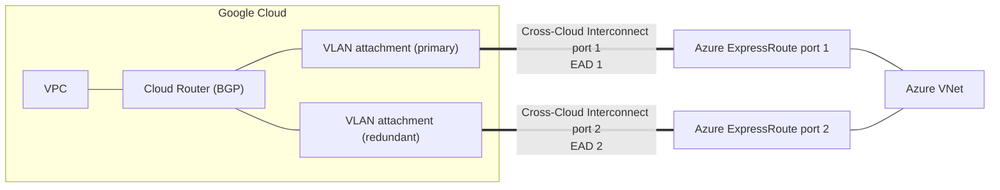

# GCP54 — Cross-Cloud Interconnect

> 🎛️ **Interactive visualization:** [Interconnect Chooser](../../visualizations/gcp/GCP49-54%20-%20Interconnect%20Chooser.html), "SLA builder" and "MACsec scope" tabs. Opens in your browser.

## Summary
**Scenario:** Rob's Cymbal environment spans **Google Cloud and Microsoft Azure**. As the workload grows, he needs consistent, secure, redundant connectivity between the two without the internet's latency and bandwidth limits.

**Cross-Cloud Interconnect:**
- **What it is:** Google provisions a **dedicated physical connection** between Google's network and another supported cloud: **AWS, Azure, Oracle Cloud Infrastructure, Alibaba Cloud**.
- **Setup:** you choose locations, buy **primary and redundant ports from Google** *and* from the other provider, then peer your VPC with your network in that cloud.
- **Support boundary:** Google supports the link **up to the other provider's network**. Google doesn't guarantee the other cloud's uptime and can't open tickets with them for you.
- **Speeds:** **10 or 100 Gbps** per the lecture (the transcript's "210" is "2 sizes: 10"). The docs now also list **400 Gbps**.

---

## Core Concepts

### Architecture

### Why multicloud (lecture)
- **Avoid vendor lock-in**
- **Split data and logic:** data in one cloud, business logic in another
- **Resilience:** keep running if one cloud has an outage; **DR** in a second cloud
- **Analytics** across data in several clouds

Without it, the options are complex: your own hardware in a colo, or a third-party exchange. Cross-Cloud Interconnect removes both.

### NCC site-to-site data transfer
Use Cross-Cloud Interconnect attachments as **NCC hybrid spokes**, and the **Google backbone becomes your WAN**. Example (docs): an Azure network and an AWS network, each on its own Cross-Cloud pair, exchange traffic through Google. This is covered in Module 2 and in [[GCP18 - Hub-and-Spoke Topology]].

### SLA topologies (all Cloud Interconnect types)
| Target | Layout |
|--------|--------|
| **99.9%** | **2 connections**, same metro, **different edge availability domains** |
| **99.99%** | **2 pairs** in **2 metros**, each pair across **2 edge availability domains** (4 connections) |

### MACsec for Cloud Interconnect: what it does and doesn't encrypt
| Interconnect type | MACsec encrypts between |
|-------------------|------------------------|
| Dedicated | Google's peering edge router ↔ **your on-prem router** |
| Partner | Google's peering edge router ↔ **service provider's** peering edge router |
| Cross-Cloud | Google's peering edge router ↔ the **remote cloud's** router |

- MACsec does **not** encrypt traffic **inside Google's network**, so it's hop-by-hop L2 encryption.
- For end-to-end protection, **combine** it with **IPsec** (HA VPN over Interconnect) and/or **TLS**.

### Gemini prompts from the lecture
- "Which should I use, Cloud VPN or Cloud Interconnect? Provide details supporting each according to their strengths." (Returns a comparison table.)
- "List the steps to generate a report on the past week's performance of my Cloud Interconnect link: bandwidth utilization, latency, packet loss."

---

## Key Terms
| Term | Definition |
|------|-----------|
| Cross-Cloud Interconnect | Google-provisioned physical link to AWS, Azure, OCI or Alibaba |
| Primary / redundant ports | The pair of ports bought on both clouds for an SLA topology |
| Site-to-site data transfer | NCC feature that uses Google's network as a WAN between spokes |
| MACsec | IEEE 802.1AE L2 encryption on the Interconnect hop |

## Real-World Connections
- **Azure side:** ExpressRoute Direct ports. **AWS side:** Direct Connect dedicated connections. **OCI** also offers a partner-style "Interconnect for OCI" with smaller speeds (1–50 Gbps) per the docs' comparison.
- **AZ-500 tie-in:** the same encryption question (ExpressRoute isn't encrypted by default; use MACsec or IPsec over ExpressRoute).
- **DR design:** primary in GCP, replicas in Azure over CCI, with failover tested quarterly.

## Troubleshooting Scenario
**Scenario:** GCP → Azure works over the CCI pair, but during Google edge maintenance in one edge availability domain, traffic drops for minutes.
**Cause:** both attachments were placed in the **same** edge availability domain (no 99.9% topology), or BGP timers on the Azure side are too slow to fail over.
**Fix:** move one attachment to the other EAD, tune BFD/BGP timers, and test failover.

## Hands-On Ideas
1. Sketch Rob's 99.99% design: 2 metros × 2 EADs, with Azure ports matching each.
2. Compare egress costs: GCP → Azure over the internet vs over CCI (data transfer out still applies, at interconnect rates).

## Quiz
1. Which clouds does Cross-Cloud Interconnect support?
   - A) Only Azure  B) AWS, Azure, OCI and Alibaba Cloud  C) Any provider with a VPN  D) Only AWS
2. Up to where does Google support a Cross-Cloud connection?
   - A) Up to the point where it reaches the other cloud provider's network  B) Only during setup  C) End to end, including the other cloud  D) Only Google ports, no support
3. 99.99% availability needs:
   - A) 1 connection  B) Two pairs in two metros, each across two EADs  C) 2 connections in one EAD  D) Four VPN tunnels
4. MACsec on Cross-Cloud Interconnect encrypts:
   - A) Nothing  B) Between Google's peering edge router and the remote cloud's router  C) Only VPN tunnels  D) End to end, including inside Google
5. Which NCC feature uses the Google network as a WAN between sites?
   - A) Site-to-site data transfer  B) Mesh preset  C) Star preset  D) PSC propagation

**Answers:** 1-B, 2-A, 3-B, 4-B, 5-A

## Weak Areas to Revisit
*(none flagged yet)*

## Linked Pages
- [[GCP52 - Dedicated Interconnect]] · [[GCP53 - Partner Interconnect]] · [[GCP51 - Connectivity Options]] · [[GCP18 - Hub-and-Spoke Topology]] · [[GQ09_Connectivity_Options]] · [[certs/gcp-networking]]
