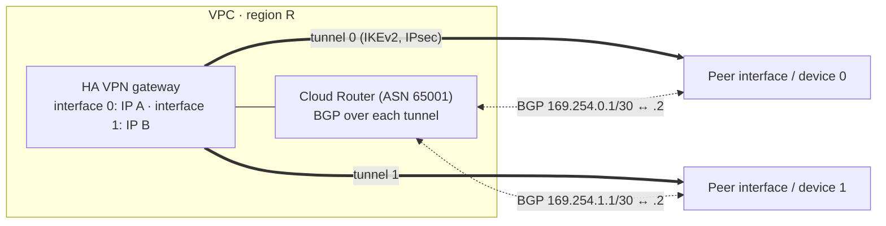

# GCP56 — Cloud VPN Overview

> 🎛️ **Interactive visualization:** [HA VPN and BGP Paths](../../visualizations/gcp/GCP55-60%20-%20HA%20VPN%20and%20BGP%20Paths.html), "HA VPN topologies" tab. Opens in your browser.

## Summary
**Use Cloud VPN when:**
- you don't need Interconnect speeds (low-volume or low-bandwidth links)
- you want the **economics of IPsec over the internet**
- your site **can't support dedicated fiber**
- you need **encryption in transit**

Cloud VPN is **cheaper and faster to set up** than Interconnect. One gateway **encrypts**, the peer **decrypts**, and the data is protected across the internet.

Unlike **VPC peering**, which exchanges **all** subnet routes, Cloud VPN with Cloud Router lets you **selectively advertise** routes (custom advertisements).

**Two types:**
| | **HA VPN** (recommended) | **Classic VPN** |
|--|--------------------------|-----------------|
| Interfaces / public IPs | **2** per gateway, each from a **different address pool**, auto-assigned | 1 |
| SLA | **99.99%** (with 2 tunnels configured correctly) | 99.9% |
| Routing | **Dynamic (BGP) only** | Static (policy- or route-based); dynamic routing is legacy |
| Use | Production hybrid connectivity | Specific static-routing cases |
| Scope | **Regional** resource, per VPC | Regional |

**Scenario:** Jack's company sees **occasional outages on Classic VPN** and needs higher availability with simple setup. Moving to **HA VPN** gives redundancy, **automatic failover** through BGP, and better performance.

---

## Core Concepts

### How an HA VPN connection is built

| Building block | Role |
|----------------|------|
| HA VPN gateway | 2 interfaces, 2 public IPs |
| Peer VPN gateway / external VPN gateway resource | Describes the on-prem or other-cloud device (its IPs and redundancy type) |
| VPN tunnel | IKEv2/IPsec tunnel from one gateway interface to one peer IP, with a shared secret |
| Cloud Router + BGP session | One BGP session per tunnel, on link-local `169.254.x.x/30` addresses. Exchanges routes dynamically |

### Capacity reminder
About **1.5 Gbps per tunnel** over the internet (3 Gbps over Direct Peering). Add tunnels for more. With HA VPN, prefer **active/passive** for predictable bandwidth ([[GCP57 - HA VPN Topologies]]).

---

## Key Terms
| Term | Definition |
|------|-----------|
| IKE (v1/v2) | Key exchange protocol that negotiates IPsec security associations |
| Shared secret | Pre-shared key both gateways use to authenticate the tunnel |
| Selective advertisement | Cloud Router custom advertisement of chosen prefixes only |
| Classic VPN | Older single-interface gateway with a 99.9% SLA |

## Real-World Connections
- **Home lab idea:** HA VPN from GCP to a strongSwan/VyOS box at home (FRR for BGP) connects your k3s lab privately to a GCP VPC, which is exactly this module.
- **AWS:** Site-to-Site VPN (two tunnels per connection, BGP or static), about 1.25 Gbps per tunnel.

## Troubleshooting Scenario
**Scenario:** After migrating from Classic to HA VPN, only one tunnel was configured, and the SLA report shows "not eligible".
**Fix:** HA VPN needs **two tunnels** (one from each gateway interface) with BGP to qualify for 99.99%.

## Hands-On Ideas
1. Do the HA VPN lab ([[GCP58 - Lab - Configuring Google Cloud HA VPN]]), then try advertising only one subnet with `--advertisement-mode=custom`.

## Quiz
1. Which Cloud VPN type offers a 99.99% SLA?
   - A) Any single tunnel  B) HA VPN with two tunnels  C) Classic VPN  D) Policy-based VPN
2. HA VPN tunnels must use:
   - A) No routing  B) Policy-based routing  C) Static routes  D) Dynamic BGP routing
3. What advantage does Cloud VPN have over VPC peering for route control?
   - A) Selective route advertisement  B) Faster  C) No encryption  D) Transitive peering

**Answers:** 1-B, 2-D, 3-A

## Weak Areas to Revisit
*(none flagged yet)*

## Linked Pages
- [[GCP55 - Module Introduction - Cloud VPN]] · [[GCP57 - HA VPN Topologies]] · [[GCP51 - Connectivity Options]] · [[certs/gcp-networking]]
