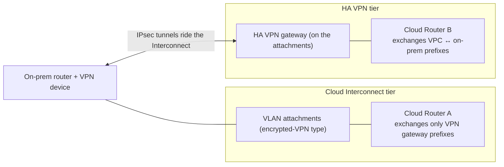

# GCP57 — HA VPN Topologies

> 🎛️ **Interactive visualization:** [HA VPN and BGP Paths](../../visualizations/gcp/GCP55-60%20-%20HA%20VPN%20and%20BGP%20Paths.html), "HA VPN topologies" tab: pick a topology and see the tunnel mapping and redundancy type. Opens in your browser.

## Summary
HA VPN supports four families of site-to-site topology:
1. **HA VPN ↔ peer VPN devices** (on-prem)
2. **HA VPN ↔ AWS** (virtual private gateway or transit gateway)
3. **HA VPN ↔ HA VPN** (two Google Cloud VPCs)
4. **HA VPN ↔ Compute Engine VMs** acting as IPsec appliances

It also has a layered design, **HA VPN over Cloud Interconnect**.

**Rules that always apply:**
- **Two interfaces, two external IPs** from separate address pools (auto-chosen)
- **Tunnels use BGP**
- **99.99%** needs a tunnel from **each** interface
- Prefer **active/passive** for consistent bandwidth: with active/active, a single tunnel failure can halve your bandwidth unless total traffic fits in one tunnel

---

## Core Concepts

### Peer VPN gateway configurations
| Peer side | Tunnels | REDUNDANCY_TYPE | SLA |
|-----------|---------|-----------------|-----|
| **Two separate peer devices**, one IP each | iface0 → device 0, iface1 → device 1 | `TWO_IPS_REDUNDANCY` | 99.99%, with hardware redundancy on-prem too |
| **One device, two IPs** (two interfaces) | iface0 → peer IP 0, iface1 → peer IP 1 | `TWO_IPS_REDUNDANCY` | 99.99% (Google side) |
| **One device, one IP** | Both tunnels → the same peer IP | `SINGLE_IP_INTERNALLY_REDUNDANT` | 99.99% (Google side); the peer is a single point of failure |
| **AWS** (2 Site-to-Site VPN connections = 4 AWS IPs) | iface0 → conn0 IP0/IP1, iface1 → conn1 IP0/IP1 (4 tunnels) | `FOUR_IPS_REDUNDANCY` | 99.99% |

(The transcript's "to IPS redundancy" is `TWO_IPS_REDUNDANCY`.)

### HA VPN to AWS
- Google side: one HA VPN gateway (2 interfaces), a Cloud Router, and an **external VPN gateway resource** describing AWS's 4 IPs.
- AWS side: **two Site-to-Site VPN connections**, each with 2 tunnel endpoints, on either a **virtual private gateway** or a **transit gateway**.
- **Only the AWS transit gateway supports ECMP** across the active tunnels.

> **Lecture wording:** "two AWS virtual private gateways". The docs' topology uses **one** AWS gateway (VGW or TGW) with **two VPN connections**. Same 4 tunnels, fewer gateways.

### HA VPN to HA VPN (two VPCs)
- **iface0 ↔ iface0, iface1 ↔ iface1.** The gcloud flag `--peer-gcp-gateway` replaces an external gateway resource.
- Used in the lab to simulate on-prem ([[GCP58 - Lab - Configuring Google Cloud HA VPN]]).
- It's also a way to get **transitive or selective routing between VPCs**, where peering would advertise everything.

### HA VPN over Cloud Interconnect (encrypted Interconnect)

- **Two tiers, two Cloud Routers.** The Interconnect-tier router is used **only** by the VLAN attachments, and it can't be reused for VPN.
- The HA VPN tier needs a working Dedicated or Partner tier underneath.
- Result: **private and encrypted** connectivity. This is the encryption fix for Interconnect ([[GCP54 - Cross-Cloud Interconnect]] MACsec scope).

### HA VPN to Compute Engine VMs
Peer devices are **VMs running IPsec** (NVAs), in another VPC or region, each with its own external IP. Put them in **different zones, or regions** for higher availability.

### Active/active vs active/passive
| Mode | Normal | One tunnel fails |
|------|--------|------------------|
| Active/active (equal MED) | ECMP across both tunnels, ~2× bandwidth | Capacity halves. Overload if traffic exceeds one tunnel |
| **Active/passive** (one tunnel preferred via MED) | One tunnel carries traffic | The standby takes over at the **same** capacity |

The preference is set with **advertised route priority** ([[GCP59 - Influence Best Path Selection]]).

---

## Key Terms
| Term | Definition |
|------|-----------|
| External VPN gateway | Google Cloud resource describing a non-Google peer (IPs + redundancy type) |
| REDUNDANCY_TYPE | `SINGLE_IP_INTERNALLY_REDUNDANT`, `TWO_IPS_REDUNDANCY`, `FOUR_IPS_REDUNDANCY` |
| ECMP | Equal-cost multipath: traffic spread across equal BGP paths |
| HA VPN over Interconnect | IPsec tunnels carried on Interconnect VLAN attachments |

## Real-World Connections
- **AWS/GCP multicloud** without Cross-Cloud Interconnect: HA VPN ↔ AWS TGW (4 tunnels, ECMP) is the quick-start design, with Cross-Cloud Interconnect when bandwidth grows.
- **Azure:** an active-active VPN gateway (2 public IPs) maps to `TWO_IPS_REDUNDANCY`.

## Troubleshooting Scenario
**Scenario:** HA VPN ↔ HA VPN was created with iface0 → peer iface1. Tunnels flap or never establish.
**Fix:** between two Google HA VPN gateways, **interface numbers must match** (0↔0, 1↔1).

## Hands-On Ideas
1. Write the `external-vpn-gateways create` command for AWS: `--interfaces 0=IP0,1=IP1,2=IP2,3=IP3` (FOUR_IPS_REDUNDANCY).

## Quiz
1. One on-prem device with one public IP. Redundancy type?
   - A) None  B) SINGLE_IP_INTERNALLY_REDUNDANT  C) FOUR_IPS_REDUNDANCY  D) TWO_IPS_REDUNDANCY
2. Which AWS gateway supports ECMP across HA VPN tunnels?
   - A) Virtual private gateway  B) Neither  C) Both  D) Transit gateway
3. HA VPN over Cloud Interconnect needs how many Cloud Routers?
   - A) One per tunnel  B) Two: one per tier  C) One shared  D) None
4. Why prefer active/passive?
   - A) More encryption  B) Cheaper  C) Consistent bandwidth after a tunnel failure  D) Required by BGP

**Answers:** 1-B, 2-D, 3-B, 4-C

## Weak Areas to Revisit
*(none flagged yet)*

## Linked Pages
- [[GCP56 - Cloud VPN Overview]] · [[GCP58 - Lab - Configuring Google Cloud HA VPN]] · [[GCP59 - Influence Best Path Selection]] · [[GCP52 - Dedicated Interconnect]] · [[certs/gcp-networking]]
