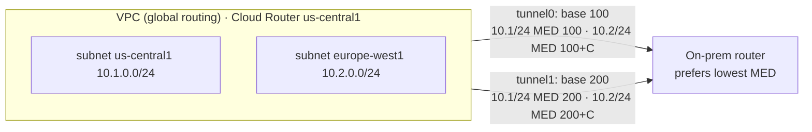

# GCP59 — Influence Best Path Selection

> 🎛️ **Interactive visualization:** [HA VPN and BGP Paths](../../visualizations/gcp/GCP55-60%20-%20HA%20VPN%20and%20BGP%20Paths.html), "BGP path selection" tab: set base priorities and regions, and watch the MED and the chosen tunnel change. Opens in your browser.

## Summary
When Cloud Router advertises prefixes to a BGP peer, it attaches a **route priority**, carried in the **BGP MED (multi-exit discriminator)** attribute. The **peer prefers the lowest MED**, so setting the **advertised route priority per tunnel or VLAN attachment** steers **inbound** traffic (on-prem → Google) onto the path you want.

| Value | Range | Notes |
|-------|-------|-------|
| **Base priority** (advertised route priority) | **0–65535**, **default 100** | **Lower = preferred** (0 is the highest priority). Applies to **all** prefixes on that BGP session |
| **Region-to-region cost** | **201–9999** | Added to the base priority **only in global dynamic routing mode**, for prefixes from a **different region** than the Cloud Router. Google computes it from distance and latency; **you can't change it** |
| **Advertised MED** | base + region cost (when it applies) | What the peer actually compares |

---

## Core Concepts

### MED in an active/passive HA VPN

- On-prem picks **tunnel0** for both prefixes (lower MED), and **tunnel1** is standby: **active/passive** ([[GCP57 - HA VPN Topologies]]).
- Equal base priorities give equal MEDs and **ECMP** (active/active).
- `C` is the region-to-region cost (201–9999), larger for farther regions. In the lecture's map, us-central1 ↔ europe-west1 costs less than europe-west1 ↔ us-west1.

### Commands
```bash
gcloud compute routers update-bgp-peer cr-usc1 --region=us-central1 \
    --peer-name=bgp-tunnel1 --advertised-route-priority=200      # make tunnel1 the backup
gcloud compute routers get-status cr-usc1 --region=us-central1 \
    --format="yaml(result.bestRoutes, result.bgpPeerStatus[].advertisedRoutes)"
```

### What MED does and doesn't control
| Direction | Controlled by |
|-----------|---------------|
| **Inbound to Google** (on-prem chooses a tunnel) | MED you advertise (advertised route priority) |
| **Outbound from Google** (VPC chooses a tunnel) | What on-prem advertises to Cloud Router (its MED / route priority), then the VPC routing order |

MED is one step in BGP best-path selection, after local preference, AS path length and origin on the peer. A peer that sets local preference **overrides** your MED.

---

## Key Terms
| Term | Definition |
|------|-----------|
| MED | BGP attribute hinting which entry point a neighbor AS should prefer; lower wins |
| Advertised route priority | Cloud Router per-peer setting that becomes the MED |
| Region-to-region cost | Google-computed penalty added in global mode for cross-region prefixes |

## Real-World Connections
- **Telecom/BGP:** MED is the classic "multi-homed customer tells the provider which link to use" knob. AS-path prepending is the blunter alternative.
- **AWS:** Direct Connect/VPN uses AS-path length and BGP communities (local preference) for the same steering.

## Troubleshooting Scenario
**Scenario:** You set tunnel1's priority to 200 to make it the backup, but on-prem still splits traffic.
**Causes:**
- The on-prem router ignores MED (compares MED only from the same neighbor AS, or `bgp always-compare-med` is off).
- Local preference is set on-prem.

**Fix:** enable the MED comparison on-prem, or set local preference there. Verify with the peer's BGP table.

## Hands-On Ideas
1. In the HA VPN lab, set `--advertised-route-priority=200` on one peer, then check `routers get-status` on the on-prem router: its `bestRoutes` should point to the other tunnel only.

## Quiz
1. Which advertised base priority is most preferred?
   - A) 100  B) 65535  C) 0  D) 201
2. The default base priority is:
   - A) 201  B) 100  C) 1000  D) 0
3. When is region-to-region cost added?
   - A) Only for Interconnect  B) Only in global dynamic routing mode, for cross-region prefixes  C) Always  D) Never
4. Can you edit region-to-region costs?
   - A) Only in the console  B) Yes, per router  C) No, Google generates them  D) Only with Partner Interconnect

**Answers:** 1-C, 2-B, 3-B, 4-C

## Weak Areas to Revisit
*(none flagged yet)*

## Linked Pages
- [[GCP57 - HA VPN Topologies]] · [[GCP58 - Lab - Configuring Google Cloud HA VPN]] · [[GCP01 - Routes and Route Preferences]] · [[GCP03 - BYOIP - Bring Your Own IP]] · [[certs/gcp-networking]]
