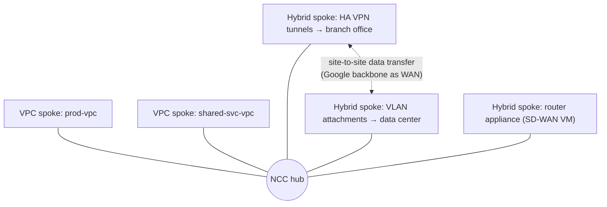

# GCP60 — Network Connectivity Center

> 🎛️ **Interactive visualization:** [HA VPN and BGP Paths](../../visualizations/gcp/GCP55-60%20-%20HA%20VPN%20and%20BGP%20Paths.html), "NCC hub" tab: attach spokes and toggle site-to-site data transfer. Opens in your browser.

## Summary
**Scenario:** Zeek is connecting VPCs across regions for Cymbal's global expansion. Today that's a web of **manual configuration** with **no central visibility**. **Network Connectivity Center (NCC)** gives a **central hub** for every connection, simpler configuration, monitoring, and easy scaling.

What NCC adds:
- **Third-party appliances** (router appliances / NVAs) between external sites and VPCs, or between VPCs
- **Site-to-site data transfer:** external sites use **Google's network as a WAN** (supported regions), lowering latency
- **Central management** of multi-site connectivity between external sites and Google Cloud

Course 3 already covered NCC hub-and-spoke for VPCs ([[GCP18 - Hub-and-Spoke Topology]], [[GCP19 - Lab - Implement a Hub-and-Spoke Network Using Network Connectivity Center]]). This lesson adds the hybrid side.

---

## Core Concepts

### The two spoke families
| Family | Spoke types | Connects |
|--------|------------|----------|
| **VPC spokes** | `linked-vpc-network` | VPC networks to each other through the hub (mesh or star preset) |
| **Hybrid spokes** | `linked-vpn-tunnels` (HA VPN), `linked-interconnect-attachments` (VLAN attachments), `linked-router-appliances` (NVA VMs running BGP) | External sites (on-prem, other clouds, SD-WAN) to the hub |



### Commands
```bash
gcloud network-connectivity hubs create zeek-hub --preset-topology=mesh
gcloud network-connectivity spokes linked-vpc-network create prod --hub=zeek-hub \
    --vpc-network=projects/P/global/networks/prod-vpc --global
gcloud network-connectivity spokes linked-vpn-tunnels create branch-1 --hub=zeek-hub --region=us-east4 \
    --vpn-tunnels=tun0,tun1 --site-to-site-data-transfer
gcloud network-connectivity spokes linked-interconnect-attachments create dc-1 --hub=zeek-hub --region=us-east4 \
    --interconnect-attachments=att-1,att-2 --site-to-site-data-transfer
gcloud network-connectivity spokes linked-router-appliances create sdwan --hub=zeek-hub --region=us-central1 \
    --router-appliance=instance=projects/P/zones/us-central1-a/instances/sdwan-vm,ip=10.0.0.5
gcloud network-connectivity hubs list-spokes zeek-hub
```
Full anatomy: [[gcp-command-anatomy]] §7.

---

## Key Terms
| Term | Definition |
|------|-----------|
| Hub | Global NCC resource that spokes attach to |
| VPC spoke | Attaches a VPC network to the hub |
| Hybrid spoke | Attaches HA VPN tunnels, VLAN attachments or router appliances |
| Router appliance | NVA VM that peers BGP with Cloud Router as a spoke (SD-WAN, firewalls) |
| Site-to-site data transfer | Hybrid spokes exchange traffic over Google's backbone |

## Real-World Connections
- **AWS:** Transit Gateway (VPC + VPN + DX attachments) and **Cloud WAN** ≈ NCC with site-to-site transfer.
- **Telecom:** NCC site-to-site is like buying a global MPLS backbone, except the backbone is Google's.
- **Multicloud:** Azure and AWS each on Cross-Cloud Interconnect spokes can talk through Google ([[GCP54 - Cross-Cloud Interconnect]]).

## Troubleshooting Scenario
**Scenario:** Two branch offices attached as VPN spokes can reach GCP, but not each other.
**Cause:** **site-to-site data transfer** isn't enabled on the hybrid spokes, or the region doesn't support it.
**Fix:** recreate or update the spokes with `--site-to-site-data-transfer` in a supported region.

## Hands-On Ideas
1. Extend the HA VPN lab: create a hub, attach `vpc-demo` as a VPC spoke and the two tunnels as a hybrid spoke, then `hubs list-spokes`.

## Quiz
1. Which spoke type attaches HA VPN tunnels?
   - A) Regional spoke  B) Global spoke  C) Hybrid spoke (linked VPN tunnels)  D) VPC spoke
2. Site-to-site data transfer lets external sites:
   - A) Skip encryption  B) Use Google's network as a WAN between them  C) Avoid BGP  D) Share IP ranges
3. Which spoke runs a third-party SD-WAN VM?
   - A) linked-router-appliances  B) PSC spoke  C) linked-interconnect-attachments  D) linked-vpc-network

**Answers:** 1-C, 2-B, 3-A

## Weak Areas to Revisit
*(none flagged yet)*

## Linked Pages
- [[GCP18 - Hub-and-Spoke Topology]] · [[GCP19 - Lab - Implement a Hub-and-Spoke Network Using Network Connectivity Center]] · [[GCP54 - Cross-Cloud Interconnect]] · [[GCP58 - Lab - Configuring Google Cloud HA VPN]] · [[GQ10_Cloud_VPN]] · [[certs/gcp-networking]]
