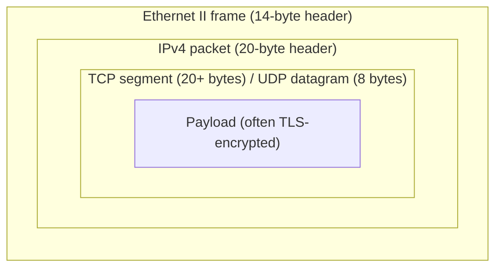

# WS11 — The Anatomy of a Packet

> 🎛️ **Interactive visualization:** [Packet Dissector](../../visualizations/wireshark/WS11-13%20-%20Packet%20Dissector.html): click any byte of Lab 1 frame 1 to see which field it belongs to and what it means. Opens in your browser.

## Summary
Once you've captured traffic, reading it starts with **encapsulation**. Picture the instructor's "box inside a box inside a box":
- the **payload** is wrapped in a **TCP** (or UDP) segment
- that segment is wrapped in an **IP** packet
- the packet is wrapped in an **Ethernet** frame

Each protocol does its own layer's job and leaves the rest to its neighbors. Wireshark **unpeels** the layers in the details pane. Today the payload is usually **encrypted** (TLS), but the **headers** (Ethernet, IP, TCP/UDP) stay readable, and that's enough for most troubleshooting.

**Why Ethernet everywhere:** it's the dominant layer 2 on LANs (Token Ring is gone; ATM and PPP are WAN). Even on **Wi-Fi**, a normal capture shows **Ethernet II** headers, because the OS hands frames to Wireshark before the Wi-Fi card adds 802.11 headers. You only see 802.11 headers with a card in **monitor mode** capturing the RF itself.

---

## Core Concepts

### Encapsulation, as Wireshark shows it

| Layer (OSI) | Lab 1 frame 1 | Wireshark tree line |
|-------------|---------------|---------------------|
| 2 Data link | Ethernet II | `Ethernet II, Src: Apple_e7:ce:6d, Dst: BelkinIntern_9d:02:73` |
| 3 Network | IPv4 | `Internet Protocol Version 4, Src: 192.168.10.108, Dst: 192.168.10.1` |
| 4 Transport | UDP | `User Datagram Protocol, Src Port: 63151, Dst Port: 53` |
| 7 Application | DNS query `www.google.com` (A) | `Domain Name System (query)` |

`frame.protocols` for frame 1 is `eth:ethertype:ip:udp:dns`: the encapsulation chain in one field.

### How Wireshark knows what comes next
Each header has a "next protocol" field, and Wireshark uses it to pick the **dissector** for the following bytes:
| Header | Field | Example |
|--------|-------|---------|
| Ethernet | EtherType | `0x0800` → IPv4 ([[WS12 - The Ethernet Frame]]) |
| IPv4 | Protocol | `17` → UDP, `6` → TCP ([[WS13 - The IP Header]]) |
| UDP/TCP | Ports | `53` → DNS, `443` → TLS (a heuristic, not guaranteed) |

### What's in Lab 1 (protocol hierarchy, verified with tshark)
| Protocol | Frames | Note |
|----------|--------|------|
| Ethernet / IPv4 | 2831 / 2831 | Every frame is IPv4 (EtherType 0x0800 only) |
| UDP → DNS | 14 | Name lookups |
| TCP | 2817 | |
| TLS | 1799 | Encrypted payload: headers readable, content not |

---

## Key Terms
| Term | Definition |
|------|-----------|
| Encapsulation | Wrapping a higher-layer unit inside a lower-layer header |
| PDU names | Frame (L2), packet (L3), segment/datagram (L4) |
| Dissector | Wireshark's decoder for one protocol |
| Monitor mode | Wi-Fi capture of raw 802.11 frames from the air |

## Real-World Connections
- **k3s / Kubeshark:** pod traffic adds more boxes: VXLAN (Flannel) wraps the whole Ethernet frame inside UDP 8472. Kubeshark shows the inner layers.
- **Cloud:** GCP Packet Mirroring copies the full stack to a collector ([[GCP37 - Packet Mirroring for Network Traffic Inspection]]), and you read it with exactly this layering.
- **Network+:** OSI and TCP/IP models, encapsulation ([[L01 - The OSI Model]]).

## Troubleshooting Scenario
**Scenario:** A user says an HTTPS app is slow, and the capture shows only TLS "Application Data".
**Approach:** you can't read the payload, but the IP TTL, TCP handshake timing, retransmissions and window sizes all sit in clear headers. Diagnose from those (as in [[WS01 - Pre-Lesson - Your First Lab]]).

## Hands-On Ideas
1. Open Lab 1, then **Statistics → Protocol Hierarchy**. Match it to the table above.
2. Add a column for `frame.protocols` and sort by it to see the encapsulation chains.
3. `tshark -r "Lab 1-IntrotoWireshark.pcapng" -q -z io,phs`

## Quiz
1. Which layer usually stays readable when the payload is TLS-encrypted?
   - A) None  B) The Ethernet, IP and TCP/UDP headers  C) Only the payload  D) Only DNS
2. Capturing on a normal Wi-Fi adapter, the layer 2 header Wireshark shows is usually:
   - A) 802.11  B) Ethernet II  C) PPP  D) Token Ring
3. How does Wireshark decide to decode the bytes after the Ethernet header as IPv4?
   - A) It guesses  B) EtherType 0x0800  C) The destination MAC  D) The frame length

**Answers:** 1-B, 2-B, 3-B

## Weak Areas to Revisit
*(none flagged yet)*

## Linked Pages
- [[WS12 - The Ethernet Frame]] · [[WS13 - The IP Header]] · [[WS10 - The Statistics View]] · [[wireshark]] · [[certs/wireshark-101]]
