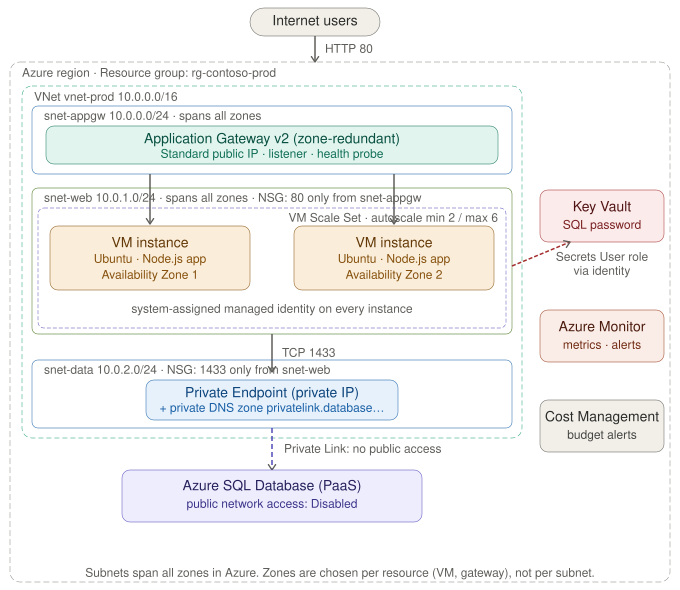
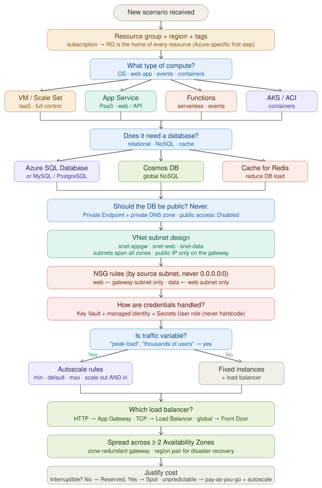

# AZS01 — Contoso Clinic: Highly Available Web App on Azure

**Context → Architecture → How to think → Steps → Why → Verify → Takeaway.** Method and decision rules: [[concepts/azure-scenario-framework]]. Service details: [[concepts/azure-service-reference]]. Exam page: [[certs/az-900]]. AWS counterpart of this design (EC2 + ALB + RDS across two AZs): the Module 11 student-records architecture.

---

## Context
**Contoso Clinic** runs an online appointment-booking portal. Every morning at opening time, thousands of patients log in at once and the portal becomes slow or unavailable. You are the cloud engineer asked to build a proof of concept on Azure. It must be highly available, scalable, load balanced, secure, cost-optimised and high performing.

**Assumptions:** one region only · HTTP is acceptable (no custom domain or HTTPS) · Ubuntu machines running the provided Node.js app · database in a single zone · site publicly accessible without authentication.

### Requirements → Azure services
| Requirement | Azure service | How it satisfies it |
|-------------|---------------|---------------------|
| Load balanced | **Application Gateway** | Layer-7 HTTP load balancer; spreads requests across healthy VM instances using health probes |
| Scalable | **VM Scale Set + autoscale** | Adds instances when CPU is high (morning peak) and removes them when load drops |
| Highly available | **Availability Zones** | VM instances spread over Zone 1 and Zone 2; a zone outage leaves the other serving traffic |
| DB not public | **Private Endpoint** | Azure SQL gets a private IP inside the VNet; public network access is disabled |
| Only needed ports | **NSGs** | Web subnet accepts port 80 only from the gateway subnet; DB reachable only on 1433 from the web subnet |
| No hardcoded credentials | **Key Vault + Managed identity** | DB password stored in Key Vault; VMs read it with their identity, so no password in code or on disk |
| Cost optimised | **Autoscale · Reservations · Budgets** | Scale in off-peak; reserve the baseline instances; budget alerts in Cost Management |
| High performing | **Autoscale + right-sized SKU** | Enough instances at peak; monitor with Azure Monitor and tune thresholds |

---

## Architecture
Pay attention to how the subnets run **across** the zones. This is the biggest structural difference from AWS.



---

## How to think
Run the 9-step framework from [[concepts/azure-scenario-framework]] and follow the decision tree:



**Why VM Scale Set for this scenario:** it mirrors the EC2 + Auto Scaling design, and the scenario says "Ubuntu machines running the provided Node.js app". If the scenario instead said "minimise management effort", **App Service** would be the better answer, because it removes OS patching and has autoscale built in. Always tie the choice back to a sentence in the scenario.

### Four ways to do the same thing
Everything below can be done in the **Azure Portal** (GUI) or by commands. The CLI is shown because it is compact and unambiguous; the portal is the better starting point for learning.

| Tool | What it is |
|------|------------|
| **Azure Portal** | Web GUI. Click-through wizards, visual overview. Best for learning and one-off setups. |
| **Cloud Shell** | A terminal built into the portal (Bash or PowerShell). Nothing to install, already signed in. |
| **CLI / PowerShell** | Run commands from your own machine. Good for scripts and automation. |
| **Bicep / ARM templates** | Infrastructure as code. Repeatable, version-controlled deployments of the whole stack. |

---

## Steps
Each phase fixes one weakness of the previous one, as in the AWS module. Replace the placeholders in `<angle brackets>`.

### Phase A — Governance scaffold and network
**Portal:** `Resource groups` → Create. Then `Virtual networks` → Create → *IP addresses* tab: add the three subnets.
```bash
RG=rg-contoso-prod
LOC=westeurope          # pick the region closest to your users
az group create -n $RG -l $LOC --tags env=prod app=contoso-clinic

# VNet with the gateway subnet, then the web and data subnets
az network vnet create -g $RG -n vnet-prod --address-prefixes 10.0.0.0/16 \
  --subnet-name snet-appgw --subnet-prefixes 10.0.0.0/24
az network vnet subnet create -g $RG --vnet-name vnet-prod -n snet-web  --address-prefixes 10.0.1.0/24
az network vnet subnet create -g $RG --vnet-name vnet-prod -n snet-data --address-prefixes 10.0.2.0/24
```

### Phase B — Network security groups
**Portal:** `Network security groups` → Create → *Inbound security rules* → Add. Then open the VNet → *Subnets* → associate the NSG.
```bash
# Web subnet: allow port 80 only from the gateway subnet
az network nsg create -g $RG -n nsg-web
az network nsg rule create -g $RG --nsg-name nsg-web -n allow-appgw-80 \
  --priority 100 --direction Inbound --access Allow --protocol Tcp \
  --source-address-prefixes 10.0.0.0/24 --destination-port-ranges 80
az network vnet subnet update -g $RG --vnet-name vnet-prod -n snet-web --network-security-group nsg-web

# Data subnet: allow 1433 only from the web subnet
az network nsg create -g $RG -n nsg-data
az network nsg rule create -g $RG --nsg-name nsg-data -n allow-web-1433 \
  --priority 100 --direction Inbound --access Allow --protocol Tcp \
  --source-address-prefixes 10.0.1.0/24 --destination-port-ranges 1433
az network vnet subnet update -g $RG --vnet-name vnet-prod -n snet-data --network-security-group nsg-data
```

### Phase C — Key Vault and the database (decoupling)
**Portal:** `Key vaults` → Create (permission model: *Azure RBAC*) → *Secrets* → Generate/Import. `SQL databases` → Create → new server → *Networking*: public access *No access*.
```bash
KV=kv-contoso-$RANDOM
az keyvault create -g $RG -n $KV -l $LOC --enable-rbac-authorization true
az keyvault secret set --vault-name $KV -n sql-password --value '<StrongPassword>'

SQL=sql-contoso-$RANDOM
az sql server create -g $RG -n $SQL -l $LOC -u sqladmin -p '<StrongPassword>' --enable-public-network false
az sql db create -g $RG -s $SQL -n studentsdb --service-objective S1
```

### Phase D — Private Endpoint and private DNS
**Portal:** SQL server → *Networking* → *Private access* → Create private endpoint. Leave *Integrate with private DNS zone* = Yes; the wizard creates the DNS zone for you (easier than the CLI here).
```bash
SQLID=$(az sql server show -g $RG -n $SQL --query id -o tsv)
az network private-endpoint create -g $RG -n pe-sql --vnet-name vnet-prod --subnet snet-data \
  --private-connection-resource-id $SQLID --group-id sqlServer --connection-name sql-conn

# The step people forget: private DNS so the server name resolves to the private IP
az network private-dns zone create -g $RG -n privatelink.database.windows.net
az network private-dns link vnet create -g $RG -n link-vnet-prod \
  --zone-name privatelink.database.windows.net --virtual-network vnet-prod --registration-enabled false
az network private-endpoint dns-zone-group create -g $RG --endpoint-name pe-sql -n sql-dns \
  --private-dns-zone privatelink.database.windows.net --zone-name sql
```

### Phase E — Web tier across zones, with a managed identity
**Portal:** `Virtual machine scale sets` → Create: zones 1 and 2; *Management* tab → system-assigned identity On; *Advanced* → custom data. Then Key Vault → *Access control (IAM)* → Add role assignment → *Key Vault Secrets User* → *Managed identity*.
```bash
az vmss create -g $RG -n vmss-web \
  --image Ubuntu2204 --vm-sku Standard_B2s --instance-count 2 --zones 1 2 \
  --vnet-name vnet-prod --subnet snet-web \
  --admin-username azureuser --generate-ssh-keys \
  --assign-identity '[system]' --lb "" --public-ip-address "" \
  --custom-data cloud-init.txt
```
`cloud-init.txt` installs Node.js, fetches the app and, at startup, asks Key Vault for the SQL password using the instance's identity instead of a stored password.
```bash
# Let the scale set's identity read secrets (and nothing more)
PID=$(az vmss show -g $RG -n vmss-web --query identity.principalId -o tsv)
KVID=$(az keyvault show -n $KV --query id -o tsv)
az role assignment create --assignee-object-id $PID --assignee-principal-type ServicePrincipal \
  --role "Key Vault Secrets User" --scope $KVID
```

### Phase F — Application Gateway (portal is easiest here)
**Portal:** `Application gateways` → Create.
1. Tier **Standard v2** (or WAF v2), autoscaling on, zones 1 and 2.
2. Put it in `vnet-prod` / `snet-appgw` with a new **Standard** public IP.
3. Backend pool: target type *Virtual machine scale set*, select `vmss-web`.
4. Routing rule: listener on HTTP port 80 → backend pool → backend setting port 80.
5. Add a **health probe** (path `/`, expect HTTP 200–399) so unhealthy instances leave rotation.

### Phase G — Autoscale and monitoring
**Portal:** scale set → *Scaling* → Custom autoscale (add out and in rules). `Cost Management` → Budgets. `Monitor` → Alerts.
```bash
az monitor autoscale create -g $RG --resource vmss-web \
  --resource-type Microsoft.Compute/virtualMachineScaleSets \
  -n autoscale-web --min-count 2 --max-count 6 --count 2
az monitor autoscale rule create -g $RG --autoscale-name autoscale-web \
  --condition "Percentage CPU > 70 avg 5m" --scale out 1
az monitor autoscale rule create -g $RG --autoscale-name autoscale-web \
  --condition "Percentage CPU < 30 avg 10m" --scale in 1
```
Then add a **budget** under *Cost Management → Budgets* with an email alert at 80%, and a CPU alert rule in Azure Monitor.

---

## Why
| Phase | Why it is done this way |
|-------|-------------------------|
| A | The resource group and tags come first so every later resource inherits a home and a cost label. Three subnets separate the edge, web and data tiers, which keeps the NSG rules simple. |
| B | Implements "only the appropriate ports" using the **source subnet**, not the internet. Azure's default rules already deny other inbound internet traffic. The Application Gateway subnet needs its own specific NSG rules if you attach one (ports 65200–65535 from `GatewayManager`), so leave it without an NSG in a first proof of concept. |
| C | The password lives only in Key Vault (and the SQL server), never in code. `--enable-public-network false` is the single most important line for "DB not public". You need an Azure RBAC role such as *Key Vault Secrets Officer* on yourself to write the secret. |
| D | The endpoint gives the database a private IP inside `snet-data`. Without the DNS zone, `<server>.database.windows.net` still resolves to the public address and the connection fails. |
| E | `--zones 1 2` gives zone resilience (with `--instance-count 2`, one instance per zone). `--lb ""` and no public IP keep the VMs unreachable directly from the internet. The role assignment is the "IAM role" step, scoped as narrowly as possible. |
| F | The load-balancing and health-check layer. Because it sits in its own subnet and is the only component with a public IP, the VMs are reachable only through it. |
| G | The out rule handles the morning peak; the in rule is what actually saves money (the scale-in pitfall); the minimum of 2 keeps one instance per zone. |

---

## Verify
**Portal:** application gateway → *Monitoring* → *Backend health*. Scale set → *Instances* to watch the count change.
1. Browse to the Application Gateway public IP and confirm the app loads.
2. In the gateway's **Backend health** blade, confirm both instances show *Healthy*.
3. Stop the VM instance in Zone 1: the site should keep working from Zone 2.
4. From your laptop, try connecting to the SQL server name: it must fail (public access disabled).
5. Generate load and watch the instance count rise, then fall after the load stops.
6. Check *Advisor* for cost and security recommendations.

## Takeaway
- **Constraints → service per requirement → why → trade-off.** Every service in the diagram answers one sentence in the scenario.
- Biggest differences from AWS: subnets span zones, the resource group comes first, and "DB not public" means **Private Endpoint + private DNS + public access disabled**.
- Pitfalls to remember: missing private DNS zone, `0.0.0.0/0` on the web NSG, no scale-in rule, gateway sharing a subnet with the VMs, over-granted identity roles, hardcoded password. Full list in [[concepts/azure-scenario-framework]].
