# GS01 — Private Connectivity Scenarios, Explained

Each scenario follows the same pattern:
**Context → Architecture → How to think (workflow) → Steps (how) → Why it works → Verify → Takeaway.**
Diagrams are Mermaid (they render in Obsidian and GitHub).

**The one decision you keep making in this module:**
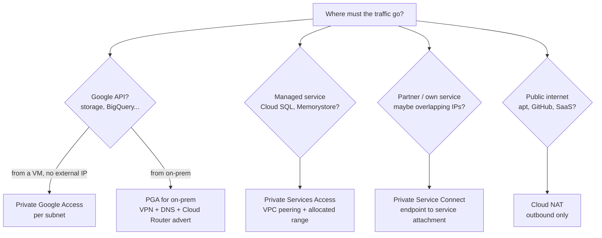

---

## Scenario 1 — Cymbal: sensitive VMs need BigQuery and Cloud Storage, no public IPs
*Source: [[GCP08 - Private Google Access]] (course use case)*

### Context
A recommendation engine processes **sensitive customer data** and needs **BigQuery** and **Cloud Storage**. Security wants **no external IPs** (smaller attack surface) and **no self-managed NAT boxes** (overhead, bottleneck).

### Architecture (target)
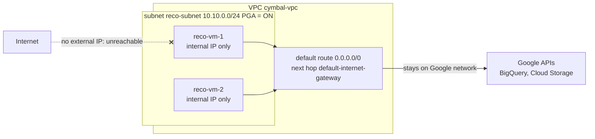

### How to think
1. Destination = **Google APIs** → not NAT, not PSC (unless you need a custom internal IP).
2. Source = **VMs without external IPs** → **Private Google Access** on their subnet.
3. Check prerequisites: **default route present**, **egress firewall allows** it, the **APIs are enabled**.

### Steps (how)
```bash
# 1. Create the VMs without external IPs
gcloud compute instances create reco-vm-1 --zone=us-central1-a \
  --subnet=reco-subnet --no-address
# 2. Turn on PGA for the subnet (the ONLY switch: it is per subnet)
gcloud compute networks subnets update reco-subnet --region=us-central1 \
  --enable-private-ip-google-access
# 3. Confirm the default route still exists
gcloud compute routes list --filter="network:cymbal-vpc AND destRange=0.0.0.0/0"
# 4. Enable the APIs the workload uses
gcloud services enable bigquery.googleapis.com storage.googleapis.com
```

### Why it works
- Without PGA, a VM with only an internal IP can **only send traffic inside the VPC**.
- With PGA, traffic to Google API IPs uses the **default route → `default-internet-gateway`**, but Google keeps it **on its own network**: no public IP and no NAT involved.
- PGA **has no effect on VMs that already have external IPs**. They'd use their own IP, so removing external IPs is what makes the design secure.

### Verify
```bash
gcloud compute ssh reco-vm-1 --zone=us-central1-a --tunnel-through-iap
bq ls                                   # works
gcloud storage ls gs://<bucket>         # works
curl -m 5 https://example.com           # times out (no internet: by design)
```

### Takeaway
**Google APIs + no external IP = PGA, per subnet.** Nothing else to deploy.

---

## Scenario 2 — "Cloud Storage works, but `apt update` hangs"
*Source: [[GCP07 - Private Connection Options - Overview]]*

### Context
An internal-only VM can `curl https://storage.googleapis.com` but `apt update` times out.

### Architecture (what's actually happening)
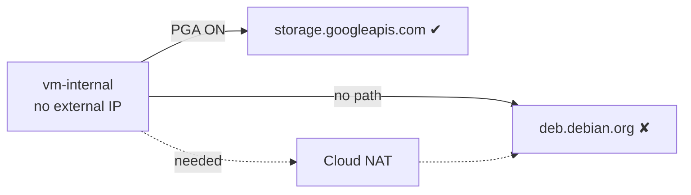

### How to think
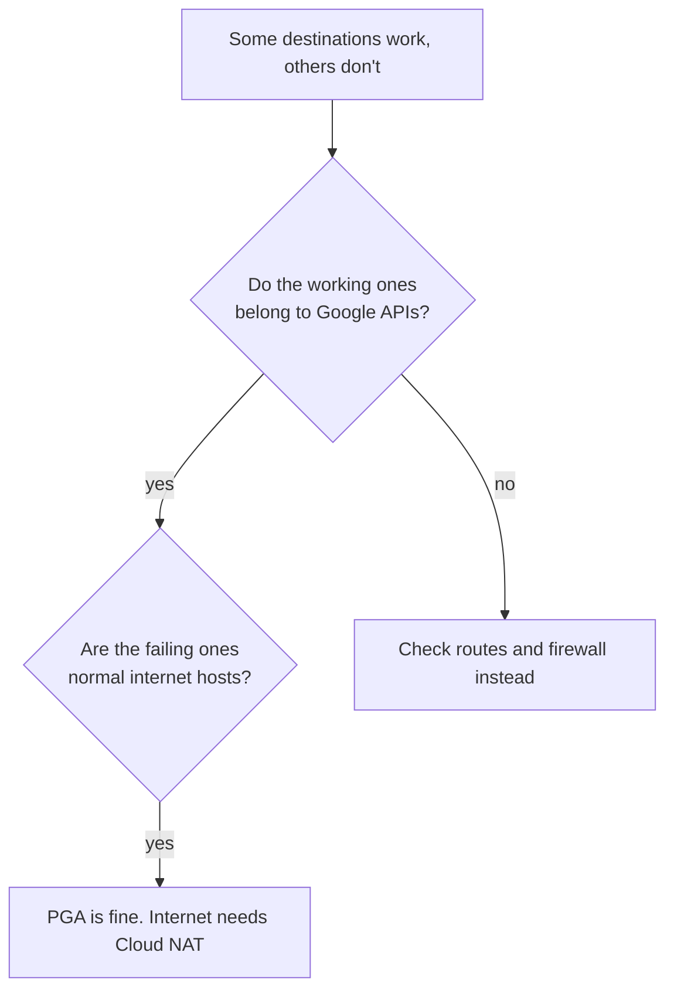

### Steps
```bash
gcloud compute routers create nat-router --network=<vpc> --region=<region>
gcloud compute routers nats create nat-gw --router=nat-router --region=<region> \
  --auto-allocate-nat-external-ips --nat-all-subnet-ip-ranges
# wait 1-3 minutes, then on the VM:
sudo apt-get update
```
Alternative with **no internet at all**: point apt at an **Artifact Registry remote repository** for Debian, which is a Google API and so reachable through PGA.

### Why
**PGA only covers Google APIs and services.** Debian mirrors are ordinary internet hosts, so they need **outbound NAT**.

### Takeaway
**PGA ≠ internet.** Split dependencies into "Google APIs" (PGA) and "everything else" (NAT or a mirror).

---

## Scenario 3 — On-prem Tokyo → Cloud Storage over VPN: DNS resolves, traffic times out
*Source: [[GCP08 - Private Google Access]]*

### Context
On-prem servers must reach Cloud Storage **privately** over Cloud VPN. `nslookup storage.googleapis.com` returns `199.36.153.5` (restricted VIP), but `curl` times out. The tunnel is up.

### Architecture (correct design)
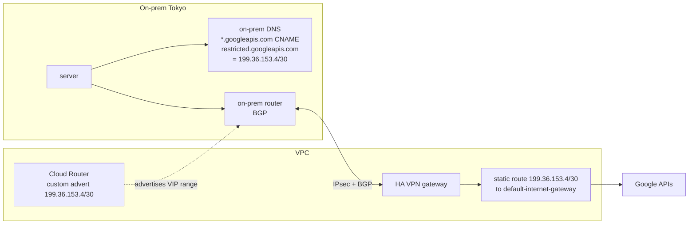

### How to think: three things must line up
| Layer | Question | Status here |
|-------|----------|-------------|
| **DNS** | Does the name resolve to the VIP? | ✔ `199.36.153.5` |
| **On-prem route** | Does on-prem send `199.36.153.4/30` **into the tunnel**? | ✘ probably not |
| **VPC route** | Does the VPC route the VIP to `default-internet-gateway`? | check |

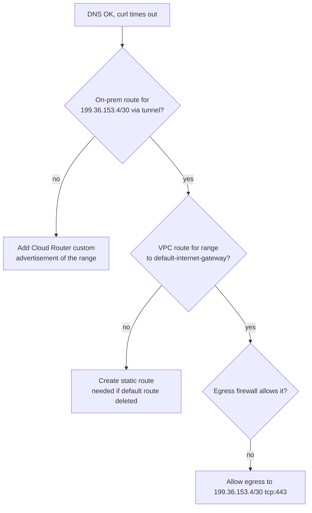

### Steps
```bash
# 1. Check what on-prem learned (on the on-prem router)
show ip route 199.36.153.4        # no BGP route? It follows the default route to the internet
# 2. Advertise the VIP range from Cloud Router (keep subnets too!)
gcloud compute routers update tokyo-router --region=asia-northeast1 \
  --advertisement-mode=CUSTOM --set-advertisement-groups=ALL_SUBNETS \
  --set-advertisement-ranges=199.36.153.4/30
# 3. Make sure the VPC can deliver it
gcloud compute routes create restricted-apis --network=<vpc> \
  --destination-range=199.36.153.4/30 --next-hop-gateway=default-internet-gateway
```

### Why
- The VIP range isn't a VPC subnet, so Cloud Router's **default advertisement mode doesn't announce it**. On-prem then sends it to its own internet path, where `199.36.153.4/30` isn't reachable.
- `ALL_SUBNETS` must stay in the custom list, or you'd **withdraw the subnet routes** and break everything else.
- `restricted` = **VPC Service Controls–supported APIs only**. If another API fails, switch to `private.googleapis.com` (`199.36.153.8/30`).

### Verify
On-prem: `show ip bgp 199.36.153.4/30` shows the route learned from Cloud Router. `curl -I https://storage.googleapis.com` returns HTTP 200/4xx (a response, not a timeout).

### Takeaway
**PGA for on-prem = DNS + advertise the range + VPC route.** Debug them in that order.

---

## Scenario 4 — A bank exposes a transaction API to partners (overlapping IPs)
*Source: [[GCP09 - Private Service Connect]] (course use case)*

### Context
A financial institution must offer a **sensitive API** to partners in other clouds and on-prem. It must not be exposed to the internet, IP allow-lists and VPNs don't scale, and **partner IP ranges may overlap** with the bank's.

### Architecture
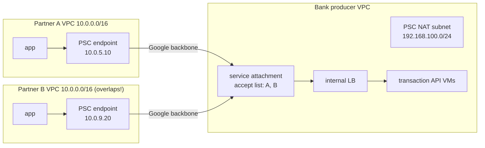

### How to think
- *Overlapping IPs* rules out peering and PSA. *Many consumers* calls for a multi-tenant producer. *Consumers only call in* means one-way access. All three point to **PSC**.

### Steps
**Producer (bank):**
```bash
gcloud compute networks subnets create psc-nat --network=bank-vpc --region=us-central1 \
  --range=192.168.100.0/24 --purpose=PRIVATE_SERVICE_CONNECT
# internal passthrough/proxy LB in front of the API (forwarding rule: api-fr)
gcloud compute service-attachments create txn-api --region=us-central1 \
  --producer-forwarding-rule=api-fr --nat-subnets=psc-nat \
  --connection-preference=ACCEPT_MANUAL \
  --consumer-accept-list=partner-a-project=10,partner-b-project=10
# firewall: allow from the PSC NAT range ONLY
gcloud compute firewall-rules create allow-psc-nat --network=bank-vpc \
  --allow=tcp:443 --source-ranges=192.168.100.0/24
```
**Consumer (each partner):**
```bash
gcloud compute addresses create txn-ep-ip --region=us-central1 --subnet=app-subnet
gcloud compute forwarding-rules create txn-ep --region=us-central1 --network=partner-vpc \
  --address=txn-ep-ip \
  --target-service-attachment=projects/BANK/regions/us-central1/serviceAttachments/txn-api
```

### Why
- PSC exchanges **no routes**; the consumer only sees **one IP in its own subnet**, so overlap is irrelevant.
- The producer SNATs consumers into the **PSC NAT subnet**, so **one firewall rule** covers every partner.
- Connections are **consumer-initiated only**, so the bank can't reach into partner networks and vice versa.

### Verify
Producer: `gcloud compute service-attachments describe txn-api --region=us-central1` shows connections `ACCEPTED`. Consumer: `curl https://10.0.5.10/health`.

### Takeaway
**Publish a service, not a network.** PSC is the answer whenever you see "overlapping IPs" with "specific consumers."

---

## Scenario 5 — PSC endpoint unreachable from a peered VPC
*Source: [[GCP09 - Private Service Connect]]*

### Context
VPC-A has a PSC endpoint `10.10.5.50`. VPC-B is **peered** to VPC-A. VPC-A works; VPC-B times out.

### Architecture
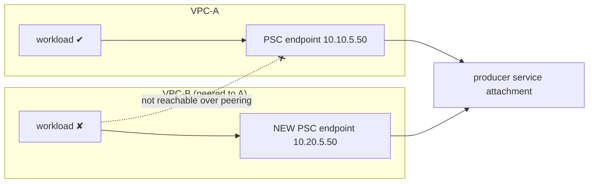

### How to think
Firewall and routes are fine, so think "**what does PSC not support?**" → **endpoints aren't reachable from peered VPCs** (a documented caveat).

### Steps
```bash
gcloud compute addresses create b-ep-ip --region=<r> --subnet=<vpc-b-subnet>
gcloud compute forwarding-rules create b-ep --region=<r> --network=vpc-b \
  --address=b-ep-ip --target-service-attachment=<same attachment URI>
# Optional: Cloud DNS private zones so "partner-api.internal" resolves per VPC
```

### Why
The endpoint is a forwarding rule tied to its VPC; peering doesn't export it. Each consuming VPC needs **its own endpoint**. The producer may need to **accept** VPC-B's project.

### Takeaway
**One endpoint per consuming VPC.** Use DNS so apps don't care which IP they hit.

---

## Scenario 6 — On-prem can't reach Cloud SQL's private IP (PSA)
*Source: [[GCP10 - Private Services Access]]*

### Context
On-prem (HA VPN + Cloud Router) must query Cloud SQL at `10.240.0.2`. VMs in the VPC work; on-prem times out.

### Architecture
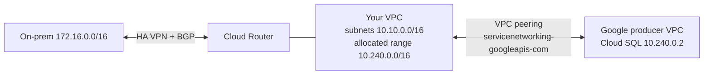

### How to think: two directions, two fixes
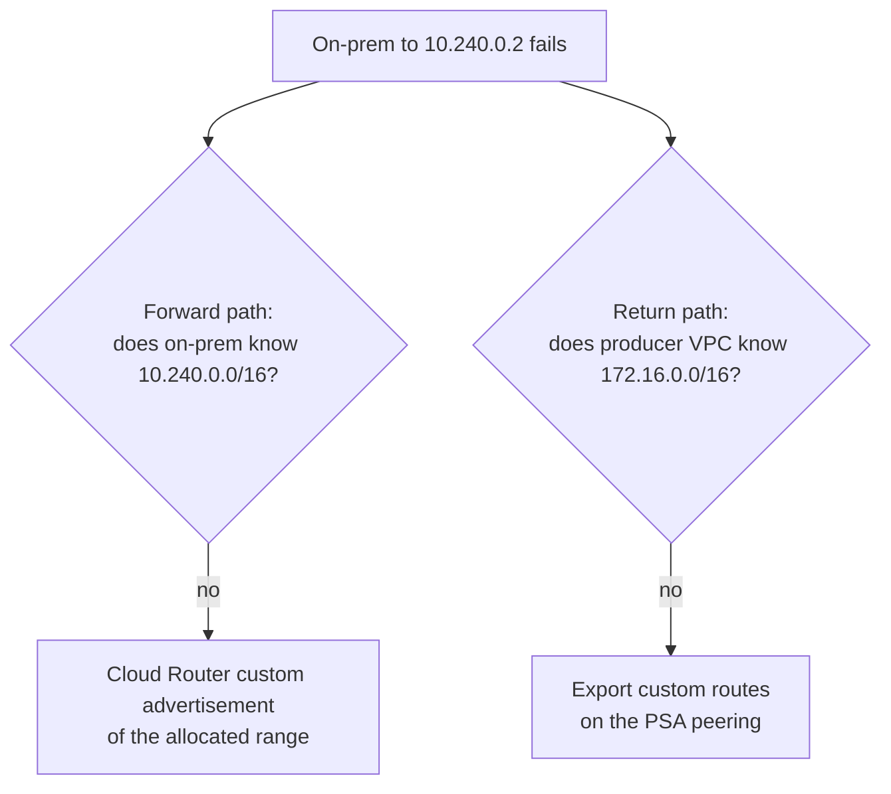

### Steps
```bash
# Forward: tell on-prem about the PSA range
gcloud compute routers update onprem-router --region=<r> --advertisement-mode=CUSTOM \
  --set-advertisement-groups=ALL_SUBNETS --set-advertisement-ranges=10.240.0.0/16
# Return: let the producer VPC learn on-prem routes
gcloud compute networks peerings update servicenetworking-googleapis-com \
  --network=<vpc> --export-custom-routes
# Check what is exported
gcloud compute networks peerings list-routes servicenetworking-googleapis-com \
  --network=<vpc> --region=<r> --direction=OUTGOING
```

### Why
- The allocated range isn't a local subnet, so it's **not advertised by default**.
- Peering is **non-transitive**: the producer VPC only gets your **subnet** routes, not **dynamic** (on-prem) routes, unless you **export custom routes**.

### Verify
From on-prem: `psql -h 10.240.0.2 -U postgres`.

### Takeaway
**Hybrid + PSA = advertise the allocated range + export custom routes.** Always check both directions.

---

## Scenario 7 — CI builds fail intermittently behind Cloud NAT (port exhaustion)
*Source: [[GCP11 - Cloud NAT]]*

### Context
50 internal-only CI runners, Cloud NAT in auto mode with 1 NAT IP and the **default 64 ports/VM**. Peak builds fail with timeouts during `npm install` / `docker pull`; small builds pass.

### Architecture
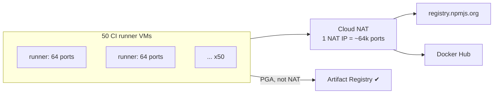

### How to think
*Intermittent* + *load-dependent* + *only internet destinations fail* points to a **finite shared resource**, here **NAT ports** (the cloud version of DHCP pool exhaustion).

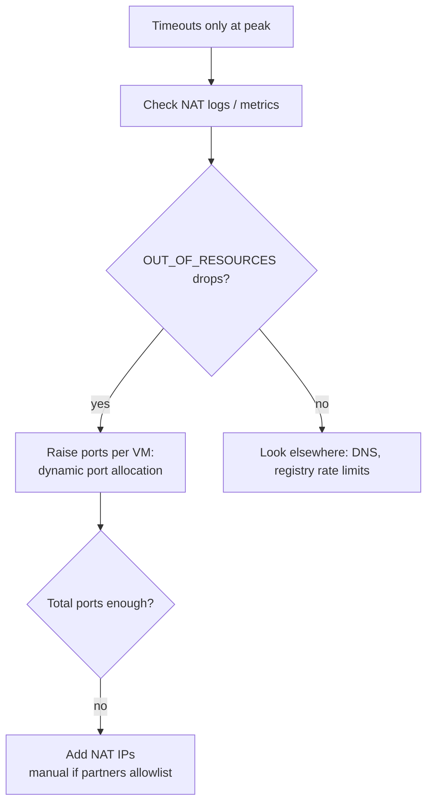

### Steps
```bash
# 1. Evidence
gcloud logging read 'resource.type="nat_gateway" AND jsonPayload.allocation_status="DROPPED"' --limit=10
# 2. Scale ports per VM with demand
gcloud compute routers nats update ci-nat --router=ci-router --region=<r> \
  --enable-dynamic-port-allocation --min-ports-per-vm=64 --max-ports-per-vm=4096
# 3. More capacity if needed (each IP adds ~64k ports)
gcloud compute routers nats update ci-nat --router=ci-router --region=<r> \
  --nat-external-ip-pool=nat-ip-1,nat-ip-2
```

### Why
Each VM gets a fixed **slice of source ports** on a NAT IP. A parallel `npm install` opens hundreds of connections, so 64 ports run out and new connections are dropped. Dynamic allocation grows the slice only when it's needed.

### Verify
Drop counter at 0 during a peak build: `nat/dropped_sent_packets_count` (reason OUT_OF_RESOURCES).

### Takeaway
**Intermittent egress failures under load → check NAT ports first.** Also route registries through PGA (Artifact Registry) to take load off NAT.

---

## Scenario 8 — Lab rebuilt in Terraform: NAT "Running" but no internet
*Source: [[GCP12 - Lab - Implement Private Google Access and Cloud NAT]]*

### Context
`gcloud storage cp` works (PGA OK) but `apt-get update` hangs 10 minutes after NAT shows Running.

### How to think
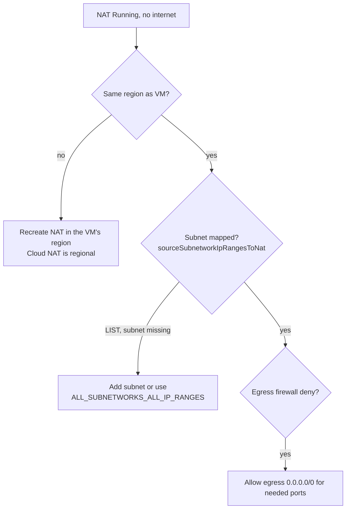

### Steps
```bash
gcloud compute routers nats describe nat-config --router=nat-router --region=us-west1 \
  --format="yaml(sourceSubnetworkIpRangesToNat,subnetworks)"
gcloud compute routers nats update nat-config --router=nat-router --region=us-west1 \
  --nat-all-subnet-ip-ranges
```
Terraform fix: `source_subnetwork_ip_ranges_to_nat = "ALL_SUBNETWORKS_ALL_IP_RANGES"` (or list the subnet in a `subnetwork {}` block).

### Why
A NAT gateway only translates for **the subnet ranges mapped to it**, and only **in its region**.

### Takeaway
**"Running" ≠ "serving my subnet."** Check region and mapping.

---

## Summary Table

| # | Symptom / need | Answer | Key command |
|---|----------------|--------|-------------|
| 1 | Google APIs, no external IP | PGA on subnet | `subnets update --enable-private-ip-google-access` |
| 2 | Google APIs OK, internet not | Cloud NAT (or AR mirror) | `routers nats create` |
| 3 | On-prem: DNS OK, traffic times out | Advertise VIP + VPC route | `routers update --set-advertisement-ranges` |
| 4 | Partners, overlapping IPs | PSC service attachment + endpoints | `service-attachments create` |
| 5 | PSC from a peered VPC fails | Endpoint per VPC | `forwarding-rules create --target-service-attachment` |
| 6 | On-prem → Cloud SQL private IP | Advertise range + export custom routes | `peerings update --export-custom-routes` |
| 7 | Intermittent egress at peak | NAT port allocation / more IPs | `nats update --enable-dynamic-port-allocation` |
| 8 | NAT Running, no internet | Region + subnet mapping | `nats describe` |

**Practice:** [[GPL01 - Private Connectivity Practice Labs]]

## Linked Pages
[[GCP07 - Private Connection Options - Overview]] · [[GCP08 - Private Google Access]] · [[GCP09 - Private Service Connect]] · [[GCP10 - Private Services Access]] · [[GCP11 - Cloud NAT]] · [[GCP12 - Lab - Implement Private Google Access and Cloud NAT]] · [[gcp-private-access]]
