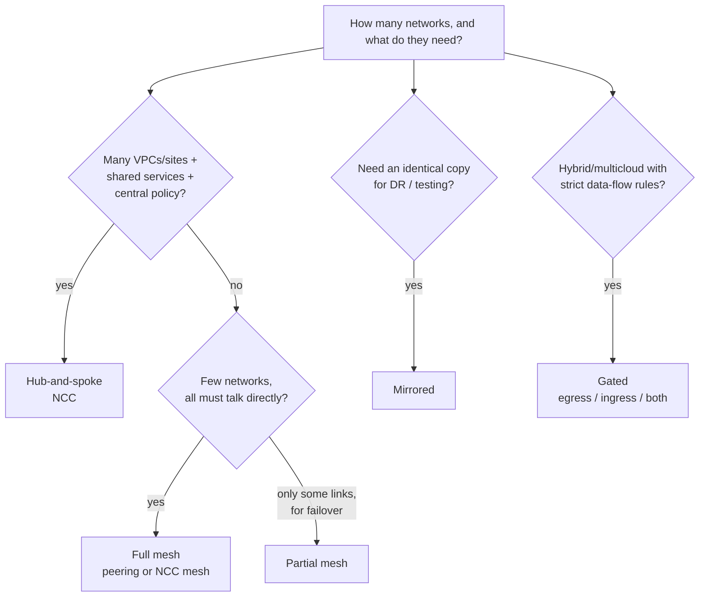
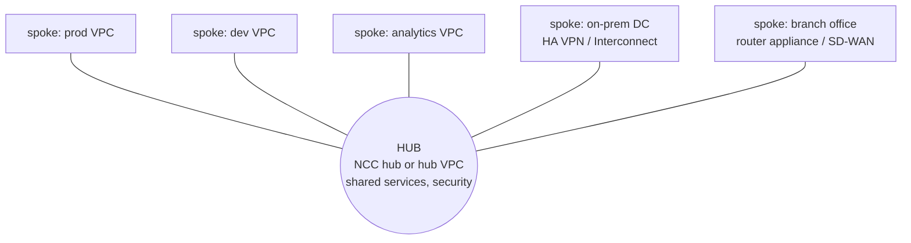
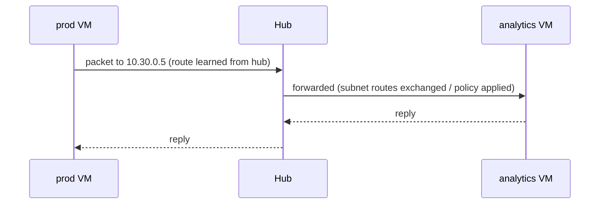
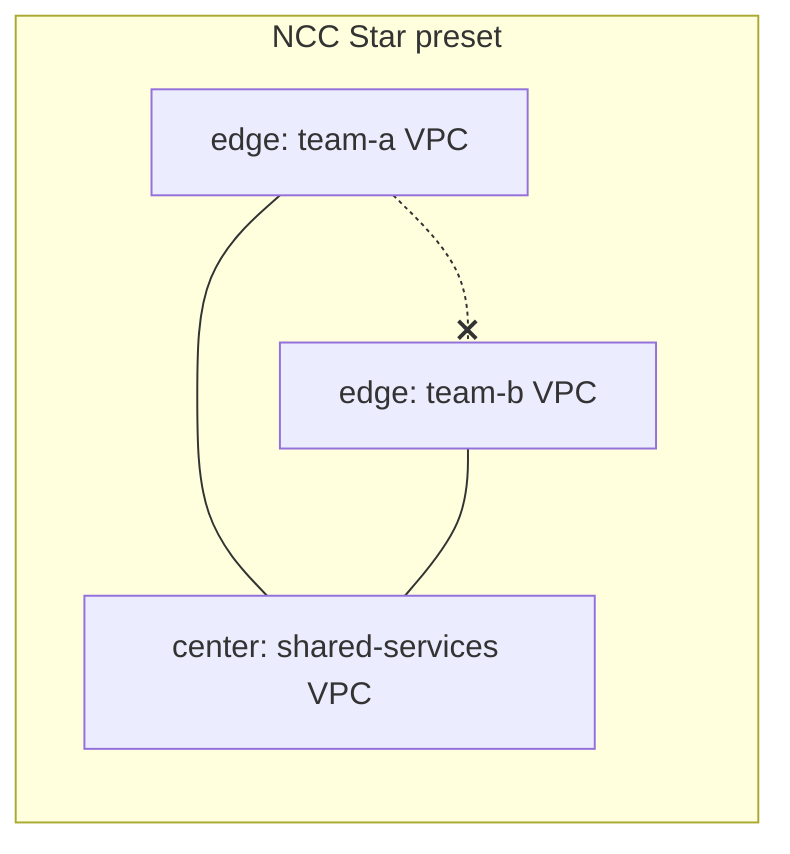
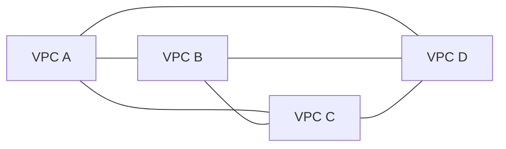
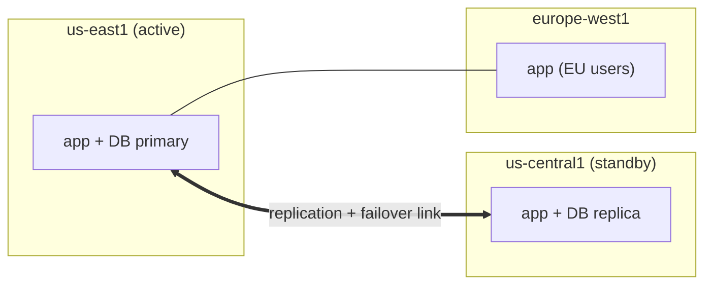
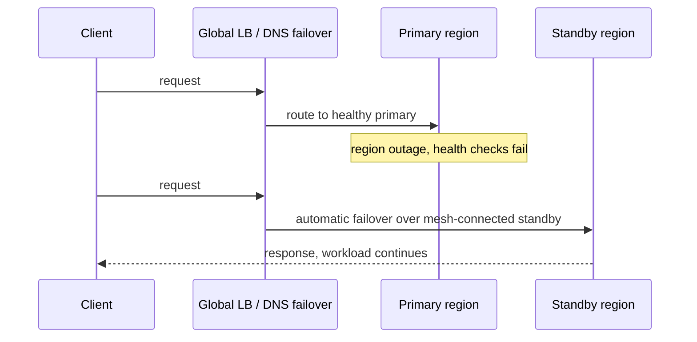
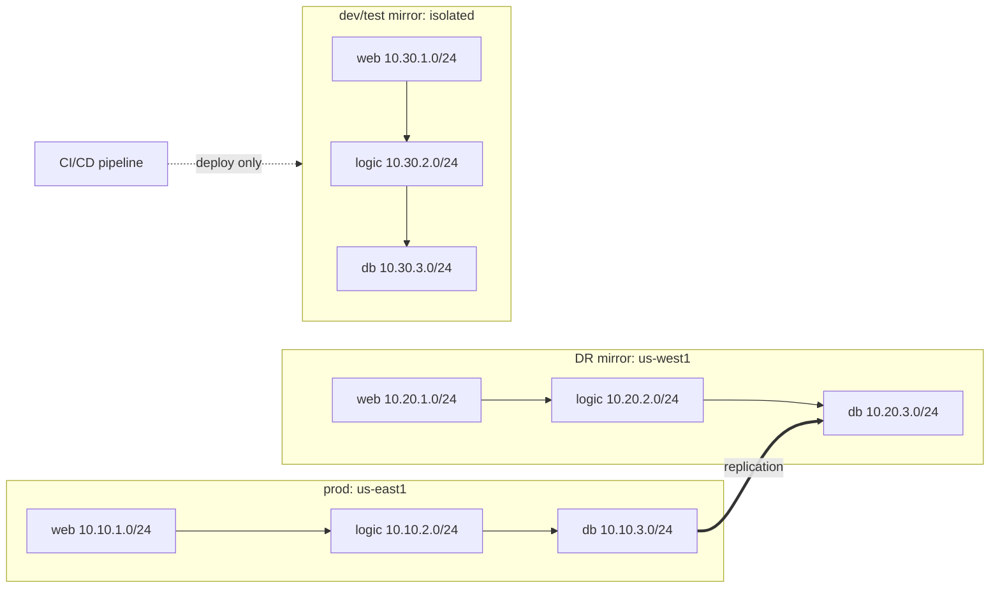
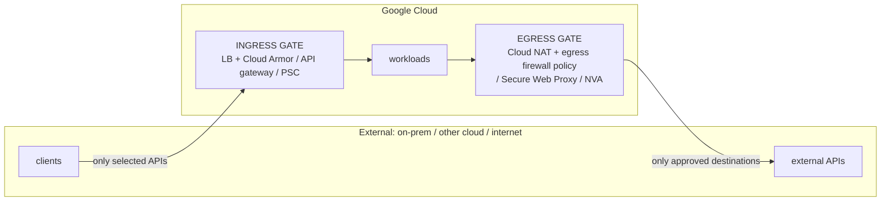

# GS02 — Network Topologies Explained

A **topology** is the *shape* of how your networks (VPCs, on-prem sites, other clouds) connect, which decides **who can reach whom, through what, and how much there is to manage**.

**Quick picker:**


**These combine.** A real enterprise is often **hub-and-spoke** (inside GCP) + **gated** (toward on-prem) + **mirrored** (DR region).

---

## 1. Hub-and-Spoke

### How it works
One **hub** is the transit and control point. Every **spoke** (VPC, office, data center) connects **only to the hub**, and spoke-to-spoke traffic goes **through the hub**.



**Traffic flow (prod → analytics):**


### When it's used
- **Many** VPCs, projects, or sites (grows past ~5).
- **Shared services** (DNS, logging, AD, CI) everyone needs.
- **Central security/inspection** and one place to manage connectivity.
- Example: Cymbal's Nur with remote offices + cloud apps ([[GCP18 - Hub-and-Spoke Topology]]).

### Pros / cons
| ✅ Pros | ❌ Cons |
|--------|--------|
| Central control, monitoring, troubleshooting | Hub = critical dependency (managed NCC mitigates it; DIY NVA hubs must be HA) |
| Simple admin: n spokes = n connections | Spoke↔spoke path may be longer |
| Easy to scale (add a spoke) | Hub limits/quotas cap growth |
| Consistent security at the hub | **Transitivity must be designed** (peering doesn't give it) |

### Implementation options in GCP
| Option | Spoke↔spoke? | Use when |
|--------|-------------|----------|
| **NCC** (VPC spokes + hybrid spokes) | ✔ automatic (subnet routes exchanged) | **Default choice**: managed, cross-project/org |
| **HA VPN** hub ↔ spokes with Cloud Router BGP | ✔ via custom advertisements | Need encryption, or a hub that's also the on-prem gateway |
| **VPC peering** hub ↔ spokes | ✘ (non-transitive) unless NVA in hub | Spokes only need hub services, not each other |
| **Peering + NVA** in hub | ✔ via custom routes to the NVA | Need deep inspection (third-party firewall) |

### How to build it (NCC)
```bash
# 1. Hub (global resource)
gcloud network-connectivity hubs create corp-hub --preset-topology=mesh   # or star
# 2. VPC spokes (repeat per VPC; can be other projects)
for v in prod-vpc dev-vpc analytics-vpc; do
  gcloud network-connectivity spokes linked-vpc-network create ${v}-spoke \
    --hub=corp-hub --vpc-network=projects/$PROJECT/global/networks/$v --global
done
# 3. Hybrid spoke: existing HA VPN tunnels to on-prem
gcloud network-connectivity spokes linked-vpn-tunnels create onprem-spoke \
  --hub=corp-hub --region=us-central1 --vpn-tunnels=tunnel-1,tunnel-2 \
  --site-to-site-data-transfer
# 4. Verify
gcloud network-connectivity hubs list-spokes corp-hub
gcloud compute routes list --filter="network~prod-vpc"
```
**Design rules:** no overlapping ranges · firewall rules are still **per VPC** · hybrid-spoke IPv6 is Preview only (router appliances IPv4-only) · **Star preset** = center group (shared services) ↔ edge groups, edges isolated from each other.



---

## 2. Full Mesh

### How it works
**Every network connects directly to every other network.** There's no transit hop, so each pair has its own link.


Links needed = **n(n−1)/2**: 4 → 6, 10 → 45, 25 → 300.

### When it's used
- **Small, stable** set of networks that talk constantly (e.g., tightly coupled **microservices / GKE Enterprise** clusters).
- Lowest latency between every pair matters.

### Pros / cons
| ✅ Pros | ❌ Cons |
|--------|--------|
| Direct paths, lowest latency | Links explode as n(n−1)/2 |
| No hub dependency | **Peering quotas** per VPC |
| A link failure affects only that pair | Many policies to keep consistent; no central inspection point |

### How to build it
**Option A: VPC peering, every pair** (small n):
```bash
# A <-> B (repeat for every pair, both directions)
gcloud compute networks peerings create a-to-b --network=vpc-a --peer-network=vpc-b
gcloud compute networks peerings create b-to-a --network=vpc-b --peer-network=vpc-a
```
**Option B: NCC mesh preset** (recommended once n grows): one hub, n spokes, managed full-mesh routing with no pairwise peerings ([[GCP19 - Lab - Implement a Hub-and-Spoke Network Using Network Connectivity Center]]).

> **Insight:** an NCC hub with the **mesh preset** *looks* like hub-and-spoke operationally (one place to manage) but *behaves* like a full mesh for routing. You get the best of both.

---

## 3. Partial Mesh

### How it works
Only **strategic** links exist, typically between paired regions for **failover** or between the networks that genuinely exchange traffic.



**Failover workflow:**


### When it's used
- **DR/failover pairs** between regions or zones.
- Some networks need direct links, others don't.

### Pros / cons
| ✅ Pros | ❌ Cons |
|--------|--------|
| Resilience where it matters, fewer links than full mesh | Routing/failover logic is more complex |
| Cost-efficient | Unlinked networks need another path (or none) |

### How to build it
1. Connect the failover pair (NCC spokes or peering).
2. Put a **global external Application LB** (Premium Tier) in front of **regional managed instance groups** with **health checks**, or use a Cloud DNS **failover routing policy** ([[GCP04 - Cloud DNS]]).
3. Replicate data over the link (Cloud SQL cross-region replica, GCS dual-region).
```bash
gcloud compute health-checks create http app-hc --port=80 --request-path=/healthz
gcloud compute backend-services create app-bes --global --protocol=HTTP --health-checks=app-hc
gcloud compute backend-services add-backend app-bes --global \
  --instance-group=app-mig-east --instance-group-region=us-east1
gcloud compute backend-services add-backend app-bes --global \
  --instance-group=app-mig-central --instance-group-region=us-central1
```

---

## 4. Mirrored

### How it works
A **replica of the network infrastructure** (same subnets/tiers/policies **layout**) in another **environment** or **region**.



### When it's used
| Use | Detail |
|-----|--------|
| **Disaster recovery** | Identical standby ready to take over (warm/hot site, [[L15 - Disaster Recovery]]) |
| **Dev/test** | Prod-like but **isolated**: experiments don't touch prod |
| **Performance** | Identical stacks near users in several regions |

### Pros / cons
| ✅ Pros | ❌ Cons |
|--------|--------|
| Predictable failover; tests match prod | Duplicate cost |
| Infrastructure-as-code friendly (same module, different variables) | Drift if not automated |
| | Same IPs = can never interconnect |

### How to build it
- **Terraform module once, instantiate per environment** with different variables: region and **CIDR base** (`10.10`, `10.20`, `10.30`). **Mirror the layout, not the addresses.**
- Connect DR to prod (NCC spoke / peering) for replication. Keep dev/test **unconnected** except through CI/CD and management paths.
```hcl
module "prod" { source = "./net"  region = "us-east1"  cidr_base = "10.10" }
module "dr"   { source = "./net"  region = "us-west1"  cidr_base = "10.20" }
module "dev"  { source = "./net"  region = "us-east1"  cidr_base = "10.30" }
```

---

## 5. Gated (Egress / Ingress / Both)

### How it works
Traffic between your cloud and **external environments** (on-prem, other clouds, internet) may only pass through **controlled gateways**. You **expose specific APIs, not whole networks**.



| Pattern | Controls | Example |
|---------|----------|---------|
| **Gated egress** | **Only GCP workloads initiate**, to selected on-prem/other-cloud APIs via a gateway/LB/PSC endpoint. The private side can't initiate into GCP | Cloud workloads may call the on-prem ERP API and nothing else |
| **Gated ingress** | **Only the private side initiates**, to selected GCP APIs via an API gateway/LB (optionally a transit VPC + NVA). GCP can't initiate back | On-prem apps call one cloud API through an internal LB / API gateway |
| **Gated ingress and egress** | Both sides, **specific APIs/IPs only**; networks needn't align | M&A, partner integrations, org units in different clouds |

### When it's used
- **Hybrid and multicloud** with **security/compliance** requirements (banks, health, PCI scope reduction, [[L18 - Basic Network Security]]).
- **Data-exfiltration** prevention (gated egress).

### Pros / cons
| ✅ Pros | ❌ Cons |
|--------|--------|
| Fine-grained control of data movement | Gateways add latency and things to operate |
| Smaller attack surface, compliance evidence | Gateways can become bottlenecks; must be HA |
| Exposes APIs, not networks | More design work per new integration |

### How to build it
**Gated egress:**
```bash
# deny all egress, then allow only the approved destination (network firewall policy)
gcloud compute network-firewall-policies create egress-gate --global
gcloud compute network-firewall-policies rules create 1000 --firewall-policy=egress-gate \
  --global-firewall-policy --direction=EGRESS --action=allow \
  --dest-ip-ranges=172.16.50.10/32 --layer4-configs=tcp:443      # on-prem ERP API
gcloud compute network-firewall-policies rules create 65000 --firewall-policy=egress-gate \
  --global-firewall-policy --direction=EGRESS --action=deny \
  --dest-ip-ranges=0.0.0.0/0 --layer4-configs=all
gcloud compute network-firewall-policies associations create --firewall-policy=egress-gate \
  --network=app-vpc --global-firewall-policy
```
(For domain-based allow-lists, use **FQDN objects** in firewall policy rules or **Secure Web Proxy**.)
⚠️ A deny-all egress rule also blocks **Google APIs**. Add an allow rule for `199.36.153.8/30` (`private.googleapis.com`, with matching DNS) if workloads use Cloud Storage, BigQuery, Logging, etc. ([[GCP08 - Private Google Access]]).

**Gated ingress:** publish the service through an **internal Application LB / API gateway**, or a **PSC service attachment** ([[GCP09 - Private Service Connect]]). Add Cloud Armor for internet-facing ingress. Firewall-allow only the LB/proxy ranges to the backends.

---

## Side-by-Side Summary

| | Hub-and-spoke | Full mesh | Partial mesh | Mirrored | Gated |
|-|--------------|-----------|--------------|----------|-------|
| **Shape** | Star | All ↔ all | Strategic links | Copies | Controlled gates |
| **Links for n nets** | n | n(n−1)/2 | < n(n−1)/2 | per env | per gate |
| **Best for** | Many VPCs, shared services | Few, chatty networks | Failover pairs | DR, dev/test | Hybrid/multicloud compliance |
| **GCP build** | **NCC** (or HA VPN, peering+NVA) | Peering / NCC mesh | Peering/NCC + global LB/DNS failover | IaC module × env, unique CIDRs | LB/API GW/PSC + NAT/egress policy/SWP |
| **AWS analogue** | Transit Gateway | VPC peering mesh | TGW peering + Route 53 failover | Multi-region/pilot light | ALB/API GW + Network Firewall |
| **Main risk** | Transitivity design | Link explosion | Failover complexity | IP overlap, drift | Gateway bottleneck |

**Practice:** [[GPL02 - Architecture and Topology Practice Labs]] · **Scenarios:** [[GS03 - Architecture and Topology Scenarios]]

## Linked Pages
[[GCP17 - Module Introduction - Network Topologies]] · [[GCP18 - Hub-and-Spoke Topology]] · [[GCP19 - Lab - Implement a Hub-and-Spoke Network Using Network Connectivity Center]] · [[GCP20 - Other Topologies - Mesh, Mirrored, Gated]] · [[gcp-network-architecture]] · [[L06 - Network Topologies, Architectures & Traffic Flows]]
