# GS03 — Architecture & Topology Scenarios, Explained

Same pattern as [[GS01 - Private Connectivity Scenarios]]: **Context → Architecture → How to think → Steps → Why → Verify → Takeaway.** For the topology theory, see [[GS02 - Network Topologies Explained]].

---

## Scenario 1 — Cymbal Bank takes a 3-VM app global
*Source: [[GCP15 - Cloud Network Architecture Overview]] (course use case)*

### Context
A subsidiary's banking app runs on **3 VMs in 1 subnet** (web, logic, DB). It must serve **Asia, North America, Europe** without bottlenecks.

### Before → after
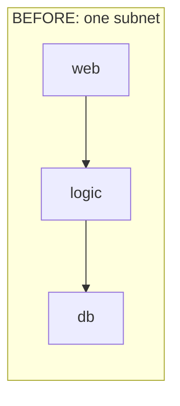
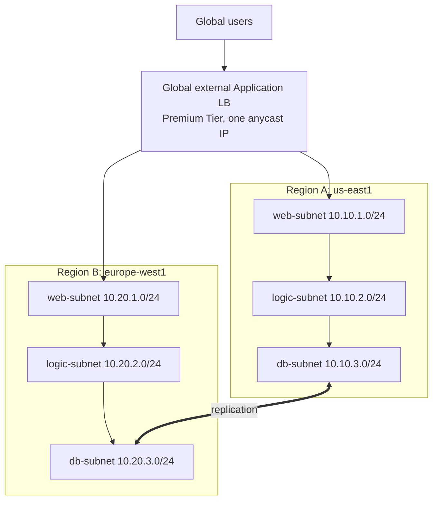

### How to think: apply the design process ([[GCP16 - Getting Started with Network Architecture]])
| Step | Applied here |
|------|-------------|
| Requirements | Global users, no bottleneck, DB isolation, compliance (bank) |
| Metrics | p95 latency < 150 ms per continent; DB reachable only from logic tier |
| HLD | Multi-region, 3 tiers per region, global LB |
| LLD | Unique /24 per tier per region; SA-based firewall matrix |
| BoM | MIGs per tier/region, LB, Premium Tier egress, Cloud SQL or DB VMs |

### Steps
```bash
# 1. One custom VPC, six subnets (tier x region), UNIQUE ranges
gcloud compute networks create bank-vpc --subnet-mode=custom
for r in "us-east1 10.10" "europe-west1 10.20"; do set -- $r
  gcloud compute networks subnets create web-$1   --network=bank-vpc --region=$1 --range=$2.1.0/24
  gcloud compute networks subnets create logic-$1 --network=bank-vpc --region=$1 --range=$2.2.0/24
  gcloud compute networks subnets create db-$1    --network=bank-vpc --region=$1 --range=$2.3.0/24
done
# 2. Identities per tier (used by firewall rules)
for t in web logic db; do gcloud iam service-accounts create $t-sa; done
# 3. Firewall matrix (service-account based)
gcloud compute firewall-rules create lb-to-web --network=bank-vpc --allow=tcp:80 \
  --source-ranges=130.211.0.0/22,35.191.0.0/16 --target-service-accounts=web-sa@$PROJECT.iam.gserviceaccount.com
gcloud compute firewall-rules create web-to-logic --network=bank-vpc --allow=tcp:8080 \
  --source-service-accounts=web-sa@$PROJECT.iam.gserviceaccount.com \
  --target-service-accounts=logic-sa@$PROJECT.iam.gserviceaccount.com
gcloud compute firewall-rules create logic-to-db --network=bank-vpc --allow=tcp:5432 \
  --source-service-accounts=logic-sa@$PROJECT.iam.gserviceaccount.com \
  --target-service-accounts=db-sa@$PROJECT.iam.gserviceaccount.com
# 4. MIGs per tier/region + global LB (backend service with both regional web MIGs)
```

### Why
- **More server sets + LB to the least-busy one** removes the single bottleneck.
- **Tier per subnet** allows per-tier policy (NAT mapping, PGA, on-prem ACLs). **Service-account rules** keep "DB only from logic" working even if VMs move.
- **Unique ranges** let the regions route and replicate between each other.
- `130.211.0.0/22` and `35.191.0.0/16` are Google's **LB and health-check ranges**; the web tier must allow them.

### Verify
```bash
gcloud network-management connectivity-tests create logic-db --source-instance=<logic-vm> \
  --destination-instance=<db-vm> --protocol=TCP --destination-port=5432   # REACHABLE
gcloud network-management connectivity-tests create web-db --source-instance=<web-vm> \
  --destination-instance=<db-vm> --protocol=TCP --destination-port=5432   # UNREACHABLE (expected)
```

### Takeaway
**Scale out per region, segment per tier, unique IPs per region, identity-based firewall.**

---

## Scenario 2 — Multi-region gone wrong: overlapping ranges + DB open to all
*Source: [[GCP15 - Cloud Network Architecture Overview]]*

### Context
The team copied the US subnets **including IPs** into Europe, and the DB rule allows `10.0.0.0/8`. EU replica sync fails, and EU web can reach the US DB.

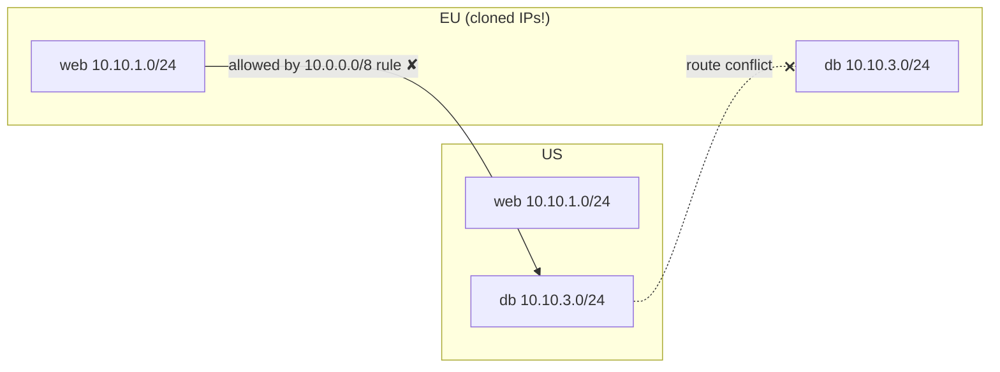

### How to think
Two separate defects: **addressing** (overlap breaks routing) and **policy** (rule far too broad). Fix both, then prove it with Connectivity Tests.

### Steps
1. Re-IP EU to `10.20.x.x` (new subnets, migrate the VMs, delete the old ones).
2. Replace `allow 10.0.0.0/8 → db` with the **SA-to-SA rule** from Scenario 1.
3. Run Connectivity Tests: EU-logic → EU-DB ✔, EU-web → US-DB ✘.

### Takeaway
**Mirror the layout, never the IPs. Least privilege by identity, not by giant CIDR.**

---

## Scenario 3 — New VPC collides with on-prem; logs fail compliance
*Source: [[GCP16 - Getting Started with Network Architecture]]*

### Context
A rushed VPC uses `10.0.0.0/16`, which overlaps on-prem, so the Interconnect integration fails. Audit also finds that log retention doesn't meet bank rules.

### Workflow that would have prevented it
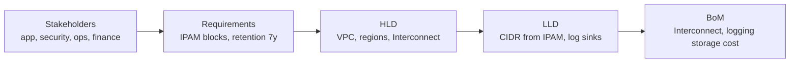

### Steps
```bash
# 1. Allocate a non-overlapping block from IPAM (e.g., 10.64.0.0/16), create new subnets, migrate
# 2. Logging to meet retention
gcloud logging buckets create compliance-7y --location=global --retention-days=2555
gcloud logging sinks create to-compliance \
  logging.googleapis.com/projects/$PROJECT/locations/global/buckets/compliance-7y \
  --log-filter='logName:"cloudaudit.googleapis.com" OR resource.type="gce_subnetwork"'
# 3. VPC Flow Logs for network evidence
gcloud compute networks subnets update app-subnet --region=<r> --enable-flow-logs
```

### Takeaway
**Assess existing infrastructure and compliance before the LLD.** Re-IPing later is far more expensive.

---

## Scenario 4 — Peering sprawl: 25 VPCs in a full mesh
*Source: [[GCP14 - Network Architecture - Course Introduction]], [[GCP17 - Module Introduction - Network Topologies]]*

### Context
Each new VPC was peered with every existing one: 25 VPCs means **300 peerings**. New peerings now fail (quota) and routing is hard to follow.

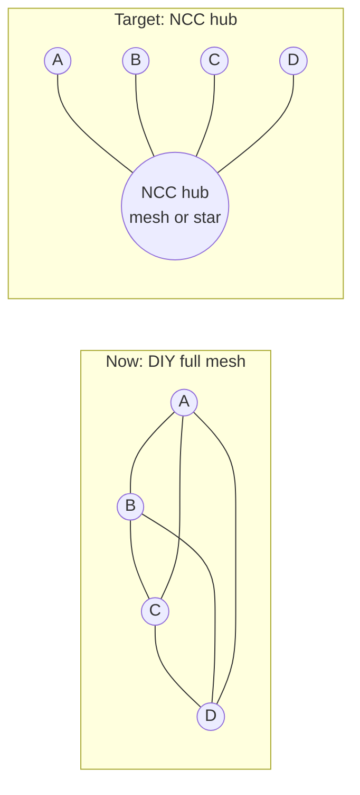

### Migration workflow
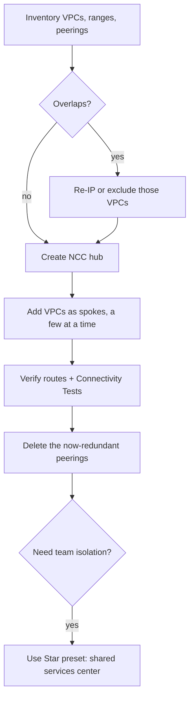

### Steps
```bash
gcloud compute networks peerings list --format="table(name,network,peerNetwork,state)"
gcloud network-connectivity hubs create corp-hub --preset-topology=mesh
gcloud network-connectivity spokes linked-vpc-network create vpc-a-spoke \
  --hub=corp-hub --vpc-network=projects/$P/global/networks/vpc-a --global
# ...repeat; verify; then remove old peerings:
gcloud compute networks peerings delete a-to-b --network=vpc-a
```
⚠️ **Order matters:** add spokes and verify **before** deleting peerings, and do it in a change window ([[L13 - Organizational Processes and Procedures]]). When a peering and an NCC route cover the same prefix, check route precedence during the overlap period.

### Takeaway
**n VPCs = n spokes, not n(n−1)/2 peerings.**

---

## Scenario 5 — Peering hub: spokes reach the hub but not each other
*Source: [[GCP18 - Hub-and-Spoke Topology]]*

### Context
`spoke1-vpc` and `spoke2-vpc` are peered to `hub-vpc`. Each spoke reaches the hub, but **spoke1 ↛ spoke2**.

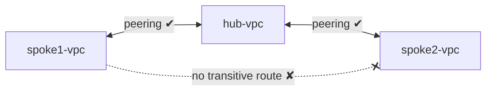

### How to think
Peering is **non-transitive**: spoke1 learns hub routes, never spoke2's routes *through* the hub.

### Three fixes
| Fix | Diagram idea | When |
|-----|-------------|------|
| **A. NCC** | both VPCs → VPC spokes on one hub | Default, simplest |
| **B. HA VPN + BGP** | hub Cloud Router re-advertises spoke ranges | Need encryption / on-prem through the same hub |
| **C. NVA in hub** | custom routes: spoke ranges → NVA (ILB next hop), exported over peering | Need inspection |

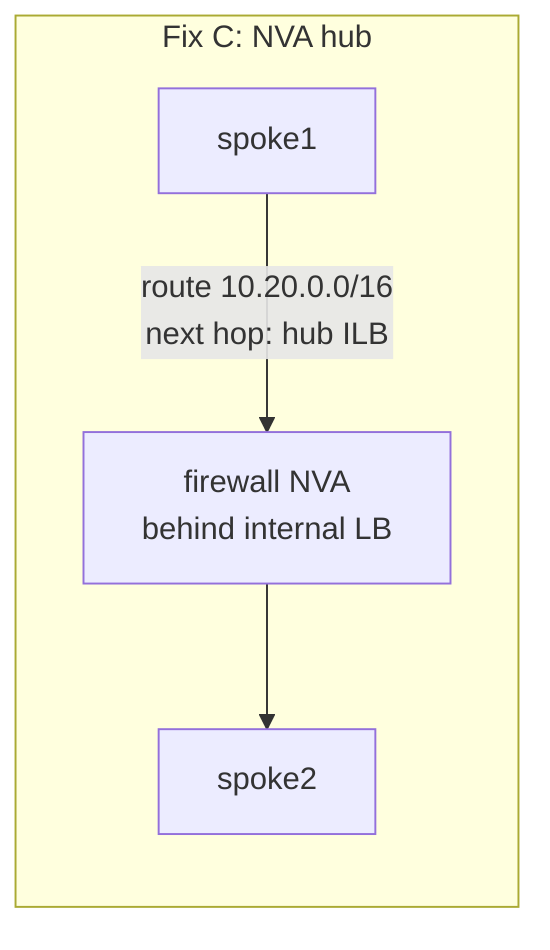

### Steps (fix A)
```bash
gcloud network-connectivity hubs create hub1 --preset-topology=mesh
gcloud network-connectivity spokes linked-vpc-network create s1 --hub=hub1 \
  --vpc-network=projects/$P/global/networks/spoke1-vpc --global
gcloud network-connectivity spokes linked-vpc-network create s2 --hub=hub1 \
  --vpc-network=projects/$P/global/networks/spoke2-vpc --global
```

### Takeaway
**"Hub-and-spoke with peering" isn't transitive.** Use NCC, VPN+BGP, or an NVA.

---

## Scenario 6 — Third NCC spoke can't reach the others
*Source: [[GCP19 - Lab - Implement a Hub-and-Spoke Network Using Network Connectivity Center]]*

### Diagnosis workflow
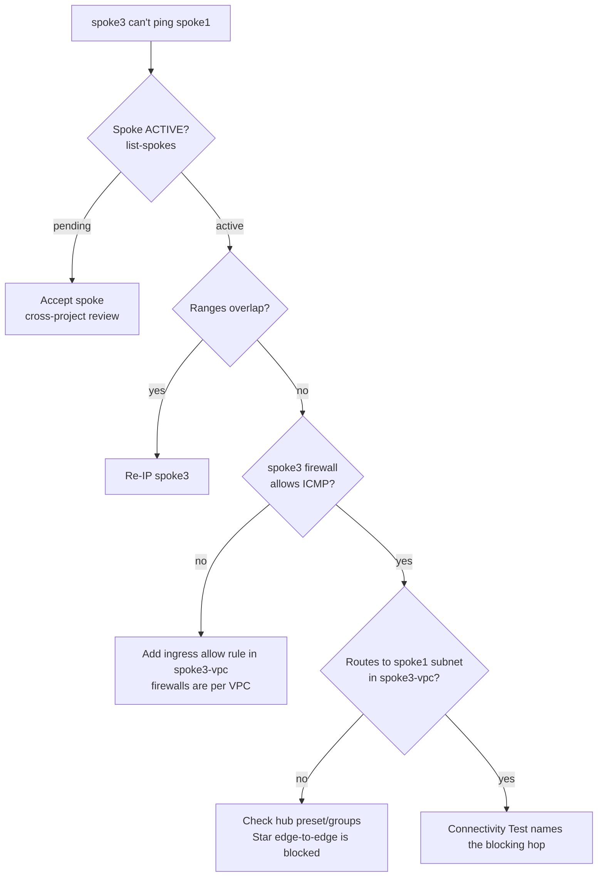

### Steps
```bash
gcloud network-connectivity hubs list-spokes my-hub
gcloud compute routes list --filter="network~spoke3-vpc"
gcloud compute firewall-rules list --filter="network~spoke3-vpc"
gcloud network-management connectivity-tests create s3-s1 \
  --source-instance=<spoke3-vm> --destination-instance=<spoke1-vm> --protocol=ICMP
```

### Takeaway
Debug in this order: **spoke state → IP overlap → firewall (per VPC!) → routes → preset.**

---

## Scenario 7 — DR mirror with identical IPs can't be connected
*Source: [[GCP20 - Other Topologies - Mesh, Mirrored, Gated]]*

### Context
Prod `10.10.0.0/16` was mirrored to DR with the **same ranges**. The partial-mesh link for replication/failover can't be built.

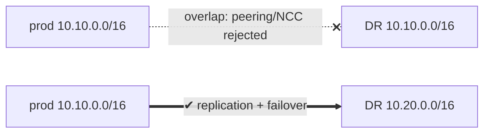

### Steps
1. Rebuild DR from the **same IaC module** with `cidr_base = "10.20"`.
2. Connect it (NCC spoke or peering), set up DB replication.
3. Add failover: global LB with health checks, or a Cloud DNS failover policy.
4. **Test failover** (stop prod backends) as a tabletop exercise followed by a live drill ([[L15 - Disaster Recovery]]).

### Takeaway
**Mirror the layout, not the addresses.**

---

## Scenario 8 — Nur's growing estate: offices + data center + cloud apps
*Source: [[GCP18 - Hub-and-Spoke Topology]] (course use case)*

### Context
Remote offices, an on-prem data center and several cloud VPCs need **central control and simple administration**.

### Target architecture
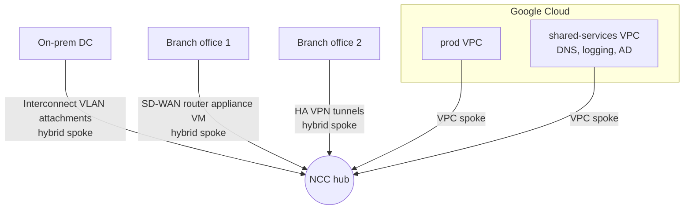

### Steps
1. **IPAM first**: unique ranges for every VPC, office and DC; IPv4 for hybrid spokes (no IPv6 there).
2. Create the hub; add **VPC spokes** for prod and shared services.
3. Hybrid spokes: `linked-interconnect-attachments` for the DC, `linked-vpn-tunnels` for VPN branches, `linked-router-appliance-instances` for SD-WAN branches (BGP with Cloud Router), with **site-to-site data transfer** enabled where offices must talk via Google.
4. Central visibility: Network Topology, Connectivity Tests, VPC Flow Logs.

### Why
Each new site = **one spoke**. Routing is exchanged by the hub (BGP for hybrid, subnet routes for VPCs). Policy lives in firewall policies applied consistently.

### Takeaway
**NCC is the "hub" for everything: VPCs, VPN, Interconnect, SD-WAN.**

---

## Summary Table
| # | Situation | Answer |
|---|-----------|--------|
| 1 | Single-subnet app goes global | Multi-region, tier subnets, global LB, SA firewall |
| 2 | Cloned IPs + broad DB rule | Re-IP, SA-to-SA rules, Connectivity Tests |
| 3 | Overlap with on-prem + compliance gap | IPAM + requirements first; log buckets/sinks |
| 4 | 25-VPC peering mesh | Migrate to NCC (spokes before deleting peerings) |
| 5 | Peering hub, spokes isolated | NCC / VPN+BGP / NVA |
| 6 | NCC spoke3 unreachable | State → overlap → firewall → routes → preset |
| 7 | DR mirror same IPs | Same IaC, new CIDR base, then connect |
| 8 | Offices + DC + VPCs | NCC with VPC + hybrid spokes |

**Practice:** [[GPL02 - Architecture and Topology Practice Labs]]

## Linked Pages
[[GS02 - Network Topologies Explained]] · [[GCP15 - Cloud Network Architecture Overview]] · [[GCP16 - Getting Started with Network Architecture]] · [[GCP18 - Hub-and-Spoke Topology]] · [[GCP20 - Other Topologies - Mesh, Mirrored, Gated]] · [[gcp-network-architecture]]
