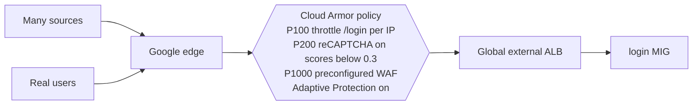
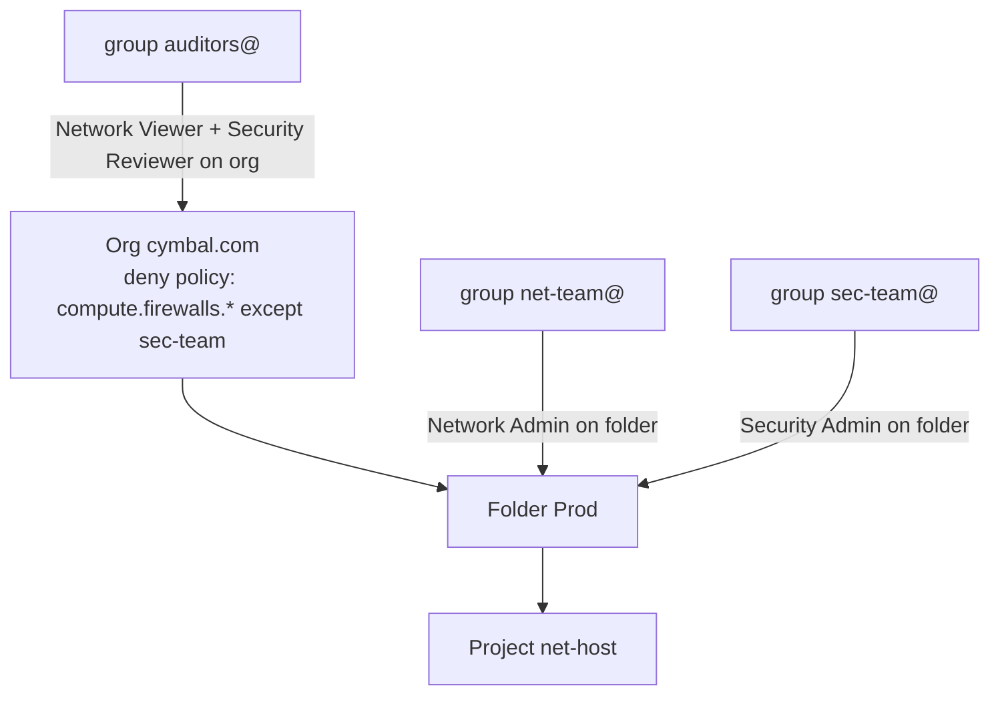
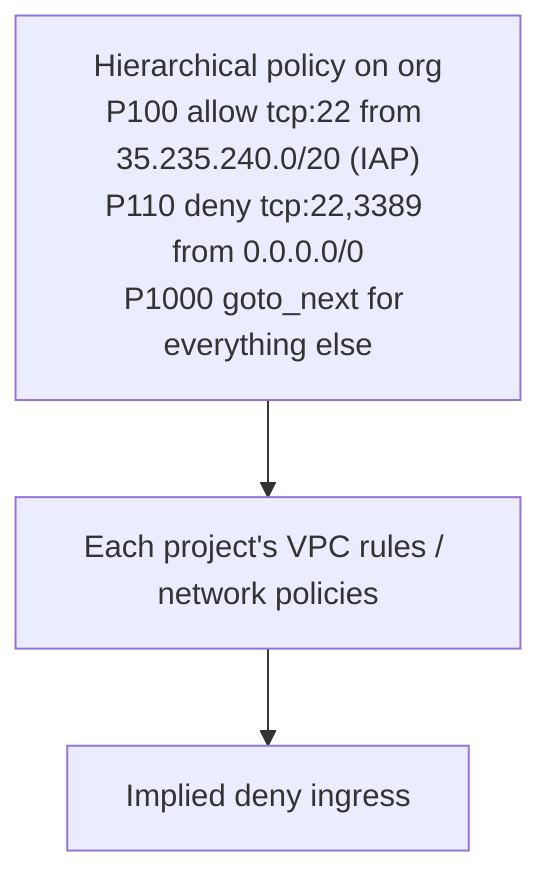
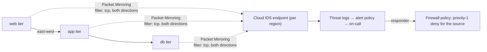
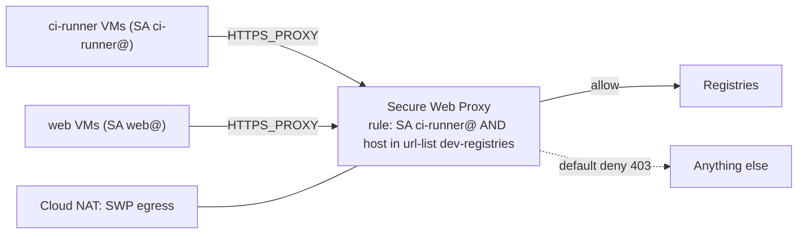
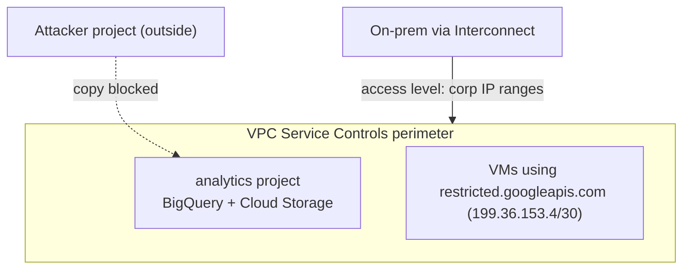

# GS04 — Network Security Scenarios, Explained

Each scenario follows the same pattern: **Context → Architecture → How to think → Steps → Why → Verify → Takeaway.** Hands-on versions are in [[GPL03 - Network Security Practice Labs]]. To self-test on these scenarios first, use the [Scenario Drill](../../visualizations/gcp/GS04-07%20-%20Scenario%20Drill.html).

---

## Scenario 1 — Login page under an L7 flood
*Source: [[GCP25 - How DDoS Attacks Work]] · [[GCP26 - Google Cloud DDoS Mitigations]]*

### Context
Cymbal Retail's `/login` gets ~40× normal requests from thousands of IPs during a sale. Bandwidth looks normal, backend CPU is pegged, and the other pages are fine.

### Architecture


### How to think
| Signal | Means |
|--------|-------|
| Normal Gbps, high rps, one path | **L7 attack**, not volumetric. The LB's built-in L3/L4 protection doesn't help |
| Thousands of IPs | A static IP blocklist won't scale |
| One expensive endpoint | Target the rule at that path: rate limiting + bot management |

### Steps
```bash
gcloud compute security-policies rules create 100 --security-policy=shop-policy \
    --expression="request.path.matches('/login')" --action=throttle \
    --rate-limit-threshold-count=20 --rate-limit-threshold-interval-sec=60 \
    --conform-action=allow --exceed-action=deny-429 --enforce-on-key=IP --preview
gcloud compute security-policies update shop-policy --enable-layer7-ddos-defense   # Adaptive Protection
gcloud compute security-policies rules update 100 --security-policy=shop-policy --no-preview   # after checking logs
```

### Why
- **Throttle per IP** caps each source without blocking real users entirely.
- **Preview first** shows in the logs what *would* be blocked, so you don't lock out customers.
- **Adaptive Protection** learns the baseline and proposes signatures for the next wave (full features need Cloud Armor Enterprise).

### Verify
Logs Explorer: `jsonPayload.enforcedSecurityPolicy.priority=100` with outcome DENY and status 429. Backend CPU drops while the login success rate for normal users stays flat.

**Takeaway:** L7 floods are fought at the edge with **per-path rate limiting + Adaptive Protection**, not with bigger VMs.

---

## Scenario 2 — Least-privilege network team
*Source: [[GCP30 - IAM Roles]]*

### Context
Cymbal has three groups: a **network team** (builds VPCs, routes, NAT, VPN), a **security team** (owns firewall rules and SSL certs), and **auditors** (read only). A contractor accidentally opened a firewall rule last month.

### Architecture


### Steps
```bash
gcloud resource-manager folders add-iam-policy-binding FOLDER --member=group:net-team@cymbal.com --role=roles/compute.networkAdmin
gcloud resource-manager folders add-iam-policy-binding FOLDER --member=group:sec-team@cymbal.com --role=roles/compute.securityAdmin
gcloud organizations add-iam-policy-binding ORG --member=group:auditors@cymbal.com --role=roles/compute.networkViewer
gcloud organizations add-iam-policy-binding ORG --member=group:auditors@cymbal.com --role=roles/iam.securityReviewer
gcloud iam policies create no-fw-edits --kind=denypolicies \
    --attachment-point=cloudresourcemanager.googleapis.com/organizations/ORG --policy-file=deny.json
```

### Why
- Grant to **groups**, at the **smallest scope** that covers the job.
- The Network Admin / Security Admin split stops builders from opening the network.
- A **deny policy** is the only thing that beats an inherited grant (like an old Editor grant to the contractor).

### Verify
`gcloud policy-intelligence troubleshoot-policy iam … --permission=compute.firewalls.create` for a net-team member should say **denied**, and for a sec-team member **granted**.

**Takeaway:** **groups + predefined roles + deny guardrails**. Reach for custom roles only when no predefined role fits.

---

## Scenario 3 — Org-wide "no RDP or SSH from the internet"
*Source: [[GCP31 - Firewall Rules]] · [[GCP32 - Lab - Configuring VPC Firewalls]]*

### Context
200 projects. Some still have `default-allow-rdp` and `default-allow-ssh`. The security team wants a guardrail app teams can't override, while app teams keep control of their own app rules.

### Architecture


### Steps
```bash
gcloud compute firewall-policies create --organization=ORG --short-name=org-baseline
gcloud compute firewall-policies rules create 100 --firewall-policy=org-baseline --organization=ORG \
    --direction=INGRESS --action=allow --src-ip-ranges=35.235.240.0/20 --layer4-configs=tcp:22
gcloud compute firewall-policies rules create 110 --firewall-policy=org-baseline --organization=ORG \
    --direction=INGRESS --action=deny --src-ip-ranges=0.0.0.0/0 --layer4-configs=tcp:22,tcp:3389
gcloud compute firewall-policies rules create 1000 --firewall-policy=org-baseline --organization=ORG \
    --direction=INGRESS --action=goto_next --src-ip-ranges=0.0.0.0/0 --layer4-configs=all
gcloud compute firewall-policies associations create --firewall-policy=org-baseline --organization=ORG
gcloud resource-manager org-policies enable-enforce compute.skipDefaultNetworkCreation --organization=ORG
```

### Why
- **Priority 100 vs 110:** the IAP allow has the **lower number**, so it's evaluated first and wins. If you swapped them, the deny at 100 would block IAP too. That's the most common mistake with this pattern.
- **goto_next** delegates everything else to project-level rules, so app teams keep autonomy.
- An **org policy** stops new default networks from being created at all.

### Verify
From an outside IP, `nc -zv VM_IP 22` times out. `gcloud compute ssh vm --tunnel-through-iap` still works. Connectivity Tests show the hierarchical policy as the blocking rule.

**Takeaway:** **hierarchical policy for guardrails, goto_next for delegation.** Priority mistakes are the #1 bug.

---

## Scenario 4 — Lateral movement inside the VPC
*Source: [[GCP33 - Cloud IDS]] · [[GCP34 - Lab - Getting Started with Cloud IDS]] · [[GCP37 - Packet Mirroring for Network Traffic Inspection]]*

### Context
Threat intel says attackers who get into one web VM then scan and exploit internal services. Cloud Armor only sees internet traffic to the LB.

### Architecture


### Steps
1. Private services access range for IDS, then the endpoint at severity **MEDIUM** (production; INFORMATIONAL is lab-only noise).
2. Mirror the **app and db subnets** (the protected tiers) rather than everything. That avoids the duplicate detections seen in GCP34 and halves mirroring cost.
3. Logs-based alert on `alert_severity` ≥ HIGH.
4. Runbook: copy the source IP from the threat log and add a priority-1 deny rule, as in GCP34 Task 9. Later, automate it with a log sink → Pub/Sub → Cloud Run function.

### Why
Cloud IDS **detects only**, so the response must come from the firewall. Mirroring only the protected tiers still catches attacks *arriving* there.

### Verify
Run the lab's **benign test signatures** (or the EICAR file) from a test VM and confirm a HIGH alert within minutes.

**Takeaway:** **Cloud Armor for north-south, Cloud IDS + mirroring for east-west**, with a firewall-based response.

---

## Scenario 5 — Build runners may only reach package registries
*Source: [[GCP35 - Secure Web Proxy]]*

### Context
CI VMs need `github.com`, `pypi.org`, `files.pythonhosted.org` and `registry.npmjs.org`. Everything else must be blocked and logged, and other workloads in the same subnet shouldn't inherit the access.

### Architecture


### Steps
URL list → gateway security policy rule with `sessionMatcher` on the service account and the URL list → gateway in a proxy-only subnet → set `HTTPS_PROXY` on the runners. Add an **egress firewall** rule so runners can't bypass the proxy: deny tcp:443 to `0.0.0.0/0`, allow tcp:443 to the proxy IP.

### Why
- **Identity + host** beats IP rules, because the registries' IPs change constantly.
- The **egress deny** closes the "just don't use the proxy" bypass.

### Verify
From a runner: `curl -I https://pypi.org` returns 200 and `curl -I https://example.com` returns 403. From a web VM, pypi also returns 403. The SWP logs show every attempt.

**Takeaway:** **SWP for identity-aware web egress; firewall egress rules to force traffic through it.**

---

## Scenario 6 — Stop data exfiltration from BigQuery and Cloud Storage
*Source: [[GCP38 - Network Security Best Practices]] · [[GCP08 - Private Google Access]]*

### Context
An analyst's key leaks. The attacker copies a bucket to a personal project. Firewall rules can't help, because this is API traffic.

### Architecture


### Steps
1. Access policy + perimeter around the analytics project, with **restricted services** `storage.googleapis.com,bigquery.googleapis.com`.
2. Private DNS `*.googleapis.com` → `restricted.googleapis.com` (199.36.153.4/30) for VMs.
3. An access level for the corporate egress IPs.
4. **Dry-run mode** first, then enforce.

### Verify
From outside the perimeter: `gcloud storage cp gs://analytics-bucket/x .` fails with `VPC_SERVICE_CONTROLS` / request violates perimeter. From an inside VM it works.

**Takeaway:** **VPC Service Controls protect data at the API layer**, where firewalls can't see.

---

## Linked Pages
- [[GPL03 - Network Security Practice Labs]] · [[GS05 - Load Balancing Scenarios]] · [[GS06 - Hybrid and Multicloud Scenarios]] · [[GS07 - Capstone - Cymbal Global Landing Zone]]
- [[certs/gcp-networking]]
