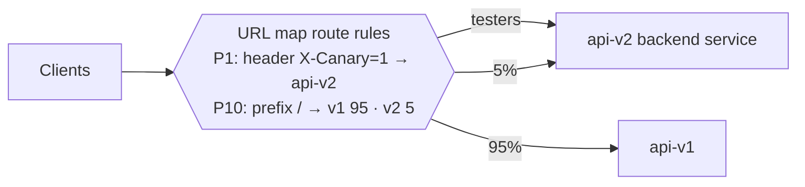
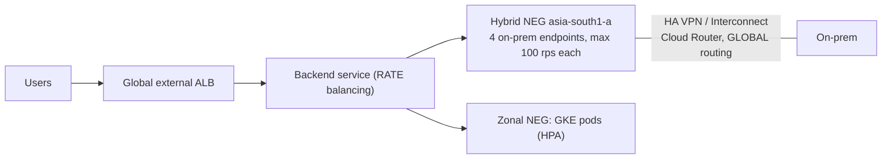
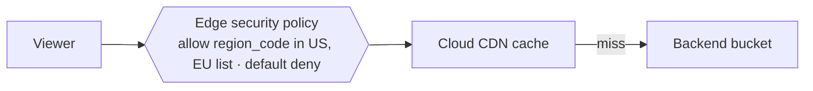
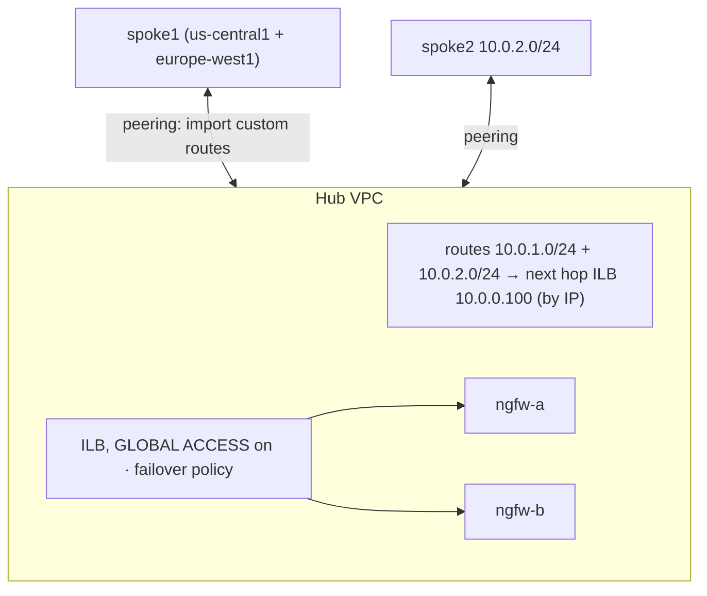

# GS05 — Load Balancing Scenarios, Explained

**Context → Architecture → How to think → Steps → Why → Verify → Takeaway.** Hands-on versions: [[GPL04 - Load Balancing Practice Labs]]. Self-test: [Scenario Drill](../../visualizations/gcp/GS04-07%20-%20Scenario%20Drill.html).

---

## Scenario 1 — Which load balancer?
*Source: [[GCP40 - Module Introduction - Hybrid Load Balancing and Traffic Management]]*

| Requirement | Pick | Why |
|-------------|------|-----|
| Global website, one IP, Cloud CDN + Cloud Armor | **Global external Application LB** | L7, anycast, CDN and WAF attach to it |
| Internal microservices, path routing, one region | **Regional internal Application LB** | URL maps internally; Envoy in a proxy-only subnet |
| Game servers on UDP, need the client IP | **External passthrough NLB** | Any protocol, client IP preserved, regional |
| Global TCP (non-HTTP) service with TLS offload | **Global external proxy NLB** | L4 proxy, global anycast |
| HA firewall appliances as a route's next hop | **Internal passthrough NLB** | The only LB that works as a next hop |
| Backends on-prem + GKE, one endpoint | **Application LB or proxy NLB with a hybrid NEG** | Passthrough NLBs don't support hybrid NEGs |

**Takeaway:** start from **protocol → internal or external → global or regional → need the client IP → hybrid backends**.

---

## Scenario 2 — Canary API v2 behind one hostname
*Source: [[GCP42 - Traffic Management]] · [[GCP43 - Lab - Configuring Traffic Management with a Load Balancer]]*

### Context
`api.cymbal.com` v1 is stable. v2 should take 5% of traffic, internal testers always hit v2 (header `X-Canary: 1`), and rollback must take seconds.

### Architecture


### Steps
```yaml
routeRules:
- priority: 1
  matchRules: [{prefixMatch: /, headerMatches: [{headerName: X-Canary, exactMatch: "1"}]}]
  service: projects/P/global/backendServices/api-v2
- priority: 10
  matchRules: [{prefixMatch: /}]
  routeAction:
    weightedBackendServices:
    - {backendService: projects/P/global/backendServices/api-v1, weight: 95}
    - {backendService: projects/P/global/backendServices/api-v2, weight: 5}
```
`gcloud compute url-maps import api-map --global --source=canary.yaml`

### Why
The **header rule has the lower priority number**, so testers bypass the dice roll. Rollback is a weight change, with no DNS or client changes.

### Verify
`curl -H 'X-Canary: 1' https://api.cymbal.com/version` always returns v2. 1000 plain requests come out at about 5% v2. Compare v2's error rate in LB logs, filtered by `jsonPayload.backendTargetProjectNumber` / backend service.

**Takeaway:** **advanced route rules = canaries, header routing and instant rollback.**

---

## Scenario 3 — Black Friday bursting from on-prem
*Source: [[GCP41 - Hybrid Load Balancing]]*

### Context
Jia's on-prem web farm (Bengaluru, 4 servers) handles 400 rps comfortably. The sale peak is 3000 rps, and buying idle on-prem capacity is too expensive.

### Architecture


### Steps
1. Hybrid NEG `NON_GCP_PRIVATE_IP_PORT` in the **closest zone**; add the 4 endpoints.
2. `add-backend --balancing-mode=RATE --max-rate-per-endpoint=100` for both NEGs.
3. Advertise `35.191.0.0/16, 130.211.0.0/22` to on-prem and allow them in the on-prem firewall.
4. VPC in **global** dynamic routing mode.
5. GKE HPA on requests per second.

### Why
The RATE cap fills on-prem to 400 rps, then the LB spills the rest to GKE, which autoscales. Health-check ranges must be routable **both ways**, or on-prem endpoints show unhealthy.

### Verify
Load test (your own service) at 1000 rps. In Monitoring, about 400 rps goes to the hybrid NEG and about 600 to GKE.

**Takeaway:** **hybrid NEG + RATE caps = cloud bursting without a DNS change.**

---

## Scenario 4 — Territory-licensed video on Cloud CDN
*Source: [[GCP45 - Cloud CDN]] · [[GCP46 - Google Cloud Armor with Cloud CDN]] · [[GCP47 - Lab - Cloud Armor Edge Security Policies for Cloud CDN]]*

### Context
Video segments live in a bucket behind an external ALB with CDN. The license covers only US + EU. A backend policy already denies other countries, yet users there still stream cached segments.

### Architecture


### Steps
```bash
gcloud compute security-policies create geo-license --type=CLOUD_ARMOR_EDGE
gcloud compute security-policies rules create 1000 --security-policy=geo-license \
    --expression="origin.region_code == 'US' || origin.region_code in ['DE','FR','IT','ES','NL']" --action=allow
gcloud compute security-policies rules update 2147483647 --security-policy=geo-license --action=deny-403
gcloud compute backend-buckets update video-bb --edge-security-policy=geo-license
```

### Why
Backend policies **never see cache hits**. Only an **edge** policy is evaluated before the cache.

### Verify
From an unlicensed region (a VPN exit node), a segment returns 403 even though `Age` would show it's cached. LB logs show `enforcedEdgeSecurityPolicy`.

**Takeaway:** **cached content needs edge policies.**

---

## Scenario 5 — Shared inspection firewalls for all spokes
*Source: [[GCP44 - Internal Network Load Balancers as Next Hops]]*

### Context
Security mandates that spoke-to-spoke traffic go through a pair of NGFW VMs in the hub, with spokes in us-central1 and europe-west1.

### Architecture


### Steps
ILB with NVA backends (`--can-ip-forward`) and `--allow-global-access`. Static routes in the hub per spoke prefix → next hop **by IP**. Hub peerings `--export-custom-routes`, spokes `--import-custom-routes`. Failover policy with a backup NVA group.

### Why
- **By IP:** works from the peered spokes.
- **Global access:** europe-west1 sources aren't dropped.
- **Failover:** health-check failure alone doesn't withdraw the route.

### Verify
`traceroute` from a spoke1 VM shows the NVA hop. Stop ngfw-a and flows continue through ngfw-b. A Connectivity Test shows the route's next hop as the ILB.

**Takeaway:** **next-hop ILB = HA appliances, with peering export/import and global access as the usual misses.**

---

## Scenario 6 — Cut the load balancing bill by 40%
*Source: [[GCP48 - Load Balancer Optimization Strategies]]*

### Context
The global ALB fronts 20 VMs sized for peak all day. 70% of requests are images and JS bundles. Billing shows backend compute + egress as the top costs.

### Plan
| Lever | Action | Expected |
|-------|--------|----------|
| CDN | `--enable-cdn --cache-mode=CACHE_ALL_STATIC` on the static backend; move assets to a backend bucket | Origin requests −60–70% |
| Autoscaling | MIG on `--target-load-balancing-utilization=0.7`, min 3 across zones | Nights at 3–4 VMs, not 20 |
| Right-size | Recommender machine-type suggestions | Smaller instances |
| Discounts | CUD for the steady baseline; Spot VMs for thumbnail batch jobs | Lower unit price |
| Visibility | Labels `team`, `env`; billing export to BigQuery | Prove the savings |

### Verify
Compare 30-day billing by label before and after. CDN hit ratio > 80% on `/static/*`. Track p95 latency to confirm it didn't regress.

**Takeaway:** **cache first, then scale with demand, then buy discounts for the floor.**

---

## Linked Pages
- [[GPL04 - Load Balancing Practice Labs]] · [[GS04 - Network Security Scenarios]] · [[GS06 - Hybrid and Multicloud Scenarios]] · [[GS07 - Capstone - Cymbal Global Landing Zone]] · [[certs/gcp-networking]]
