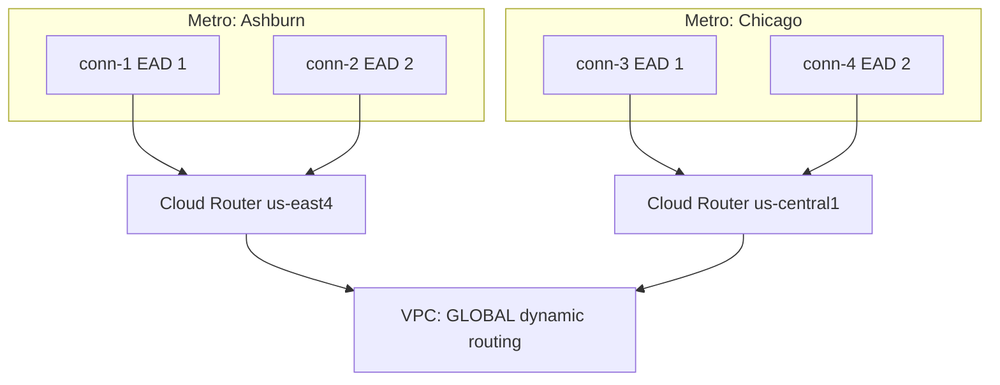
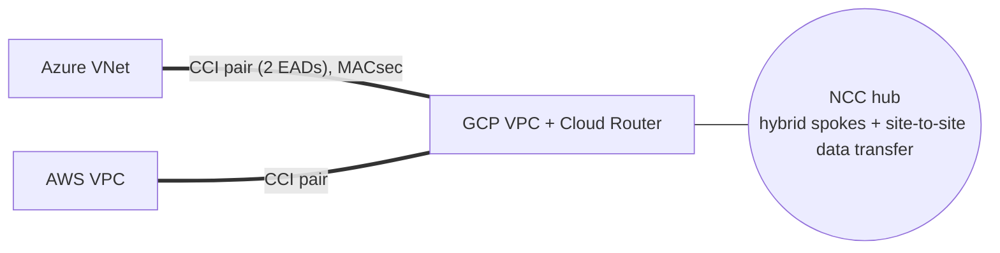

# GS06 — Hybrid and Multicloud Scenarios, Explained

**Context → Architecture → How to think → Steps → Why → Verify → Takeaway.** Hands-on versions: [[GPL05 - Hybrid and Multicloud Practice Labs]]. Self-test: [Scenario Drill](../../visualizations/gcp/GS04-07%20-%20Scenario%20Drill.html).

---

## Scenario 1 — Pick the connection
*Source: [[GCP51 - Connectivity Options]]*

| Situation | Pick | Key reason |
|-----------|------|------------|
| Branch office, 300 Mbps, needed this week | **HA VPN** | Minutes to set up, encrypted, 2 tunnels give 99.99% |
| HQ in a city with a Google colo, 40 Gbps of replication | **Dedicated Interconnect** (4 × 10G or 1 × 100G) | Own router in the colo, cheapest at volume |
| Plant in a remote city, no colo, 2 Gbps | **Partner Interconnect** | The provider already reaches Google; 50 Mbps–50 Gbps attachments |
| Analytics in GCP, app in Azure, 20 Gbps | **Cross-Cloud Interconnect** | Google provisions into Azure; no hardware of your own |
| Regulated data that must be encrypted on a 10G private link | **Dedicated + MACsec, or HA VPN over Interconnect** | Interconnect is plaintext by default |
| 30 Mbps IoT gateway | **HA VPN** | Below the 50 Mbps Partner minimum |

---

## Scenario 2 — Design for 99.99% on Dedicated Interconnect
*Source: [[GCP52 - Dedicated Interconnect]]*

### Context
Sam's workloads are all in `us-east4`. The business requires 99.99% availability for on-prem connectivity.

### Architecture


### How to think
- **Two connections in one metro** (different EADs) = 99.9%.
- **The second metro** protects against a metro-level failure.
- **The second Cloud Router region** protects against a regional disruption, even though every VM is in `us-east4`.

### Verify
Simulate failures:
- Shut one VLAN attachment (`attachments update … --no-admin-enabled`). BGP converges and traffic continues.
- Shut a whole metro. Routes are now learned only through Chicago, so latency rises but there's no outage.

**Takeaway:** **4 connections · 2 metros · 2 EADs each · 2 router regions · global routing.**

---

## Scenario 3 — Active/passive HA VPN with predictable bandwidth
*Source: [[GCP57 - HA VPN Topologies]] · [[GCP59 - Influence Best Path Selection]]*

### Context
A branch pushes 1.2 Gbps through HA VPN. With active/active, a tunnel failure would leave 2.4 Gbps of expected capacity on one 1.5 Gbps tunnel. Leadership wants "the same speed after a failure".

### Steps
```bash
gcloud compute routers update-bgp-peer cr-branch --region=us-east4 --peer-name=bgp-t0 --advertised-route-priority=100
gcloud compute routers update-bgp-peer cr-branch --region=us-east4 --peer-name=bgp-t1 --advertised-route-priority=200
# on-prem side: advertise its prefixes with a lower MED on tunnel0 too, so outbound from GCP also prefers t0
```

### Why
The peer prefers the **lowest MED** (100 on tunnel0), so all traffic uses one tunnel. On failure it moves to tunnel1, which has the **same** capacity. The design must keep total load ≤ one tunnel (~1.5 Gbps), or add tunnel pairs.

### Verify
`routers get-status` on both sides: best routes point to tunnel0. Delete or disable tunnel0, and pings continue (like GCP58 Task 7).

**Takeaway:** **MED (advertised route priority) turns HA VPN into active/passive.** Steer both directions.

---

## Scenario 4 — Azure ↔ GCP data platform
*Source: [[GCP54 - Cross-Cloud Interconnect]] · [[GCP60 - Network Connectivity Center]]*

### Context
Rob replicates 15 TB/day from Azure SQL to BigQuery and needs private, redundant, encrypted transport. Later, AWS workloads must reach Azure through the same backbone.

### Architecture


### Steps
1. Buy primary + redundant **Cross-Cloud Interconnect** ports on GCP **and** matching ExpressRoute Direct ports on Azure, in two EADs.
2. VLAN attachments + BGP on both clouds.
3. MACsec on the links; TLS for the replication stream.
4. Add the attachments as **NCC hybrid spokes with site-to-site data transfer**, so AWS ↔ Azure can transit Google.

### Why
- 15 TB/day is about 1.4 Gbps sustained: far past VPN comfort, ideal for 10G CCI.
- MACsec covers only the link hop, so TLS covers end to end.
- NCC avoids a separate AWS ↔ Azure circuit.

**Takeaway:** **CCI for cloud-to-cloud bandwidth; NCC site-to-site to reuse it as a WAN.**

---

## Scenario 5 — Remote plant on Partner Interconnect (Layer 3)
*Source: [[GCP53 - Partner Interconnect]]*

### Context
Ken's plant has no colo, and its MPLS provider is a Google partner offering an L3 service. The plant team has no BGP skills.

### Steps
1. Create two `PARTNER` attachments (Cloud Router **ASN 16550**) in two EADs, and copy the **pairing keys**.
2. Order 2 × 1 Gbps from the provider with the keys.
3. Activate the attachments.
4. The provider runs BGP with Cloud Router. The plant just default-routes to the provider.

### Why
**Layer 3** partners own the BGP sessions, which matches the "no BGP skills" constraint. Two EADs give the 99.9% topology.

### Verify
Attachment state `ACTIVE`. `routers get-status` shows BGP peers **established by the provider** and plant prefixes learned.

**Takeaway:** **pairing key + Layer 3 partner = private connectivity without running BGP yourself.**

---

## Scenario 6 — "Tunnels are up but nothing works"
*Source: [[GCP58 - Lab - Configuring Google Cloud HA VPN]]*

| Symptom | Layer | Check | Fix |
|---------|-------|-------|-----|
| `NO_INCOMING_PACKETS` | IPsec | Peer IP, NAT in front of the peer, UDP 500/4500 | Fix peer address; allow IKE/ESP through the on-prem firewall |
| `AUTHORIZATION_ERROR` | IKE | Shared secret, IKE version | Match secret + IKEv2 |
| ESTABLISHED, BGP down | BGP | `routers get-status` → `bgpPeerStatus` | Fix link-local /30 pairs and peer ASN |
| BGP up, region-2 VMs unreachable | Routing mode | `networks describe → routingMode` | `--bgp-routing-mode=GLOBAL` |
| Routes present, pings fail | Firewall | Allow rules for the remote ranges | Add ingress rules on both sides |
| Works, but slow after a failover | Capacity | Active/active halved | Active/passive (MED) or more tunnels |

**Takeaway:** **troubleshoot bottom-up: IPsec → BGP → routing mode → firewall → capacity.**

---

## Linked Pages
- [[GPL05 - Hybrid and Multicloud Practice Labs]] · [[GS04 - Network Security Scenarios]] · [[GS05 - Load Balancing Scenarios]] · [[GS07 - Capstone - Cymbal Global Landing Zone]] · [[certs/gcp-networking]]
