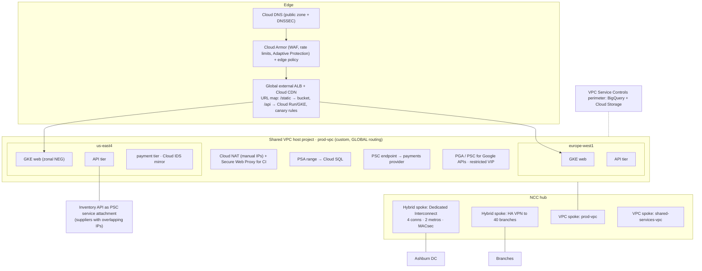

# GS07 — Capstone: Cymbal Global Landing Zone

One design that uses every course. Treat it as a **design interview**: read the brief, sketch your answer, then compare with the reference design. Hands-on build: [[GPL06 - Capstone Practice Lab]].

---

## The brief
Cymbal Corporation is moving its e-commerce platform to Google Cloud.
- **Users:** North America and Europe. p95 page load < 200 ms.
- **Workloads:** web (GKE), APIs (Cloud Run + GKE), PostgreSQL (Cloud SQL), analytics (BigQuery).
- **On-prem:** a data center in Ashburn (ERP, 20 Gbps sync, must stay private) and 40 branches (≤ 200 Mbps each).
- **Partners:** a payments provider publishes its API privately; Cymbal also exposes an inventory API to suppliers who use overlapping 10.x ranges.
- **Security:** no SSH/RDP from the internet, WAF + DDoS on public endpoints, IDS on the payment tier, build runners reach only package registries, analytics data must not leave the org, least-privilege IAM.
- **Operations:** central network team, app teams self-serve their own projects, everything in Terraform.

**Pause here and draw your design.**

---

## Reference design

## Decision log: each requirement → choice → course
| Requirement | Choice | Why | Course |
|-------------|--------|-----|--------|
| Global users, one endpoint, low latency | Global external ALB, Premium Tier, Cloud CDN | Anycast + edge caching | 3, 5 |
| URL-based routing + safe releases | Advanced URL map: path rules + weighted canaries | Instant rollback | 5 |
| Central network, self-service apps | **Shared VPC** host + service projects; Network Admin for the net team, app teams get Network User on their subnets | Separation of duties | 3, 4 |
| Many VPCs + hybrid | **NCC hub** with VPC and hybrid spokes | Transitive, centrally managed | 3, 6 |
| DC 20 Gbps private, 99.99% | **Dedicated Interconnect**: 4 × 10G, 2 metros, 2 EADs, 2 router regions; **MACsec** | SLA topology + encryption | 6 |
| 40 branches ≤ 200 Mbps | **HA VPN** per branch (2 tunnels, BGP), active/passive via MED | Cheap, fast, encrypted | 6 |
| Payments provider privately | **PSC endpoint** to their service attachment | Private, no peering | 2 |
| Suppliers with overlapping IPs | Publish the inventory API as a **PSC service attachment** (NAT subnet) | Overlap doesn't matter | 2 |
| Cloud SQL privately | **Private services access** range | Google-managed producer VPC | 2 |
| Google APIs without public IPs | **PGA** + private DNS for `restricted.googleapis.com` | Works with VPC-SC | 2 |
| Outbound internet for VMs | **Cloud NAT** with manual IPs (partners allowlist them) | No external IPs | 2 |
| CI egress allowlist | **Secure Web Proxy** (SA + URL list) + egress deny bypass rule | Identity-aware egress | 4 |
| No SSH/RDP from the internet | **Hierarchical firewall policy** (allow IAP, deny 22/3389, goto_next) + `skipDefaultNetworkCreation` | Org-wide guardrail | 4 |
| WAF + DDoS | **Cloud Armor** backend policy (WAF, throttling, Adaptive Protection) + **edge policy** for cached content | L7 at the edge | 4, 5 |
| IDS on the payment tier | **Cloud IDS** endpoint + mirroring the payment subnet only | East-west visibility | 4 |
| Analytics data stays in the org | **VPC Service Controls** perimeter | API-layer exfiltration control | 4 |
| Least privilege | Groups + predefined roles; deny policy on firewall edits outside the security team | IAM inheritance rules | 4 |
| Everything as code | Terraform modules, Cloud Build CI, policy checks in review | Immutable, reviewed | 4 |
| Visibility | Flow logs on all subnets, firewall logging on key rules, Firewall Insights, Network Topology, Connectivity Tests in CI | Monitoring practice | 3, 4 |

## IP plan (non-overlapping, room to grow)
| Block | Use |
|-------|-----|
| 10.0.0.0/12 | GCP (prod 10.0.0.0/14, non-prod 10.4.0.0/14, shared services 10.8.0.0/16) |
| 10.16.0.0/12 | On-prem DC + branches (already in use) |
| 10.2.0.0/16 (inside prod /14) | GKE secondary ranges: pods 10.2.0.0/17, services 10.2.128.0/20 |
| 192.168.100.0/23 | Proxy-only subnets (one /26 per region) |
| 10.250.0.0/20 | PSA allocated range (Cloud SQL, IDS) |
| 100.64.0.0/24 | PSC NAT subnet for the inventory service attachment |

## Failure drills to rehearse
| Drill | Expected |
|-------|----------|
| One Interconnect metro down | Traffic shifts to the other metro; no outage |
| One branch tunnel deleted | BGP moves to the standby tunnel |
| L7 flood on /checkout | Throttle rule plus Adaptive Protection alert |
| IDS CRITICAL alert from a payment VM | Priority-1 firewall deny, then isolate the VM |
| Analyst key stolen | VPC-SC blocks the copy to an external project |

## Linked Pages
- [[GPL06 - Capstone Practice Lab]] · [[GS01 - Private Connectivity Scenarios]] · [[GS03 - Architecture and Topology Scenarios]] · [[GS04 - Network Security Scenarios]] · [[GS05 - Load Balancing Scenarios]] · [[GS06 - Hybrid and Multicloud Scenarios]] · [[certs/gcp-networking]]
